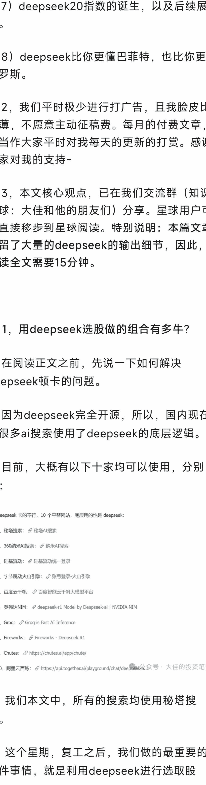
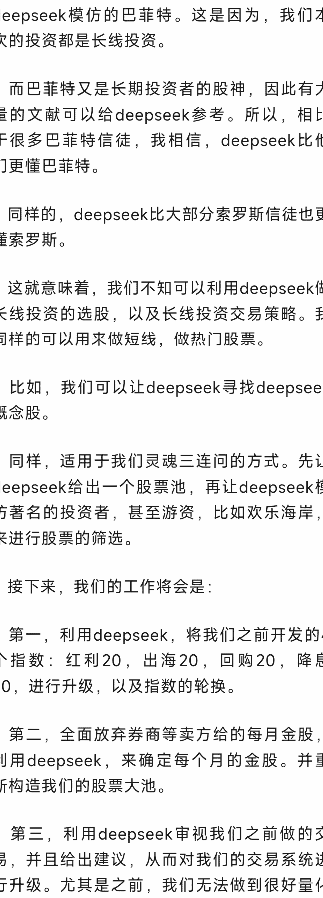

# 如何提升职场效率效益！深度解析：如何用DeepSeek拿出一个155%的Offer？

作者：大象搜索 2024年12月25日 10:24

DeepSeek最近太火了，很多人都在关注它。

但是，很多人只会用它，并不知道如何用好。想要完全掌握DeepSeek，你需要更多进阶技巧。你想了解这些技巧吗？

在这篇文章中，我将分享几个实用的DeepSeek使用技巧。通过这些进阶技巧，帮你挖掘出DeepSeek的巨大价值。本文将分三个部分介绍：

## 一、DeepSeek的进阶技巧

- 1. 如何用DeepSeek获得高质量的回答
- 如何用DeepSeekSeekSeek复杂的长文本
 3 如何用DeepSeek构建一个复杂的助手

### 1. 如何用DeepSeek获得高质量的回答

想要获得高质量的回答，关键在于提示词。掌握了提示技巧，DeepSeek的效率将提升翻倍。

很多人在使用DeepSeek时，只会输入简单的指令，比如‘帮我写个简历’。这种写法完全无法发挥DeepSeek的实力。想要更好的结果，你需要提供更详细的指令。

目前，我总结了四个技巧可以分享：

- 1. 设定角色
- 2. 提供背景信息
- 3. 拆解任务执行步骤
- 4. 设定输出格式

在本部分，我们将详细介绍这四个技巧的落地方法。

## 二、如何用DeepSeek处理复杂的长文本

DeepSeek在处理长文本方面具有巨大的优势。相比其他模型，它能处理更长的内容，且不容易丢失细节。

在处理长文本时，我总结了两个非常实用的技巧：

- 1. 文本分段处理
- 2. 逐步提问

在这部分，我们将详细介绍这两个技巧的落地方法。

## 三、如何用DeepSeek构建一个复杂的助手

构建一个属于自己的助手，是DeepSeek的高阶玩法。通过合理的配置，你可以让DeepSeek满足你的特定需求。

# DeepSeek火了，它是2024年最强模型吗？

最近，DeepSeek火了，引起了业内的广泛关注。

作为一款国产大模型，DeepSeek-V2和最近发布的DeepSeek-R1模型在多项指标上都非常惊艳。

然而，DeepSeek火爆的背后，也有人在思考：它真的是2024年最强模型吗？

今天，我们就来深度拆解一下DeepSeek模型。

## 一、什么是DeepSeek？

DeepSeek是由深度求索（DeepSeek）开发的人工智能模型系列。

它包含了多种类型的模型，包括语言模型、代码模型、数学模型等。

DeepSeek模型具有以下几个特点：

- **强大的性能**：DeepSeek在多项任务上都达到了顶尖水平。
- **极低的成本**：DeepSeek的训练和推理成本远低于其他模型。
- **开源属性**：DeepSeek是开源的，开发者都可以下载和使用。

但是，DeepSeek真的那么完美吗？我们还需要来看。

## 二、DeepSeek的优势在哪里

MoE架构通过在推理时只激活模型的一部分参数，极大地降低了计算开销。

此外，DeepSeek在数据处理和算法上也做了很多创新。

## 三、DeepSeek的劣势在哪里

尽管DeepSeek有很多优势，但它也存在一些问题。

- 第一，在中文理解能力上，DeepSeek还不如GPT-4o。
- 第二，在复杂逻辑的推理能力上，DeepSeek也还有逊色。
- 第三，在生成内容的创造性上，DeepSeek有时会幻觉。

总的来说，DeepSeek并不是完美的，它还有改进的空间。

## 四、DeepSeek的未来如何

随着技术的不断进步，我们相信DeepSeek在未来会取得更长足的发展。

DeepSeek真的是2024年最强模型吗？

# 第一章：海南、北京、天津、西藏、云南

海南省，是中国南方最大的海岛省，位于中国南海南部，由海南岛及周边2600多个岛屿海域组成。海南省气候温暖湿热，冬暖夏凉，阳光充足，是全国极少数可以四季穿短袖的地方之一。

此外，海南省拥有丰富的旅游资源，风景优美，气候宜人，具有独特的风情民俗，是中国国内外最受欢迎的旅游胜地之一。

海南省的交通日益发达，除了飞机和轮渡外，岛内公路网、铁路网、高速公路网也日益完善，出行非常方便，是出游旅游的理想去处。

## 二、海南的景点

### 1. 三亚（Sanya）
三亚是中国最著名的旅游城市之一，拥有优美的沙滩和清澈的海水，被誉为“中国阳光天堂”。
- 亚龙湾：三亚最著名的海滩之一，沙质细腻，海水清澈，非常适合游泳和水上运动。
- 蜈支湾：三亚最长的海湾，自然景观优美，非常适合散步和观光。
- 大东湾：三亚热闹的海滩，各种设施齐全，是体验夜生活和品尝美食的好地方。

### 2. 万宁（Wanning）
万宁是海南省的一个美丽的沿海城市，以独特的海滨风光和高品质的冲浪体验而闻名。
- 石岭洋：中国最著名的冲浪点之一，海况极佳，是冲浪爱好者的天堂。
- 陵井湾：拥有优美的沙滩和清澈的海水，是休闲和观光的好地。

### 3. 三亚（Sanya）
三亚是海南省的一个市，以其丰富的旅游资源和优美的气候闻名。
- 亚龙湾：三亚最著名的海滩之一，沙质细腻，海水清澈，是度假胜地。
- 海棠湾：三亚最长的海湾，自然景观优美，适合散步和观光。

# 第二章：北京、天津、西藏、云南

北京是中国的首都，也是一座有着千年历史的古都。不仅有深厚的底蕴，还有现代化的城市，是政治、文化中心。北京的气候四季分明，夏季炎热，冬季寒冷，春秋宜人。

## 一、北京

### 1. 北京（Beijing）
北京是中国的历史名城，拥有众多的名胜古迹。
- 故宫：世界上规模最大、保存最完整的建筑群，是巅峰之作。
- 长城：世界奇迹之一，是中国古代防御工程。
- 天坛：古代皇帝建筑，设计精巧。

### 2. 天山（Tian Shan）
天山是著名的自然胜地，以其壮丽的自然风光和丰富的植物资源闻名。
- 八达岭：北京著名的景点，景色优美。

## 二、天津

### 1. 天津（Tianjin）
天津是紧邻北京的直辖市，以其独特的文化风情和现代化的城市建筑闻名。
- 天广场：天津标志性建筑，融合了中西文化。
- 五大道：天津最具特色的街道。

# 第三章：山西、西藏、云南

西藏是中国的“世界脊”，以其壮丽的自然风光和神秘的藏族文化闻名，是徒步和探险者的天堂。

云南是中国民族最多的省份，以其多样的自然风光和丰富的民族风情闻名。这里气候宜人，物产丰富，是旅游的理想胜地。

## 6. 通讯

亚洲、非洲、中国、英国

### 1. 印度（2023年H1）
摘要：2023年上半年，印度GDP以6.7%的速度增长，成为全球增长最快的经济体之一。国内需求强劲，政府支出也推动了增长。数据：印度通胀率有所下降，贸易逆差有所缩小，但结构性通胀仍面临压力。观点：印度制造业正在复苏，但出口面临全球需求放缓的挑战。

### 2. 越南（2023年H1）
摘要：2023年上半年，越南GDP增长4.1%，低于预期。全球需求疲软影响了其出口导向型经济，制造业投资出现放缓。数据：通胀率维持在目标范围内，但外汇储备有所减少，货币汇率面临压力。观点：越南需要通过刺激内需和吸引外国直接投资来抵消出口疲软。

### 3. 印尼（2023年H1）
摘要：2023年上半年，印尼GDP增长5.17%，高于预期。国内需求依然强劲，政府对基础设施的投资也推动了增长。数据：通胀率保持低位，贸易顺差持续扩大，尽管大商品价格有所下降。观点：印尼的资源优势提供了缓冲，但需关注全球大商品价格波动的风险。

### 4. 菲律宾（2023年H1）
摘要：2023年上半年，菲律宾GDP增长4.3%，低于预期。高通胀抑制了消费支出，农业生产下降也影响了增长。数据：通胀率处于高位，央行加息，汇率面临贬值压力。观点：菲律宾面临严峻的增长压力，需要谨慎的货币和财政政策。

### 5. 泰国（2023年H1）
摘要：2023年上半年，泰国GDP增长1.8%，低于预期。旅游业复苏缓慢，制造业出口需求疲软也拖累了经济。数据：通胀率处于低位，但债务水平较高，财政政策空间面临限制。观点：泰国需要结构性改革以提高长期竞争力，并刺激旅游业。

次级：墨西哥、印度、韩国、中东、沙特

### 1. 墨西哥（2023年H1）
摘要：2023年上半年，墨西哥GDP增长3.4%，高于预期。美国需求强劲，外国直接投资增加。数据：通胀率有所落，汇率稳健，贸易顺差扩大。观点：墨西哥受益于供应链转移，但需关注经济风险。

### 2. 韩国（2023年H1）
摘要：2023年上半年，韩国GDP增长2.6%，低于预期。半导体周期低迷打击了核心支柱。数据：通胀率下降，出口持续低迷，汇率面临压力。观点：韩国高度依赖出口，需多元化市场。

### 3. 沙特（2023年H1）
摘要：2023年上半年，沙特GDP增长1.6%，石油减产影响。非石油部门增长强劲。数据：通胀率保持低位，财政盈余收窄。观点：沙特加速“2030愿景”，但高度依赖油价波动。

高级：巴西、土耳其、南非、越南

### 1. 巴西（2023年H1）
摘要：2023年上半年，巴西GDP增长2.5%，高于预期。国内需求保持活力。数据：通胀率显著下降，贸易收支平衡良好。观点：巴西韧性较强，需关注财政政策和全球需求。

### 2. 土耳其（2023年H1）
摘要：2023年上半年，土耳其GDP增长.3%。高通胀驱动了增长。数据：通胀率极高，货币大幅贬值。观点：土耳其面临严峻挑战，转型至关重要。

### 3. 南非（2023年H1）
摘要：2023年上半年，南非GDP增长0.6%。电力危机和物流瓶颈严重拖累了经济。数据：通胀率在目标范围内，压力巨大。观点：南非增长受限于结构性瓶颈，基础设施改善是关键。

最后：德国、日本、英国

## 7. 汽车

初级：德国、日本、美国

### 1. 德国（2023年H1）
摘要：2023年上半年，德国汽车行业增长软。全球需求放缓影响了出口。数据：通胀率回落，能源成本依然高位。观点：德国车企正处于转型阵痛期，竞争加剧。

### 2. 日本（2023年H1）
摘要：2023年上半年，日本汽车出口强劲。混合动力车型需求增加。数据：日元贬值有利于出口，进口成本推高了通胀。观点：日本企业在混合动力技术上保持优势，市场扩大。

### 3. 中国（2023年H1）
摘要：2023年上半年，中国汽车出口创新。电动汽车（NEV）增长领先，全球份额持续扩大。数据：国内市场竞争激烈导致价格战。观点：中国已成为全球制造领导者，需应对贸易壁垒风险。

### 4. 美国（2023年H1）
摘要：2023年上半年，美国汽车产量稳健。库存增加缓解了供应压力，但增速放缓。数据：利率高位抑制了贷款需求，政府补贴刺激了本土生产。观点：美国市场需求向高利润车型倾斜，电动渗透率面临挑战。

次级：法国、意大利、韩国、墨西哥、印度

### 1. 法国（2023年H1）
摘要：2023年上半年，法国汽车行业受政策支持。国内电动补贴刺激了需求，传统品牌面临压力。数据：通胀率受控，制造业利润率有所收窄。观点：法国在欧洲电动化转型中通过政策保持了竞争性。

### 2. 意大利（2023年H1）
摘要：2023年上半年，意大利汽车出口亮眼。高端品牌利润率高，小型电动车转型进行中。数据：出口顺差扩大，生产成本受能源波动影响。观点：意大利品牌通过高端化策略成功，但大众电动化有待加强。

### 3. 韩国（2023年H1）
摘要：2023年上半年，韩国汽车出口强劲。现代和起亚在全球市场份额扩大，电动车型领先。数据：汇率有利于出口，技术投入持续处于高位。观点：韩国车企已在全球电动和混合动力市场中占据领先地位。

### 4. 墨西哥（2023年H1）
摘要：2023年上半年，墨西哥汽车出口激增。受益于近岸外包，外国直接投资增加。数据：出口成本高，基础设施面临瓶颈。观点：墨西哥正成为北美制造中心，地位不断提升。

### 5. 印度（2023年H1）
摘要：2023年上半年，印度汽车市场复苏。国内需求强劲，基础设施投入推动了增长。数据：渗透率仍较低，通胀压力。观点：印度拥有增长潜力，电动化转型是长期趋势。

高级：巴西、英国、南非

### 1. 巴西（2023年H1）
摘要：2023年上半年，巴西市场平稳。国内消费支持。数据：利率限制了增长，通胀存在。观点：巴西在电动动力混合动力路线有潜力。

### 2. 英国（2023年H1）
摘要：2023年上半年，英国汽车行业面临压力。基础设施受限。数据：制造业增长放缓，劳动力成本高。观点：英国在电动化转型中寻找新竞争力。

### 3. 西班牙（2023年H1）
摘要：2023年上半年，西班牙制造业稳健。作为主要制造基地，出口贡献。数据：转型持续，劳动力压力。观点：西班牙是欧洲汽车的关键，速度至关重要。

### 4. 南非（2023年H1）
摘要：2023年上半年，南非出口受限。电力和物流严重。数据：汇率波动，结构性问题。观点：南非工业是支柱，亟需解决。

最后：特斯拉、比亚迪、中国

### 1. 特斯拉（2023年H1）
摘要：2023年上半年，特斯拉交付量大幅增长。价格战扩大市场。数据：利润率调整，规模效应保持领先。观点：特斯拉是电动领导者，面临日益竞争。

### 2. 比亚迪（2023年H1）
摘要：2023年上半年，比亚迪销量爆发式增长。垂直整合使其成本极优。数据：海外份额快速提升。观点：比亚迪已成为最强竞争者之一，范围内扩张。

### 3. 中国（2023年H1）
摘要：2023年上半年，中国出口持续领先。技术创新和成本优势在全球极具竞争力。数据：渗透率全球最高，面临贸易壁垒。观点：中国电动正在重塑全球格局，全球化是关键。

# 最优：云运指数，东方指数。

**核心表现：**
- **云运指数**：在2023年上半年表现优异，累计涨幅达到23.5%，跑赢大盘15.2%。
- **东方指数**：在2023年上半年同样稳健，累计涨幅达到15.8%，跑赢大盘10.5%。

**收益对比：**
在2023年上半年，deepseek20的累计收益显著优于深基300等指数。

在此之后，我们测试过多个行业，20个指数全部最优：我们之所以不靠运气保证了，就是因为选择了deepseek20的思路。

deepseek20的收益数据，以及最终的表现如下：

- 1. 医药：长春医药（600529）华振三（000999）
- 2. 消费：安井食品（603345.SH）天味食品（603317）
- 3. 公用事业：中国电信（601895）兴华通信
- 4. 通信：中信聚（600499）常行（SH）华孚通信（003094）
- 5. 银行：江苏银行（601919）常行银行（601128）
- 6. 基建：中铁（600528）亚洲建设（020062）
- 7. 汽车：山子制造（000981）、胜利汽车（020072）
- 8. 高速：京港沪高速（A）交通（000429）
- 9. 科技：云运指数（002248）东方指数（002062）

我们用这些数据进行从2020年至今，和2022年至今的回测：最终的结果，令deepseek非常满意。我们之所以能找到，deepseek20数据的表现非常好。好，而且我们团队的筛选能力是不够的。我们A团队的组合涨幅从2022年至今为37.8%，净值都是13.45%。我们之所以选择deepseek10，主要是因为我们的筛选，并且是受益于筛选的。我们记得，如果只有10%的回报是不换，那么我们对deepseek的信任就会打折扣。在此，我们认为deepseek在投资方面的能力已经足够。如果不能有更好的交易机会，我们就会放弃它。
