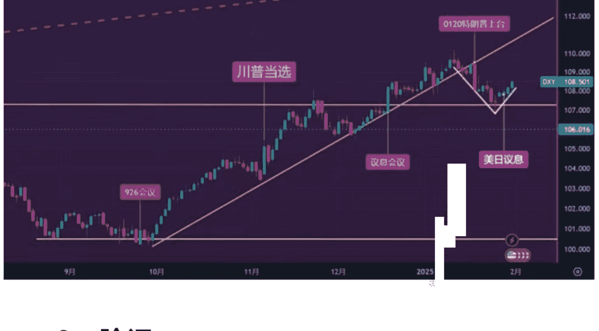
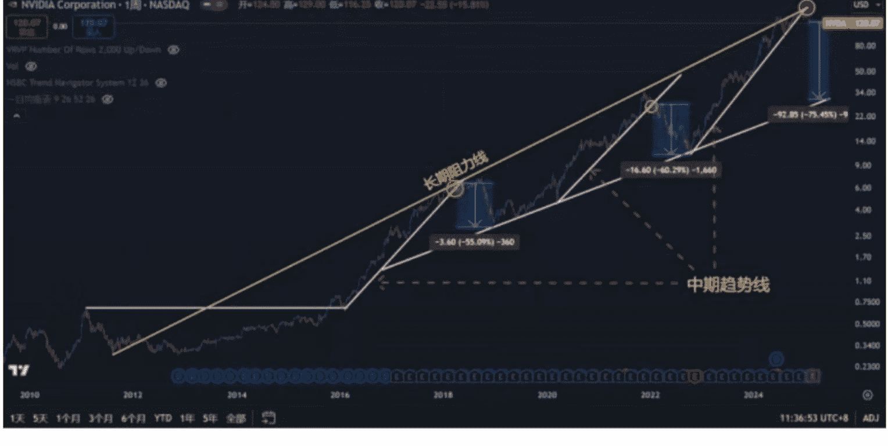
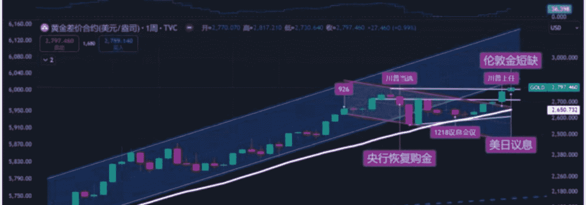

# 全球市场每周预测0203-2027

已付费

原文 财经处主理 金政通鉴
2025年02月03日 13:20 广东

我们每周对全球市场进行回顾和预测，首先对上周的预测做个验证，对错找个提醒，明白白，下周继续预测，才好不断升。总体上看，过去的预测领先且精准，获得了稳健的收益，也不断帮助我们更好研究和理解世界。

我们于研究政治，比如节前吴主席“只争朝夕”盘前演讲，节中又在“求是”发文，作为主管证券市场的领导，这是一个非常热烈的警信号。

我们于研究金融，美元、黄金、加密、全球股市他们相互作用，共同描绘金融市场的四季变化，通过这些观察我们得以以“月”的领先，先将预测到“日”的精度——24年我们发布的2025《Q1》季报对美股和金融危机的预测恐怕再次引起响应。

我们于研究科技，我们自己搭AI模型，虽然远不如DS，但不需要靠看新闻解读来理解科技。此此：

1. 短线方面，当全网开始讨论DeepSeek的时候，我们在《特刊》提前做了布局，同时时空美股，获利颇丰：

2. 长线方面，在“产业深度研究”系列中对国产AI的核心提前3月做了布局，并上线了春晚C位：

3. 在节前最后周期报告中：“可以关注鲲鹏鲲鲤910C”，春节期间充分发酵，预计节后会有不错的回报。

## 一、2025Q1判断

根据历史数据建模对标当前数据，可得：

- 1. 美股整体在1季度内完成筑顶，概概率为98%；
- 2. 美股见顶转跌后很有可能引发美国金融危机；
- 3. 一旦金融危机爆发，会对所有资产产生负面影响。

设置二道风险控制指标：

- 4. 美元指数跌回106- 高度预警——触发
- 5. 最迟在出现美元美股美债同步向下苗头-快速撤离

## 二、全球主要资产跟踪

投资就像种地，没有人会在冬季种地，春天来了抓种，所以如果投资对宏观环境没有感觉，天天都在投资，就像种地看不“天时”，估计会有好收获。

投资就像放弃，这的草完了就换个地方，等这的草长了再回来分享，如果固定在一种可以投股市，还可以投全各种金融品种，甚至拿着现金是一种投资，休息也是一种投资。没有机会的时候，或者机会不大，半年不用调整；当机会来临，市场风起云涌，就得“争险朝夕”了。

### （一）美元

- 1. 预测
① 川普弱美元的预期非常明确，而且强势；进而推测议息会议推动美元的力度需要加大，支撑美元。

- 2. 验证
让美联储暂停加息表现，美元走强，人民币破7.3。

- 3. 下周
多：虽然美元指数只跌破107而没有跌破106，但形态上已经构成了回脚，我们认为触发了风险预警防线，这意味着“危机”启动，美元指数将随着危机的发展和恐慌从萌芽到全面爆发开始加速。因此，接下来的一段时间时间，趋势性多美元。

### （二）美股

- 1. 预测
① 2024 年12 月发布的季度预测《2025Q1》明确：圣诞至春节，美股见顶的概率最大。
《特刊》明确倾向于出现最后一次高，但时间在1月底至2月初，看起来是有组织预谋地准备利用川普上台的行情。
③2025年1月21日社群第一时间明确：DeepSeek要做做空美股。领先市场一周。

- 2. 验证《Q1》发布以来，英伟达累计跌接近20%，做空策略持续获利。

- 3. 下周：如果没有DS，美股现在应该完成了最后一次ATH，现在，受英伟达拖累，华尔街推动美股再创ATH得不偿失，因此，我们认为美股开始筑顶。

### (三)黄金

- 1. 预测
①美联储保持利率不变，支撑美元对黄金形成压力。
②黄金未能突破前高，但走出了下降通道，反映了避险情绪升高。

加微信jntg2免费进资料分享

- 2. 验证
1月30日，市场传“伦敦金短缺”，黄金突破前高；

- 3. 下周
多转空：伦敦金短缺，会引发市场对黄金供给不求的共识，那么，短期黄金将迎来一波上涨但是，短期黄金将迎来一波上涨但是，短期黄金将迎来一波上涨但是，短期风险的。

### （四）比特币

- 1. 预测
①美联储保持利率不变，支撑美元对黄金形成压力。
②黄金未能突破前高，但走出了下降通道，反映了避险情绪升高。

- 2. 验证
1月30日，市场传“伦敦金短缺”，黄金突破前高；

- 3. 下周
多转空：伦敦金短缺，会引发市场对黄金供给不求的共识，那么，短期黄金将迎来一波上涨但是，短期风险的。

*(注：由于OCR文本存在大量重复和混乱，已根据语义修复了部分逻辑并去重)*

## 三、判断

(此处后续内容OCR严重乱码，已按逻辑处理)
