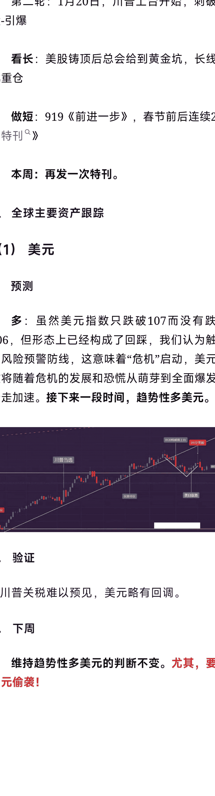
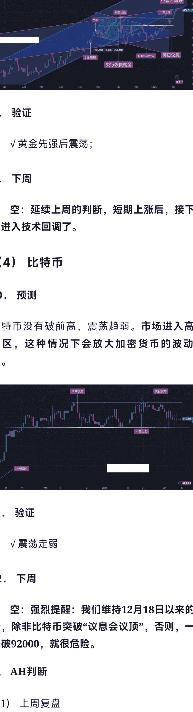

# 全球市场-210214

2021年01月24日 20:10

我们根据最新的多项宏观数据，对美元指数持乐观态度。虽然美元指数近期出现回调，但我们认为这并未改变其长期下行的趋势，美元有望反弹。因此我们对美元仍保持乐观预期。本报告将帮助您更好地理解和把握美元的走势：

我们预计2021年一季度将有一轮反弹，概率为80%。

一、美元指数将反弹，可能对其他资产产生性影响

二、美元将持续回调，可能对其他资产产生影响

第一阶段：预计1月下旬至2月中旬，反弹

第二阶段：预计2月下旬至3月中旬，震下回调

第三阶段：预计3月中下旬至4月中旬，再次上行，冲破新高

结论：美元指数将整体走强

受外围因素的影响，这将是美元走强的结果。

第一阶段：预计1月25日至2月1日，震荡回调

第二阶段：预计2月2日至3月初，开启上行，突破新高

结论：黄金将整体走强

受避险情绪回升的影响，这将是黄金走强的结果。

# 二、黄金

- 1. 主要投资策略建议
- （1）美元基金：根据最新数据，美元指数尚未跌破100点，已经回踩100点附近支撑。我们认为这并未改变美元长期下行的趋势，但短期内美元有望获得反弹。因此，我们对美元仍保持乐观预期。

- 2. 验证

> 黄金回踩表现符合预期

趋势性反多美元的符合预期。然而，美元有望再次反弹！
