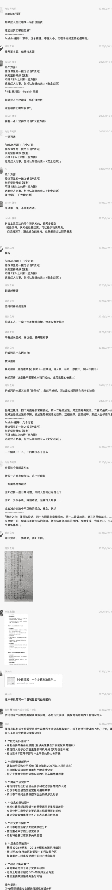

# 关于微信的思考

2019-10.26 20:24

一个关于微信的思考——我最近对微信产生了一些思考，想把它们记录下来，和大家分享：

## 一、微信不仅仅是一个社交工具

“微信不仅仅是一个社交工具，它更是一个生活工具。我们每天都在用它来聊天、支付、购物，它已经渗透到了我们生活的方方面面。”

## 二、微信的社交属性正在加强

微信的社交功能越来越强大，人与人之间的关系也变得越来越紧密。通过朋友圈、群、视频号等功能，微信的社交属性已经变得越来越不可替代了。

## 三、微信的商业价值正在挖掘

微信正在不断尝试新的商业化模式。通过广告、小程序、视频号、支付费率等方式，微信的商业价值正在被不断挖掘出来。

## 四、微信面临的挑战

尽管微信非常强大，但它也面临着巨大的挑战。比如，竞争对手的崛起、监管政策的压力等，这些都是微信未来需要面对的问题。

## 五、微信的未来

我相信微信的未来是光明的。只要它能够不断创新，坚持用户价值，它一定能在竞争中脱颖而出。

## 六、总结

微信是一个伟大的产品，它的未来充满了无限可能。让我们一起期待它的吧。

2019-10.26 20:24

李三：写得不错，感觉很有启发性，赞了，不知道作者怎么看？

2019-10.26 20:30

作者：感谢支持，这只是我个人的一些浅见，希望能和大家交流。

2019-10.26 20:35

王五：我也赞同你的观点，微信的社交属性确实越来越强。

2019-10.26 20:40

赵六：确实，现在离了微信生活太不方便了。

2019-10.26 20:45

钱七：我也有同感，微信确实越来越强大。
