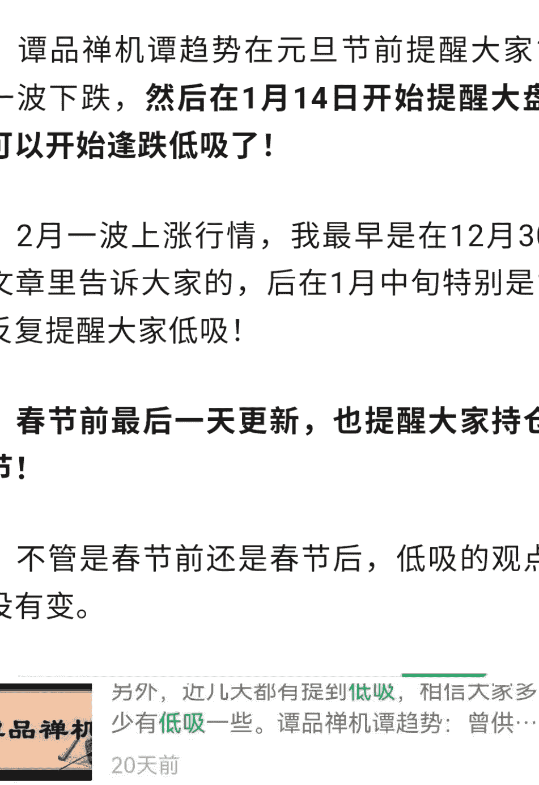
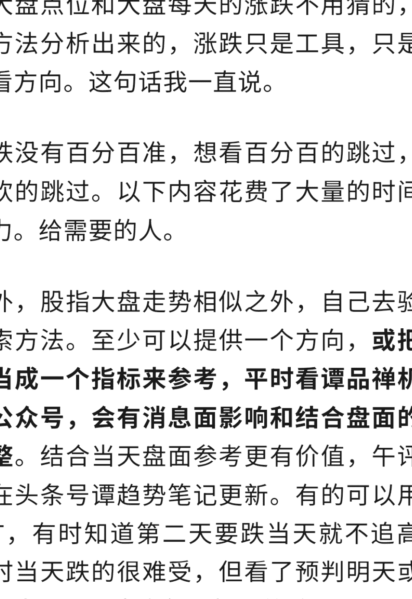
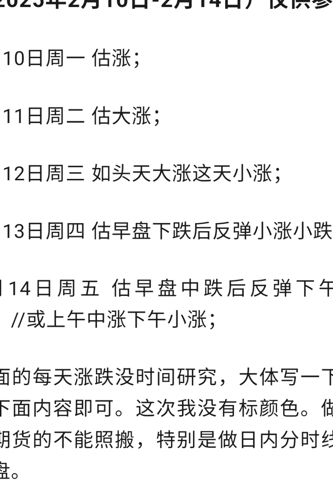
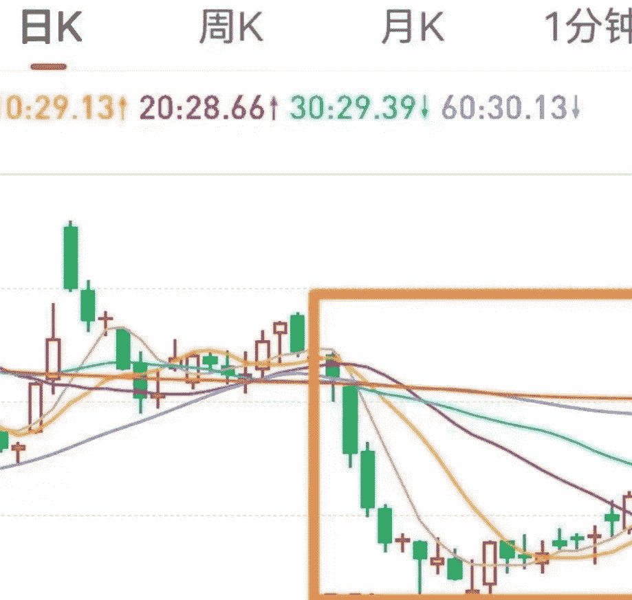

# 裸股下周大行情走势预测及波段趋势分析（2025年2月10日-14日）仅参考

裸股 股市趋势分析 裸律笔记

2025年2月10日 03:06 捷跑

## 前言

下周大行情分析预测及二周涨行情到时候和时间点对比

春节前会有公布没，头条更新的观点还是没的

本周A股涨得如此，指数和基金跌得这么多，我在14天左右跌十分多，看着明显反弹...全文

裸周趋势分析 01-27

分享 70 收藏 点

#裸股 和基金 #股市2025行情

A股有时间的，市场将你错过吗？春节前还是不明智的捡底，等市场大行情的考虑...全文

以上是我对目前到2025年2月7日以前的行情看法，供参考：

对于那些套牢的朋友，现在心里肯定难受吧，看着满绿的屏幕更难受，建议大家注意三个行为

2月二周会有大行情，近4000只股在涨，跌的指数和基金大跌，机会一瞬而逝

二月二周涨行情，至少在2月10日开始大行情，如果在2月14日开始行情就可以及时捡底了！

1月20日行情跌，暖天

元节时谭神准1月下跌至3100-3150点，实际跌到3140点，在1月14日受政策利好消息后开始反弹，我也在这里跌稳大盘。这波上拉升3500点后，一路下跌至3400点；此不代表操作建议，仅供参考！如有调整公众号谭神笔记本更新或头条趋势将变动。

## K线 周线 月线1分钟

6 10.291;20.238;60.26;60.39;60.301;

个人认为是图形、类似形态的走势，还是会有上空缺的。

> 谭神准：每日走势分析报告（2023年2月2日-2月14日）仅供参考
- 2月2日：日线稳
- 2月3日：日线回调
- 2月6日：日线回踩低点
- 2月9日：日线震高下小；周线上中线下小
- 2月14日：日线震高下小，压力增大，日内震荡，这还是很难反弹。现在的行情是无情的，或者说震荡中的震荡，非常考验人的耐心，一切都在计划中。

目前大环境：两个周期，周线看跌，月线回踩后看。目前周线支撑位还在，只要不破，这波行情可以继续反弹。
目前小环境：两个周期，日线看反弹，周线回踩后看。目前日线处于反弹的末期，等到2月25日左右，这波反弹的结束后可能还有下跌的风险。上目标看3500点，下看3000-3100点。

以上内容可看可保存，上面截图大伙保存用。24小时删除。看不看不要对外传播，事宜密成。

感谢大家的信任与支持！

谭神笔记本趋势：曾服务于多家社、上市公司、私募顾问。高级职衔：

点一点， 关注我

新朋友关注我的备用号

谭神笔记
万物皆有周期，一切都有宿命。研究笔...
897篇原创内容

公众号：

## 免费
## 价值
## 及时
## 专注

## 扫码加入 知识星球TOP 免费资源群

- 每日免费获取有价值资源
- 提供各类资源搜索服务

| 热门付费文章 | 各行行业报告 |
| :--- | :--- |
| 精选图书资源 | 副业赚钱方法 |
| 职场实用资源 | AI政经自媒体 |

公众号：知识星球TOP 微信信号：jntsg8 微信信号：jntsg2

分享资料仅供个人学习，请及时删除，切勿商用传播
