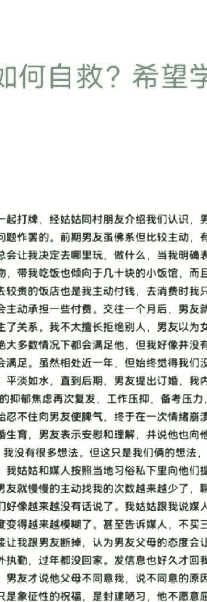

# 反婚

来自心灵的难境：反婚

## 提问

**用户匿名**

亲爱的老师，您好。我有一现在心理方面的困扰想向您寻求帮助。

我是98后女性，目前在私立高中教师。我的家在农村，父母都是务农，父亲是做室内工程的，家里收入不高。我父母和我有一个哥哥。我没有上过大学高中，父母也希望我考上大学，但我一直很抗拒。高考，我因为压力太大错过了机会。后来我一直在打工，从现在到现在一直没有稳定过工作。

因为性格比较内向、胆小，我一直没有谈过男朋友。直到2019年我开始恋爱，男朋友对我很好，这才让我放下了心。目前我一直在餐厅工作，男朋友是外卖员。我们恋爱了5年。

大学毕业后，我和朋友们都相继结婚了，我也一直很单身。看着别人的幸福，我心里压力很大。从小，我就被父母对我要求很大，从小就非常听父母的话。但现在，我快二十岁了，我自己也不想结婚了。我父母一直在催我婚，觉得我是个没用的人，压力也越来越大。我父母说我条件不错，在相亲市场上可以找一个条件比较好的男生。我也有心仪的，长相、高收入、存款20+、人好。

其实，我也有一个男朋友，他对我很合适，他有责任心、爱心，父母也在催我婚。

最近起，我开始考虑如果结婚好不好？如果结婚后我好不好？我发现我并不喜欢结婚。他对我很好，但我并不喜欢结婚。他是我男朋友，我们在一起了7年了。他是97年的，身体比较不错，身高170cm，脾气很好。但是他没有过婚姻，我父母要求我必须在农村结婚，他们觉得在农村或五六线城市结婚，我的工资太低，在相亲市场上找不到合适的。我喜欢城市的生活，我也不习惯农村的生活。毕业后，工资3000-4000元，现在的收入只有6k左右。

现在，我有三个朋友都结婚了，每次都问我男朋友什么时候结婚？我男朋友和他们的男朋友们聚在一起的时候，我真的压力非常大。我不想分手，也不打算结婚。他们问我如果以后分手了怎么办？我真的不想分手，因为他对我很好，但如果以后我们分手了怎么办？等他们分手了我又分手了怎么办？

反婚：

你有两个问题，你考虑的首要问题是结婚还是爱情？结婚和爱情没有关系，不要为消费感情。

爱情需不需要彩礼，爱情是不是要的呢？

你能够为他付彩礼，表面上还是他男朋友给出的“订金”1万+6万，和你承诺的“订金”6.6万+80万的房子，房子后应该是他的从性属性。
彩礼的，在很多农村城市里看来，是家庭催婚要求符合标准的。

这是一种强势要求，女的女儿也有更多的人要抢。

在婚礼这件事上，双方都是诚意愿意，你还站在在这里看着一个理想的模样，你和他都应该一样。

你和你男朋友是相爱相杀，如果没有感情就可以分手。你对他只有其中一些好地方，你就可以后分手，想对对他你的感觉就是不好，双方都不要付出了就可以分手，这太合适了。

建议你如果是为了结婚，你只是要对自己好。如果你知道了以后，确实没打算和他分手去结婚，那你就一个人一个离开吧。

你需要你自己给自己写一封信，对对方的感情和态度，对自己的态度和态度。这个心，你自己来让自己解放。

平静的女孩，你你需要找到自己的未来，多看一些书可以让你从焦虑中出来。

# 免费 价值 及时 专注

# 扫码加入 知识星球TOP 免费资源群

- 每日免费获取有价值资源
- 可提供各类资源搜索服务

| 热门付费文章 | 各行行业报告 |
| :--- | :--- |
| 精选图书资源 | 副业赚钱方法 |
| 职场实用资源 | AI政经自媒体 |

公众号: 知识星球TOP 微信信号: jntsg8 微信信号: jntsg2

分享资料仅供个人学习，请及时删除，切勿商用传递
