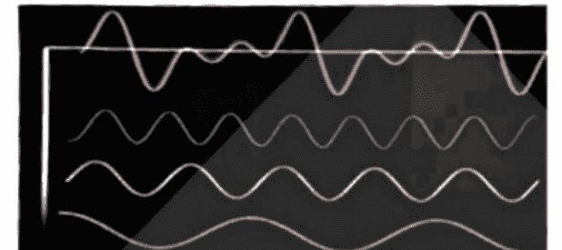
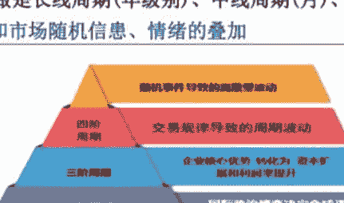
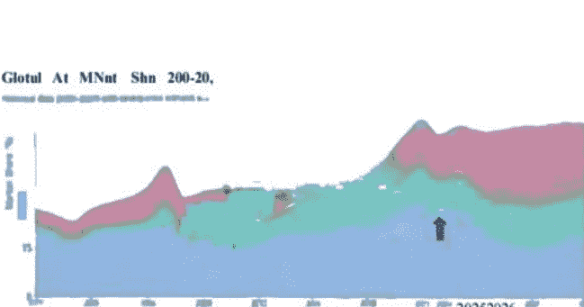
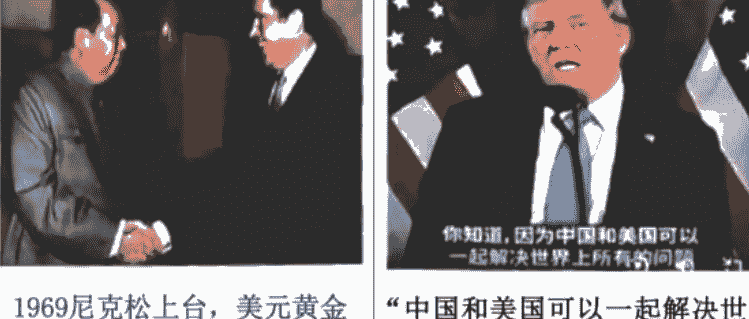
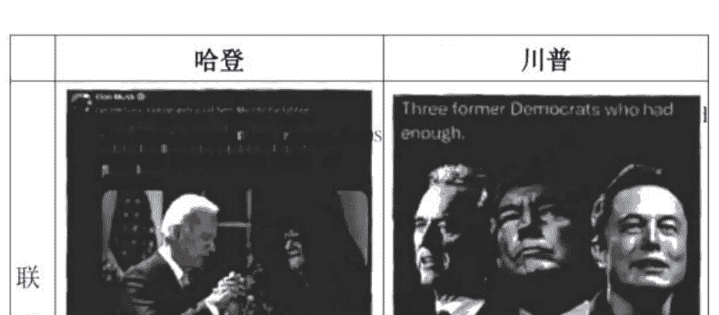
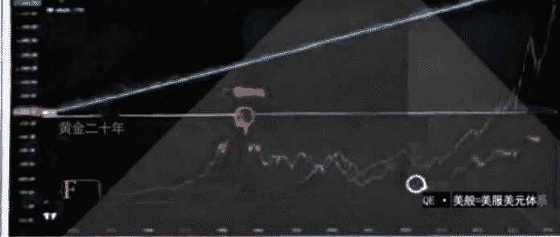
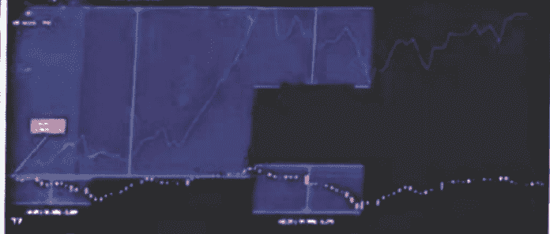
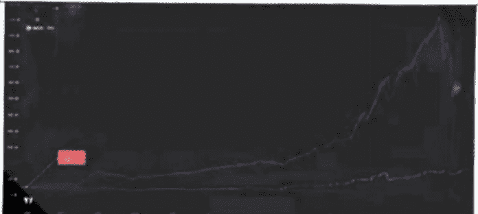
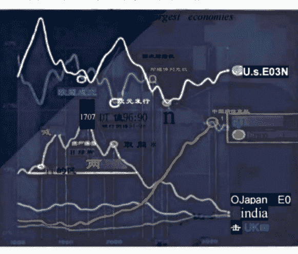
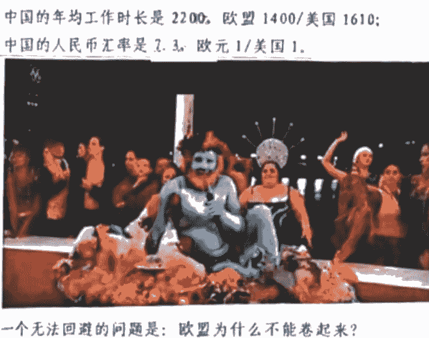

# 总论

## 概述

2019年，我们启动《奔袭交易》，是的，在他上任之前，我们投资中和和方向；2022年底，我们选择了寒武，我们是在OPEN发布之前。

在“社群”中，我们对2024年大选做了详细解读，实际上“选择”和我们想象中是不一样的。这也是为什么《奔袭交易》可以在奔袭当前启动的原因。

我们都听过“政策市”，但对于“政策”的理解是分层的。理解政策能够正确纠错、参与政策过程并理解其中的平衡布局与博弈，有关宏观政策以服务于高目标的一定政策布局使整个系统的利益最大化。我们的专业是研究、理解布局者和定者的意图，并将准确地把握全球宏观趋势。因此，我们不炒这些煽动的新闻，那太晚了，我们布局好了“新闻”。

区分于2019年前后的《奔袭交易》。在本季中，我们结合宏观数据和模型告诉了危机的真实性，市场交易应该在范围内，在全球金融风险高时、资产价格下跌时，抄底部，此为《新趋势底部》。

区分于2015年第一期《跨境交易》，因为这次意外，有了“百年未有之大局”的开局；而与以往每4年4次的交易周期期间，这是“大局”成局的4年，它将开启一个跨越更长的长时间周期，此为“新货币战争”。

每4周周期，大概我们提前分为前半和后段两个部分。现在我们已经启动了。

| 免费 | 每日免费获取高价值资源 提供各类资源服务 | |
| 价值 | 热门付费文章 | 各行业报告 |
| 及时 | 精选图书资源 | 职业恋爱方法 |
| 专注 | 职场实用资源 | AI财经自媒体 |

分享资料仅供个人使用，请及时删除，切勿请滥用

## 内涵介绍

## 发布时间

| 行业 | 左侧打底，各局总仓位的 5% | | |
|---|---|---|---|
| 行业 | 标1，是新趋势交易最先表达的风向变化 | 黄金 2410 |
| 刘莱 | 标2，是货币战争中最具潜力的方向之一 | 标1 2410 |
| | 特种领先交易在一年以前已锁定框架，但就此时 | 标2 2412 |
| | 清，所有的资产达的仍然是货币交易。 | 总论 2501 |
| 川泉 | 有川普在后才能进入第一阶段的公开 | 标3 2502 |
| | 并得以实施，最好的机会是在于避免此时 | 标4 2502 |
| 交易 | 总论1届，讲解博弈。 | 标5 2503 |
| | AI竞赛，3到4个标的 | 标6 2503 |
| | 中美竞合，3到4个标的 | 标7 2504 |
| 新 | “百年未有之大规模”根据本博弈和形成 | 标8 2504 |
| | 的大局是什么什么样的 | 总论 2502 |
| 新 | 各国证券的变化趋势及其 | 2503 |
| 货币 | 总论1届，讲解博弈。 | 2504 |
| 竞争 | 期货1届，加密1届 | 2505 |
| | | 货币1届，证券1届 | 2506 |
| | | 加密 2507 |

加微信jntsg2，免费进资料群

## 一、背景知识

### （一）投资的根本

傅里叶展开：

所有不规则的波动，都可以由若干规则的波动组成。展开为为主导、二阶、三阶..周期，叠加随机点。
以K线的波动为例：可看是长线周期（年）、中线周期（月）、短线周期（周）和市场随机、情绪的叠加。

主导周期强于二阶强于三阶强于四阶随机。基于这一原理，可以将所有资产波动进行分解，从而找到其中的主导规律（周期）甚至方程，进行预测。

加微信jntsg2，免费进资料群

### （二）基于周期的预测

生产力决定了生产关系。人类大科技发明和全球力量的关键博弈，即是生产力和生产关系的相互作用，更是全球资产波动的主导力量。主导周期：GPT-3.5预览版于2022年底发布；同期特朗普参加选举宏观预测和下次周期同时发生了重大变量，使得趋势性的变化。进一步量化，就可以得到一个全球预测。

这是2023至2024年全球资产强劲的动力：FED加息，美元强势；全球大头和欧元强势；比特币强势；而部分地区高度承压。这也是重大转折，我们从2025年Q1开始。

### （三）基于预测的布局

从全球博弈视角出发，结合宏观数据和模型，类比历史经验导出客观结论：

- 1. 美股整体在一个季度内完成顶部，概率为98%。
- 2. 目前的资产特点，如果美股触顶，将会影响国家信用，快速恶化，形成连锁反应。
- 3. 这次金融结构与以往不同，计划美股跌幅接近20%级别。

加微信jntsg2，免费获取资料

回顾《战略主动牛市》：演绎了川普当选的必然，这将是一个非常不错的牛市；但美股必然崩盘，由于拖延至2023年后，错过了“窗口期”。牛市早于“过山车”——过山车就是2025Q1报告中的“危机”。通过预测，是否有人在2022年底已经建立“危机”预期？从那时起，全球开始增持黄金，以历史性背离美债和美元。

显然，各国“央行”掌握着更大的更精确更复杂的模型。同理，各国政府早已开始全方位的布局。在激烈的博弈中，“未雨绸缪决胜千里”。当代国家竞争已经广泛采用现代信息系统和领先模型作为参考。如果我们带着记忆回到2022年底，就会看到很多预示全球政治经济局势的不稳定和危机，那么，无论是个人还是组织，“未来”当然不会启动激进的策略，会更加保守“高筑广积粮”。正是在这样的背景下，2024年我们发布首份报告并名为“战略主动牛市”——这也意味着：

- 1. 全方位的布局，基本构成：
- 2. 要准备进入战略转型阶段，迎接下一年。

但是需要理解，如果两人打仗，“冲锋”以后就是决战；但是对于将持续多年的大型战斗，前锋战，面对万面齐下，各路通过连贯阵列形成，“冲锋”是军事登场的第一次摘要，是冰封王王的片头。

加微信intjs2，免费进资料群

这场战役，始于2016年“百年未有之大局”的判断将持续到2026年：看到变局，布局变，改变局。

## 二、美国反对美国

### （一）认识变局：川普

美国是金融、科技、军事强国，构建以美元为核心的经济和全球贸易，全世界都为美国工作。为保持领先，美国以“效率优先”为根本方针，因此在制度上配置了“不拘一格用人”的自由文化和移民制度、激烈的市场竞争机制，提升全球化多元化。

但“效率优先”的体制机制导致美国“赢者通吃”，资源向高价值金融和科技集中，其他产业不断向成本更低的G7和BRICS国家转移，导致本土底层居民被“位置淘汰”，所谓“铁锈带”和日益巨大的“红腰子”。

### 川普的基准政策

补短，提升造力，增强实体。强长，加大吸血，金融。为降低企业成本增加就业而降税，进一步发挥金融、科技优势，国内经济减少政府支出，集中用于本土实体，恢复制造业，给人口增长机会。

- 金融上以缩减债务
- 金融上围堵美国
- 科技上投入更多，且海外化
- 军事上收紧预算
- 外交上引领G7秩序
- 贸易上领先出口
- 贸易上迫使进口更廉价

要理解“新趋势趋势”，首先要理解川普和拜登代表的两种力量治理体系。这可以从川普两年的实践中观察。

加微信jntsg2，免费资料群

### （二）布局：支持川普

| 川普1.0初的先生 | 川普1.0末的先生 |
|---|---|
|  |  |

“大干一场”包括：
- 1. 一是不把美国国货卖到中国
- 2. 二是以勇敢探索新金融方向。

| 川普2.0前的先生 | 川普2.0初的先生 |
|---|---|
|  |  |

中美两国经济深度融合，你彼此获益。从对方发展中获益，中国向美国投资1000亿美元用于建设基础设施，并创造至少10万个岗位。然而特朗普表示，他很想日本增加美国投资和就业，这是显而易见的。

加微信jntsg2，免费进资料群

### （四）选择：黄金二十年VS过去三十年

肯尼迪发布美元，继任的约翰逊，实施金融政策，签署《1965年铸币法案》，使美国的价值基础依赖信用体系，而非特定的黄金储备。

川普施压FED，削弱金融；前任的哈登，实施金融政策，巩固G7，挑起地缘冲突，实施暴力加大形成历史的美债倒挂，推动美元周期强势。

1969年尼克松台上，美元脱钩，股市崩盘，经济衰退。1972年，尼克松华。你知道，“因为中国和美国可以一起解决所有的问题”。川普上台，美股开始崩盘，类似。

今年首发的2025季度系列《Q1:超常规逆周期》对今年

整个宏观博弈的开局做了分析：根据数据建模，通过历史回测并对比前期数据，美股整体在1季度内完成顶部概率为98%。

美股见顶后爆发很可能引发美国金融危机。前文提到“管理头的各国政府已开始全方位的布局，在激烈的博弈中无虞缪决胜千里。”这正是我们押注川普上的核心原因之一——川普和哈登代表了危机治理的两大联盟。

| 哈登 | 川普 |

- 国际金融与科技巨头组成的联盟U1+G7：金融危机爆发后全面萧条，继续围堵锁目标，使他们陷入“失去三十年”，大肆抄底，金融和科技支撑美元汇率先复苏强化优势。
- 主权国家民族资本和产业工人组成的联盟U2+BRICS：金融危机爆发后全面萧条，各国政府债务再扩张支持产业复苏并重塑世界经济结构，建立新的金融/科技/产业集团。

加微信jntsg2，免费进资料群

## 我们将在《新货币战争》中进一步演绎：AI有机机会类比

1969年尼克松上台以后的日本市场的走势:

以史为鉴：到底是“失去三十年”还是“黄金十年”？

美元脱钩，代表美国陷入长期衰退。

由此开启的日本十年，有多辉煌。

### （五）交易结局：跑得慢被割

老大准没错，老二和老三联合防御没错。这是一般情况。当遇到特殊的时候，比如危机，这时候跑得慢就会被拿刀。

老大、老二、老三的顺序会重构。

### （六）改变结局：滞后的慢

| | 2030 | 2020 |
|---|---|---|
| 80%财富 | | 高科技芯片、人工智能、生物技术 |
| US | | 机器人、飞机、航天 |
| G7 | | 制造：电子、能源、新型材料 |
| CHINA | | 分子工业、日韩竞争、汽车工业
| BRICS | 15%财富 | 机械、化工、基础工业 |
| ELSE | | 出口

中国的平均工资是0.8美元，欧洲是32；中国的年均工作时长是200；人民币汇率是7.3；欧元是1。

一个无法回避的问题是：欧洲为什么不能起来？科技比美国，产业比中国，军事比俄罗斯？甚至得放在西方世界的餐桌上。

## 三、新趋势

回到开头阐述的基本原理，结合“百年未有大局”的解析，现在我们进一步向投资领域延伸主导周期：人工智能技术的发展趋势；二周期：全球格局从U1+G7向G2+/BRICS过渡。加微信jntsg2，免费进资料群

## 三周期：金融危机后的再扩张

新趋势必须满足三阶段周期。

### （一）主导周期：AI时代

- 1. AI成为生产力：在《行业洞察》系列中，详细分析了AI发展的趋势：每一个阶段都有每个阶段的核心，最后聚焦到满足三阶段周期的标1。
- 2. AI生产力的保障条件：在《行业洞察》系列中，为什么奥特曼说“算力的尽头是能源”，具体什么是能源，什么环节存在最大的颈，聚焦到满足三阶段周期的标2。
- 3. AI为国家竞争力：在2025Q1《常规延续周期》中，我们使用了一段广告语，这段广告指向了标3/4。我们将在本系列之后的报告中进一步分析。

### （二）二周期：全球格局重塑

限制一个国家发展的方式是限制其技术进步，最有效的方式是领先市场，并形成与目标的产业利益链。

很多人认为趋势处于苦境的结尾，是因为趋势1.0发动的“贸易战”和“科技战”。事实上，正是科技，我们才能获得温顺蓝青的果实，正名顺利走向科技领先；正是贸易战，我们得以对西方体系进行制衡，正名顺利地推高全球贸易地位的提升。趋势虽然不像，是因为如此，在2.0时代，虽有过实而坚实的基础。而在2.0时代，再去套1.0时代的“贸易战”和“科技战”，就别再寻求了。

“贸易战”和“科技战”还有领域：AI领域，试一下一下，既然翻榜可以使用最先进的AI，为什么不下美国旗帜的进入中国呢？这对美国有多少好处：

- A. 占据市场并获得更多收益，加速美国AI生态形成循环，同时中国化的AI生态。
- B. 获得的数据使美国更快迭代。加速形成生产力和竞争优势。

因此，AI的竞合，是因为U+1技术的发现，本系列后续报告将聚焦到满足三阶段周期的标5/6必须三个途径。

### 2. 碳中和

要理解，“碳中”是一场U1+7全球的不公平竞争，是贸易。美国最先工业化，产生了最多的排放，但由于产业转移，现在的排放量。然而，在全球发展中做碳和，成为了目前最大的挑战：我们对转型（如后能源），如贸易削制）。

### （三）再扩张

在农业时代，土地扩张是扩张的基础；在工业时代，人口的经济基础是；在AI时代，不需要土地和庞大人口，需要权力和能量。有些评论认为趋势是，其实恰恰相反：

- 1. 美国新建

- 2. 中国全球化

全球收缩的空间，将成为中国的扩张腹地，“一带一路”和“人类命运共同体”将加速。美国新建和中国全球化，将会面临赛道标7/8

