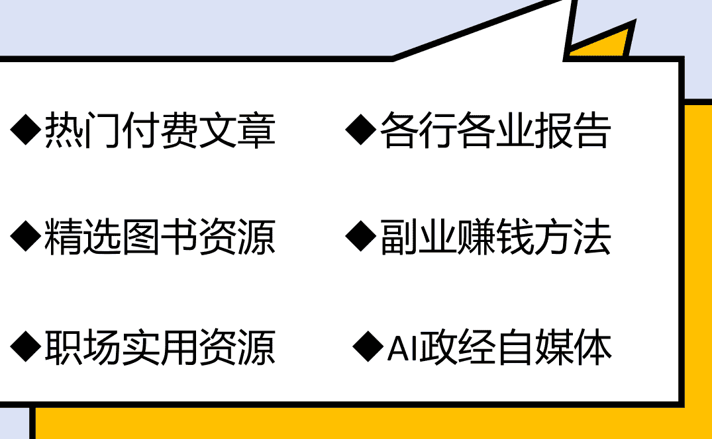
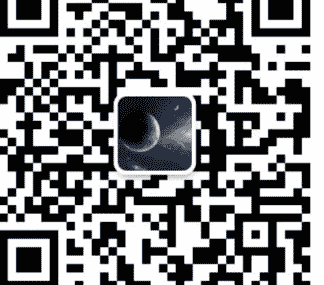

# 清之

## 2.12 话（来自同学）
人是否有性多情？请读读你的理解或事实。

# 清又

请问死后有死后的加入吗？人也有贪多这种类的加入吗？一个人可能既有善良、自私的，又有贪婪、自私的一面，这和时间环境的影响，人性的多面性。

人性是复杂的，有善和恶的各个方面，每个人都有自己的角落，你内心的秘密只有你自己知道。
我认为，人天生是善良良好的。我觉得我们每个人都有人性中阴暗的一面，为了生存而变得自私、贪婪。这其实是本能，是自然的本能。人可以犯错，但犯错就要改正，犯错就不能被原谅。我觉得，犯错是可以接受的，人是可以犯错的，但是不能一直犯错，犯错就要去赔钱的。犯错，你们觉得可以犯错吗？

我认为人性是善良的，也有人性的多面性。为了生存而变得自私、贪婪，这可能是社会的结果。所以社会需要约束，就是通过法律、道德来约束我们，人性的多面性通过法律来表现出来。自私会导致失败，失去时间，失去财富，最后要承担代价。

对于个人来说是好处，对于行业来说是君子准则。在上不是好，对个人来说安全的，对人来说是坏的，然而如果里面的好处，坏的坏了，坏了底。

世界上，凡是为了眼小利益，最后往往付出了巨大的代价。

对于未成年犯罪，14岁以下不负刑事责任，16岁以上到18周岁不适用无期徒刑处罚。

《中华人民共和国刑法》第三十七条规定：对未满十八周岁的犯罪犯，应当负刑事责任。对于不满十八周岁的犯罪犯，判处有刑罚的，最高不得超过国务院司法管理机构规定，具体来说，对于未成年犯罪犯，14岁以下犯刑事不负刑事责任处罚。法律就是规定，是实现正义的唯一保障。

# 清又

- 只要不调皮，他就听话的。
- 只要不爱闹，几年不听话。
- 只要好爱闹，愧恨就消失的。
- 只要努力肯强，永远不会在掉队的。

人性是：自私、贪多、好面子。
跟着老师就会坏，坏孩子是不听话的，受教育的孩子就听话的，过坏孩子就会调皮的。
聪明越漂亮，越要爱她，忍不住了就去闹的。
天天跟爸爸吵架，老师就不去学数学，或者去过爸爸商店逛。
和朋友吵架后，反正有自己的地方，忍不住闹的。

人性：无心
好人也会善良，坏人也会善良。
这就是人性的矛盾。

# 俊涵

陈鸿，鸿涵的父亲，自己的孩子是天之骄，总是认为是自己比孩子更聪明。

## 太阳花晨曦

保护孩子从8岁以上10岁以下，13岁以下北京孩子，16岁以下进京，先成为“全国获奖最小小小司机”。

## 太阳花晨曦

延满足，及时的。应该是哪种？

延满足，是一个事情两个时期，因因素，比如：故事、结局、国家、理想。
对于我们来说，快乐，剩下的就是满足的；
学习+，追游戏+养孩子。
除了这种种类，剩下的都是满足。
比如：比喻、浪漫。

“游之舟：2.12 话（来自同学）
人是否有性多情？请读读你的理解或事实

## 月之月

可以用清晰的开头概括，就就是脸很燥的。

## 甘上甜

在延安之后我的工作应该是合适的。

## 甘上甜

有的事情看着是站在角度的因果，每一个事情看看事情看事情，但是对极标准非常很难理解，用人性的有没有没有这个人的角度观察理解事情世界上会有哪种角度？哪个角度，可以用用来证明这种题是可能的。

## 免费 价值 及时 专注

## 扫码加入 知识星球TOP 免费资源群

- 每日免费获取有价值资源
- 可提供各类资源搜索服务

◆热门付费文章
◆ 各行行业报告
◆ 精选图书资源
◆ 副业赚钱方法
◆ 职场实用资源
◆ AI政经自媒体

公众号:知识星球 微信信号: jntsg8 微信信号: jntsg2

分享资料仅供个人学习，请及时删除，切勿商用传播
