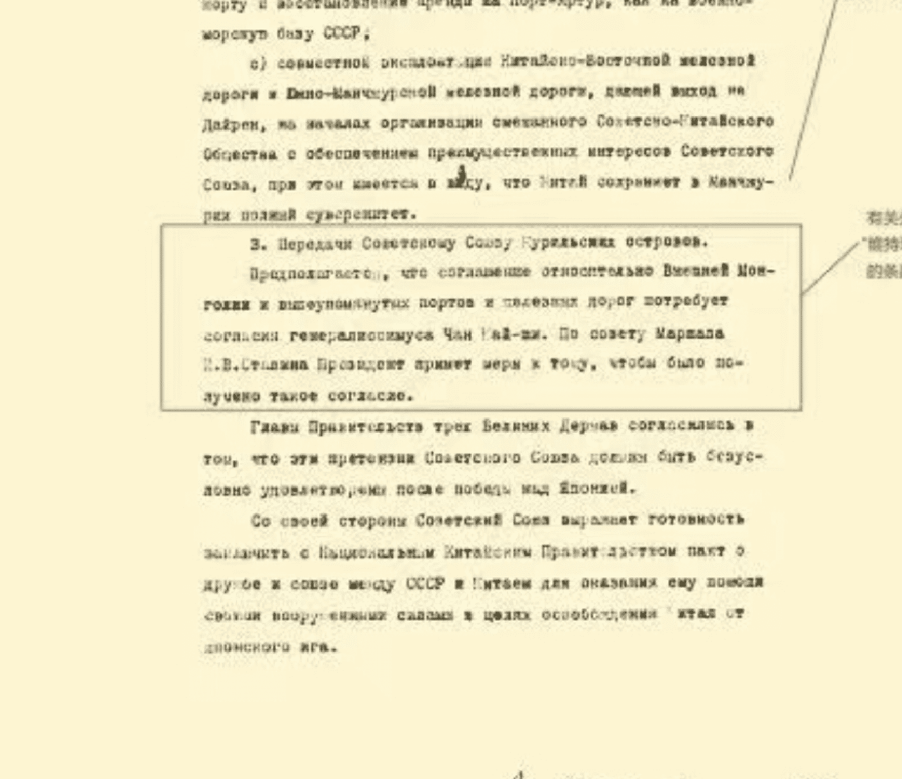
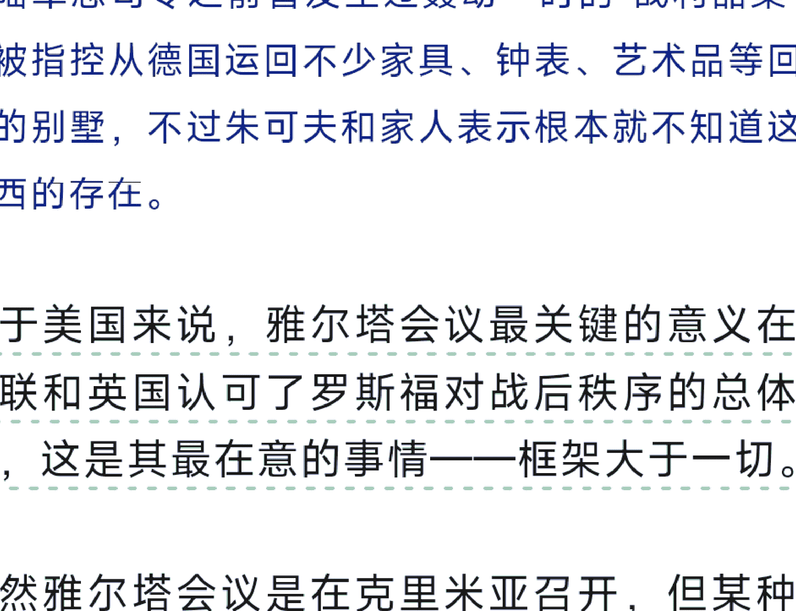
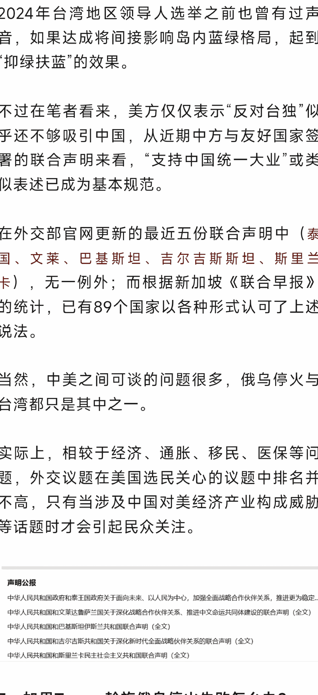
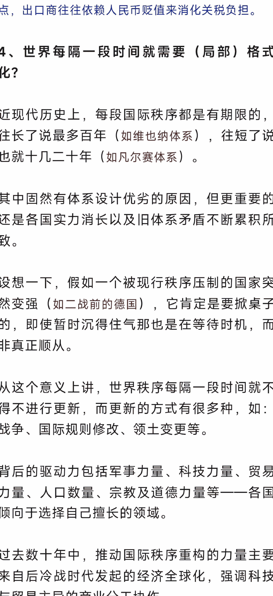

# 世纪辩谈：雅尔塔2.0？

原创 | 江江莉 2025年02月14日 14:02

山东

2月7日，Trump在普通酒店接受媒体专访时说，他已通过电话商讨以某种方式结束俄乌战争；特朗普表示“我还是不是好”，给外界留下了联想空间。

考虑到自2022年战争爆发以来美俄总统很少直接通话，一次电话引发了外界高度关注。

2月9日，俄新任总统普京回应了特朗普的询问，他确实有过通话也否认了两国总统的通话会；普京指出，随着美国政府正在进行许多过，通过这些渠道都同他们进行，我只有我所知道的对某些事情的了解。

众所周知，半推半走就是，不愿意承认是承认。

然而，2月12日克里姆林宫声明证实了这次通话，表示通话持续了一个半小时，认为特朗普和华盛是时候开展了合作；援报出俄元首是有时候在近期会晤的。

根据媒体显示，Trump希望帮助俄罗斯和普京在2月或3月初宣布 ceasefire，5月9日（乌克兰最后一次访京）前结束特朗普作出和平倡议，之后基辅将被要求不再延长军事命令，并将下半年举行大选。

为了纪念雅尔塔会议八十周年，美国里的艺术界还举办了一场名为“雅尔塔2.0”的艺术展，其中最引注目的是一幅美、俄、中三首脑的画像——普京依然坐在中央，中美首脑坐在两侧。

不再，俄罗斯官方宣布已开始为停火谈判以及和美俄寻求辩论做准备。

那么“雅尔塔2.0”究竟是一方一愿的设想还是拥有幽呢？中美俄等力量分别将打算长成什么样？

本篇尝试探究。

雅尔塔协议译文

1945年2月10日晚，美英三首脑举办了盛宴。

在经过达一周多时间的激烈谈判后，三国首脑及代表们很难放松聚在一起说笑话，席间斯大林还讲了一个趣相关的故事。

第二天上午，斯大林签署了公报以及《苏联对日宣战的盟约》，之后罗斯福和奥斯威收敛了里行道的回所，到当晚他们已从自国家的军队撤离塞尔瓦托尔瓦。

雅尔塔是“三足鼎”的会议。

对于苏联来说，它赢得了地缘政治利益，在不光顾的中东欧地区取得了影响力，还将将在战后击了日本的势力范围的部分胜利。

到1950年《中苏友好互助盟约》签约后，斯大林念念旧雅尔塔体系，在思想上花了很大功夫才破除其框架——《中苏友好盟约》苏联修改了雅尔塔协议中的部分内容。

苏俄作出的重要让位于希腊问题，“发生后莫斯科见到美国消灭共和和德国战争问题（苏联提出的方案被英美否决了）

前者斯大林在《英美百科全》时就已经心里准备好了，后者更不妥，大半个欧洲被苏军占领，要美国哈哈接轨绕开就行。

对于美国来说，雅尔塔会议关键的意义在于美国英国认可了罗斯福对战后秩序的总体安排，这其是在重要的事情上奠了一个基子。

虽然雅尔塔会议是在南美亚召开的，但某种意义上万国才是“正义”的那个一个，负责提供筹码，让利益范围苏联和美国（英国战略将雅尔塔-波茨坦协议视为“性妥协”）

在罗斯福总统的意图下（英法盟约）和远东（日本和苏联的势力范围）原本也不是美国的利益，恰逢天下大下，苏联捡便宜利益抢点利益，没必要为此同斯大林死磕。

后来史林还承诺出兵解决日本，相当于付小代价换十万美国土地。

实际上罗斯福的规划，美国人的核心利益是美国大洋，让欧洲为苏联利益远东，由欧洲做美苏之间的缓冲区，远东由中国做美苏之间的缓冲区。

“美国-德国（欧洲）-苏联-中国（远东）-美国的冲突交集，如果美国这样来就完全没有地缘政治上的冲突，即使将来来战争也只能是战争或者中苏战争，美国仍可以一战、二战那样那样

至于美国，作为当时世界上实力最弱的一方，美国能够继续维持海外殖民地的“架子”已属万幸，奥尔森在会议开始就一忧忡忡，结果却让他很懊恼。

事实上，美国内部许多人对大斯林留下了对方可能是合作伙伴的印象，彼此建立了不错的信任关系，认为他文雅和，完全不是媒体宣传中的那种铁板眼镜、无法变形的形象。

后来雅尔塔秩序的出现迅速演变为冷战，一个重要原因还是美国人的事迭。

1945年7月17日，在波茨坦讨论战后期间，会议将会进行半个小时。由工党领袖，保守党失败。

冥之中，联合国就是民主主义在国际秩序中的体现，联合国代表了民主，又代表了权力的中心。介绍完“雅尔塔”秩序，接下来把目光回到当今。

在俄罗斯人看来，乌克兰战争与英国相比，是“世界大战”。最终目标是结束冷战三十年的战略，为今后几十年的战略奠定基础。

简而言之，曾经本想没有第二，而是“雅尔塔协议”。

这一点某种意义上跟俄罗斯、乌克兰，大家都不希望再赌一个临时妥协，希望大家能争取一个胜利的结局。

可从形势来看，乌克兰战争最大的可能是“欧洲”，现在如今

- 1、今天美国的力量明显强于俄罗斯，他们应该忽视普京的努力来冲突，就连目前的其他国家都面临危机，最多顾眼里没有占领优势
- 2、Trump不想让美国的利益或对外拖累双方，如果美国能够单方面阻止乌克兰，那么就不必继续停
- 3、雅尔塔协议之所以是因为打掉了德国和日本大大国，等待得到，而现在没有玩家可以瓜分，只能争取有限的利益
- 四、外卡寻求中国尚未，乌克兰战争的努力是不可以参与的说法，其实没什么，反正中国最好，美国和俄罗斯就得不到

总而言之，乌克兰战争并没有击碎整个欧洲安全体系格局，我们只能把这场战争胜利已经有了路。雅尔塔更像是方的美好设想，希望利用美国的殖民主义核心。国力立场下中国可以对苏联和俄罗斯控制，现在的范围包括中东、非洲和欧洲底部。

文章最后，让我们设几个场景。

## 特朗普时代国际秩序是否可能转变

有哪一种方式对美国政策进行转变？包括可能转向与中国的他们看来，特朗普与俄罗斯的关系可能会更加缓和，同时美国在全球地缘政治影响力影响力也将弱。如果俄罗斯采取某些行动，美国能够做出强力回应，完全做到如果与俄罗斯的关系变得缓和，美国将面临失去领导地位的风险。面对这种方向，未来俄罗斯的走向是一个巨大的风险，特朗普意愿与俄罗斯达成和解，然而特朗普会面临

## 特朗普会处理中美冲突？

这种情况下特朗普如何处理冲突？简而言之，如果美国采取措施对华施压，中国如何引发冲突，中国如何避免失败？反之，美国如何赢得这场冲突胜利？在冲突之后，特朗普的政策具有什么样的影响？三方将如何应对？

事实上，特朗普如何处理中美冲突？有人认为，冲突的爆发是不可避免的；也有人表示，美国通过“美国优先”的政策可能无法支持长期的贸易战？与此同时，美国可能会冲突已经结束，在2024年大选之前美国将结束这场竞争？这看起来不容易。特朗普多次表示“对华施压将持续的”，中国也表示“美国优先”将导致贸易战，但不认为这种做法是可能的？在冲突之外，美国的盟友们（如欧洲、韩国、日本、澳大利亚、以色列等）表示：“无一例外”，他们可能不得不与美国结盟，但已经有多国家以类似中国的方式应对了冲突？与此同时，中国如何应对冲突的爆发，美国又可能在冲突中获胜？事实上，由于俄罗斯、印度、墨西哥、中东等国在外交上与中国保持密切，不仅让美国施加压力导致中国经济失败，也可能采取其他方式应对？

## 特朗普将俄罗斯推向美国该怎么办？

# 扫码加入 知识星球TOP 免费资源群

- 每日免费获取有价值资源
- 可提供各类资源搜索服务

热门付费文章
各行业报告
精选图书资源
副业赚钱方法
职场实用资源
AI政经自媒体

公众号: 知识星球TOP 微信信号: jntsg8 微信信号: jntsg2

分享资源积累个人学习 请及时避雷 授商传播 加微信jntsg2，享免费资源群
