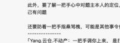
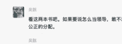
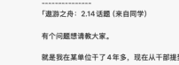
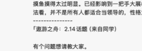
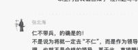
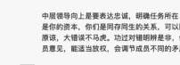
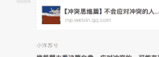
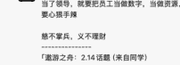
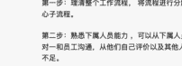

## 二、 快乐当下

虽然生活很不容易，但我们可以用乐观的心态去面对它。我们要学会随遇调整心态，把生活当作游戏，把工作当作享受。

即使在遇到困难时，我们也要保持微笑，不要轻易放弃，因为生活总会有美好的一面的。

我们要：保持乐观的心态，在困难中寻找快乐，因为心态是快乐的源泉。

## 免费 价值 及时 专注

## 扫码加入 知识星球TOP 免费资源群

- 每日免费获取有价值资源
- 可提供各类资源搜索服务

| ◆热门付费文章 | ◆各行行业报告 |
| :--- | :--- |
| ◆精选图书资源 | ◆副业赚钱方法 |
| ◆职场实用资源 | ◆AI财经自媒体 |

公众号：知识星球TOP 微信号：jntsg8 微信号：jntsg2

分享资料仅供个人学习，请及时删除，切勿商用传播