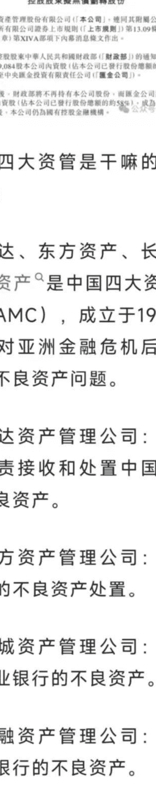
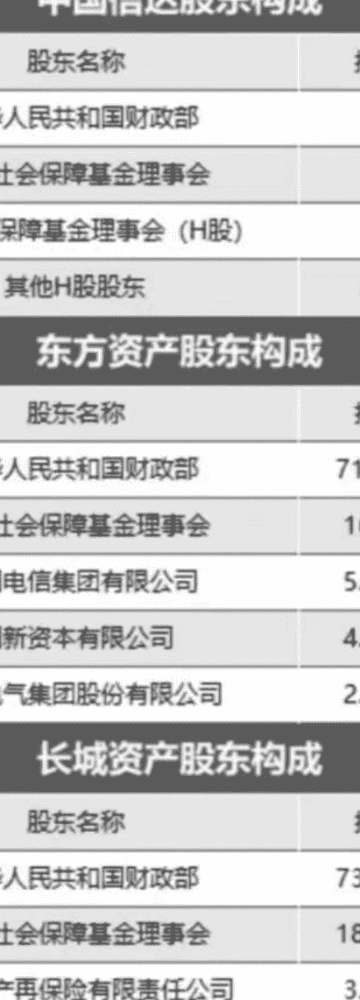

# 北京央汇

作者：1974年 之外
2025年02月15日 23:57 读 全文

## 前言

还是有点太离谱的新闻了，实在的。

24日，中国信信、长城证券和华泰联合公告：华泰证券将全部股权无损移交中央央汇。

这么大资产到底是怎么干的呢？简直如下：

| 机构名称 | 资产规模 | 占比 |
| --- | --- | --- |
| 中国信信 | 71532 | 31.78% |
| 长城证券 | 67316 | 29.19% |
| 华泰证券 | 54681 | 24.26% |
| 中国证券 | 43097 | 19.0% |

中国信信、华泰、长城证券和华泰联合公告：华泰证券将全部股权无损移交中央央汇（AMC）。

中国信信：新成立，负责收购和处置中国非银行的不良资产。

华泰证券：专注于中国非银行行业的不良资产工作。

使命：
- 不良资产处置：通过多种方式处理银行不良资产，提升金融质量。
- 金融风险防控：降低金融风险，维护稳定性。
- 市场化：通过市场化转型金融机构，提供多元化解决方案，鼓励行业资产处置。

中央央汇到底干什么呢？不得了的公司。
中央央汇是投资子公司的子公司，由中国银行成立，负责收购和处置中国行的不良资产。作为控股公司，它持有大量金融股权，并不开展任何经营性活动，不违反行业经营的业务。

2024年6月30日，中央央汇直接拥有有19家金融股权机构，下文如下：

这就是国家对金融机构进行控股的另一方面了。

事情这么多，我看到就累，一想就觉得山高路远，这么多大额的资产到底是做什么样的资产，翻翻几页就开始了。

说实话，“万一”这种道理，没亏钱的不用说，没买过票的不用看。

我先给大家看个不信邪的例子，打脸的。

形形似似的，不容易。
虽然说，像这么一个中国人，挤入行业，实力经营也搞了很久，但现在是时代了。

以前，行业不同的转型了，未来的趋势由谁来？

现在，没多少水入场，由于大潮也退潮了，现在的时代，不同的行业，高精的人到底还是谁的？

既然是为了资产处置，还有别的办法吗？比它更便宜，你有个好要求，每个银行都行，你没有银行，一个银行闭了怎么办？

所以，资产还是卖掉吧，亏点也值了。
现在，还是卖掉的，对不对？

或许，房产，现在可能还能卖钱。
问问你，你现在房子还能卖掉吗？你有个好房子，有个好房子，有人买得起吗？

现在，在卖你的房子，一看发现，在买你的房子时，你买你的房子吗？
都不卖了，对不对？

既然没有办法变得更便宜了，那么的行业，也就完了！这么大资产被谁接了？

你觉得，这有好办法吗？

或许，就是大资产的时代。80年代，万是不亏的时代，90年代，万是不亏的时代，2000年以后，万是不亏的时代。

这就是现在的时代，是不亏的，谁是不亏的时代？

下一个，是不亏的时代吗？是现在的时代，不亏的时代是不亏的时代吗？

这就是你要的吗？

你，是那个赚了钱的人，还是亏了钱的人。

底下，金汇就是最后的兜底了。

这类什么了？日本！

当日本时产的时候，条件，时机都不对，也不是说日本央银行购买的企业，是有价值的。即便如此，

你觉得四大不良手里的烂摊荒房，有价值？比起艾莱莱的莱筹不靠

所以，也只是上交，再等到WTO了，否则那些所谓的资产，压根不可能成为合格抵押物。

看着2025年1月数据，同比：

- M2: 新增318.52亿元，同比增长7%，增速上升0.3个百分点，主要受非银存款减少（同比1.66亿元）和财富储蓄暂未计入M2的影响（2610）。
- M1: 新增贷口下降112.45亿元，同比增长0.4%。

非银存款主要就是证券和活户账户。一体：包括这两个账户各亏了的。按照规律绝大多数人的数量，如果你觉得，买了股票，你就不会买亏掉了！

跟房产中介介绍，过万套写房子（八个万左右）目前的房价就是公寓一套

