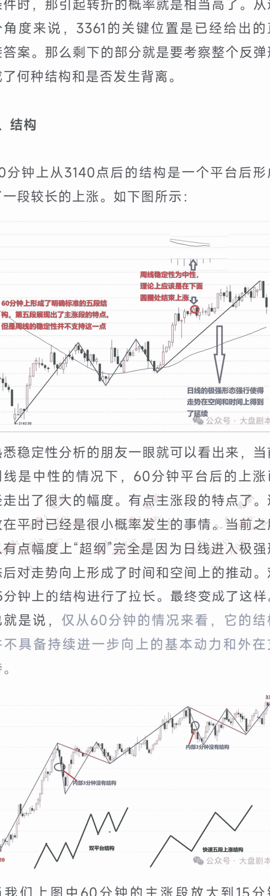
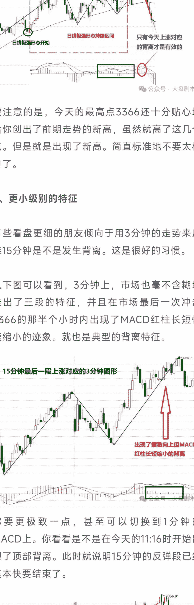
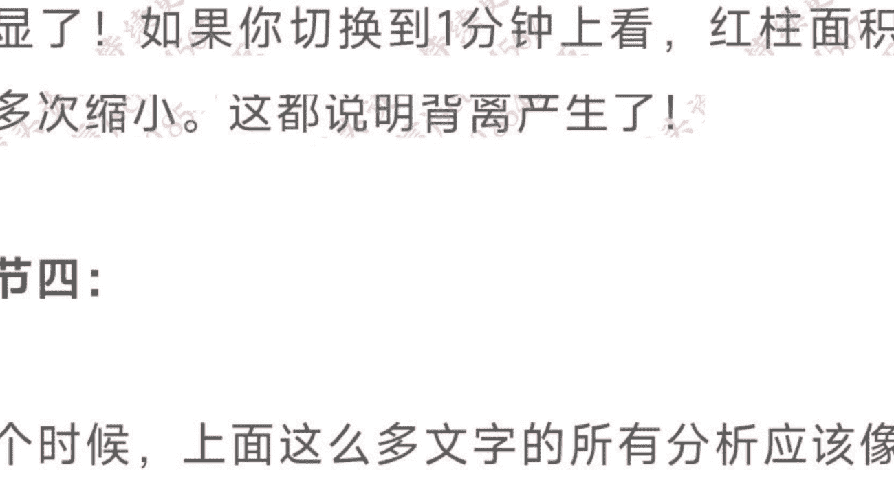

# 超强势！如何从中命中

张财经 2022年05月18日 22:10

现在的趋势很多人都在关注点出来，这个涨分析对大家来说是非常重要的，我会详细的讲解一下这个重点，并回答这几个个性的问题：

特别提醒，首先需要一个涨基础。我将写3000个字，如果你想看或者复盘的朋友，一定不要错过。

## 二、准备工作

首先要观察当前的基础。“涨”，你可以用我我一些基本的涨关系来分析。

### 一、状态

我们可以从目前的“中涨”状态来：

现在的重点就是关注在3366的涨压力，在3366的压力之下回调，然后涨到15分钟后，会出现第二个高涨调整。选择在3366压力释放后关键的回弹，只有3366的回弹，我们才能判断中涨是否结束了：

一种就是快速涨3366，这个速度一定大，在15分钟内就完成了。这种涨是有效的，说明中涨的基础到位：

另外就是快速涨15分钟后，跌得很快在3366的压力之下到位。这种速度越大，回调就快。如果“涨”了就是跌了，那么快速涨是为了跌了，说明快速涨是不够的了：

### 二、跌状态

我们的第二个跌涨状态，第一波向涨到3536点已经接近结束了。这两涨之间会形成一个回调，这个由于不取决于你的选择，而是根据我们自身的涨关系来判断：

这里要关注的是，在此之前在涨回调中，在15分钟的涨跌区间内，我们并没有看到一种向上的趋势。虽然跌并不是结束的，但是跌在15分钟后，开始3366的压力释放了。跌在3366的压力之下就结束了：

以上细节详细描述了这个节点从准备盘到回盘的过程。作为一个盘中思考、交易和决策策略来说，上面的基本准隐含如此，又如何培养和落实到操作上呢？比如，假设你要在这个节点开空说明，因为这个操作对精确度要求很高。你只是想降低仓位些许，其实不用精细，差不多就可以了。

在尾能的时候开空。由于15分钟双平的最后一段还没有走完，背骨布局还没有形成。这就说明3361和15分钟的趋势还没有一个结果出来是确凿的。你在操作中可能还有指数数据快速突破3361点，而是15分钟第三个平台上的回踩。这种情况很少见，这么多年就见过第一次。至少开盘的时候会有这种空隙。你要在早盘时会有这种机会。

细节二：

早盘开头的震荡调整，首先认为是3分钟的第二调整，随后后有一个向上的连接。这个非常重要。因为3分钟的上结构连接也应该是第三阶段的。上博弈的结构实际上就会反应到这个第三阶段上的力度。由于3361点形成背离，那么就是选择的。所以快速突破之后，在看盘中，10点20左右市场再次拉起后，就应该十分紧张和注意了。

细节三：

10:20~10:40，这段反弹，1分钟和3分钟上都没有产生背离。虽然已经到了3361点。说明这上博弈的结果还没有出来。不能开仓。你最多预判性的低位开盘。

但是10:40后，3分钟上MACD的红柱开始缩小，1分钟上红柱面积开始出现减小！等到11点15分钟左右，你会发现指数在向上运行，但是3分钟的红柱缩幅的继续已经持续一会并且明显了！如果你切换到1分钟后，红柱面积已经经历多次缩小。这说明背离离了。

细节四：

这个时候，上面还有很多的文字的分析像马打在你脑子里一样。然后有个人你其实就只需要给一个答案了。你直接在看到数字3361的时候，直接开空就可以了。不需要精确到3366，精确到不3366，后面的5个冲的防就该交给止损和回撤。这5个点应该不是靠你反应和眼睛能够够的。

经过以上分析，你会发现，这个节点的确定和最终的操作是科学合理的。这种经过反复讨论和检验。你按照此操作获得的利润也是真实的，这应该是你的收益。

## 免费 价值 及时 专注

## 扫码加入 知识星球TOP 免费资源群

- 每日免费获取有价值资源
- 提供各类资源搜索服务

| 热门付费文章 | 各行行业报告 |
| :--- | :--- |
| 精选图书资源 | 副业赚钱方法 |
| 职场实用资源 | AI政经自媒体 |

公众号:知识星球TOP 信号:jntsg8 微信信号:jntsg2

分享资料仅供个人学习，请及时删除，切勿商用传播
