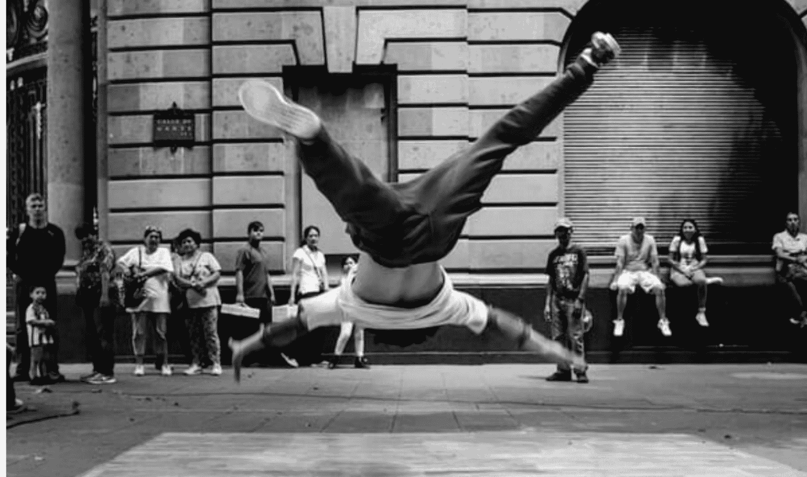
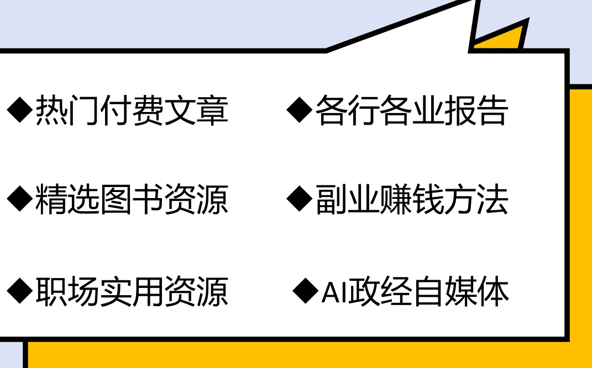

# 普通人如何复制高手的本能?

# Part1: 为什么隐性知识刻意练习更重要?

我想要写篇文章来谈谈隐性知识 (Tacit Knowledge)，以及为什么我认为它是技能习得领域中最有趣的话题。如果你是《Commonplace》的长期读者，可能已经多次见过这个概念，因为我之前就写过不少相关内容。

但我仍然觉得，专门用一整篇文章来探讨这个话题是个不错的主意。

之所以要写这篇文章，是因为每当我提到隐性知识时，总会有人在Twitter、Hacker News、Reddit或者邮件中被反驳，声称隐性知识并不存在。我希望有一篇文章可以直接拿来应对这些难题，而不必每次都重复解释。

另一个值得探讨隐性知识的原因：它确实存在，而且理解它的存在你能获得最有价值的认知之一。一旦你意识到了隐性知识的存在，你就会发现任何网络中的大部分内容都是隐性的。

这意味着你可以去寻找，进而找到真正有用的问题：“那个人拥有这种能力，他做得非常出色，我要怎么才能学会？” ☕

## 01 什么是隐性知识？

隐性知识是一种无法通过语言传递的知识。

想象一下骑自行车。光靠描述是无法教会别人骑车的。

当然，你可以尝试解释骑自行车时该做什么，但当你对孩子大喊“保持平衡！”想象自己自己在绳索上“平衡！”时，他们可能还是直接摔进沟里。

一定有人说：“只要解释得更清楚，用的对的方法，就可以教会他们。”如果你也是这么想的……我建议你尝试试试看。

去找一个还会骑车的孩子（或者成人！），试着用语言教他们骑车，让他们不要摔倒，不撞伤自己。如果你成功了，请务必记住：你的成功有多多少归于你的理解，又有多少是他们自己摸索出来的？

这个问题值得深入思考了。

在教育学中，这种单一依靠讲解来授技能的理念被称为“传输主义（Transmissionism）”，在严肃的教育学者看来，它就像是“地平说”一样荒谬。

这种观点认为，只要找到正确的词汇、恰当的比喻，把隐性知识拆解到每一层的细节，学生就能领悟。但真正实践教学的人都知道，事实绝非如此。

如果你这种观点的维护者，我希望能够尝试去做一名教师，教一项感兴趣的运动，这样我的孩子就能和你的孩子对战——最后我们可以亲眼见证他们是如何彻底 Hold住孩子的。

如何教授隐性知识？我们如何教授骑自行车

我小时候学会骑自行车的，后来又教会了我的妹、表弟、以及邻居。每个人在几小时内都能骑得很快。我的方法如下：

1. 选择一个自行车，它的高度高于学习者，这样他们随时能够落地。这不仅给他们安全感，也能减少损失。
2. 让他们用腿撑地，向前滑行一段，然后双脚停留，重复这个过程。
3. 逐渐增加地力和滑行的距离，他们尝试双脚空行。在某次滑行时，告诉他们开始踏板。通常他们已经对滑行感到无聊了——正是让他们进入下一个阶段。恭喜，成功教会了一个孩子！注意，这个过程中几乎没有太多的语言指导！更重要的是模仿和实践——让学习直接去感受，而不是靠头上说。

这种方法的神奇之处在于，你可以在短短几分钟内看到从：
- “意识到自己不会”（无意识无能）
- “努力学习”（有意识努力）
- “最终就能学会”（无意识胜任）

换句话说，教授知识的方式是模仿、示范和学徒。通过直观地模仿大师的行为，逐渐内化背后的规律。有些人可能会说：“这只适用于自行车、网球等技能，但对于思维呢？”事实上，人们对隐性知识并不知道。研究列出了几个例子：创造艺术、评估公司、木工、金属加工、家政、跳舞、即兴演讲、流水线管理、快速解决、心脏手术——这些涉及大量的隐性知识。如果你从事的是知识工作，那么隐性知识在你的发展中更重要。

## 02 知识工作的隐性知识

我花了几年才意识到，观察别人的方法。在我之前的工作中，技术主管有一种惊人的能力：他可以在需求会上短短几分钟内勾出最优架构，还能预留足够的灵活性应对后续的项目。相比之下，我的设计通常需要后期调整，显然不如他精准。

于是我多次尝试向他请教，然而我们的对话通常是：

> “为什么优先考虑外部 API？”
> 他：“因为风险最大。”

> “那为什么不用缓存 API？”
> 他：“因为我之前用过，知道它很好。”

> “为什么关注 Firebase？”
> 他：“我们要用它作为底层，很有风格。”

> “所以应该优先处理层？”
> 他：“是的，优先解决最难的部分。”

> “库存 API 我们为什么不先处理？”
> 他：“那个重要，我们会先做基础功能。”

这让我想起刚入行时，曾写过很多测试代码。资深工程师看一眼说：“这个结构不行，后面会出问题。”我问他为什么五秒就能判断？他先给了一大软件工程原则的解释，我不耐烦地打断，继续问：“但是你怎么五秒内出来的？”他笑着：“感觉不对。”然后我们就去吃饭了。

我在关于感知学习的文章中提到了这个。我并不是说他或高级工程师无法解释他们的判断，也不是说他们不能明确说明十几个变量之间权衡取舍的原则——他们是可以的，哪怕解释得很糟糕。但是现在是，他们的解释并不会让我具备判断能力。当我深入追问他们的判断依据时，他们会尝试用准则或启发方法来解释。

为什么会这样呢？看那段对话就明白了。当我深入追问判断依据时，他们会尝试挖掘越例外、附加条件和注意事项。这其实是一个普遍现象。在任何复杂的领域，没有专业知识的人都会用类似的方式来解释经验，比如：

“嗯，做 X。如果遇到 Y，就改做 Z，为 A。如果遇到 B，就直接做 P。如果是同时看到 A 和 C，但没有 B，就做 Q，因为 D 原因。还有些特殊情况，比如你应该选 Z，后来发现 C 出现了，就得做 Q。”

如果你继续下去，他们可能会最后：“久了，你也会有这种感觉。”最终，我打算学习技巧有效的方法就是模仿他——自己设计一款软件，然后给他反馈（或者让他看我的设计）。

与同时，我也明白了一个道理：如果在解释某事实时列出一串注意事项和例外情况，那么可能就是一种“隐性知识”在发挥作用。

这种研究在专家领域早已被广泛了，许多领域的从业者也曾多次讨论过这一点。比如，外科医生 Atul Gawande 在谈论尾炎手术时，就提到了类似的情况：

假设有一位尾炎患者需要手术。如今，外科医生通常会使用腔镜尾肠切除。具体来说，在肛门附近切一个四分之一英寸的小口，将腹腔镜（带有摄像头的头部）插入腹腔，然后在直线下方切一个口，插入长形镊，最后在左下方切一个口，用于切割和缝合的器械。接下来用镊钳住大小的尾肠，使用钳器在尾肠头部及其血血管处进行切割和融合，然后将切下的肠放入塑料袋中，最后缝合口。这是理想的操作流程，但往往并不顺利。在正式开始手术之前，就要做出一些准备。如果遇到解剖结构异常、严重脓肿，使用摄像镜会遇到困难——你就决定放弃腔镜，改用传统的开放手术。这种手术需要用各种工具器械开展组织：钉子、剪刀、钩子。此外，你还可以调整姿势，让移动方向正确。一旦成功并看到尾炎位置，可能会让感染形成。

随着时间的推移，我已经完成了超过两台手术。其中与我的专业相关的内分泌外科（如甲状腺、肾腺手术）涉及从简单的活检到各种类型手术。在我的专业领域，我已经熟悉大多数可能出现的严重问题，并找到了解决方案，能够在时刻灵活适应。注意，Gawande 在描述专业技能时，列举了大量的“例外情况”。这可能就是隐性知识在作用。当你试图掌握复杂的判断——一种能够瞬间综合多个因素并做出决策——这种价值体现出来了。

最后，Klein 的研究报告指出：虽然部分工作可以标准化，但关键的决策环节依赖隐性知识，无法简单地转换为自动化的流程。美国空军最终放弃专家系统计划，继续依赖人类专家。这种情况在多个领域屡复上演，导致“专家系统”在 20 世纪末逐渐失败（维基称为“知识获取问题”）。

- 显性知识 (Explicit)：经过整理和编码的知识，通常存在于文档、数据库中。
- 隐性知识 (Tacit)：直觉知识和技能，植根于特定情境、经验和价值观；难以传达，通常存在实践者的头脑中；是长期竞争优势和创新的来源；主要通过社交、指导等方式传递，而非 IT 系统有效。

## 03 隐性知识能够被显性化吗？

让我们重新审视这句话：隐性知识真的能变成一套明确的指令吗？理论上或许可以。我们能否把专家的决策过程拆成分路径，编写成“专家系统”？或者我们能够把它整理成“流程清单”，然后交给从业者，而不是让他们像传统方式通过实践习得？

关于这个问题，主流观点是：“原则上可能的，但在实践中极其困难。”我的观点更为倾向：这种转换难度太大，以至于根本上不值得尝试。如果你阅读这篇文章的目的是在职业生涯中提升技能，那么你应该放弃把隐性知识转化为显性知识的考虑，而是直接去追求隐性知识本身。

20 世纪 70 年代，包括美国方的内的许多组织曾资助研究，探索是否可以开发“专家系统”来增强或取代人类决策者。当时，替代人类的专家系统被视为一股潮流，就像今天人工智能（AI）和神经网络的热度一样。然而，几十年过去了，这个潮流早已被抛弃。研究人员很快发现，要把人类专家的经验、细节和异常情况编码成计算机系统，几乎是不可能的。

以色列空军维修专家的案例：其中一个著名的案例发生在两次中东战争（Yom Kippur War）之后：美军尝试将以色列空军的维修数据数据库探索是否可以用专家系统取代维修军官。当时，一个年轻的工程师 Gary Klein（后来的知名决策研究专家）被派去采访这些维修军官，试图获取他们的专业知识。他在一次访谈中提到这个项目：

> 在录入数据时，我可以填写大约 80% 的表格，删掉 20%……可能有些字段是空的，或者存在错误。我是这样询问军官：‘你们怎么填这些数据的？’ 他们回答：‘看这个损伤的大小，然后看飞机是后天还是两天后恢复。如果是损伤，那就说明损伤没有波及关键细节，否则他们会长……’

换句话说，这些维修军官不仅依赖数据，而是能够根据经验推测损伤的传播，从而推断出最佳的解决方案。最后，Klein 的研究报告指出：虽然部分工作可以标准化，但关键的决策环节依赖隐性知识，无法简单地转换为自动化的流程。

当然还有其他反对意见。例如 Klein，如今被认为是决策研究（Naturalistic Decision Making, NDM）领域的先驱。他经常说过度依赖会人类变得脆弱（参考《The Source of Power》第15章）。如果要求人类机械执行一系列预设流程而不真正理解和思考，就会阻碍他们建立自己的能力；而这种能力又能让他们进行创造性的解决——这是专家们常面对的事情。此外，一旦现实中出现突发状况，他们缺乏应对的能力。那么，是否意味着这个问题无法解决？其实并不是，有一些表明它可以解决：

1. 我认为一些人工智能领域的专家认为专家系统或许可以培养，特别是结合古代方法可能会获得突破。
2. Gary Klein 本人开发了一种提取隐性知识将其显性化的方法，被称为“关键决策法”（Critical Decision Method, CDM）。不过这种方法本身就需要专业知识，因此不容易实施。
3. 在某些情况下，可以将整个隐性知识提炼成清晰的方法。例如 John Boyd 在编写空军的第一本战斗手册时，成功做到了。在此之前，很多人认为战斗是一种无法系统化的艺术。

这些观点值得深思。但我认为，“既然隐性知识可以显性化，就不存在真正的隐性知识。”但这只是一种辞藻，对现实没有帮助。我们无法期望专家系统的复制，也不能像 Boyd 那样的天才出现。因此，与其等待某种突破让隐性知识显性化，不如接受隐性知识的现实，积极寻找这种方法才有实际价值。

## 04 学习隐性知识的技巧

这对意味着什么？如果你想在自己的领域精通技能，你应该关注隐性知识的研究。你会问：“刻意练习不是关于专家的主要逻辑吗？”答案是肯定的，它不是。Anders Ericsson 在《Peak》书中对“刻意练习”做了一个相当狭隘的定义，随后虽然他没有经历过这种方法在其他领域的应用，但刻意练习的理念或许推广到那些非成熟的学科。

自然决策（NDM）方法的本质——与众多 NDM 领域的专家共同合作编写了《剑桥专家手册》（Cambridge Handbook for Expertise）。所以，如果你是一个程序员、设计师、画家或作家，在阅读关于刻意练习的内容可能会：“如果没有成熟的方法，我该怎么办？”如果你开始考虑这个问题，你已经踏上了一条很有趣的道路——这才是真正探究的问题。答案其实很简单：如果你从事这些领域，自然决策（NDM）可能比刻意练习更有用。

学习隐性知识的过程如下：找到大师，在他们身边工作几年，通过模拟、反馈和潜移化来掌握技能，而不是依赖刻意练习。（比如，沃尔·巴菲特在格雷·厄姆下学习的那些年，就是一个典型案例。）NDM 研究的重心正是如何让这种学习方式变得更加。我认为今天的世界对刻意练习和知识发现关注太多，而对隐性知识的获取过于重视。如果隐性知识确实存在——我认为它存在——那么关于技能最有价值的方法，应该来自专门研究隐性知识的领域。去年年底，自然决策研究（NDM）领域的专家们共同编写并出版了《牛津专业知识手册》（Oxford Handbook of Expertise）。这是目前我们所知的关于该领域最全面的研究综述。Ericsson 的刻意练习理论论了 30 年才进入大众视野，这在一定程度上归功于《异类》（Outliers）的畅销。如果按照同样的计算，NDM 方法可能要到 2030 年才会被广泛接受。或许到了 2030 年，我们会像今天谈论“1 万小时法则”一样，讨论隐性知识。

但如果你正正在阅读这篇文章，那你已经领先了一步。关注 NDM 方法，留意那些专注于隐性知识的研究。在我看来，隐性知识是当今专业能力领域最有趣、又被严重低估的话题。

## 免费 价值 及时 专注

## 扫码加入 知识星球TOP 免费资源群

- 每日免费获取价值资源
- 可提供各类资源搜索服务

| 热门付费文章 | 各行行业报告 |
| :--- | :--- |
| 精选图书资源 | 副业赚钱方法 |
| 职场实用资源 | AI财经自媒体 |

公众号: 知识星球TOP 微信信号: jntsg8 微信信号: jntsg2

分享资料仅供内部交流，请勿转发、扩散请勿商用传播
