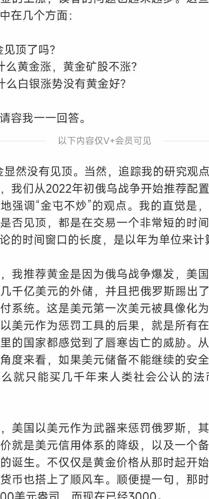
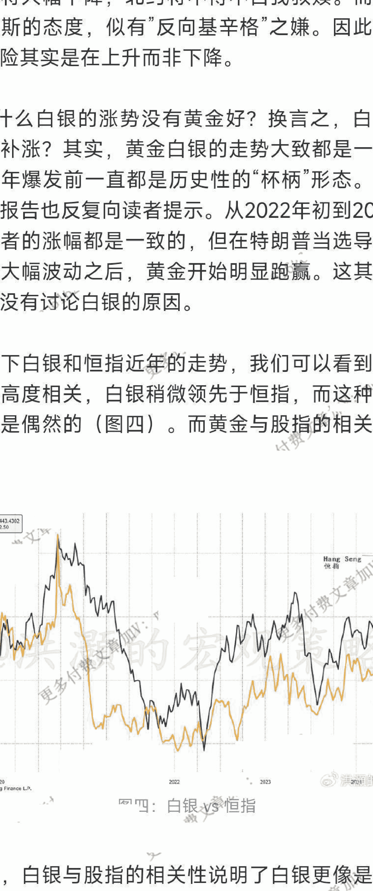

# 黄金：黄贵还是昂贵？金子有多重要

2022-07-29 华尔财经

最近，黄金再次出圈，并突破了1700美元的关口。过去两个月来，黄金已经上涨了7%，去年的涨幅也达到了12%。由于通胀压力持续，黄金的上涨并未结束。此外，地缘政治风险的加剧也使得各国央行纷纷增加黄金储备。数据显示，2022上半年全球央行购入黄金量创下新高，超过1,100吨。

然而，我们认为黄金的价值被低估了。在目前的经济环境下，黄金具有比想象中更重要的作用。那么，黄金到底贵吗？

首先，黄金具有避险属性。当市场动荡时，投资者倾向于购买黄金来规避风险。此外，当美元走强时，黄金往往会下跌。其次，从利率角度来看，黄金的持有成本是负的，因为黄金没有利息。当利率持续上升时，黄金的吸引力就会下降。

那么，黄金到底贵不贵？我们可以从以下几个维度来看：

- 1）黄金贵吗？
- 2）黄金还值钱吗？
- 3）为什么黄金会如此昂贵？

## 一、从价格角度来看

从历史角度来看，黄金的价格并不贵。在2011年，黄金曾创下1900美元的高位；而在2020年，黄金甚至突破了2000美元大关。虽然目前黄金价格在1700美元左右，但从历史波动来看，它仍处于中低位。

其次，从购买力角度来看，黄金也并不贵。在1970年，黄金的价格是35美元/盎司，考虑到通胀因素，现在的价格相当于当时的2000美元左右。因此，目前1700美元左右的价格，其实比几十年前还要便宜。

## 二、从收益率角度来看

# 免费 价值 及时 专注

# 扫码加入 知识星球TOP 免费资源群

- 每日免费获取价值资源
- 可提供各类资源搜索服务

公众号:知识星球TOP 信号:jntsg8 微信信号:jntsg2

分享资料仅供个人学习，请及时删除，切勿商用传播
