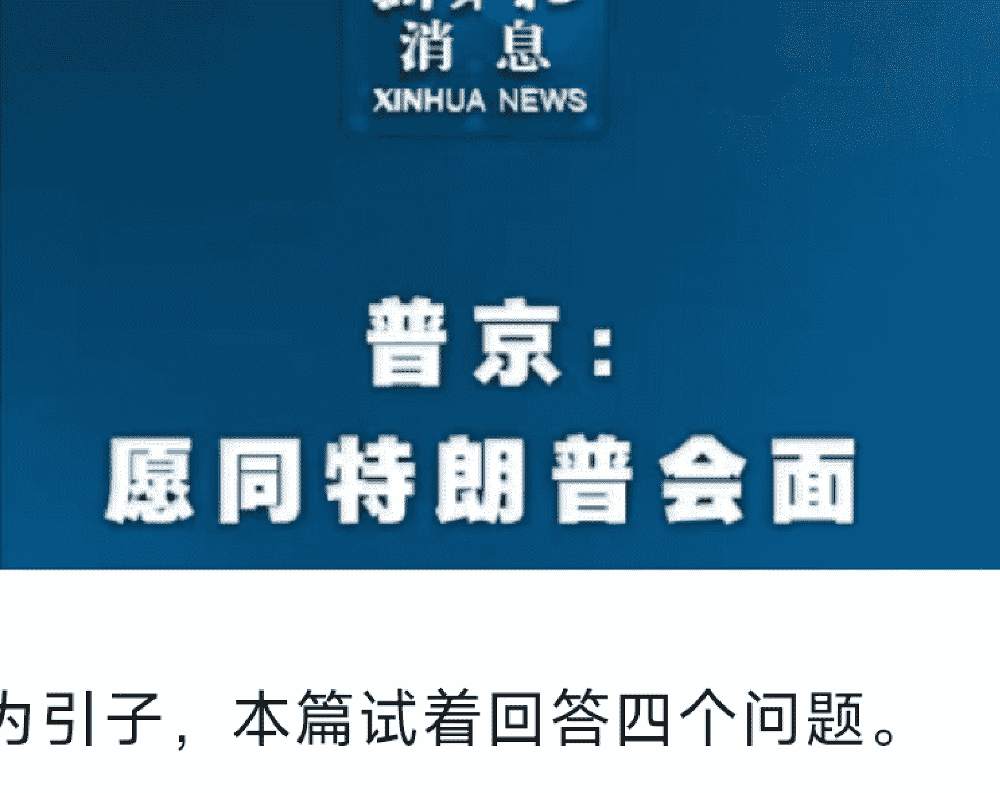
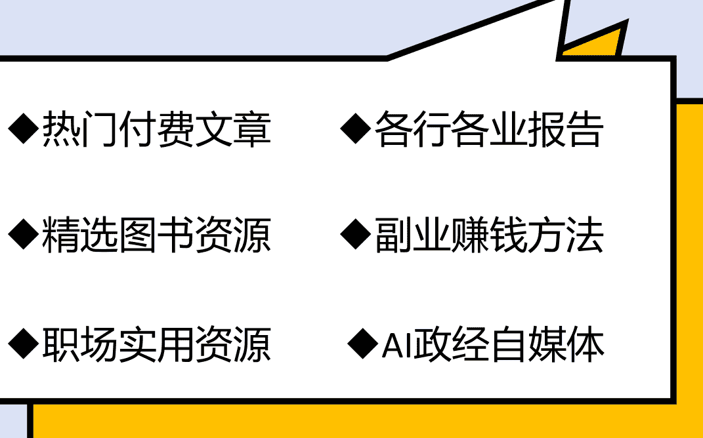
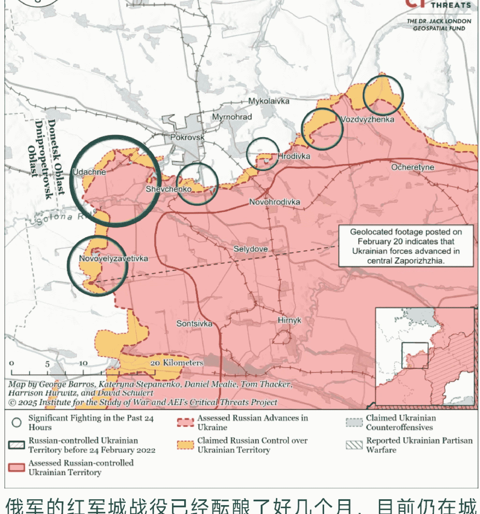
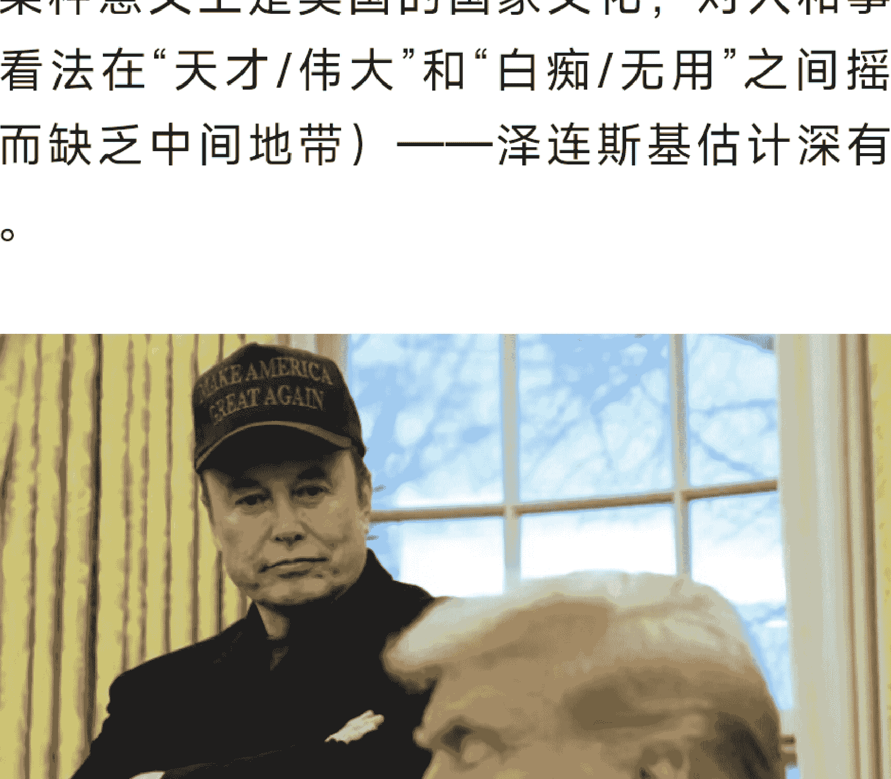
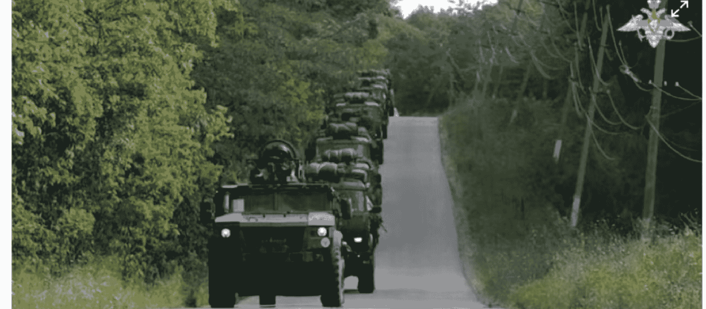
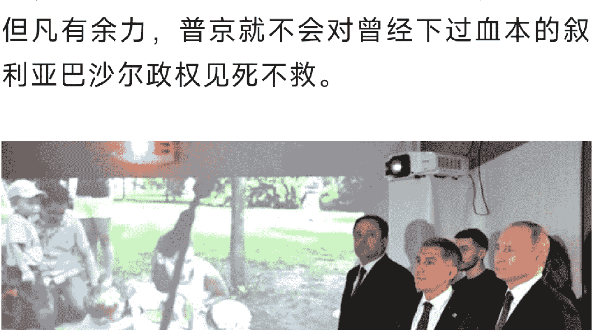

# 大国的惊变时刻

原文 闲生 江宁知府 2025年02月23日 09:01
山东

## 前言

大规模军事动员往往是“单向的”，不可轻易启动。假如俄罗斯不能作为筹码争取尽可能的地缘政治利益，那么它当前的动员状态就会迅速转化为财政和债务负担，并对国民经济面临长期负影响……

2月18日，美国和俄罗斯的外交高层在欧洲和乌克兰代表参加的情况下，于沙斯科首都进行了四个半小时的双边会谈。

虽然从官方通稿看两国未提及达成什么重要事情，但破冰的氛围还是能够被感受到。

接着美俄高层展现改善关系的意愿，有消息称特朗普本月就会跟普京见面，美财长甚至表示“如果需要将逐步取消制裁”。

2月20日，多外交人士透露美国在联合国大会上提议一项支持乌克兰领土完整的决议草案——美方都是牵头组织该提案的，真是让人措手不及。

从坚定支持乌克兰对抗俄罗斯到“亲远乌”，短短一周时间里，全世界目睹了华盛顿外交策略的大逆转。

面对特朗普抛出的橄榄枝，以及坊间流传的关于美国可能拉拢俄罗斯制衡中国的说法，克里姆宫究竟会做出怎样的选择呢？

以此为引子，本篇试着回答四个问题：

- 1、特朗普为什么弃乌克兰？
- 2、普京有可能可能做出怎样的选择？
- 3、这次停火会是“墨黑2.0”（俄欧大战的前奏）吗？
- 4、中国的角色与影响

## 免费 价值 及时 专注

## 扫码加入 知识星球TOP 免费资源群

- 每日免费获取有价值资源
- 可提供各类资源搜索服务

| 热门付费文章 | 各行行业报告 |
| 精选图书资源 | 副业赚钱方法 |
| 职场实用资源 | AI经营自媒体 |

公众号:知识星球TOP 微信信号: jntsg8 微信信号: jntsg2

分享资料仅供个人学习，请及时删除，切勿商用传播

从第一期与朝朝鲜的关系可以看出，特朗普其实并不擅长处理复杂的国际冲突。民主党对半岛问题采取冷处理方式，他们认为从特朗普拉扯朝鲜根本就犯了政治扭捏病。

### 1、特朗普为什么战斗力很强且十分亲的国家

乌克兰过去几十年间美国扶持的代理人，像泽连斯基和乌克兰这样能打的可谓少之又少。

远的不说，近处的俄罗斯像普京政府——枪准一响各自，美式装备全资金。

在拜登和布林肯等人看来，很容易找到如此优秀的代理人，花点钱或许可以不计较呢？

去年三月号追踪了俄战争态势，尽管2024年俄军取得一定进展，前线乌军打得有些吃力，使得丢掉个别城镇也没有发生崩溃，也不需要这么忙忙忙。

以苏德战期间的实力消长做参考，当下乌军只能微弱占据主动，尚未到达1942年下半年斯大林格勒战役的战略优势。

换句话说，即使美国觉得形势对乌不利不想尽快结束这么忙忙——如果要把泽连斯基和老罗比较，“丢包时刻”至少要等俄军打到第聂聂伯河彼岸。

由此不难体会，仅从军事角度来解释特朗普的行为，必须加上这个维度综合考虑的。

俄军的战场已经胶着几个月，目前仍在乌克兰南部围攻。是一座千万人口规模的城市，进展如此缓慢，更不要说哈尔科夫、第聂聂伯、罗霍克的战略优势。

按照支持者的理解，特朗普的考量主要有以下两点：

#### A、特朗普弃乌克兰

竞选期间特朗普曾激烈批评拜登支持乌克兰，他成功赢回了“重视内政”的观点，使得上任后迅速停火成为其招牌。既然要迅速停火，那就只能就俄罗斯立场，因为俄方不会妥协的，但乌克兰可能有在美国压力下屈协。

实际上，特朗普和他的支持者并不在乎外交政策高度服务于国内利益，比如通过加关税、减少对外援助等事件中能够窥一眼，美国在未来五年军费不受影响。

#### B、不同于民主党相对包容的西方思维

特朗普脑海中根深蒂固的“好西方”和“坏西方”之分——这一点与民主党相似。之前提到，特朗普试图将欧洲改造成右翼风格，尽可能扶持意大利总理梅洛尼等右翼力量，同时打压欧洲内部的中左力量。

在特朗普看来，当前欧洲多为民主立场的左翼国家，而俄罗斯则是欧洲的小弟，长期。如果A因素是特朗普在利益层面看重乌克兰，那么B因素就是感情层面对待欧洲。

以上两点是最原因，至于俄罗斯战略、集中资源对接、促进欧洲自主等，更像是一种托管——美国习惯于将全球方向回归中国，已经成了完美的借口。

另外，从乌克兰身上能够发现一点，那就是美国文化和民意基础无法持久战。当公司拿来了订单时，老板和同事都捧高在上；一旦表现不好，立刻就被裁掉。

这种意义上是美国的文化，对人和事物的看法在“天才/伟大”和“白痴/无用”之间摇摆（而缺乏中间带）——泽连斯基非常有体会。

特朗普是那种说脸就脸的人，被他们掉的下属不计数。

### 2、普京有可能做出怎样的选择?

普京之前提到过一句很有味的话，大意思是中国和印度的领导人是“世界级政治家”，可以长期发表影响力，而拜登以及一些欧洲领导人不是国际舞台上的灯，几年换一个。

考虑到普京执掌俄罗斯政权已经整整二十五年，历经克林林、小布什、奥巴马、特朗普1.0、拜登、特朗普2.0六届政府，这段历程显然是经验之谈。

欧洲俄罗斯问题专家、明智智库中国主任丹布罗夫在分析普京的行为时这样说：

“为什么要为了某个个人不值得信任的人，而牺牲与一个长期合作的战略伙伴的关系？”

这句话既适用于中国对俄罗斯，也适用于俄罗斯对中国。

假如没有中国的经济投入和国际外交支撑，俄罗斯很难过去这三年。现阶段中俄关系是高度绑定的，短期内几乎不可能被美俄关系撼动。

实际上，美国影响俄罗斯的大分为“负面码”，比如只是解除、停止援助，即便打出两国关系铺垫道路，回到2014年至2022年的状态。想要继续提关系，就必须拿出“正面码”，可俄罗斯最大的外部利益为出口，这一点根本上普京是竞争对手。

从根本上讲，普京是有底线思维的。谁不能保证四年后MAGA继续执政，如得罪了中国，万一美国党归来后新旧党一起，俄罗斯又要采取这“短期策略”。

其实不止是俄罗斯，考虑到美国国内政策已缺乏灵活性，一旦换届很容易发生180度大弯，这种情况下，任何国家同美国谈判交往都会变时，并留有一余地。

回顾历史，国家关系和个人关系一样，想恢复是很困难的。除非中方主动发起军事威胁或军事进攻，否则美俄绝可能达成类似七十年代美国关系正常化那样的世纪和。

### 3、此次停火会是“墨黑2.0”（欧俄大战的前奏）吗？

有朋友继续提问，美俄或许达不到盟友那一步，但不会照宣地瓜分欧洲，就像二战初期的德国一样。这就牵扯到对俄罗斯的评价。根据笔者判断，俄罗斯没有能力发起针对整个欧洲的战争，即便不支持乌克兰。经历了三年的战争，俄罗斯已经在进入全面备战状态，现役军人数达到38万，仅居世界第二，领先美国和印度。如果只考虑北约成员国的兵力，俄罗斯军力和机动能力仍然无法满足征服大陆的需求。

俄罗斯陆军人数根据普京的说法约70万——这是远远不够的。乌克兰战线长达1000多公里，实际防御外转换，进攻战斗力见肘。俄罗斯战场的焦点，如：哈尔科夫战役、第聂聂伯战役、梅吉斯特战役、奥斯拉斯战役、红军战役，双方野战战斗力基本在10万以内。征服中等国家至少要动员百万。以二战为例：1939年德国入侵波兰动用了150万军队，其中直接进攻的300万；1940年德国入侵法国动用了400万军队，其中直接进攻的有57个师，外加从阿尔萨斯向侧翼辅助的30万士兵。1941年德国入侵苏联发动了55万军队，初期投入“巴尔罗斯计划”的部队高达376万。为了压倒德国，苏联规定身体合格的17岁至55岁的男性都要完全入伍。战争期间苏联总动了两千多万军队，1945年直接作战的军人高达80万。考虑到俄罗斯相对于欧洲国家并没有装备优势，空军力量还处于劣势，因此更靠人数来补。

本月初，据斯科廖夫报道，俄方从名单中透露为每位名义上作战的公民付了19万卢布，他们一年的薪酬接近百万。

那问题来了：俄罗斯有多大的动员空间呢？普京能否借已经发起的战争一势平乌克兰乃至东欧？非常困难。事实上，普京完全没有斯大林的组织能力，二人对权力的稳固程度更是天壤之别。斯大林是历史上罕见的顶级统治者，身后无数累将，满天天下。而普京依赖于派系平衡与斯大林横衡，事事大扫，通过举军队来换取自身的合法性，事事都得顺及普通民众的民意，征兵动员主要还是通过诱导等方式。这种模式下，俄军继续大规模扩张已不太，否则也没有必要安排朝鲜军队作战，或者说若有凡力，普京就不会对曾经流过血的叙利亚政权视死无疑。

俄罗斯总理尼古哈洛夫（前将）陪同普京观察俄罗斯文体中心。俄罗斯境内有许多像小卡特洛夫那样的“现代诸世”，比如坐庄2024年塔克斯坦共和国总统尼古哈洛夫，此人有“加爱可汗”，自1998年起担任塔克斯坦总统和俄罗斯总理，2010年至今一直担任总理。许多欧洲人对俄罗斯认为是苏联，但美国认为，苏联是一个从诞生之就开始为世界大战准备的国家，与1940年全民强制动员的模式相比，当时的俄罗斯并没有那种“爆发性”。在2022年普京第一次宣布征兵，数十万青年集体出走，成为苏联解体以来最大规模的移民潮（目前征兵政策缓解，部分人陆续返回俄罗斯）。面对这种场景，普京被采取了安抚妥协策——这放到斯大林身上是不可能想的。简而言之，1940年的苏联是一个“非正常国家”，今天的俄罗斯经历多年的西方化，已经是一个“正常国家”了。反过来，如果俄罗斯不能战取尽可能的地缘利益，它当时的动员状态就会迅速转化为财政债务负担，并对国民造成长期负影响——大规模军事扩张往往是“单向的”，容易忽视。

“祖母亲在召唤”是一座为纪念胜利而设立的雕像，位于莫斯科山上。雕像人物以震撼的姿态面向伏加河，右手执剑，左手指向柏林。战斗中俄军亡数高达13万，其中48万，相当于俄罗斯陆军近八成。

苏联1930年代新建工厂基本上都是按照军事需求设计的，包括工厂里的技术人员和工人。在战斗最激烈的时刻，他们可以驾驶刚造好的坦克直接进入战场。

# 4、中国的角色与影响

试着描绘一条线，表示美、欧、乌对于停火谈判的立场。

拜登时期：俄------欧--乌

简单来说，俄罗斯和乌克兰立场处于两端，最近最难调和。特朗普执政，美国立场开始脱离欧洲向西方靠拢。作为斡旋者，美国还想达成协议，必须把俄罗斯和乌克兰的立场向中拉。由于俄罗斯出了十分坚定的姿态，因此主要给欧洲和乌克兰一边。

什么时候美国需要中方帮忙？我们很容易预测，那就是欧洲和乌克兰要坚持下去，此时美方将三种选择：

- A、重新支持乌克兰——对于特朗普来说可能性很低，无异于承认调停失败并开启“滚蛋”。
- B、撒手不管——以特朗普的行风，他可能宣称“欧洲自己解决”，放任欧洲和乌克兰去打，其实上一次解决克里米亚问题的《明斯基协议》就是欧洲跟俄罗斯搞出来的。
- C、让中国拉近俄罗斯的立场，使其与欧洲和乌克兰的立场更加接近。

其实站在中方角度，我们对俄立场十分“开放”，只要不出现俄罗斯大溃或俄罗斯胜利两种场景，中间的情况对中方来说都可以接受。

## 北京支持美就乌问题达成共识 重申俄友好根基不可破

蒋旭 | yushachao@sph.com 发布于2025-02-22 12:04 AM

中国外交部长王毅与俄罗斯外长拉夫罗夫于2月20日在海南举行的第二届中俄外交期间期间表示。（新华社）

耶鲁大学历史学家保罗·尼迪在点评世纪初的大英帝国时曾说道：

“当年的英国的精神状态，是帝国扩张导致的全球性疲怠，不停地处理战争、金融危机、大流行（西班牙流感）和红海危机各种‘危机’……”

其意义已详，近年来美国在国际政治中的也暴露出一种明显的“疲感”，奔波在阿富汗危机（2021年）、乌克兰危机（2022年）、俄罗斯危机（2023年）和红海危机各种危机之中。站在特朗普的角度，他最希望的就是赶紧停止这一桩乱事，哪怕丢掉面子也不在乎。然而长远来看，特朗普停掉乌克兰冲突的做法会极大损害美国作为全球霸权和二战后首要建立者的“道德地位”，激励越来越多的挑战者效俄罗斯和普京。这是一条致命无疑之路。

## 免费 价值 及时 关注

## 扫码加入 知识星球TOP 免费资源群

- 每日免费获取价值资源
- 可提供各类资源搜索服务

热门付费文章   ◆各行行业报告
精选图书资源   ◆副业赚钱方法
◆职场实用资源   ◆AI财经自媒体
