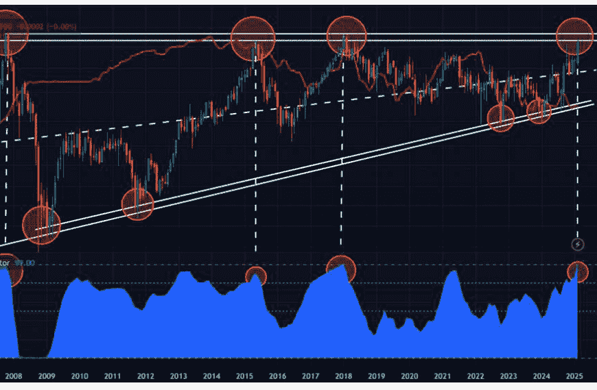
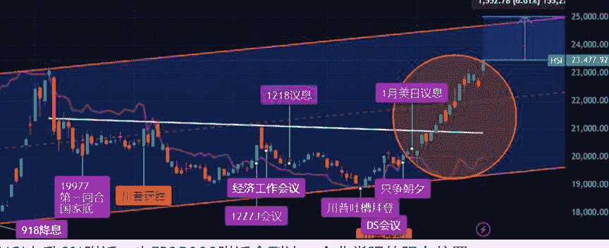
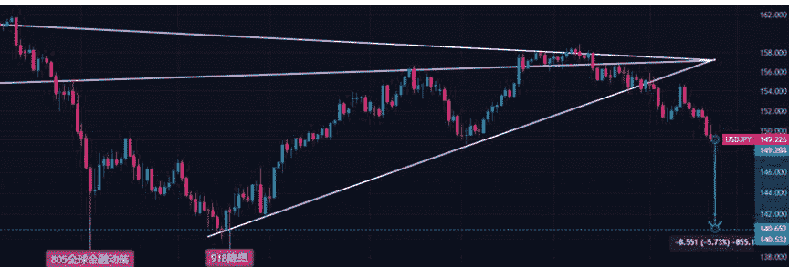
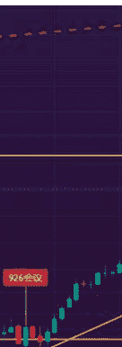
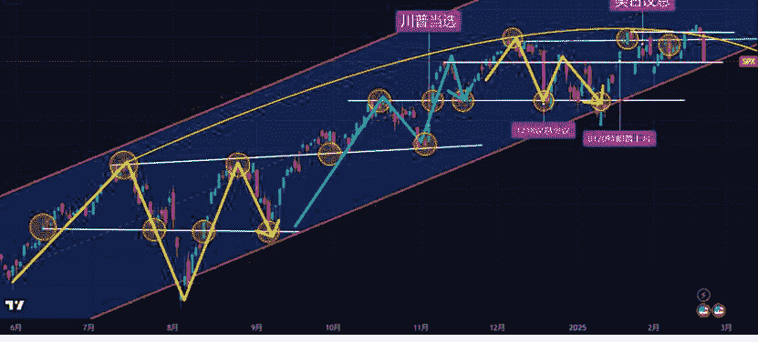
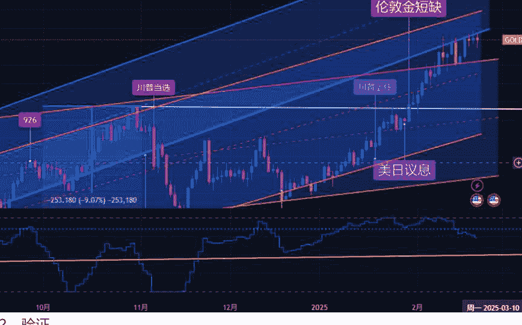
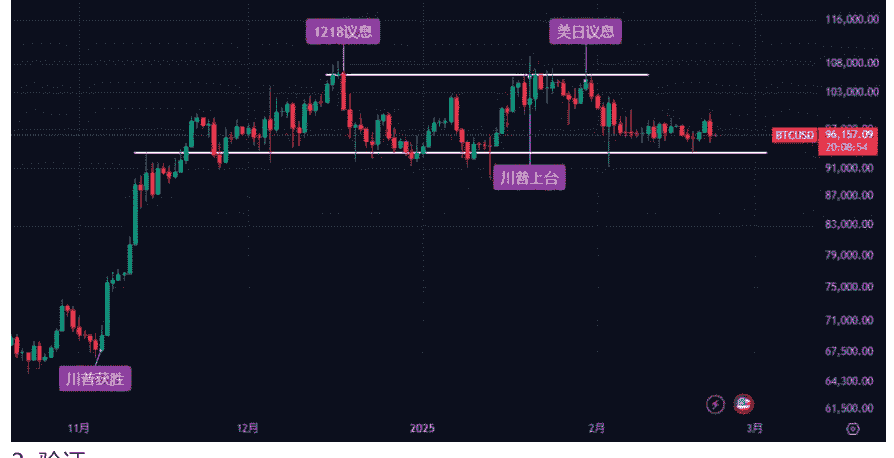
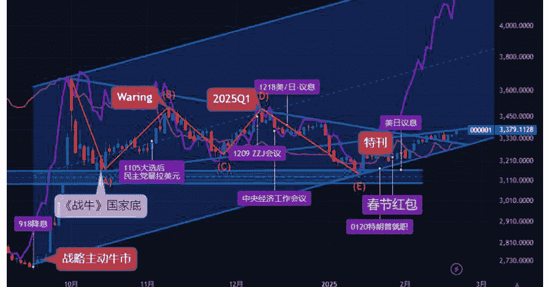
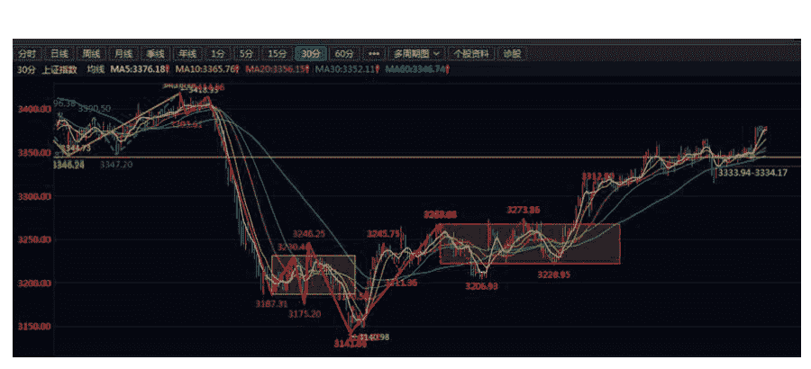
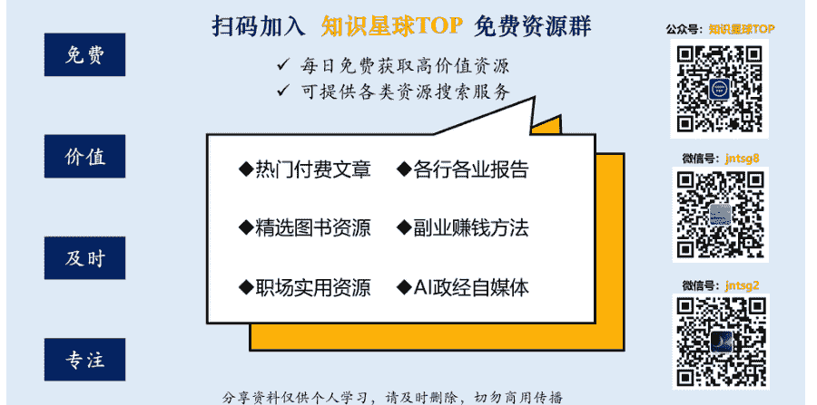

# 全球市场每周预测0224-0228

原创 财会计经理 金余通 2025年02月23日22:31

上周，判断全部正确。我们用了非常大的篇幅，讨论了巨大的美元指数背后市场的其中：U1和U2博弈的升级，上周对美元、美股、BTC、AH的分析也得到了验证，其中：现在在行情中吸引外资做AH的意图是比较强的，更是在座会议和我们的团队策略全场；“港澳银行内分”；周五人民币小高峰，一览无余。

从1月20日座会，到2月17日座会，我们发动了第二次攻击。针对订阅研报的读者，我们发布了《特刊》，按数字、云服务方向，第二周至今组合平均收益为：

2024年9月19日 凌晨03:00
2025-02-23 2025-02-22

| 收益率 | 收益额 | 总资产 |
| --- | --- | --- |
| 我的 | 上证 | 深度 | 创业板 | 沪深300 |
| 30.0% | 25.0% | | | |

2024年9月19日发《Q4》，截至2025年2月21日，收益至今已参与了2轮攻势，收益率为26.78%。

注意：请理解，客观预测并不非常精确时，因为时间区间内随机事件的影响会增大，此时我们只能能提前一些。这也意味着，我们还没有能力把一个波段做到收益最大化，风险只能能控制到局部。

## 2025Q1整体的预测：

1. 美股整体在1季度内完成洗销，概率为98%
2. 美股见顶转跌后很可能引发美国金融危机
3. 一旦金融危机爆发，会对所有资产产生负面影响。

## 设置风险控制指标：

1. 美元指数跌回106-高度预警 - 已触发
2. 最近在出现美元美股债同步向下溜 - 已触发

# 免费 价值 及时 专注

# 扫码加入 知识星球TOP 免费资源群

- 每日免费获取有价值资源
- 可提供各类资源搜索服务

| 热门付费文章 | 各行行业报告 |
| 精选图资资源 | 副业赚钱方法 |
| 职场实用资源 | AI政经自媒体 |

公众号: 知识星球TOP 微信信号: jntsg8 微信信号: jntsg2

分享资料仅供个人学习，请及时删除，切勿商用传播

近期市场波动带来了热情和更一致的预期，每一轮进攻的时候，涨期情绪开始抬头，回调后大市场实际上是被套的。同样，在两次调整均发生后，我们认为盯在AH期间顺便获利的阶段已经过去了，风险继续在积累，策略依然适用，但重要的是有警觉的意识，机会很多，最终落袋的是赚到的。

本周，我们将公开模型中的一个进行监控，只争争夺秒——为什么要争分夺秒？并以此，对第二轮攻防的空间、顶部位置和时间，做概率拆分。针对AH，涨跌是从属于博弈的动态过程，我们会给出一个简单的指标和相应的操作建议参考。

## 一、争争夺秒

主图以HSI*USDJPY，衡量2000年以后HSI的相对位置，这个指标刻画了2007、2015、2018三次HSI的大底部；

副图是调整过的MACD指标，配合主图作为验证。

具体原理，涉及到2000年以后全球政治格局的调整，以及美元金融系统的调整，限于本篇，在研报中开展。但结论是客观明显的——HSI现在的位置，从主图和副图来看，与2007、2015、2018的情况是非常接近的：

主图进入水平压力区域，副图进入上限区域。

请注意：

1. 指标帮助我们量化今天所在的位置以及接下来概率的将发生情况，且与《2025Q1》其他模型的分析一致；
2. 并不是要上行动，毕竟底部还可以上涨4%，才会达到25年阻力上限。

接下来的，我们分别看919以来的HSI和USDJPY:

USDJPY现在处于升值趋势，6%附近也即140附近可能发生去年8月5日引发的金融市场波动。回到HSI*USDJPY，在日元突破140以前，如果HSI可以冲到25000，那么按照22日的收盘价计算：23477.9*140≈25000。日本3月18日至19日再次议息，最近一次CPI已经确认了认为会加息，也即日元升值。我们在之前报中反复强调的“跟踪日元和股市的平衡”，这也是“只争夺秒”的第二轮进攻，是不是精彩。

## 二、全球资产策略

### （一）美元

1. 预测：美元将走弱，推动日元走强，风险继续积累。
2. 验证：正确的。美元走弱。
3. 下周：日本1月核心物价指数（CPI）：同比3.2%，创2023年6月以来的新高。日本1月全国物价指数（CPI）：同比4.0%，创2023年1月以来的新高。预测：日元会走强，美元走弱。

### （二）美股

1. 预测：美股走弱，并逐渐加速。
2. 验证：正确的。尤其是五末大跌，并落在支撑线上。
3. 下周：在AH，市场见顶的多数共识是“某一天”，但在美股，越来越多的股市见顶，然后DJX、NDX、SPX见顶。上图中，看到“白线”之间的距离越短，就像一个跳高，开始乏力了。预测：美股走弱。我们更坚持（2025Q1的预测）。

### （三）黄金

1. 预测：如果美元走弱驱动日元走强，在完成调整后，继续看多。
2. 验证：正确的。黄金走强再次测试压力。
3. 下周：2月18日马斯克说审计，2月20日财政部长宣布审计“所有黄金都到位”。金库自1937年以来积累了美国一半的黄金，两个风险控制指标启动，也就是美元债走弱的预期形成，加上马斯克的质疑和财政部观点有点“无银”，继续看多。

### （四）比特

1. 预测：空：维持判断，震荡走弱。
2. 验证：正确的。震荡走弱。
3. 下周：空：维持判断，走到这个截图看起来要对齐。

## 三、AH判断

### （一）上周回顾

1. 预测：多：现在行情吸引外资做AH的意图是比较强的。
2. 验证：正确的，恒生突破了10月前高。
3. 下周判断：HSI前面“争取回”已经经历了。接下来来看。紫色为HSI，红色为MS，相对而言，H强于AH。

AH得到了“战友”（政策）、汇率（金融）、第一轮进攻成果、DS情况，还有HSI牵引，倾向于看多，考虑到博弈的临近，机会应该出来了。

从技术分析的角度来看，大盘在30分钟级别出了a+横+b的结构，关键压力位3381/3418，关键支撑位3339和3314。

《特刊》和《研报》方向继续，可以参考以下对风险的观察指标：

1. 日元突破150，警戒，开始准备降低关注；
2. 日元突破145，降低，保持长短关注20至50%；
3. 日元突破141，降低，保持长线底仓的关注。

总体跟随日元回三角角，日越越高，仓位越低，例如：

| 日元 | 150 | 149 | 148 | 146 | 145 | 144 | 143 | 142 | 141 |
|---|---|---|---|---|---|---|---|---|---|
| 保守型 | 100 | 95 | 90 | 85 | 75 | 65 | 50 | 35 | 20 |
| 激进型 | 100 | 100 | 100 | 95 | 95 | 90 | 80 | 70 | 50 |

