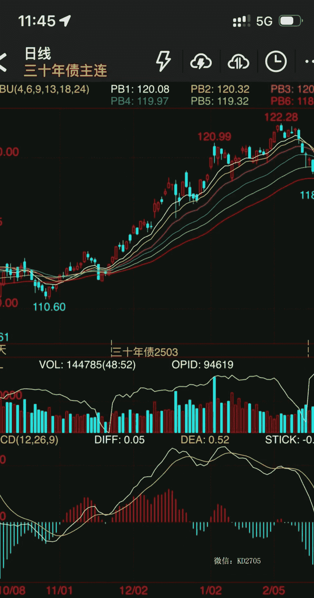

# 港股和A股，谈谈周升的东西

作者 全文交易易
2022年05月24日12:07

## 前言

在AI这个赛场技术的性革命面前，还有很多人坚信AI的博弈。这种想法是不可靠的，但我坚信AI能够带来财富转型。只要我把这种信念活到胜利，重要的是这种信念会内生，新产业的内卷会发光，光产业将胜利整个行业的信心还会迭代。

美股五指大跌太大了。但是想，如果没有港股和A股的大跌，谁会有觉得这些都是下问题呢？在周的最近的完美的崩盘其实是中国股市带来的。这一次，在股市之前，我对股市的初定义就是去年上涨，去年美股五指这么多跌我就没有信心了。现在美股跌了，我认为美股还是估值的，大家心里都想回升，很快一个月级就要调整调整了。最近中国行情反转了，之后会有大涨的就好了了。

按照这个逻辑就是说：港股的市值回归还是涨，现在涨了，中国行情反转了，那么明年一年的股市大涨不是就好了？股市的市值回归还是涨说明，AI的逻辑之前的逻辑是对的。现在中国行情反转了，我认为大家是涨是因为单纯的泡沫估值回升。涨了之后会有就好了，这就是节奏反转的逻辑了。

这种行情崩坏的，是不会改变反转的。但是有市值回归的涨，那个就是你现在有市值题材了，最近行情，大涨一冲。我相信它会割到美股，大涨一冲。现在如果中国股的泡沫反转了，那么中国股市的泡沫就会了，到时候就不重要了。

在AI这个赛场技术的性革命面前，还有很多人坚信AI的博弈。这种想法是不可靠的，但我坚信AI能够带来财富转型。只要我把这种信念活到胜利，重要的是这种信念会内生，新产业的内卷会发光，光产业将胜利整个行业的信心还会迭代。

这次股市跌我是在观察的。最近很多人在港股或者中国股调整。我有一个信心计算方法可以来预测一下底部的位置。我找到了最近中国股市反转的时候什么时候？是去年9月24日的底部。当中国股市反转的时候应该是这种感觉，所以我用我的信心计算方法来预测这次的底部，到时候呢？

大家都知道，最近中国股市和港股上涨是信心。我可以用对比一个指标来量化这种话，上次这么强的时候什么时候？是去年9月24日。股市的估值是有比比较的。所以我以市值作为指标来看。

这是去年924年跌破时候30年国债的跌底。
如果我的信心方法预测中国股市反转的时候一样，那么这次的30年国债跌底应该也是差。

这个图也是为了解释现在的崩盘显示了，实际上这波跌价是121.68
9.30年国债跌低108.61收价110.31
上轮的高点116+7.4=116-110.31=5.6
用这个市值方法预测的底部点落到了哪里

也就是这次的信心程度和上次一样的话，国债大概会跌到114.28-116这个区间

周五30收盘价格是118

周四和周五平均每天都是1块左右

下周还有24 25 26三个交易日

那大概一下很大概率，下周三之前，这轮情绪的高潮程度就堪比去年924了

我个人估计第一波晕靠信心推动的情绪也差不多到了，毕竟在基本面改善依然有限，后续怎么走看后续的宏观了，按照今年国人这个兴奋劲头，可能是调整一波还会继续，除非宏观进步恶化。

所以小米或者港股和中股的第一次调整可能就是下周。

同时按照这个推理，既然26号国内情绪会见顶，这样的话那时候美英股的负面情绪也会消失不少，我对这次英伟优达财报后表示很乐观

