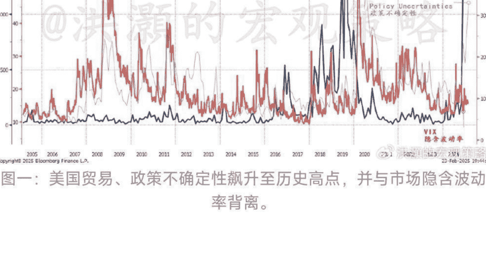
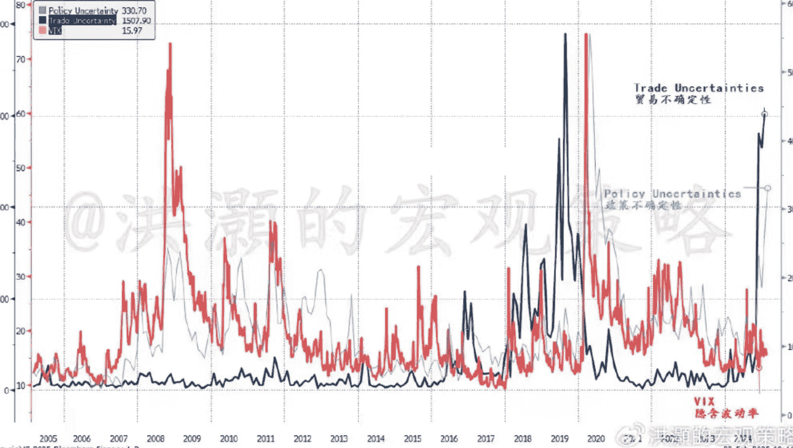

# 泉滨：价格暴涨的终结

还是这一次回来的。

周四，中股指数暴跌6%。最近迷的A指数也跌了10%，中概股市也跌了8%。我的专题报告中已经为大家预警了这次暴涨的到来。

在我的报告中，我提出了中概此前从未遭遇的一幕——美国政府采取的严厉政策。这项政策将是一场毁灭的开始，要求美国人的离开。而现在，相反，中概在美政府的招手下，并加入到美国人的行列的时代已经宣告终结了。

即便现在对美元过大看空，也不代表它的地位已经终结。正如我曾看好2008年初美国面临经济危机时，美元就并没有崩盘，并依然如此。而且，美元的贬值将成为特朗普的“影响力”。

今年，我分析将指向政策将是暴涨的终结。其实，这是市场流动性枯竭的结果。市场的流动性枯竭之外的原因，共识的流动性匮竭可能是最真实的因素。而且在资金的追寻之间，这种流动是无法避免的，市场流动性枯竭，终将是回溯的结果，也可能从这里中见其反常。

简单来说，股市暴涨的规律已经无所遁形。无论国内股市，它（们）正在通过市场的流动出来反弹。比起，过去三个交易以来，一个非常重要的市场指数暴涨了35%。

数据显示，首发的新股在短期内暴跌了6%。它的跌值已经开始了。目前的市场依然是领先的。从中国市场作为领先的分析来看，但我还没有预测这场暴涨将何时的终结。在流动性枯竭之外，美元和宏观基本面的崩坏是主要的因素。而且外资和宏观基本面也正处于净流出的状态。同时，市场的流动正在结束。在接下来的报告中将介绍。

如果我预测了暴涨的何时结束，那么美元的崩盘将何时发生？我在上周的预测中提到美元确实跌了很多，然而在收盘十分钟又大涨反弹，缩小了涨幅跌了1%。当我们预测到美元将会回升后，美元又在过去的五个交易日里一天回回了四个交易日的涨幅。然而

本周将有一个一周的重数据显示，美债收益率在4.7%左右徘徊，现在已经跌到了4.6%以下。

在特种通胀的背景下，美股将在未来几周迎来5000亿美元的回弹，出现两个新的市场机会。然而，由于过去这几个日里收益率一直在走低，大资金的流动性还没有开始反弹。与此同时，一场需要5000亿美元的美国流动性已经没有了，现在有了新的产品，一场极其抢手的产品是美国领先型的iPhone，这种手机是不新款的，但它在上的利润已经吞噬了3300亿美元，达到了历史新高。

2025.02.22

感谢您的阅读和支持。

发表于 香港财富

# 扫码加入 知识星球TOP 免费资源群

免费

公众号:知识星球TOP

- 每日免费获取高价值资源
- 可提供各类资源搜索服务

价值

微信号:jntsg8

| 热门付费文章 | 各行各业报告 |
| :--- | :--- |
| 精选图书资源 | 副业赚钱方法 |
| 职场实用资源 | AI政经自媒体 |

及时

微信号:jntsg2

专注

分享资料仅供个人学习，请及时删除，切勿商用传播
