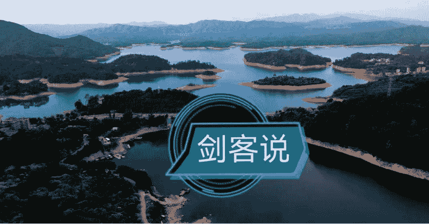

# 如何搞定你想要搞定的人？

创客1
2023-07-18 原文

+ 收录于合集
#投资笔记 220 个
#折叠付费 85 个
#成长系 12 个

这是我付费过的内容，和我一起看看。

## 前言

加微信jntsg2，免费进资料分享群

读者反映公司每月都要月度报告，季度，半年也是，事情都做了，但要花心思总结出来太难了，而且领导还喜欢每次都要不一样的东西，是很头疼，想请创创给点指导。

读者是投资顾问，日常工作就是去各地当地客户做路演的，每场路演市场都要考核他的投产，简单就是定了几个客户，能够覆盖市场投入的成本。

读者正在追求心恋人，对对方就是不冷不淡地应着，搞不清对方是否有意在考验你，不知道还要不要继续坚持？

这类的问题平时接到不少老老少，我并没有单独拿出来，今天就把其中的共性问题拿给大家讲一下。

你看到问题，不知道意识有没有没有，上述问题的“宗”是什么？

一切都是围绕“搞定人”开展的。

你领导如何做汇报是在搞定领导，你路演做介绍是在搞定客户，你谈恋爱是在搞定爱对象，你去面试是在搞定面试，你公司上市是在搞定二级市场的“韭菜”。

不同的，不同人的言行，会带来你不同的感觉，并且随着你搞定人的能力日益精进，你也会越来越幸福。

如果你也恰好碰见了搞定人的痛点，那么来看看这篇文章写给你的小“秘方”，将应用于让你搞定人的水平再上一层楼。

加微信ntgs2 免费进阶资料分享

闲话少叙，下面进入正题。

## 目录

- 一、创意
- 二、挑战
- 三、工具

### 一、创意

人类的大脑对新鲜的、不一样的刺激反应强烈，而同样的刺激，重复次数越多，反应也会趋于麻木。

既润人的天性讨厌重复，它让人厌倦。我们可以做点什么？

可以尽量做不一样的事，观点不一样的，追求不同的体验。快乐的真正意义者擅长使用不确定性的方式，整合多重维度的资源，解决具体问题的行动，并最终得到超出付出的收益。

在一个运作上的社会里，最重要的就是“创意者”了，因为我说过多次，你沿着旧跑，是永远找不到新大陆的。

任何一个没有创意的组织和个体，大概会被时代所淘汰，而一个优秀的组织的一大特征，就是能够批量产生“创意者”。

### 二、挑战

加微信jtsg2免费进资料分享群

在一个组织里大体有这四大类角色：

- 自律者（基层员工）
- 律他者（主管, 经理）
- 分配者（总监, 总裁）
- 信念者（创始人）

都需要具备“创意”的能力和认知。管理背后的真相，通常会遇到以下五个问题：

一、发现问题所在
二、没总结问题能力
三、没工具解决问题
四、方案呈现能力
五、方案沉淀计划

### 三、工具

#### 发现问题
工具：5Why追问，创新的来源：5Why 追问

#### 总结问题
工具：复盘四步法，头脑风暴：复盘四步法 头脑风暴

#### 掌握工具
工具：搜商、一抄二改三研发：搜商 快速迭代

#### 方案呈现
工具：5H2W汇报，PREP 结构表达

#### 方案沉淀
工具：做课，知识 IPO

今天主要要把落底的两个问题的工具讲完，即方案呈现和方案沉淀。

从人类几万年的发展历史中，我们比较容易看到的是推动人类发展的“生产力”水平的提升。比如从狩猎到游牧，从游牧到农耕，从农耕到工业化，从工业化到信息化，从信息化到人智能。

但是不能看到随着生产力存储能力的提升。游牧是对于“物”的存储，作物是对于劳动的存储，工业化是得益于存储，而信息化更是对经验的存储。一方面我们可以通过做课和知识IPO把经验积累下来，另一方面我们可以通过5W2H以及PREP，把储存下来的和知识呈现出来，做出更大的贡献。

先来讲方案呈现。先看一个经典报告。当年的“曼哈顿计划”，爱因斯坦向罗斯福写了一封信（加微信jtsg2免费进资料分享群）：

1939年8月日爱因斯坦给罗斯福写了一封信，全文如下：

总统先生，通过和罗斯福进行交流，最近的工作使我相信在将来，元素将成为一种新型能源。由此引起的许多问题需要提高警惕，如有必要的话，政府部门应当采取行动。因此我有责任提醒您关注以下事实和建议。在过去的几个月里，通过约罗斯福的工作，使用大量的元素建立链反应，从而产生巨大的能量和新型元素是可能的。现在基本认为将在不久实现。这种现象将引起原子爆炸，而且是有可能的，尽管还那么确定，威力巨大的原子因此可能被制造出来。这样一个原子弹，用船运输，将可能会实现。

对于你而言，这样的任务也许包括以下内容：

- 1，接近政府部门，熟悉未来的情况，并且提出建议，特别是关注获取铀矿的供应。（加微信ntsg2免费进资料群）
- 2，通过提供资金活动，解决目前预算有限的问题。假设有了资金，则通过愿意为这一事业贡献的个人联系，或者是具有必要设备的公司实验室进行合作。了解到国际上已经停止了铀交易，并对其接管。它已经采取这样的行动是可以理解的，根据政府部门的观点，在柏林凯森研究，而在那里活动一直在重复。阿尔伯特·爱因斯坦正是这封信促成了“曼哈顿计划”。为什么说这封信如此重要，以至于能够让罗斯福和整个决策层接受？这就是“报告”的力量，它搞定了罗斯福和整个决策层。这封信的结构符合5W2H的规律和PREP结构。5W2H分析法又叫7问分析法，是二战中武器制造的简单、方便、易理解、好应用。

- WHY：为什么？为什么要这样做？理由何？原因是什么？
- WHAT：是什么？目的是什么？做什么工作？
- WHERE：何处？在哪里做？从哪里入手？（加微信jnts2免费进资料群）
- WHEN：何时？什么时间完成？什么时机最宜？
- WHO：谁？由谁承担？谁来完成？谁负责？
- HOW：怎么做？如何提高效率？如何实施？方法怎样？
- HOW MUCH：多少？做到什么程度？数量如何？质量水平如何？费用产出如何？

PREP是结构表达的一种工具，来源于麦肯锡的电梯汇报。麦肯锡曾经为一家重要的客户咨询，咨询结束的时候，麦肯锡的项目人在电梯间偶然遇见了对方董事长，对方问麦肯锡的项目负责人：“你没有现在的结果吗？”这位项目负责人没有提前准备，即使准备了，当时的能力在电梯从30层到1层的30秒内把事情说清楚也做不到。最终麦肯锡丢失了这位重要客户。（加微信jntg2免费资料群）

之后麦肯锡要求员工要在最短的时间内把事情表达清楚，这就是如今在商界流传广的“电梯演讲”。PREP是由四个部分组成：

#### 第一步：观点 (Position)
开头就用一句话，简明扼要要说整个PPT的核心内容，例如希望领导原则上同意预算、确定时间、确定下一步计划。

#### 第二步：理由 (Reason)
在熟悉整个PPT内容和框架的基础上，把所有材料提炼成不超过三个理由，然后用简洁有力的语言表达出来。

#### 第三步：证据 (Evidence)
在理由部分，观点仍然是核心，所以理由的陈述要简洁直接。但在证据部分，最重要的是细节，必须要有动力、具体现象、数据翔实、效果明显等。

#### 第四步：重复观点 (Position)
结尾要求带有强烈的“行动导”。更明确，更能让领导做出决策，如希望领导同意预算、确定时间、确定下一步计划等。（加微信ntsg2资料群）

了解了5W2H以及PREP之后，我们再回头看爱因斯坦这封信，就可以知道为什么说服力有多强。先看5W2H是如何回答：

- WHY：为什么？为什么要这样做？理由何？原因是什么？
- WHAT：是什么？目的是什么？做什么工作？
- WHERE：何处？在哪里做？从哪里入手？（加微信jsg2资料群）
- WHEN：何时？什么时间完成？什么时机最宜？
- WHO：谁？由谁承担？谁来完成？谁负责？
- HOW：怎么做？如何提高效率？如何实施？方法怎样？
- HOW MUCH：多少？做到什么程度？数量如何？质量水平如何？费用产出如何？

这种现象将引起原子爆炸，而且是有可能的，尽管还那么确定，威力巨大的原子因此可能被制造出来。这样一个原子弹，用船运输，将可能会实现。对于你而言，这样的任务也许包括以下内容：

- 1，接近政府部门，熟悉未来的情况，并且提出建议，特别是关注获取铀矿的供应。通过资金加速实验。（加微信jnts2免费资料群）
- 2，通过提供资金活动，解决目前预算有限的问题。假设有了资金，则通过愿意为这一事业贡献的个人联系，或者是具有必要设备的公司实验室进行合作。了解到国际上已经停止了铀交易，并对其接管。

我们从PREP结构来看爱因斯坦信：

#### 第一步：观点 (Position)
开头就用一句话，简明扼要要说整个PPT的核心内容，例如希望领导原则上同意预算、确定时间、确定下一步计划。

#### 第二步：理由 (Reason)
在熟悉整个PPT内容和框架的基础上，把所有材料提炼成不超过三个理由，然后用简洁有力的语言表达出来。关于理由，爱因斯坦讲三个：
- 1，技术是可能的，现在可以确定将在不久的未来实现。
- 2，产品是有用的，这种新的现象将引导着原子弹的构造，并且这是可能的。
- 3，资源是足够的。（加微信jnts2资料群）

#### 第三步：证据 (Evidence)
在理由部分，观点仍然是核心，所以理由的陈述要简洁直接。但在证据部分，最重要的是细节，必须要有动力、具体现象、数据翔实、效果明显等。
- 1，论证技术可行：约奥在法国的工作，以及菲尔米和西拉德在美国进行的工作。
- 2，论证产品可用：威力巨大的原子弹因此可能被制造出来。这样的单一原子弹，用船运输，并在进口爆炸，将可能会摧毁整个区域以及周围的环境。
- 3，论证资源不足：有一些矿石在加拿大和捷克斯洛伐，但最好的铀资源是在刚果。

#### 第四步：重复观点 (Position)
结尾带有强烈的“行动引导”。更明确，更能让领导做出决策，如希望领导同意预算、确定时间、确定下一步计划等。在结尾，爱因斯坦说，他的任务也许包括以下内容：接近政府部门，熟悉未来的发展情况，并且给政府的工作提出建议，特别是关注获取铀矿的供应。通过资金加速活动，解决目前预算有限的大学实验室来进行的问题。假如有了资金，则通过和愿意为这一事业奉献的个人联系，或者是具有必要设备的公司实验室进行合作。

其实，这就是在重复一开始的观点：元素将成为一种新型能源。由此引起的很多问题需要我们提高警惕性，假如有必要的话，政府部门应当采取迅速的行动。所以，整个报告，爱因斯坦取的就是PREP的结构，这样才能明扼要，又结构清晰地把观点表达出来。所以即使是“原子能”做出的生产，如果没有好的“报告”，大概率不会成为决策者的优先选择。

上面说的这些是对各类决策者的，帮助决策者认识情况，以便他们快速得出决策。如果你是讲师，或者有意向通过分享打造个体IP，都要积累自己的作品，都会成为你职场中的底气。把工作经验积累成作品，可以在市场里带来很强的影响力。知识IP为什么更适合组织，因为这是在探索未知，帮助企业持续提升的能力。对于企业而言，第一步是提出问题，必须有一个真实的、高价值且有可能解决的问题。（加微信jnts2免费进阶资料）

理解这个问题遇到的障碍和挑战。围绕这个问题搜索领域的知识，然后生长出一棵关于解决问题的“问题树”。

#### 真实的问题
搜索引擎一样，如果输入的关键词不精确、太宽泛，就会导致问题无解。对于问题的第一个要求就是“真实”。

#### 提高价值的问题
这个要求也会很多人探坑，就是花费大量时间低价值的问题。当然任何问题都是有价值的，关键是和企业当前的需求联系。

#### 能解决的问题
很多问题，其实是不能解决的，比研发一个超过光速的飞船的问题，就不太有讨论的价值。第二步不是学习知识，而是要解决问题。出于强烈的认知性和好奇，在搜资料的时候，很多组织追求事无巨细，这样效率很低，因为永远无法看完所有的资料。往往搜集了很多，但是对于推动事情进展一点帮助都没有。正如一个人不可能走完一座大山的所有角落，聪明的探险者懂得做标记，下次再来，继续向终点进。整个过程以解决问题为最高标准。

持续明确：“这个知识对于解决问题有用吗？”“如果有用，是当下就有用吗？”“如果暂时没有用，做符号收藏到笔记里，以后再说”。一旦能解决一个问题，就要尝试多解决同类型的问题，逐渐让这个解决方案能够应对不同情境，自我进化。

第三步，输出倒逼输入。一方面，写作能把这些知识形成体系，更重要的是这个过程能兑换价值，让更多人才知道有这类问题的能力。这个动作能帮企业找到下一个更大的问题，以及更大的价值，形成迭代。这个循环能持续放大，带来一轮又一轮的知识跃迁。

到这里就给各位介绍了整个体系，分享的目的也是希望大家在遇到问题和挑战的时候，能打开一扇窗，推开一扇门，能给你们的人生更多可能。全文完！
