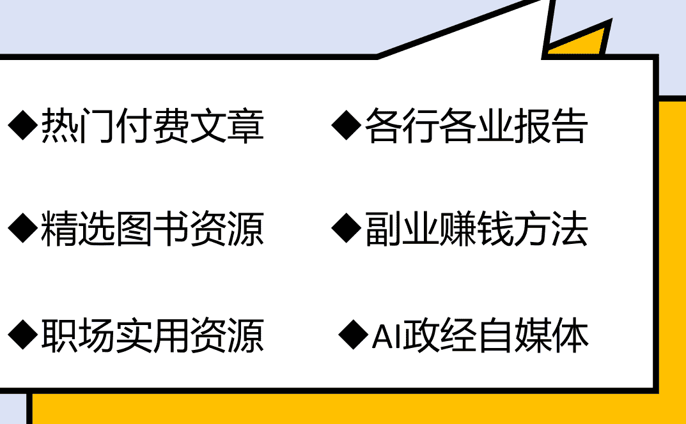

# 蚂和财富日报

在成年后，学会如何理财比努力挣钱更重要。掌握正确的理财思维，可以让你实现财富的自由。以下是几个最有效的理财技巧：

- 1. 建立一个理财目标：例如，设定十个理财目标
- 2. 制定计划：学会“先投资后消费”的思维方式
- 3. 坚持主义：理财是一个长期过程，不要指望一夜赚大富，而是通过长期投资来实现保值增值。

当然，理财并不难，关键的是你的心态和执行力。

# 蚂和财富日报

很多人认为理财是富人玩的游戏，其实并非如此。理财是每个人都应该学习的技能。只要掌握了理财方法，你也可以实现财富增值：

- 1. 留出备用金：至少留出3-6个月的生活费，以备不时之需
- 2. 资产配置：根据自己的风险承受能力，将资金在股票、债券、基金等资产间进行合理配置
- 3. 定期投资：通过每月固定投入资金，平摊成本，获取长期收益。

此外，理财需要学习和耐心，不要盲目跟风。

# 蚂和财富日报

理财不仅仅是为了赚钱，更是为了更好地规划生活。通过合理的财务规划，我们可以提高抗风险能力，让生活变得更加从容：

- 1. 记账：弄清楚自己的每一分钱的去向，减少不必要的开支
- 2. 风险控制：通过合适的保险工具，规避突发状况带来的财务风险
- 3. 投资自己：最好的投资永远是投资自己，不断提升自己的知识和能力。

总之，理财是一场终身的马拉松。

# 蚂和财富日报

很多人问，财富是如何积累的？其实，财富的积累背后都有着严密的逻辑。理解了这些逻辑，你就能找到通的密码：

财富的积累不是偶然的，它是认知、努力和执行力共同作用的结果。通过学习财富积累的逻辑，我们能够更好地实现财务目标：

- 1. 认知决定财富：你对财富的认知水平，决定了你能获取多大的财富
- 2. 复利的力量：时间是财富最好的朋友，长期的复利会产生惊人的效应
- 3. 执行力是关键：再好的想法，不付诸行动，也只是幻想。

希望这些建议能帮你离财富更近一步。

# 蚂和财富日报

在财富积累的道路上，很多人会遇到瓶颈。那么，如何突破这些瓶颈，实现财富的跨越呢？

突破瓶颈需要从思维上开始，重新审视自己的理财策略，寻找新的增长点。同时，不要害怕尝试，因为机会往往就藏在变化之中。最后，通过持续的学习和实践，不断积累财富：

# 免费 价值 及时 专注

## 扫码加入 知识星球TOP 免费资源群

- 每日免费获取有价值资源
- 可提供各类资源搜索服务

| 热门付费文章 | 各行行业报告 |
| :--- | :--- |
| 精选图书资源 | 副业赚钱方法 |
| 职场实用资源 | AI政经自媒体 |

公众号: 知识星球TOP 微信号: jntsg8 微信号: jntsg2

分享资料仅供个人学习，请及时删除，切勿商用传播
