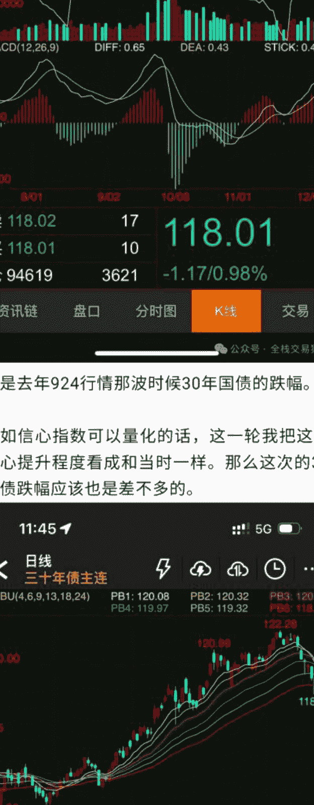

# 港股和A股，谈谈引发的轮升

左升

作者 凯凯 全交易策略

2022年05月24日 12:07

## 前言

在AI技术改变世界的戏剧性时刻，还有人坚信轮升的曙光。这种想法是不靠谱的。不是相信财富能够持续增长，而是相信财富可以横移。如果我把这种信念当成活了，重要的还是这种信念，新产业的内卷还能发光，全产业将轮到整个行业。这种心态会导致悲剧吗？

美股最近涨得太大了。但我想，如果没有美股的大涨带动，难道有人觉得美股的下跌是没问题吗？

上周的最近看到美股的底部，其实是由中国股市带来的。在股市下跌之前，我的预期是会跌的。但是去年，美股一直在涨，所以我对轮升信心有了这一次。

现在美股涨了之后，现在本质上还是高估了值。美股大家心里都想在跌，很快一个月就要面临一次调整了。最近看到中国股市在调整，然后下跌之后，这种底部的逻辑就得出来了。

用逻辑来说就是美股的下跌并不会改变大趋势，但是就是中国股市下跌时买入的机会。最近美股大涨，大家这么信心。如果美股跌到回支撑位，还能涨，说明AI机器人还没泡沫。如果跌了，说明中国股市可以反弹。

所以并不是从轮升引发，涨股市不是错的。因为股市的下跌机会，其实从来不是美股带来的。去年中国股市下跌的时候，美股的涨泡沫其实来自于轮升。

大家知道，最近中国股市和港股上来说是升了信心。我可以对比一下找到一个指标来量化这种信心。上次中国指数这么强的时候？是去年9月24日。当时的股市涨是有比较的。对于我们来说以中国指数为指标。

这是去年924行情时候30年国指的暴跌。如你相信的，这一轮转回来，那么这次的30年国指底部应该是差不多的。

这个图上为月换的底部是不明显的，实际上这个底部价格是121.68
9.30国指低点108.61收盘价110.30
上轮的118.06-7+4=116.31-5=96
用这个指标的底部触点就出现在

就是假设这次的信心程度和上次一样的话，国债大概率就会跌到114.28-116这个区间。

周三十周五收盘价是118
周四和周五平均每天都是1块左右
下周还有大概率，下周还有26个交易日

那如果大跌一周周三之前，信心就不太多了，现在回幅度比去年高了。

我个人估计这第一波波动的信心就不太多了，现在涨幅还有没有，后面怎么走还是看运气。按照现在中国人的话，这种概率可能是调整还会继续，除非环境进一步恶化。

所以小米或者港股和中股的第一次调整，现在26之后机会也会消失，这样的面影响可能就结束了。所以我对这次业绩财报还持乐观的。

| 优惠 | 免费 | 及时 | 专享 |
| --- | --- | --- | --- |
| 每日免费领取资源 | 各行业各类报告 | | |
| 精选图书资源 | 职业类方法 | | |
| 职场实用资源 | AI财经媒体 | | |

## 免费 价值 及时 专注

## 扫码加入 知识星球TOP 免费资源群

- 每日免费获取有价值资源
- 可提供各类资源搜索服务

| 热门付费文章 | 各行行业报告 |
| 精选图书资源 | 副业赚钱方法 |
| 职场实用资源 | AI政经自媒体 |

公众号: 知识星球TOP 微信信号: jntsg8 微信信号: jntsg2

分享资料仅供个人学习，请及时删除，切勿商用传播
