# AI 时代生存手册

秋叶
任泽岩
黄震炜
著


# 零基础掌握 DeepSeek

中国工信出版集团 人民邮电出版社
POSTS & TELECOM PRESS
加微信jntsg2，免费进资料分享群

# 免费 价值 及时 专注

# 扫码加入 知识星球TOP 免费资源群

- 每日免费获取有价值资源
- 可提供各类资源搜索服务

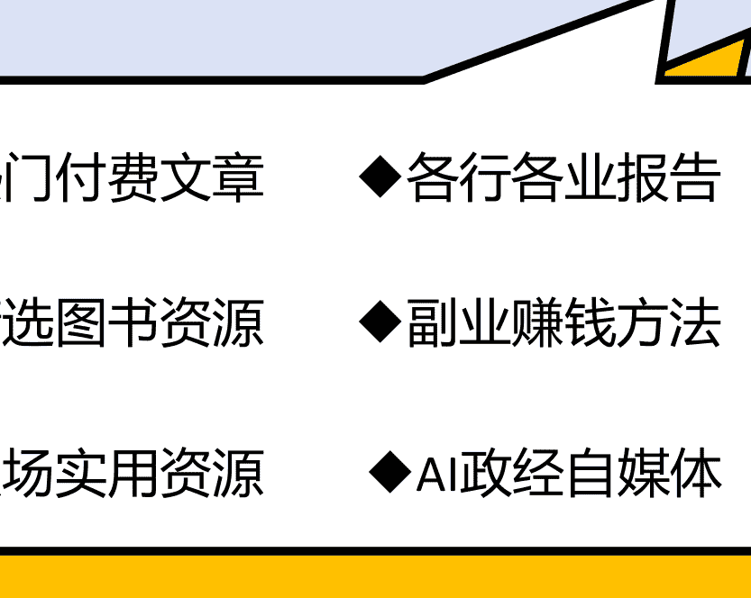

| 热门付费文章 | 各行行业报告 | 精选图书资源 | 副业赚钱方法 |
|---|---|---|---|
| 职场实用资源 | AI政经自媒体 | | |

公众号: 知识星球TOP 微信信号: jntsg8 微信信号: jntsg2


分享资料仅供交流学习，请勿转发扩散，严禁商用传播


# AI时代生存手册

秋叶
任泽岩
黄涛
著

# 零基础掌握 DeepSeek

中国工信出版集团 人民邮电出版社

加微信jntsg2，免费进资料分享群 ⊍微信

# 版权信息

书名：AI时代生存手册：零基础掌握DeepSeek
作者：秋叶;任泽岩;黄慷炜
出版社：人民邮电出版社
ISBN：9787115665201
字数：78万字

本书由人民邮电出版社有限公司授权得到APP电子版制作与发行
版权所有 侵权必究

加微信jntsg2，免费进资料分享群

# 内容提要

本书将带你深入探索AI“神器”——DeepSeek的无限可能，带你从零开始，轻松掌握AI的核心应用。

通过学习本书，你将轻松上手DeepSeek，开启智能生活新篇章；通过学习本书，你将学会DeepSeek大幅提升工作效率；通过学习本书，你将学会如何让DeepSeek成为你的职场超级助手；通过学习本书，你将学会如何利用DeepSeek激发自己的创作灵感，打造爆款内容和个人品牌；通过学习本书，你将学会利用DeepSeek解决各种专业难题。

无论你是职场精英、创业者，还是自由职业者，本书都能帮到你。本书不仅是个人竞争力的加速器，更是通智能时代的通行证。让我们一起行动，拥抱AI，解锁未来生活的无限可能！

加微信jntsg2，免费进阶资料群

# AI不是选择，而是生存

亲爱的读者朋友：

你好！在这个新的时代，我们经常听到一句话：“未来已来。”而今天，我想告诉你们，未来真的已经来了，而且正以一种前所未有的速度改变着我们的生活和工作方式。

你有没有发现，身边的人开始用对话AI，甚至用AI来解决问题？AI不是不可靠的高科技，而是实实在现在日常的生活中。它就像一把钥匙，为人们开启了通往更高效、更便捷的世界。如今，这扇门将会为所有人开启。那些使用AI的人，很容易在不知不觉中被时代悄悄淘汰。

世界经济论坛发布的《未来工作报告》预测到2025年，人工智能和自动化技术将在全球创造9700万个新工作岗位，但会取代8500万传统工作岗位。这意味着，未来将发生翻天覆地的变化，掌握AI将成为每个人生存的关键。

# AI：改变生活与工作的效率

工作效率对比：DeepSeek引发的效率革命

为了更直观地展示AI带来的工作效率的提升，笔者用深度求索（DeepSeek）开发的智能助手DeepSeek-R1准备了以下表格（见表-1），对比了使用DeepSeek和不使用DeepSeek的情况下，人们工作效率方面的差异。

表1 使用DeepSeek和不使用DeepSeek的情况下，效率的差异

| 任务类型 | 不使用DeepSeek | 使用DeepSeek | 效率提升 |
| --- | --- | --- | --- |
| 会议纪整理 | 60 分钟 | 5 分钟 | 提升11 倍 |
| Excel数据分析 | 30 分钟 | 5 分钟 | 提升5 倍 |
| PPT 设计 | 120 分钟 | 15 分钟 | 提升7 倍 |
| 文案撰写 | 45 分钟 | 10 分钟 | 提升3.5 倍 |
| 项目计划制定 | 120 分钟 | 30 分钟 | 提升3 倍 |

从表-1中可以看出，人们使用DeepSeek后，工作效率得到了显著的提升。人们节省了大量时间，可以用来做更有价值的事情，陪伴家人，学习新技能，发展良好爱好。

加微信jntsg2，免费资料分享

# 宝宝的高效生活：DeepSeek的神奇之处

有一个真实的案例。有一个一年岁的宝宝，名叫小李。她每天都为孩子添加辅食，研究各种食材配合与营养均衡。以前，她需要花费的时间去查找资料、对比方案，往往又要2小时才能确定一份合适的方案。这不仅让她不适，还占用了她陪伴孩子和处理家务的时间。

有一天，在朋友的推荐下，小李开始使用DeepSeek工具，之后，一切变得都不一样了。她尝试用DeepSeek来解决添加辅食的难题。当她在手机上输入了如下指令：

> “请为8个月的宝宝添加一份辅食方案，要求营养均衡，包括菜类、水果和肉果。”

不到30分钟，DeepSeek就生成了一份完美的辅食方案，包括食材清单、制作步骤和营养成分。小李惊喜地发现，这份方案不仅科学，而且非常实用。按照此方案准备食物，不仅节省了大量的时间，还让添加孩子变得轻松。小李感慨道：“以前需要2小时来研究辅食方案，现在只需要不到30秒，DeepSeek简直太神奇了！”

DeepSeek作为一款领先的AI，已经改变了人们的工作和生活方式。它就像一个私人助理，随时为你服务，帮你解决各种难题。如果你不用它，就相当于失去了一个巨大的助手，会在数字化的潮流中被淘汰。

# 开启AI时代战士

不过，不用担心，读完本书，你将学会如何使用DeepSeek成为AI时代战士——效率提升、成本减半。这本书不是晦涩的，而是接地气的、实用的指南。它手把手教你如何使用DeepSeek，从基础的操作到进阶技巧，学会如何用DeepSeek优化工作流程、提升效率。

无论你是初学者，还是那些已经在工作中使用AI的人，本书都能找到适合自己的内容。它会帮助你在AI时代中颖而出。

最后，我想说的是AI不是选择，而是生存。在这个快速发展的时代，不想被时代抛弃，就拥抱变化，掌握技能。本书是你的起点，让我们一起开启AI之旅，超越自己！

# DeepSeek成为你的私人助理

你好！在这个新的时代，AI以以前未有的速度改变着我们的生活和工作方式。DeepSeek作为国内的人工智能工具，为普通用户提供了极大的便利。它不仅是一个工具，更是连接与人的桥梁，帮助用户应对复杂任务，释放创造力，提升效率。

# 效率革命：从“996”到“99”

在职场环境中，我们往往面临复杂的任务。通过AI的辅助，DeepSeek能够自动处理大量重复性任务，将原本需要几天的工作缩短到几分钟。这种效率提升让职场人士从繁琐的任务中解放出来，拥有更多的时间去思考创造性问题，提高竞争力。

# 决策优化：从“经验驱动”到“数据驱动”

在工作中，质量直接决定成功。然而，决策往往依赖于经验和直觉，缺乏数据支持。DeepSeek强大的分析能力为职场人士提供了全新的决策工具。通过AI辅助，DeepSeek能够分析市场趋势、消费者行为等多种维度，生成详细报告，这种数据驱动的方法提高了决策的科学性，还降低了风险。

# 创造无限：从“工具人”到“创意大师”

在许多职场工作中，创造力的发挥受到个人资源的限制。DeepSeek的出现为职场人士提供了一个强大的助手。无论是写作邮件、设计方案，还是策划安排，DeepSeek都能提供更多支持，帮助职场人突破思维障碍，释放创造力。这种赋能让你真正成为了创意大师。

# 学习成长：从“被动接受”到“主动学习”

在快速迭代的环境中，持续学习和提升是每个人必须面对的挑战。DeepSeek不仅是一个工具，更是一个学习平台。通过对话，DeepSeek能够根据用户的需求和兴趣，提供个性化的学习资源和指导，帮助职场人掌握技能，提升竞争力。例如，一位程序员希望学习最新的编程语言，但面对海量的学习资源往往无从下手。DeepSeek可以根据程序员的基础水平和目标，提供合适的学习路径，并在实时的交互中指导。这种个性化的学习体验不仅提高了效率，还让职场人从“被动接受”转变为“主动学习”，在职场中保持持续竞争力。

# 协作：从“单打独斗”到“团队协作”

在现代团队，DeepSeek AI技术为团队提供了全新的工具和方式。无论是项目管理、任务分配还是团队调度，DeepSeek都能提供智能化的支持，帮助职场人高效完成任务。例如，一个部门经理需要协调多个任务和资源，传统做法是召开多次会议和不断沟通，DeepSeek可以通过智能管理系统自动分配任务、跟踪进度并提供实时的沟通。这种智能化的沟通不仅提高了团队的工作效率，还增强了团队的凝聚力和执行力。

# 职业发展：从“单一技能”到“多维能力”

在AI时代，职场的职业发展将会发生变化。DeepSeek通过提供多维能力的辅助，帮助职场人从“单一技能”向“多维能力”转型。无论是技术能力、管理能力还是创新能力，DeepSeek都能提供相应的资源和指导，帮助他们提升职业水平。例如，一位中层管理者希望提升自己的管理能力，面对复杂的管理和实践往往无从下手。DeepSeek可以根据管理者的实际需求，提供个性化的管理培训和指导，并通过AI模拟真实的管理场景，帮助中层管理者提升管理能力。这种多维能力的提升增强了职场人的竞争力。

# 未来展望：从“AI工具”到“智能伙伴”

DeepSeek的出现不仅改变了人们的工作方式，更预示着未来的形态。随着AI技术的不断发展，DeepSeek将从简单的工具逐渐融入人们的生活中，提供更加个性化和智能化的服务。通过分析工作习惯和兴趣，DeepSeek可以为你推荐合适的职业发展路径。

# 快速上手DeepSeek，只需4步

使用DeepSeek并不难，只需要4个按键操作就能快速上手这款强大的AI工具。

## 网页登录：好用的AI平台

通过网页端登录DeepSeek非常简单，只需3个步骤：

## 找到网址地址

在浏览器中输入网址进入DeepSeek登录界面。

## 完成登录信息

(1) 验证码登录：在网页对话框中输入电话号码，点击“发送验证码”按钮，填写收到的验证码后即可登录。网页版适合大多数用户，无需下载，以后打开浏览器即可使用，如图1-1所示。

(2) 微信码登录：在网页框中点击“使用微信码登录”按钮，便可以使用微信码登录到DeepSeek中。需要注意的是，首次使用微信码登录扫码后仍需绑定手机号，如图1-2、图1-3所示。

(3) 密码登录：点击界面的登录，输入手机或邮箱地址再输入密码即可完成密码登录。若未注册，可以点击“立即注册”按钮引导完成注册；若忘记密码，可以点击“忘记密码”按钮引导找回密码，如图1-4所示。

## 初次使用

完成注册后再进入DeepSeek网页，即可看到网页端DeepSeek的交互界面。此处可以看到官方设置的欢迎语：“我是DeepSeek，很高兴见到你！”如图1-5所示。


1-5 网页DeepSeek交互界面

# 我是 DeepSeek，很高见到你！

我可以帮你写代码、文档、写作各种内容，请把你的任务交给我吧


## 手机登录：随时随地解决问题

如果想在手机上使用DeepSeek，可以在官网下载安装DeepSeek应用程序，完成登录后即可在手机使用AI功能。无论是通勤路上还是外出办公，手机版都能让你随时获取支持，如图1-6所示。

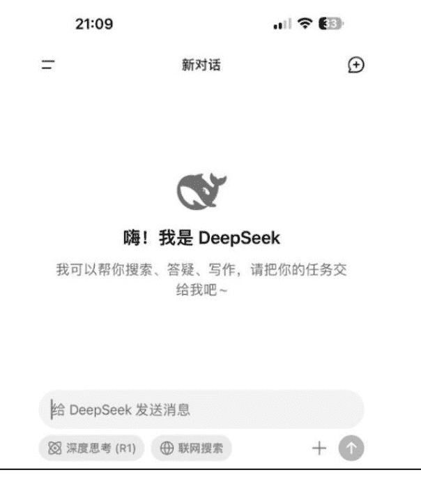
1-6 DeepSeek手机登录界面

## 开放平台

验证码登录 密码登录

您所在的地区仅支持手机号 / 微信 / 邮箱登录
+86 输入手机号
输入验证码
发送验证码
我已经阅读并同意用户协议与隐私政策，未注册的手机号将自动注册
登录
或
使用微信码登录

图-1 DeepSeek验证码登录界面


使用DeepSeek的第一步，是学会如何提出有效的问题。一个清晰、具体的指令能够帮助DeepSeek更好地理解你的需求，并给出高质量的回复。以下是提问的基本原则。

## 1. 明确目标

在提问时，首先要明确你想要完成的任务是什么。例如：“夏天，很热，我可以去哪些地方避暑呢？”

## 2. 提供上下文信息

如果有相关的背景信息或限制条件，记得提供给DeepSeek。例如：“暑假到了，我想带孩子出去，有水、有美食的旅行，不要爬山。”

## 3. 使用结构化提示

结构化提示可以帮助DeepSeek更精准地理解你的需求。例如：

- (1) 角色。你希望DeepSeek扮演角色？如“小红书博主”。
- (2) 任务。你需要完成的具体任务是什么？如“撰一篇推广文案”。
- (3) 目标。你希望的效果是什么？如“吸引年轻人群体”。
- (4) 限制条件。是否有字数、格式或风格要求？如“字数控制在500以内，风格轻松活泼”。

接下来就开始操作吧！在DeepSeek对话框中输入文字：

> 作为市场营销专家，帮我撰一篇推广智能手机的文案，目标用户是25~35岁的都市白领，要求突出健康功能和时尚的设计，字数300字左右。

通过这种方式，DeepSeek能够快速理解你的需求，并生成符合预期的内容，具体见图-1、图-10。

作为市场营销专家，帮我撰一篇推广智能手机的文案，目标用户是25~35岁的都市白领，要求突出健康功能和时尚的设计，字数300字左右。

已生成（耗时2秒）

以下是为您撰写了符合要求的文案，针对25~35岁的都市白领，强调健康功能、时间管理、工作压力、可能需要的工具，缓解睡眠不佳、久坐、眼睛疲劳等问题，随时、随地、可能为非技术人士的健康工具，也代表年轻人士。

健康是需要精心呵护的，心肺、血管衰老等基本功能，用户可能需要规律的休息，根据身体状态水平或提供建议。例如，在长时间工作后增加休息时间，或者通过脑操释放压力，选择进行运动。文案到此结束。

微信微信intjs52，免费进资料分享

## ▲ 图1-9 DeepSeek输入指令

“作为一名市场营销专家，请为我写关于智能手表的文案。目标用户总结几个技巧：在300字左右，清晰列出卖点，可以尝试多次，确保每个卖点直击痛点，标题要有吸引力，要幽默风趣。例如，如果想要吸引人的标题，需要使用不同的口号，例如【适用于都市的新款手表：XX智能手表开启你的时尚纪元】

在BCGO的写作中保持幽默，可以尝试用幽默吐槽压力，用现场吐槽：当都市的忙碌人，XX智能手表作为‘全天候监测’与‘移动单品’的双重身份，重新定义都市人的生活方式。

健康管理，比你想象的重要。接入医疗级×24小时监测系统，精准心率、血氧、压力等指标数据，找到“健康预警系统”：当连续超过50分钟，肌肉监测到异常，压力数据超阈，自动启动呼吸引导：持续时长不断，更能生成个性化方案，配合动态呼吸功能，让体检数据变成可视的健康资产。

色彩美学，一眼可见倾心


## 小练习

尝试向DeepSeek提出的第一个问题。你可以从简单的任务开始练习，例如“帮我写一封邮件，通知团队成员明下午3点开会”或者“为我的健身工作室设计一条朋友朋友圈文案，突出‘轻松松塑形’的理念”。

通过不断练习，你将逐渐掌握与DeepSeek高效的技巧，让AI真正成为你的“私人助理”。

加微信intjs2，免费进阶资料分享群

## 转转DeepSeek，从高效提问开始

在数字化时代，AI工具已广泛应用于人们的工作和生活中。DeepSeek作为工具的优秀代表，能够帮助用户提升效率、激发灵感。但不少用户困惑：如何让DeepSeek成为高效助手，实现精准、有价值的内容输出？关键在于掌握提问技巧。本章将从基础到进阶，全面介绍DeepSeek的方法。

### 获取高质量回复，学会DeepSeek

为什么别人用DeepSeek能输出漂亮文档，却总收到一堆“正确”的回答？答案很简单：提问的精度决定了AI的智能。本节将用三大法则、两大技巧一套拳，手把手教你。

### 深度模式：从“工具”到“导师”

平常我们用AI，是不是只是得到结果，却不知道结果怎么来的？深度模式就太厉害了，它像个耐心的老师，把问题一步步拆开，不仅给出答案，还把思考过程展现出来，就像给我们配备了一个专属“导师”，超级有用！

#### 场景1：快速处理复杂关系

我们需要对大量资料进行分析时，利用深度模式不仅能得出结论，还能清晰展示过程，方便与他人交流。当大量资料需要分析时，使用深度模式进行处理，仔细查看关键信息。案例：一家市场调研公司分析某新兴产品的文章，了解市场趋势、用户需求。使用普通模式和深度模式对比见表2-1。

| 模式 | 内容 | 收获 |
| :--- | :--- | :--- |
| 普通模式 | 快速产出新款电子产品 | 得到结论，深入了解市场趋势背后的原因，但在客户沟通时缺乏说服力，无具体分析依据 |
| 深度模式 | 先对文章进行检索、统计关键词出现频率，多次分析得出产品需求增长结论 | 清晰知道市场趋势，从多方面详细解释；在客户沟通时更具说服力，赢得更多机会 |

加微信intjs2，免费资料分享群

#### 场景2：助力提升思维能力

在工作中遇到难题时，借用深度模式的推理过程，总结方法并应用到类似问题中。案例：小李是公司的新人，负责策划一款食品方案。他要分析市场上同类产品的优点，但毫无头绪。表2-2展示了他使用普通模式和深度模式分析得出的结果。

| 模式 | 内容 | 收获 |
| :--- | :--- | :--- |
| 普通模式 | 直接给出同类产品优点结论，没有具体分析 | 能够依据结论做出决策，忽略自身兴趣爱好等重要因素，这样可能做出不符合实际情况的选择，影响创业和长期经营意愿 |
| 深度模式 | 综合考虑选址、周边消费群体喜好、原材料成本、设备采购费用信息，分析出店从商业收益优势 | 不知道具体结论，可以结合AI对咖啡的兴趣爱好和专业知识，做出更符合个人实际情况的决策，增强创业收益的影响程度，提高创业成功率 |

加微信intjs2，免费资料分享群

#### 场景3：提供决策的依据

决策者在商业决策时，DeepSeek深度模式能为其提供全面分析，帮助决策者根据实际情况做出合适选择。实用技巧：做决策前，将相关信息输入DeepSeek深度模式，仔细展现其分析和推理的过程，并结合自身经验寻求判断。案例：小张创业饮品店，在奶茶和咖啡店之间犹豫不决。他把店铺选址、周边消费群体喜好、原材料、设备采购等信息输入DeepSeek深度模式。表2-3展示了他使用普通模式和深度模式得到的结果。

| 模式 | 内容 | 收获 |
| :--- | :--- | :--- |
| 普通模式 | 直接给出奶茶店收益更高的结论，未展示分析过程 | 能够依据收益结论做出决策，忽略自身兴趣爱好等重要因素，这样可能做出不符合实际情况的选择，影响创业和长期经营意愿 |
| 深度模式 | 综合考虑选址、周边消费群体喜好、原材料成本、设备采购费用信息，分析出店从商业收益优势；还清楚其背后的推理依据 | 不知道奶茶店收益的结论，可以结合AI对咖啡的兴趣爱好和专业知识，做出更符合个人实际情况的决策，增强创业收益的影响程度，提高创业成功率 |

加微信intjsg2，免费资料分享群

## AI三大基础法则：让AI懂你的需求

指令模糊意味着低质量输出，精准指令意味着“开挂级”的生产力。身为职场创作者，你是否曾有这样的困扰：DeepSeek帮你得到的却是毫无价值的内容。问题在哪里？掌握精准技巧，让AI明白需求，产出高质量结果无疑是提升效率的关键。接下来我们将教你如何让AI懂法则。

### 法则一：给细节

给细节越详细，AI的结果就有针对性。错误示例：输入模糊提示词“写产品”，这样AI生成的长报告，毫无重点。正确操作：使用细节模板，如【目标】+【具体领域】+【结构】。实践对比：模糊指令与精准指令生成效果，具体如表2-4。

| 指令类型 | 指令内容 | 得结果 |
| :--- | :--- | :--- |
| 低效指令 | 写个招聘 | 模板化的内容，缺乏针对性和吸引力 |
| 分步指令 | 第一步：列出招聘包含技术栈、团队文化方面的核心模块 | 核心招聘岗位描述 |
| 第二步：为“区块链开发工程师”岗位设计“模块化”带有“模块文化”的描述 | 开发工程师岗位相关描述 |
| 第三步：将以上内容整合成为500字以内的招聘方案，吸引候选人 | 符合要求，包含特定内容且具有吸引力的500字以内文案 |

加微信intsg，免费获取资料

### 法则二：给人设

角色设置越清晰，给出的回复越贴合需求。错误示例：输入简单的提示词“营销帖”，得到的只是泛泛而谈，没有重点。正确操作：使用人设模板，如【角色】+【具体任务】+【输出要求】。实践对比：模糊指令与人设指令生成效果差异，具体如表2-5。

| 指令类型 | 指令内容 | 得结果 |
| :--- | :--- | :--- |
| 不带人设指令 | 分析竞品 | 泛泛罗列，缺乏独特视角 |
| 带人设指令 | 你是一位【科技分析师】，请你对市场上热门款进行全面分析并以【表格格式】呈现 | 简洁地呈现热点、多维度的关键信息 |

加微信int5g2，免费资料

### 法则三：给舞台

给AI分步指令，让它产出更有落地价值的内容。错误示范：使用简单指令“写营销方案”，结果AI堆空洞理论。正确操作：分步落实，例如：
- 第一步：总结2024年社交媒体五大爆发
- 第二步：筛选最适合“智能家居”的3个元素
- 第三步：设计一套执行计划，包含目标、预算分配和预测

实践对比：模糊指令与分步指令生效，具体如表2-6。

| 指令类型 | 指令内容 | 得结果 |
| :--- | :--- | :--- |
| 低效指令 | 写招聘启动 | 模板化的内容，缺乏针对性和吸引力 |
| 分步指令 | 第一步：列出招聘包含技术栈、团队文化等核心模块 | 核心招聘岗位描述 |
| 第二步：为“区块链开发工程师”岗位设计“模块化”带有“模块文化”的描述 | 开发工程师岗位相关描述 |
| 第三步：将以上内容整合成为500字以内的招聘方案，吸引候选人 | 符合要求，包含特定内容且具有吸引力的500字以内 |

## AI指令两个实用技巧：让AI成为你的强大脑

写文案时没感觉、设计没思路，这些事常让你感到焦虑？别担心，只要你掌握教学和逆向引导这两个技巧，就能轻松开启AI的创意大门。想知道如何用它们挖掘AI的创意源，让灵感不断吗？下面为你详细介绍，帮你突破创意瓶颈。

### 技巧一：教学——用AI擅长的“像素级模仿”

给AI提供明确的参考案例并添加指令，就能让AI产出风格统一、符合需求的内容。万能模板：仿照风格，【某某事件】。使用效果如表2-7。

| 指令类型 | 指令内容 | 指结果 |
| :--- | :--- | :--- |
| 无示例指令 | 为国庆节写5篇文章标题 | 《国庆快乐》《国庆怎么过》《国庆风格》《国庆小知识》 |
| 有示例指令 | 仿照案例风格，为国庆节写5篇文章标题 参考案例：《以奋斗之姿，延续时代华章》 | 《以爱之情，点燃国庆华章》《用赤诚之心，共筑国庆盛景》《民族之魂，擎国庆强音》《以使命之志，礼赞国庆佳节》《集团团结之力，同筑国庆辉煌》 |

### 技巧二：逆向引导——让AI为你提供更多问题思路

让AI帮你梳理关键问题，理清某事件的需求描述思路。万能模板：我【某某事件】，但不知道如何描述需求，请列出5个关键问题帮我理清思路。使用效果如表2-8。

| 场景 | 指令 | AI反馈 |
| :--- | :--- | :--- |
| 产品经理 | 我要优化功能 | (1) 用户当前对主要的痛点是什么<br>(2) 竞品中哪些功能可以被<br>(3) 功能是否达到医疗级标准<br>(4) 如何将数据可视化提升<br>(5) 是否需要加入个性化建议 |
| 运营 | 我要在策划活动 | (1) 目标群体对兴趣点在哪里<br>(2) 在同类型中活动有哪些<br>(3) 活动预算支持<br>(4) 如何提高参与性<br>(5) 怎样利用活动提升留存 |

## 场景：AI反馈

| 场景 | 错误/模糊 | 正确/精准处理 | 原理 |
| :--- | :--- | :--- | :--- |
| 职场 | 提取2024年Q | 采用“类目+规格”的逻辑 | 指令式：【任务主题】+【具体要求】（时间、平台、格式） |
| 能源 | 新能源行业报告 | 明确需求、平台、分类维度 | 指令式：【任务主题】+【输出格式】 |
| 市场 | 整理市场数据 | 类维度类型，其中“类目”等 | 输出新能源行业报告 |
| 输出 | 输出未清晰 | “规格”涵盖时间、平台、分类维度等，“禁忌”为想要的结果（如平台、分类维度等） | 输出为Excel表格 |
| 选择 | 选择的表格 | 识别3个主题，高频关键词并纠正 | 输出清晰 |
| 生活 | 生成一份杭州苏州菜攻略 | 同样基于“类目+规格”逻辑 | 指令式：【任务主题】+【具体要求】（时间、场所、餐饮、行业格式） |
| 推荐 | 推荐活动场景一份 | (1)包含2个产品和场所 | 明确需求，其中“类目”是子类目，“禁忌”覆盖 | 案例应用：任务主题是生成本地活动 |
| 大众化 | 大众化清单 | (2)餐厅有<100个 | 生成天数、场所、餐饮、行业格式 | 杭州苏州菜攻略；行业格式 |
| 创业 | 设计品牌（背景）、主输出 | (3)用相同格式请求，“禁忌”是非需要的个性化处理 | 指令式：【背景信息】+【任务要求】（差异化特征） |
| 业务 | 输出面子，主输出未领先的词号 | 为AI提供背景、差异化及范例等信息，使其符合需要 | 【参考案例】案例应用：Z版本的品牌；差异化特征为 |
| 案例 | 新品牌等词 | 需要10字以内的字号（限制） | 案例：“中国式视觉·莱纳风格”（案例） | “传统+科技”；任务要求是10字以内；参考案例为知名品牌口碑 |

| 场景 | 错误/模型提问 | 正确/精准提问 | 原理 | 指令式及案例应用 |
| :--- | :--- | :--- | :--- | :--- |
| 运营人员 | 如何写提示词->输出用模型 | 我研究‘AI制造业的影响’，已收集了50篇中文文献（基础），转化技术技能升级一项对模型框架（输出），列表对学生的核心观点（点） | 向AI提问框架（基础），已有基础、案例框架和输出格式，使其输出符合逻辑的内容 | 指令公式：【研究背景】+【已有基础】+【框架要求】：输出案例应用：研究背景是‘AI对制造制造业的影响’；已收集50篇文献；转化模型框架要求：输出为列表对学生的核心要点 | 指令公式：【任务主题】+【输出格式】+【具体要求】（时间节点、主产品维度等） |
| 学生 | 分析活动流程长->输出步骤一 | 用目的展示活动6_18活动 | 按阶段节点、时间节点、步骤节点、产品量、按用性，使AI输出更具针对性 | 将格拆解为‘准备-执行-检测（UV）转化率对比’ | 指令公式：【任务主题】+【输出格式】呈现形式、关键内容标注案例应用：任务主题是结论实验步骤：4个阶段；输出步骤包含阶段呈现形式和关键字段应用目标标签 |

加微信intgs2，免费获取资源分享


# 初级提问 追问策略 指令公式及案例应用

| 场景 | 行业研究报告 | 初级提问 | 追问策略 | 指令公式及案例应用 |
|---|---|---|---|---|
| | | | 指令公式（以 Step1 为例）：【基于原文问题相关内容】+【补充特定数据/信息要求】 |
| | 智能分析数据 | 智能安防设备在 | Step1：补充 2024 年案例应用：，Step1：【基于原文问题相关内容】是智能 |
| | 家居市场 | 家居市场趋势的智能安防设备，【补充特定数据/信息要求】是 2024 年、|
| | 市场趋势、沉淀概述 | 三线城市的渗透率 | Step2：列举 3 家三线城市渗透率 |
| | | | 区域型企业的渠道下 | Step2：【基于原文问题相关内容】（智能家居市场企业策略）+【列举特定企业的区域型企业渠道】 |
| | | | Step3：用 SWOT 模型特定策略要求】（3家区域型企业下沉策略） |
| | | 对比海尔与小明的生态差异 | Step3：【基于原文问题相关内容】（智能家居企业生态布局】+【用特定模型对比特定企业差异要求】（用 SWOT 模型对比海尔与小明的生态差异） |

加微信 jntsg2，免费进阶资料分享群

# 场景 初级提问 策略 指令公式及案例应用

指令公式：【针对 AI 原生的应用场景】

职场 AI 建议“提升落地性”但未给出落地方法

请针对母婴群体，+【具体方案形式要求】+【限制条件（如计划一套“签到+预算”）】

用户产生内容（UGC）案例应用：此案例中，【针对母婴群体，本方案要“奖励+活跃”的用户的应用场景】，黏性提升方案，格式要求】是“签到+用户产生内容（UGC）奖励+活跃”提升方案，预算不超过 5000 元/月

创业者希望降低成本，提高转化率

如果想让信息投放，想要用户活动增长，可能影响底部风险？列出 3 种改进的成本/转化率。假设参与率约为 5%，请给出适用方案

指令公式（以第一个提问例如）：【基于问题的解决方案设定】+【询问该设定可能产生的风险/影响】

案例应用：【基于问题的解决方案设定】是若想让信息投放想要用户活动增长，【询问该设定可能产生的风险/影响】是可能的风险

第二个提问：【基于问题的解决方案设定】+【针对特定变异及预估要求】【3 种改进的变异及转化率预测]

第三个提问：【基于问题的结果设定（活动参与率 5%）】+【询问应对结果的方案给大家给出适用方案】

在各类场景中灵活运用技巧，充分发挥 AI 的优势，为我们的决策和执行提供有力的支持，AI 更好地服务于我们的工作和生活。

## 3. 整合：从“AI 碎片”到“知识晶体”

AI 输出若不整合，将难以泛化。

整合碎片化的信息转化为高价值的“知识晶体”，提升 AI 的可用性。

(1) 信息蒸馏，提取“高浓度结论”。在利用 AI 获取信息的过程中，原始信息往往包含大量冗余内容，“信息蒸馏”显得尤为重要。它需要从碎片的 AI 生成内容中提取“高浓度结论”，将其转化为更具价值、更方便使用的信息。从事实学习、餐饮活动策划、职场汇报等多个场景，详细介绍信息蒸馏的具体应用和显著效果。

表 2-11 信息晶体的应用和显著效果

加微信 jntsg2，免费流量资源分享

| 场景 | 原始输出 | 整合步骤 | 整合后结果 |
| --- | --- | --- | --- |
| 学术场景 | AI 生成报告 | (1) 排除重复论述（如不同文献对同一概念的相似性定义），删除过时数据（如 2018 年以前） | 最终输出 |
| 大量重复 | 30 年前的行业报告 | | 一份 8 页的 |
| 观点和非合规 | 核心数据 | 文献综述 | (2) 重构：按“理论派vs实践派”的对立 | 综述、结构 |
| | | 内容重组，理论聚焦“AI逻辑的哲学争争” | 清晰、重点 |
| | | 庞杂，认为（如回归树的“黑箱问题”）；实践派 | 突出、可直接 |
| | | 合规指引、微软 AI 原则 | 接用于论文 |
| | | (3) 强化：在争议点引入研究假设“现有 | 开题答案 |
| | | 研究视域中小企业的实践困境，本研究将探 | | |
| | | 索“低成本理论工具箱”的可行性 | | |
| 餐饮活动 | 策略 A：包含 | 将 AI 输出的策略进行跨界融合，推出“联合 | 吸引顾客的 |
| 策划 | 员工折扣 | 周边健身房推出“卡路里兑换计划”；会员消 | 同时、借助 |
| 场景 | 策略 B：行业合作 | 耗 500 大卡可兑换指定菜品，同步在抖音 | 抖音直播扩 |
| | | 播健身挑战赛” | 大影响力，提 |
| | | | 提升效果 |

加微信 jntsg2，免费资料分享群

| 场景 | 原始输出 | 整合步骤 | 整合后 |
| :--- | :--- | :--- | :--- |
| 职场 | 纯AI输出 | (1) AI生成数据图、竞品案例、行业趋势 | 人机整合版为直击痛点提供决策支持 |
| 报告场景 | 数据推断 | (2) 人工介入：a. 插入内部业务调查；b. 用“问题”+行动+“结果”结构串联逻辑；c. 补充 | 报告、逻辑清晰、重点突出、满足需求 |
| | 无重点 | 加强对关注的风险预测 | 满足领导需求 |

(2) 跨界融合，创造“想不到的连接”。跨界融合是一种全新的思维方式，通过不同领域、看似不相关的元素巧妙融合，创造出令人惊人的效果，带来全新的价值和体验。在多个职场和生活场景中，这种融合都展现出了巨大的潜力，具体如表 2-12 所示。

| 场景 | AI 输出 | 整合创新 | 最终结果 |
| :--- | :--- | :--- | :--- |
| 餐饮行业 | 策略 A: 联合周边健身房推出“卡路里兑换计划” | 消费满 500 大卡可兑换指定菜品，同步在抖音直播健身挑战赛 | 吸引了健身爱好者和餐厅关注，增加流量，同时 |
| 策划场景 | 策略 B: 行业合作 | 消费满 500 大卡可兑换指定菜品，同步在抖音直播中 | 抖音扩大了活动影响力，提升了餐厅名度 |
| 文旅行业 | 方案 A: 景区，将景点串联起来 | 打造“美食之旅”景区，游览过程中当地特色美食 | 吸引更多客户访问，提升旅游知名度和体验，带动了当地旅游 |
| 宣传场景 | 方案 B: 美食推荐 | 通过短视频进行打卡互动，奖励赢取当地纪念品 | 带动了当地餐饮的发展 |

加微信 jntsg2，免费资料群

| 场景 | 建议 | 整合创新 | 最终效果 |
| --- | --- | --- | --- |
| 教育行业场景 | 建议 A: 知识竞赛 | 举办“历史穿越”活动 | 激发了学生的兴趣，提高了学习能力和理解能力 |
| | 建议 B: 小组讨论 | 编写历史主题，融入学科知识 | 创造了活跃的课堂，达成了团队协作 |
| 家居生活场景 | 方案 A: 简约家具配色 | 将简约风格与功能性收纳相结合 | 打造美观又实用的家居空间，满足了业主个性化需求 |
| | 方案 B: 欧风色彩 | 采用简约风格搭配 | 丰富了个人艺术感 |
| 个人兴趣场景 | 技巧 | 利用制作立体装置（如聚光灯） | 创作出独特的作品，丰富了工作，带来了新的价值 |

(3) 跨界协作，让 AI 当当“驾驶员”。在职场环境中，成为提升效率的关键。让 AI 当当“辅助者”，辅助人类完成复杂任务，尤其在整合场景中，能够挖掘出巨大价值。通过合理数据收集与分析，人类深度加工，两者协同，产出超出单一的能力。以下以职场汇报为例，详细描述协作优势及差异，具体如表 2-13 所示。

表 2-13 人机协作示例

| 场景 | AI 生成内容 | 人工执行内容 | 纯 AI 输出 | 人机整合效果 |
| :--- | :--- | :--- | :--- | :--- |
| 项目进展 | 项目完成度 | 关注问题的分析 | 数据图和案例汇总，没有突出问题 | 形成一份结构清晰、重点突出的报告，能够直观了解 |
| 行业发展 | 结构梳理 | 关注问题的解决 | 调研，可能导致偏离等关键因素 | 包括问题的结果，同时有清晰认识，便于及时做出调整 |
| 市场定位 | 插入特征 | 结构化处理 | 无法快速处理复杂情况，不利于决策 | 生成一份具有针对性和操作性的报告，突出了方案，同时引导领导关注风险 |
| 市场增长趋势 | 结构化处理 | 预期效果 | 内容零散，没有遵循自身需求进行分析 | 无法为公司提供决策有效依据 | | |
| 市场策略 | 引入行业介绍 | 增加竞争份额、新渠道政策变化预警 | | |

关注 jntsg2，免费获取资料

| 场景 | AI 生成内容 | 人工输出结果 | 人机整合效果 |
| :--- | :--- | :--- | :--- |
| 年度总结 | 年度业务数据、图表、行业对比、发展趋势预测 | (1) 深入分析业务增长或下降的原因、流程优化、团队建设等方面的调研<br>(2) 按照“过去一年在业务运营中的关键问题和改进最终取得的成就”逻辑组织措施、解决方案<br>(3) 加入宏观环境演化、政策调整等可能影响未来发展的预测 | 仅仅是数据和案例的堆砌，不能体现业务运营中的关键问题和解决，帮助公司制定下一年的发展规划 | 形成全面、深度的工作总结，清晰呈现公司的发展成果，同时为预防提供帮助 |

指令自查清单：

(1) 是否运用模式。针对复杂问题或重要决策，检查是否运用 DeepSeek 思维模式研究分析过程，帮助自己输出更好的判断。

(2) 是否提供足够的细节。指令中有明确【目标用户、【领域、【输出结构】等关键词信息，避免出现“写文章”这类模糊指令。

(3) 角色是否清晰。是否为 AI 设定了清晰的角色如，“科技评论家”、“专业产品分析师”等，让 AI 精准匹配需求，而不是泛泛而谈。

(4) 复杂任务有无拆解。对于复杂任务，有没有像“营销文案”那样分成多个步骤，为 AI 搭建平台以获取更高价值的内容。

(5) 有无参考示例说明。指令中是否有参考示例，利用“仿照样例格式”的方式，让 AI 输出统一、符合预期的结果。

(6) 是否综合输出组合。是否使用了追问和整合的各种方法，让 AI 输出更加具体、能解决问题的方案。

微信 jts2，免费运营资料

## 六大万能演讲模板，各类场景畅通

平时写稿时，你是否总在“空白”和“亮点”之间反复横跨？

DeepSeek的“结构化提问”，能让你在3分钟内输出具有高度又接地发言框架。本节通过六大模型，手把手教你如何用 AI 重构写作难题。

### 2.2.1 框架指令：搭建发言框架

在职场中，无论是聚会演讲还是项目汇报，一份好的发言框架都能让人留下深刻印象。然而，很多人在写发言稿时，往往找不到开头，写出来的内容要偏离主题，要又要重点。这时，框架指令就能派上大用场了。它通过明确背景、目标和要求这三个要素，帮你建立起发言框架，让你的发言更有针对性。

这就好比你准备了一个锚，背景是客户的口味和习惯（背景），目标是让客人吃满意（目标），要求就是不要太大的。

1. 包含要素

(1) 要求：背景。你需要告诉 AI 你的背景，就像给观众设定场景，就开始进入状态。

(2) 目标：明确你希望达到的效果，让发言更有针对性。

(3) 要求：设定一些指引性的要求，或者加入具体的实例。这些要求能防止发言偏离轨道。

3. 参考示例

(1) 要求：背景——虽然今年营收增长30%，但竞争激烈。

(2) 目标——写一篇分钟的演讲，突出成就与挑战，传递能量。

(3) 要求——避免使用“废话”等词汇，用具体的案例替代，加入明年的计划。

4. 参考指令

基于今年营收增长30%行业竞争背景，写一篇分钟的演讲，突出成就与挑战，避免使用“废话”等词汇，用具体的案例替代，加入明年的计划。

5. 最佳场景

(1) 为文案、报告、演讲快速搭建效果。

(2) 为旅行计划、家庭聚会策划、个人规划，如表 2-14 所示。

| 场景 | 参考提示 |
| --- | --- |
| 会议准备 | 假设你处于[会议背景，如业务进展、动态等]下，为了实现目标如争取支持、传达信息，按照演讲要求、时间限制、突出重点 |
| 项目策划 | 假设你处于[项目发起，如市场需求、策略等]下，为达成目标如盈利、拓展，按照项目要求、时间节点构建项目策划 |
| 活动构思 | 假设你处于[活动举办，如节日、周年等]下，为达成目的如吸引人气、提升形象，按照活动要求、落地限制、设计活动方案 |
| 大型演讲准备 | 假设你处于[演讲热点，如变革等]下，为达成目标如激励听众、引发思考，按照演讲要求、语言风格规划大型演讲 |

### 2.2.2 专家指令：提升内容的专业性和风格

很多人在使用 AI 时，虽然得到初步结果，但这种结果缺乏专业深度。这时，专家指令就能发挥作用。通过设定角色、背景和风格，帮助 AI 从专业视角出发。

1. 核心要素

(1) 角色。明确 AI 扮演的专业角色，如行业专家、资深顾问或领域专家。

(2) 背景。明确内容的背景，如行业趋势、政策变化，让 AI 生成的内容具针对性。

(3) 风格。根据角色和背景，选择合适的语言，如严谨、权威或通俗易懂，确保内容既专业又好。

2. 参考范例

(1) 角色。作为资深专家，专注于市场分析。

(2) 背景。当前数字化加速，竞争激烈。

(3) 风格。结合数据进行分析。

4. 参考指令

假设你是资深领域专家（角色），特别擅长市场分析，面向决策者（受众），在转型加速、竞争剧烈的背景下（场景），请重新优化内容，使其符合角色的专业表达。

5. 最佳场景

(1) 商业策略制定、技术方案评估、行业趋势研讨、个人风格。

(2) 健康咨询、理财规划、装修建议、写作。

### 2.2.3 审慎指令：让稿“一次”到位

别担心，审慎指令就是你的指导术，能帮你提前排“雷”，确保指令命中领导的心。

1. 包含要素

(1) 目标。明确需要达成的目的，确保内容逻辑清晰、信息传递准确、符合受众需求。

(2) 检查。列举具体检查的方面，如语法错误、内容完整性、观点一致性。

(3) 调整。针对可能的问题，提前准备一些可行的修改方向。

2. 完整性提示

假设你是[审核对象]，为确保内容与创作目标高度契合，基于[=目标]，请按照[=检查点]进行审核并给出[=调整建议]。

3. 参考范例

(1) 目标——确保科普文章准确传达科学知识，适合青少年阅读。

(2) 检查点——检查是否有科学性错误、语言是否俗易懂、案例是否恰当。

(3) 调整建议——用简单词汇，适合科普内容的案例。

4. 参考指令

假设你是资深领域专家，为确保内容与创作目标高度契合，基于一篇科普文章准确传达科学知识，适合青少年阅读的目标（[=目标]）。请进行检查是否有科学性错误、语言是否俗易懂、案例是否恰当（[=检查点]）进行审核，若有科学性错误增加权威性；语言生懂则用简单词汇替换，案例不恰当则更换合适案例（[=调整建议]）。

5. 最佳场景

(1) 文案审核、报告审核、书稿审核、法律审核。

(2) 社交媒体文体检查、信件内容压缩、个人日志优化、重要邮件审查。

表 2-15 相关场景及其提示词指令

| 场景 | 提示 |
| --- | --- |
| 学术论文写作 | 假设你是[某领域学者]，在当前学术前沿背景下，以专业学术风格完善以下[论文主题]的内容：具体论文内容或思路 |
| 商业策略制定 | 假设你是[行业资深人员]，面对当前市场态势和发展趋势，以专业、权威且具有前瞻性的风格优化以下[企业名称]的商业策略：现有策略内容 |
| 技术方案评估 | 假设你是[技术领域专家]，基于当前技术发展水平和背景，以严谨、专业的技术分析风格对以下[技术内容]进行评估并给出建议：技术方案 |
| 行业趋势研究 | 假设你是[行业资深人物]，在当前宏观经济、政策背景下，以深入者、见解到的风格分析[行业名称]的未来发展，并对以下研讨计划进行补充完善：研讨观点内容 |


## 场景

假设你是[资深编辑]，为确保译稿与创作目标高度契合，基于[书籍创作目标，如传播知识、讲述故事等]，请按照[检查点，如字词错误、情节连贯性、语言规范性等]进行校对，并给出[调整建议、修改错别字、完善情节逻辑等];[书籍内容]

假设你是[资深律师]，为确保法律文书与创作目标高度契合，基于[法律创作目标，确保版权、规范性等]，请按照[检查点，法律条款准确性、逻辑严谨、格式规范性等]进行审定并给出[调整建议、补充法律依据、修正条款表述等];[法律文书内容]

# 2.2.4

# 优化指令：精细化直至完美

描写时，你总觉得初稿比较混乱，反复修改却找不到方向？优化指令可以帮你解决这个问题。优化指令围绕目标、优化方法和预期效果这三个要素。优化目标清晰地说明你希望提升的哪些关键方面，如增强逻辑、提高感染力。优化方法是具体的操作路径，像增添真实案例、调整细节等。预期效果则像目标一样，引导你完成内容优化的过程。

### 1. 包含要素

- (要素1）优化目标：清晰地说明你希望提升的哪些关键方面，如增强逻辑、提高感染力等。
- (要素2）优化方法：说明采用什么具体方式来实现优化目标，如增添真实案例、调整细节等。
- (要素3）预期效果：描述经过优化后希望达到的理想状态，让读者满意度提升、转化率上升。

#### 2. 完整提示词

请基于[×优化目标]，运用[×优化方法]，以达到[×预期效果]。

#### 3. 参考案例

- (要素1）优化目标：提升一个产品推广文案的转化率。
- (要素2）优化方法：增加购买率、突出产品独特特点、优化视觉排版。

加微信jntsg2，免费运营资料群

基于提升一篇产品推广文案转化的优化目标（优化目标），请运用客户购买率、突出产品独特亮点、优化文案排版的优化方法（优化方法），达到文案转化率提高20%的预期效果（预期效果）。

### 5. 最佳场景

- (1) 产品历史改进、菜谱改良、家居收纳建议。
- (2) 个人简历改进、菜谱改良。

相关场景及其参考提示指令，如表2-17所示。

### 表 2-17 相关场景及其参考提示指令

| 场景 | 参考提示指令 |
|---|---|
| 基于[提升产品说明书的可读性和易用性的优化目标]，运用产品说明[增加列表说明、简化专业术语等优化方法]，以达到[降低用户咨询的预期效果]对该产品说明书进行优化：[产品说明内容] |
| 营销方案提升 | [提高营销方案吸引力和转化率的优化目标]，运用[增加互动环节、优化文投放渠道等优化方法]，以达到[提升营销效果，如增加销售等预期效果]对该营销方案进行优化：[营销方案内容] |
| 网站页面 | [提高网站页面的体验和访问量的优化目标]，运用[优化页面布局、加快加载速度等优化方法]，以达到[降低跳出率、增加用户停留时间等预期效果]对该网站页面进行优化：[网站页面内容或描述] |
| 品牌重塑 | [塑产品形象、提升品牌知名度和美誉度的优化目标]，运用[更新品牌标识、调整品牌传播策略等优化方法]，以达到[吸引新客户、增强客户忠诚度等预期效果]对该品牌形象相关内容进行优化：[品牌视觉有形资料、传播文案等] |

加微信jntsg2，免费进资料群

# 2.2.5

# 合规指令：让AI当你的“合规助手”

在处理危机公关、编写敏感文时，稍慎可能引发后果。如何确保内容满足需求，又能避免风险？合规指令能让AI成为你的“风险专家”。它通过明确合规要求、识别风险点并调整建议三个要素，帮助AI对内容进行全面的合规审查。合规要求决定了内容的合规边界，风险点精准定位可能出现问题的地方，并调整建议给出纠错。

### 1. 包含要素

- (要素1）合规要求：你需要确保内容遵守的相关法规、行业标准等。
- (要素2）风险点：你需要指出内容中可能违反合规要求的潜在问题。
- (要素3）调整建议：你需要针对风险点提供具体的修改措施确保内容合规。

#### 2. 完整提示词

依据[×合规要求]，判别[×风险点]，给出[×调整建议]。

#### 3. 参考案例

- (要素1）合规要求：参与方，如市场部、研发部、销售部。
- (要素2）风险点：如文案中存在的问题。
- (要素3）调整建议：明确范围、删除绝对词汇。

### 4. 参考指令

为确保内容的合规性，依据一份文案需要遵守合规要求（不得夸大收益、虚假宣传），判别文案中存在的风险点，明确范围、删除绝对词汇，用客观描述。

### 5. 最佳场景

- (1) 产品宣传、产品说明书编写、企业合同审核、入境。

相关场景及参考提示指令如下：

- (1) 产品宣传：依据法律法规、行业标准等合规要求，明确收益范围，给出调整建议。
- (2) 产品说明书编写：依据法律法规、行业标准等合规要求，判别说明书中存在的歧义，给出调整建议。
- (3) 企业合同审核：依据法律法规、管理规定等合规要求，判别合同中存在的漏洞，给出调整建议、明确权责。
- (4) 入口文件：依据国际贸易相关法规、海关规定等合规要求，识别文件可能存在的错误、格式不符合等，给出调整建议、规范格式。

加微信jfs，获取资料同步

# 2.2.6

# 共识：意见统一

在团队协作或涉及多方利益项目中，需求差异常成为推进工作的阻碍。不同部门间，相关者都有自己的立场和观点，让大家达成一致并非易事。共识就是解决冲突的有效方法，邀请参与方、汇总意见和提出建议三个要素，来达成意见。参与方需明确哪些人员或部门，共识需把大家的想法收集起来，平衡各方利益。

### 1. 包含要素

- (要素1）参与方：你需要参与讨论达成各方的意见，如不同部门人员、利益相关者等。
- (要素2）意见汇总：你需要收集并整合各提出的意见和关注点。
- (要素3）调整建议：AI将基于意见，提出平衡各方利益、达成共识的具体修改或执行方案。

### 2. 完善提示指令

汇总[xx参与方]的意见，形成[xx意见汇总]，并给出[xx调整建议]达成共识。

### 3. 参考样例

- (要素1）参与方：如市场部、研发部、销售部等。
- (要素2）意见汇总：市场部希望突出创新，研发关注技术可行性，销售部注重市场接受。
- (要素3）调整建议：产品在保证技术可行性的基础上，融入创新元素，同时不同版本满足不同市场的需求。

### 4. 参考指令

汇总市场部、研发部、销售部的意见，形成市场部希望突出创新、研发关注技术可行性、销售部注重市场接受的意见汇总，给出在保证技术可行性的基础上融入创新元素、同时不同版本满足不同市场的调整建议达成共识。

### 5. 最佳场景

- (1) 跨部门项目、公司战略规划、团队任务分工、多方合作协商。
- (2) 家庭出游决策、家庭事务商务、朋友集体活动安排、社区事务协调。

加微信js2，免费资料分享

### 表 2-18 相关场景及其参考提示指令

| 场景 | 参考提示指令 |
|---|---|
| 部门项目推进 | 汇总[部门项目中各部门，如市场部、研发部、财务部等参与方的意见，形成[各方项目目标、任务分配、时间进度等意见汇总]，并给出[能够平衡各部门利益、推动项目顺利运行的调整]达成共识；[项目现有相关资料、已有的讨论记录] |
| 部门公司规划 | 汇总[高层、各部门负责人参与方的意见，形成[对公司发展方向、业务重点、资源配置等方面的意见汇总]，并给出[公司规划整体利益和长发展的调整]达成共识；[公司规划策略初始、过往战略执行情况等资料] |
| 团队任务分配 | 汇总[团队成员意见，形成任务重点、适配、时间安排等意见汇总]，并给出[公平合理的任务分配调整]达成共识；[任务清单、情况等] |
| 多方合作谈判 | 汇总[合作方意见，形成利益分配、责任等意见汇总]，并给出[合作顺利开展的建议]达成共识；[谈判、记录等] |

## 六大指令，经过优化。在实际应用中，六大模板可以单独使用，也可以灵活适应，组合出各种神奇的效果。你可以从下方指南中快速上手。

如果你是新手，建议基于【框架指令】模板开始，明确背景、需求与约束，逐步叠加【专家指令】进行角色设定，使用【目标指令】创建创作。如果你已经一定基础，建议用【技巧指令】和【优化指令】实现内容优化，前者聚焦细节，后者搭配【共识指令】确保精准到位。

加微信js2，免费资料分享

# 2.3 # 10个进阶技巧，获得更精准的结果

为什么别人用AI能10分钟精准，你却花两小时改出一个“不像”？答案藏在提问的细节里。本章节通过四大策略、三个圈以及三大技巧，教你精准控制AI的潜力。

### 2.3.1 组合式思维：全面分析场景的四大策略

很多人在使用AI时，经常得到的答案不尽人意而让人感到困扰，如让AI分析数据，得到的毫无重点的泛谈；让它总结，输出的内容如同流水账般。溯源这些问题大多在于提问质量不够。掌握优化提问的方式，能够让AI给出更精准、具实用性的答案，从而大幅提升工作效率。本章节通过实用策略配合丰富案例，帮助你学会优化提问技巧，让AI成为你的助力。

### 策略1：引导自我反思

此策略重点在于引导AI对自己给出的内容进行反思，找出优化的方向，提高内容质量。具体如2-20所示。

### 表 2-20 反思思维提问示例

| 步骤 | 组合思维示例 | 案例说明 |
| --- | --- | --- |
| 1. 明确场景 | 确定内容在哪里？提示：应用场景 | 比如，有一个电商团队打算给一款新款耳机写推广文案。这时就需要明确应用场景：在电商平台上面向年轻上班族宣传产品，吸引他们下单购买 |
| 2. 设定维度 | 想想AI从哪些方面反思内容。提示：关键维度 | 文案没有突出耳机的降噪功能和便携设计，不能吸引年轻上班族的注意力，让他们产生购买欲望 |
| 3. 输入指令 | 按照“应用场景+关键维度”输入指令。提示：应用场景、关键维度 | 向AI输入：【应用场景：在电商平台上推出新款耳机，年轻人可以购买】+【关键维度：文案是否突出了耳机的降噪功能和便携设计，能否吸引年轻人购买】 |
| 4. 分析问题 | 仔细研究AI的反思问题。 | AI可以说：“文案里有对比这款耳机和其他产品的降噪功能”、“对于方便，没有直观的方式展示？”——提到这些信息就能发现文案在产品优势和吸引顾客方面够不够 |
| 5. 优化内容 | 根据维度来优化内容 | 优化后的文案增加了降噪效果的对比图，还配上了耳机更小巧、方便携带的描述。电商平台的点击率提升30%，销量增长25%。 |

加微信js2，免费资料分享群

### 策略2：模仿人方式

让AI模仿相关人，学习其思维，从独特视角帮助我们解决问题。具体如下2-21所示。

### 表 2-21 模仿人方式示例

| 步骤 | 组合思维示例 | 案例说明 |
| --- | --- | --- |
| 1. 选择模仿人 | 选择你想模仿的人。提示：模仿人 | 如有一位打算在大学附近开一家水果蔬菜店的人；选择科技领域的雷军 |
| 2. 提出问题 | 把你的问题说清楚。提示：具体问题 | 向AI提问：“【模仿人：雷军】，对于一家传统家具厂转型，在研发和市场推广方面有什么建议？” |
| 3. 明确要求 | 确定你期望的方面。提示：具体要求 | 期望策略要有特色，符合学生消费能力，营销活动能够吸引学生，还要控制在预算内 |
| 4. 输入指令 | 按照“模仿人+具体问题+明确要求”输入指令 | 输入：【模仿人：雷军】+【具体问题：对于传统家具厂转型，在研发和市场推广方面有什么建议】+【明确要求：策略要有特色，符合学生消费能力】 |
| 5. 应用策略 | 根据AI的方案去经营 | AI给出建议，如推出创意水果套餐，如“红脸苹果套餐；；采用会员制，粉丝越多优惠；营销活动可以在学期期间举办“新生畅聚会”活动。店铺开展后，客量在两个月内增长了35%，实现了利润。 |

### 策略3：提供背景信息

若给AI的指令过于简单，如“写个方案”，AI生成的往往是通用模板，缺乏与实际情况的契合针对性。给AI提供详细的背景信息，它给出的就能贴合实际情况，具体如2-22所示。

### 表 2-22 提供背景信息示例

| 步骤 | 案例说明 |
|---|---|---|
| 1. 梳理背景 | 把已有的背景整理清楚。提示：背景信息 | 有位打算在大学附近开一家水果蔬菜店；梳理背景：店铺在大学周边，学生是主要顾客，周边有几家类似的店，创业资金有限 |
| 2. 明确需求 | 清楚地说出自己的需求。提示：需求 | 向AI明确：制定一份水果蔬菜店的经营策略，包括产品种类、定价和营销活动 |
| 3. 明确要求 | 详细说明对答案的要求。提示：具体要求 | 明确要求：策略要有特色，价格符合学生消费能力，营销活动能够吸引学生，还要控制在预算内 |
| 4. 输入指令 | 按照“背景信息+需求+具体要求”输入指令 | 输入：【背景信息：店铺在大学周边，学生是主要顾客，周边有几家类似的店；创业资金有限】+【需求：制定一份水果蔬菜店的经营策略】+【具体要求：策略要有特色，符合学生消费能力，营销活动能够吸引学生，还要控制在预算内】 |
| 5. 实施策略 | 根据AI的方案去经营 | AI给出建议，如推出创意水果套餐，如“红脸苹果套餐”；采用会员制，粉丝越多优惠；营销活动可以在学期期间举办“新生畅聚会”活动。店铺开展后，客量在两个月内增长了35%，实现了利润。 |

在国内为没有背景信息，生成的营销通用性强但不针对性。提供背景信息，让AI给出更可行、更有针对性的方案，在实际应用中效果更好，让创业者和管理者切实地解决问题。

### 策略4：指定回答格式

简单问“公众号文章标题怎么起”，AI给的标题通常缺乏吸引性和吸引力，难以满足自媒体和运营人员的需求。为了获取更符合公众号风格、吸引读者的标题，需要指定回答格式，具体如2-23所示。

传统方式在内容创作上很难满足传播需要，生成的内容没有特色。指定回答格式，根据传播平台和目标受众的喜好，定制内容，让内容在传播的时候吸引人，能够自媒体和运营人员更好地展现内容广和深度。

### 表 2-23 指定回答格式示例

# 微信js2，免费资源资料群


## 步骤 组合式示例案例说明

| 步骤 | 组合式示例 | 案例说明 |
| :--- | :--- | :--- |
| 添加条件 | 加入一些限定条件。 | 限定标题字数不超过15字，还包含“新提示词，其他限定条件‘餐厅’这个关键词 |
| 输入指令 | 输入“回答格式如；问题相关关键词及限定条件”输入指令。 | 输入【回答格式如；用‘悬念+美食的形式】+【问题相关关键词】限定条件：为一篇关于新餐厅的推荐文章写标题，包含‘新餐厅’‘招牌菜’‘独特风’关键词，字数不超过15字】 |
| 运行内容 | 生成内容 | DeepSeek生成“神奇新餐厅！独特风味”这样的标题。使用这个标题后，阅读量比之前指定的生成内容提升了50%，粉丝互动多了。要是用直接提问，直接让DeepSeek得到的标题可能就没有吸引力，很难吸引读者，文章的传播效果自然不好 |

## 提问需避免的情况：无法“自发提问”

在借助AI解决问题的过程中，若提问不当，不仅无法有效解决，还会浪费时间。常见的“自发提问”包括模型描述、多问题混杂、缺乏关键信息等。通过了解并避开这些区域，才能让你与AI的对话高效。

### 区域1：模型描述

模型描述的问题无法让AI明确具体需求，导致只能给出抽象、泛泛的回答，对问题的解决帮助有限，具体如表2-24所示。

表2-24 模型描述案例

| 对比维度 | 错误案例 | 正确修正 |
| --- | --- | --- |
| 提问内容 | “推荐~一些旅游景点” | “我将在暑假带孩子去海旅游，预算500元，行程5天，从上海出发，希望一个人去、沙滩干净且适合孩子游玩的地方，推荐一些旅游景点” |
| DeepSeek回复 | 给出一些常见的热门旅游景点，如三亚、青岛等。考虑提问者的具体需求，可能在多人、预算符合等问题 | 根据提问者提供的背景信息，推荐如长海岛等相对合适、沙滩优质、丰富亲子游玩项目且符合预算和行程要求的景点，并提供详细的游玩攻略和费用建议 |
| 实际案例 | 我小王用暑假带孩子去海，我按照错误的方式提问，结果报错，但到了地方发现了许多游客，景观体检，没有费用支出 | 当我按照修正后的提问获取准确并规划行程，旅行非常顺利，孩子玩完开心，还得到了很好的控制 |

要提问模型的问题，可以参考以下几点：

(1) 全面理解背景。在提问之前先思考与问题相关的各种信息，包括自身情况（如预算、时间、技能等）、工作环境、生活环境、相关限制（如地域、资源限制等）。例如，在询问工作问题时，要考虑行业、公司规模、项目进度等；在生活类问题时，要考虑假期、美食、个人喜好、次数等。
(2) 详细关键信息。提问时，检查自己提供的信息是否完整、准确，是否能够DeepSeek理解问题的关键。不要遗漏信息，确保DeepSeek基于足够的信息进行分析。例如，在询问减肥时，要告诉DeepSeek自己的身体状况（身高、体重、无基础疾病等），日常生活习惯、运动习惯及目标多少，希望在多长时间内达到目标）。
(3) 检查信息完整性。提问后，检查自己提供的信息是否完整、准确，是否能够DeepSeek理解问题的关键。如果发现有遗漏的，可以及时补充，确保得到的答案有实际参考价值。

### 区域 2：深度避坑指南

同时向AI提出多个不同且互相关的问题，会使AI难以兼顾，给出的建议可能相互冲突，无法有效指导实践，具体案例如：

#### (1) 提示内容

- 错误案例：“怎么既能提高英语成绩，又能节省学习时间，还能提高英语口语水平？”
- 正确修正：
  - Step1：“我每天有2小时学习英语，如何能在3个月内提高英语阅读和写作成绩？”
  - Step2：“在英语阅读和写作成绩的基础上，尽量利用碎片时间提升英语口语水平？”

#### (2) DeepSeek回复

- 错误案例：给出的建议可能提高成绩、提升时间难以平衡，建议大量刷题，但这可能需要花费时间，与目标冲突。
- 正确修正：
  - Step1：推荐一些高效的阅读和写作学习方法，如分析、模板等，并根据每天一小时制定详细计划。
  - Step2：利用碎片时间提高口语的方法，如听力、模仿等，同时提高阅读和写作能力，更好地理解。

#### (3) 实例案例

- 错误案例：得到的建议乱无章且难以实施，尝试一段时间后，不仅没有提高，还因为不合理感到疲惫和焦虑。
- 正确修正：采用分步推进的方式，让DeepSeek在三个月内提升和进步。

要解决问题时，可以参考几个要点：

(1) 培养思路。当遇到问题时，主动拆解，将一个大问题分解为独立的小问题。我们可以从问题的维度、不同阶段或目标入手，例如项目进度、协作、成本等。
(2) 确定顺序。根据逻辑关系和重要程度，确定处理顺序。例如学习新技能时，先问基础知识。
(3) 整合答案。对于步骤给出的答案进行整合，将各个答案串联起来，形成一个完整的解决方案。在整合过程中，关注各个答案之间的协调性和连贯性，避免出现矛盾。

### 区域3：缺乏关键信息

AI描述问题时，如果没有足够的关键信息，AI无法准确判断问题所在，无法有效解决，具体见表2-25。

表2-25 缺乏信息案例

| 对比维度 | 错误案例 | 正确修正 |
| --- | --- | --- |
| 提问内容 | “我的代码报错了？” | “Python报错 'Index Error: list out of range'，完整代码截图，请指出具体行号和修复建议” |
| AI回复 | 列出一些通用的调试建议，检查变量值等，无具体错误位置和原因 | 根据提供的报错信息和代码截图，指出报错发生在代码第x行，原因是访问列表索引超出范围，并给出修改建议 |
| 实际案例 | 开发者在开发一个AI项目时遇到报错，提问“我的代码报错了？”，按照AI的通用建议尝试，花费大量时间未能解决，项目进度受阻 | AI补充关键信息重新提问，AI迅速定位并给出修复建议。根据建议修改代码后，程序顺利运行，项目按时交付 |要解决缺失关键信息的问题，可以参考以下几个步骤：

（1）明确问题要素。在提问之前，仔细考虑问题的关键要素，包括问题的主体（是什么问题）、目的（想要什么结果）、场景（在什么情况下发生）、范围（针对哪些方面等）。例如在询问健康相关问题时，要清楚自己的健康问题、想要解决的症状或达到的健康目标、日常生活习惯等信息。
（2）明确提问范围和期望结果。在提问时，要说明问题涉及的范围以及希望达到的效果或结果。例如，指出期望在某一次修复后正常运行，或者期望获得某特定功能的改进建议。通过设定边界，AI就可以避免过于宽泛或回答，近实际建议。
（3）设置量化指标。如果提问涉及过程、数量等方面，就可以定义量化的指标，让提问更加明确。例如在询问减肥问题时，不要只说“减肥”，而是说“在三个个月内，通过饮食和运动结合的方式，减掉10kg，具体的计划和方法”。

## 2.3.3 回问的方式：让AI成为“无限知识库”

AI给出一个看似完美的答案时，能够进一步追问其价值，AI就能成为你的“无限知识库”。

在运用DeepSeek的过程中，掌握有效的追问技巧挖掘其回答的价值，获取更丰富、更深层次的信息，使之成为你取之不竭的“无限知识库”。以下为您介绍3种创新的追问技巧，从更高维度助力你高效使用DeepSeek。

### 技巧1：逆向思维追问

在常规交流中，我们大多接受DeepSeek的答案。而逆向思维追问，是从相反方向思考，挖掘新思路。当DeepSeek给出一种解决方案时，我们追问相反情况。表2-26所示是一个探索产品营销策略的案例。

表 2-26 探讨产品营销策略案例

| 场景 | 初始提问 | DeepSeek 回答 | DeepSeek逆向思维回答 | 实际应用示例 |
| :--- | :--- | :--- | :--- | :--- |
| 产品营销 | “如何提高知名度？” | “加大广告投入，提高知名度” | “如果不想广告投放，还有其他方式吗？” | “举办线下活动，通过口碑传播，提高知名度” |

逆向思维的关键在于挑战常规，提出与原始问题相关且具价值的问题，引导DeepSeek从不同视角思考。

### 技巧二：关联拓展

DeepSeek的回答通常针对具体问题，但很多问题与其他领域紧密相连。关联拓展基于初始回答，挖掘相关领域或应用场景，构建知识网络。表2-27是一个医疗诊断方面的案例。

| 场景 | 初始提问 | DeepSeek 回答 | 关联提问 | 实际应用示例 |
| :--- | :--- | :--- | :--- | :--- |
| 人工智能 | “人工智能在医疗诊断中的应用？” | “人工智能在医疗诊断中的技术原理” | “哪些领域相似之处？” | “识别疾病、辅助诊断、风险评估等模型的发展” |

关联拓展可以发现不同场景下的共性与差异。

### 技巧3：批判性思维追问

表2-28是一个市场趋势报告的案例。

| 场景 | 初始提问 | DeepSeek 回答 | 批判性思维提问 | 实际应用实例 |
| :--- | :--- | :--- | :--- | :--- |
| 市场 | “市场趋势分析” | “当前行业趋势如何？” | “市场趋势主要基于哪些因素？” | “这些数据的时效性和代表性如何？” | “分析过程中考虑应对措施，可能无法解决局限性” |

批判性思维提问需要对问题保持持续关注，判断数据等方面。

## 问题自检清单是否明确

1. 问题类型是否清晰
- (1) 达标标准：能一眼看出属于分析类、建议类还是对比类的需求。
- (2) 常见错误：“如何提升销量？”没有说明目标。

2. 是否拆分复杂问题
- (1) 达标标准：任务分步问>=3个。
- (2) 常见错误：一次性要求AI输出任务。

3. 背景信息是否充分
- (1) 达标标准：提问包含行业、角色、数据等关键要素。
- (2) 常见错误：“写一个策划案”，没有说明活动且缺乏背景信息。

4. 回答格式是否指定
- (1) 达标标准：要求AI输出表格、代码、图表等格式。
- (2) 常见错误：默认AI输出大段文字。

5. 是否预留足够空间
- (1) 达标标准：对关键结论预设分析问题。
- (2) 常见错误：全堆AI输出。

## 小练习

你掌握了DeepSeek高效对话的方法与技巧后，不妨开始大胆尝试，将提问的边界拓展至你尚未涉足的领域。当你能够使用精准的提问逻辑发出一串的问题时，那些看似不可及的专业领域都将向你敞开门。

现在来试试吧，看看你的提问可以解决以下问题，希望你能即刻感受到认知偏差被打破的突破：

- 帮助一位高中班主任，为学校的每位学生定制一份专属的成长方案。
- 帮助一位旅游主播，根据当地地理优势开发沉浸式体验的文旅融合项目。
- 帮助一位社区工作人员，设计一套联动周边商业生态的垃圾分类体系。
- 帮助一位中小型制造企业，开发一套融合DeepSeek模型的陪伴软件。
- 帮助一位健身教练，根据AI生成的个性化体态报告为客户设计专项训练计划。
- 帮助一位超市经理，改进淘汰的智能硬件，让冷链成为“最慢顾客的销售圈”。
- 帮助一位农场主，在雨季来临前优化种植结构，在气候风险与市场需求之间找到平衡。
- 帮助一家科技创业团队，设计一套可以根据贡献评价体系调整的股权激励方案。
- 帮助一家三甲医院门诊，设计一套可以平衡资源配置与患者分流效率的数字挂号系统。

...

学会提问，世界将从此不同。

## 合同条款（节选）

图3-1 使用DeepSeek编写合同条款（节选）

| 场景 | 初始提问 | DeepSeek 回答 | 关联提问 | 实际应用示例 |
| :--- | :--- | :--- | :--- | :--- |
| 产品营销 | | | | |

以下是DeepSeek提供的内容如下：

### 角色设定
作为丰富的法律专家，撰写一份软件开发合同。

### 合同依据

| 任务 | 描述 |
| :--- | :--- |
| 1. 首付款 | 双方在项目启动后5个工作日内，委托方支付合同金额30%（人民币￥XX）。委托方支付合同金额30%（人民币￥XX）。 |
| 2. 验收付款 | 供应商完成开发并部署，验收后委托方在10个工作日内支付合同金额40%（人民币￥XX），双方共同签署《验收确认书》。 |
| 3. 尾款 | 软件上线且运行稳定10天后，双方共同签署《最终确认书》，委托方于签署后5个工作日内支付合同金额30%（人民币￥XX）。 |

### 供应商与保证

- 1. 质量责任：甲方在验收后或运行期间发生的质量问题（包括系统漏洞、核心功能缺陷、数据安全等），由供应商负责维护，甲方通过书面通知供应商负责修复。
- 2. 修复：供应商在收到甲方书面通知后10个工作日内完成修复并重新验收。若未解决，超过一个月，甲方有权扣除10%的违约金，直到问题解决。
- 3. 解约：若供应商在30个工作日内未完成合同，甲方有权解除合同或委托第三方进行修复，由此产生的费用及损失由供应商承担，并可以从合同中扣除。

### 甲方付款方式

- 1. 所有款项均由甲方在收到供应商开具的发票后支付，供应商应在合同签署时告知委托方指定的银行账户。
- 2. 因供应商提供的账户错误或延迟发票导致的付款延误，甲方不承担相应的责任。

## 高效完成工作报告、策划方案技巧

### 1. 工作报告

在写工作报告时，很多人会为如何清晰呈现每周工作成果、问题和改进而烦恼。借助DeepSeek，我们可以同样用上文中提到的通用公式高效完成。

以市场推广专员为例，他要写过去上个月的工作报告。首先，他理好了自己的工作内容，然后按照公式使用DeepSeek。

【角色设定】：为具有专业的视角撰报告人的身份。
【详细描述】：为我写一份过去上个月的市场工作报告。我主要负责公司新产品的线上推广，上个月我在社交媒体平台发布了50条推广内容，总曝光量达到20万次，吸引点击链接进入产品详情1次，新增粉丝2000人。而在微信朋友圈的推广平台的效果未达到预期，转化率仅

1%。经过分析，发现原因是视频内容与平台用户的喜好不匹配。接下来，我计划深入研究该平台的视频风格，调整视频内容方向，同时与平台上3~5个腰部博主合作，提升曝光和转化率。

【关键信息补充】在报告中重点突出客观数据、分析产生问题的原因。

【期望输出要求】报告逻辑清晰，简洁明了，800字左右。

这样，DeepSeek的生成就会贴合小王的实际工作情况。小王只需在此基础上补充具体的数据来源、执行细节等内容，轻松提交一份高质量的工作报告，如图3-2所示。

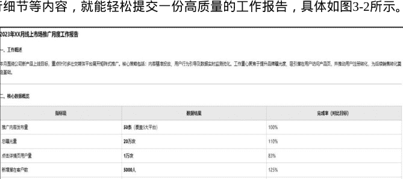

图3-2 使用DeepSeek生成工作报告示例（节选）

## 2. 方案策划

策划方案就需要创新思维，要全面考虑各种情况。

以活动策划方案为主，小张为小王即将举办的十周年庆典活动做策划。他根据向DeepSeek出发指令：

【角色设定】作为公司的资深策划。

【详细信息描述】作为公司的十周年庆典活动写一份策划方案。活动主题为“10年同行，共铸辉煌”，回顾公司10年发展历程，加强与合作伙伴、客户的互动，提升公司品牌形象。活动预算50万元，场地在公司园区举行。活动形式包括文艺表演、产品展示和交流互动。

【关键信息补充】文艺表演要体现公司不同发展阶段的特色；产品展示环节，要突出公司近3年的创新产品；交流互动要营造轻松愉快的氛围，活动风格要活泼大气，且有科技深度。

【期望输出要求】请给出详细的活动策划方案、人员安排、场地布置建议及预算方案，800字左右。

DeepSeek依据这些信息，快速生成一个涵盖活动各方面的详细策划方案。小张参考这个框架，结合合成的实际情况和领导的特殊要求，很快就出了一份活动策划方案。

关注intgpt3，免费领取资料群

案，具体如图3-3所示。

| 公益活动周末志愿者活动策划方案 |
| :--- | :--- |
| 主办：小明、阿强 | |
| 时间：2023年XXX月XX日（周六）15:00–21:30 | |
| 地点：公园（活动广场+“户外”） | |
| 预算：500元（备用） | |
| 一、 志愿者招募要求 | |
| 招募渠道：微信公众号、志愿者群（不限年龄、性别） | |
| 要求：具备良好的沟通能力、热爱工作、能抗压、有责任心 | |
| 任务描述：参与“爱心”公益活动执行与跟进调研 | |
| 二、 活动时间表 | |
| 15:00–16:00 | 签到活动 | 签到负责人/志愿者部长 |
| 16:00–17:30 | 主题互动 | 策划小组、活动负责人、活动策划 |
| 17:30–18:30 | 趣味互动区 | 产品经理/工程师现场互动 |
| 18:30–21:00 | 总结活动颁奖 | 现场组长/活动执行员 |

### 三、 分析与策划方案示例（节选）

## 3-3 利用DeepSeek生成商业推广文案的详细演示

以下以“为向职场人的智能办公软件制作推广文案”为例，方便演示协作与高效功能。例，用如何使用提示词来：

Step1：明确需求。确定你的产品是职场人的智能办公软件，重点突出其便捷与高效功能，分析其后续功能包含哪些以提供服务方案，是整个提示词的基础。

Step2：编写提示词。按照格式建立以下提示词。

【角色设定】你作为一名专业的广告文案专家。

【详细任务描述】为一款（面向职场人的）智能办公软件创作推广文案。这款软件支持多人在实时协作编辑、消息同步，让团队沟通无延迟；还具备智能日程管理功能，自动整合会议安排、任务提醒，提高办公效率。

【关键信息补充】目标是职场人，文案风格要专业且有吸引力，400字左右。

Step3：获取文案并调整。DeepSeek根据提示词生成文案后，检查是否涵盖了所有重点功能，语气是否自然。如果需要，对这些表述进行微调，使其更符合产品实际情况和目标。

# 加微信jnts2，免费获取资料分享

受众好。

根据生成结果，结合实际情况优化文案，确保文案落地真实。

按照优化后的提示，DeepSeek生成的推广文案如下：

[软件名称]——职场人士的高效利器

在职场竞争激烈的今天，高效协作与合作是成功的关键。[软件名称]智能办公软件应运而生，专为职场人打造，助你轻松应对各种挑战！

它的便捷协作功能，让团队沟通不再有延误。实时在线编辑文档、讨论，无论你是在办公室、家里还是在外，都能随时与团队成员共同编辑，消息实时同步，确保工作无缝衔接。再也不用版本不一致、沟通不畅的困扰！这极大提升了团队效率。

高效更是它的强项。智能管理功能，可以自动整合你的会议安排、任务提醒，合理规划你的工作时间。从此，你无需为琐碎的日程安排而恼，专注于工作本身，效率大幅提高。选择[软件名称]，就是选择更高效、便捷的办公方式。让它成为职场上的得力助手！

加微信jnts2，免费进资料分享

### 三、 深度洞察，精准锁定用户画像

在竞争激烈的环境中，数据就是财富。商家只需要把数据处理好，能够清楚知道数据的走势，决策就会准确。DeepSeek在处理数据方面有着强大的能力，不仅让数据快速生成销售趋势，还能展示顾客购买习惯，为商家提供精准依据。下面我们将仔细看看DeepSeek是怎么做到的：

### 3.2.1 DeepSeek数据处理与流程

表3-1 DeepSeek数据处理的流程

| 操作步骤 | 操作步骤 | 具体内容 |
| :--- | :--- | :--- |
| 目的 | 准备数据 | 商家需要整理好销售时间、产品名称、销售额等数据可以整理成表格后直接上传到DeepSeek |
| 生成趋势图 | 输入指令 | 打开DeepSeek，明确需求。例如：“我有一份销售数据，包含过去一年每月销售额。根据这些数据生成一条折线图，展示过去一年的变化。” |
| 获取结果 | DeepSeek接收数据后，对数据进行分析，利用绘图功能，快速生成趋势图。可以直接根据需求对图表的颜色、字体、坐标轴等进行调整 |

微信jnts，免费获取资料分享

### 3.2.2 提示词的底层公式

使用DeepSeek进行数据处理与分析，提示词的底层公式为：[数据背景描述] + [明确的分析方法] + [期望的输出格式]

需要说明所提供数据的基本情况，数据的类型（销售数据、用户购买数据等）、时间范围、包含的主要信息等，让DeepSeek对数据有初步了解。

表达希望DeepSeek对数据进行什么样的分析或处理，是生成图表、挖掘模式，还是其他类型的分析，具体准确。

如果对输出结果有特定的要求，如希望以折线图、柱状图呈现，或者要求以列表形式展示等，在提示词中明确指出。

### 3.2.3 实际案例展示

加微信jnts，免费进资料群

假设小李经营一家母用品用品，他想了店铺的销售情况和顾客购买行为，以便更好地调整完善营销策略。

#### 1. 生成趋势图

(1) 首先，准备数据。小李整理了过去一年店铺中各类母婴用品的月度销售数据，包括奶粉、纸尿、婴儿服装等产品。

(2) 第二，输入指令。小李在DeepSeek中输入：“【数据背景】我有过去一年母婴用品各类月度销售数据，包括奶粉、纸尿、婴儿服装等产品。【明确分析任务】根据这些数据，分别生成奶粉、纸尿、婴儿服装三类产品的月度柱状图，对比它们的销售趋势。【期望的输出格式】以状图形式”。

(3) 第三，获取结果。DeepSeek生成了三类产品的月度销售柱状图，具体如图3-4所示。通过这些数据，小李就能直观地看到各类产品的销售趋势，为后续的库存管理和促销活动找到了灵感。

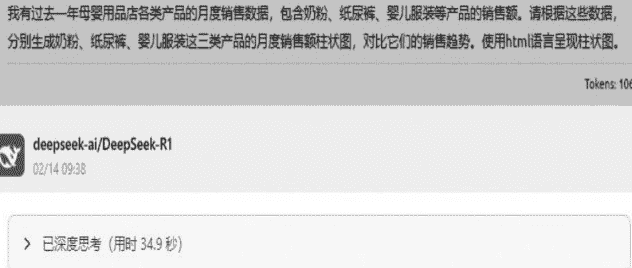

```
<!DOCTYPE html>
<html lang="zh-CN">
<head>
    <meta charset="UTF-8">
    <title>母婴用品销售分析</title>
    <!-- 引入chart.js -->
    <script src="https://cdn.jsdelivr.net/npm/chart.js@4.4.1/dist/chart.umd.min.js"></script>
    <style>
        .container {
            max-width: 1200px;
            margin: 0 auto;
            padding: 20px;
            background: #f9f9f9;
            border-radius: 10px;
        }
    </style>
</head>
```

以下是HTML/JavaScript生成交互式图表的代码，包含图表功能：

图3-4 使用DeepSeek生成销售趋势（可选）

#### 2. 把握用户购买行为模式

(1) 首先，整理数据。小李收集了店铺近半年的用户购买记录，包含用户ID、购买时间、购买金额、购买频率等信息，确保数据的完整性和准确性。

(2) 接着，输入指令。小李向DeepSeek输入：“【数据背景】我有近半年的用户购买记录，包含商品时间和金额等信息。【明确分析任务】分析这些数据，找出购买频率较高的用户群体，以及他们经常购买的产品。”

(3) 随后，获取结果。DeepSeek经过分析后输出结果，具体如图3-5。根据这些分析结果，小李决定对不同的用户推出营销活动。

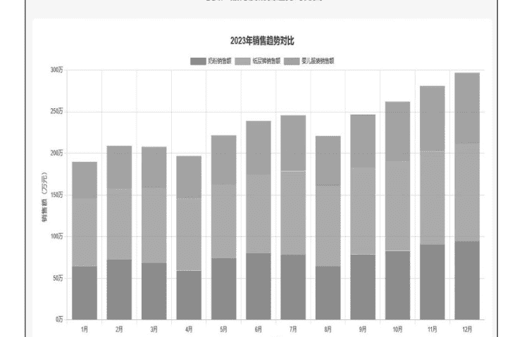

图3-5 使用DeepSeek生成柱状图

#### 实际应用

在实际数据中可以通过以下步骤分析：

1. 数据处理：将每个用户的购买记录整理为事务（例如用户一次购买的所有产品）。
2. 规则提取：使用Apriori算法或FP-Growth挖掘频繁规则。
3. 结果筛选：根据支持度、置信度和提升度筛选出有意义的规则。

#### 结论与建议

1. 用户画像：根据购买次数识别高频用户，对这些用户制定个性化营销策略（如会员活动、专属折扣等）。
2. 产品组合：通过关联规则找出一起购买的产品，优化销售策略，例如推荐婴儿湿巾。
3. 库存管理：根据购买频率预测产品供应充足。

#### 后续分析建议

1. 用户分类：根据购买金额、购买频率等维度对用户分层（如价值用户、普通用户等）。
2. 时间维度分析：分析购买规律（如节日、周末、活动期间）。
3. 用户画像构建：结合用户的基本信息（年龄、性别、地区等），构建用户画像。希望以上分析对你有帮助！如果有更多数据或需求，可以进一步深入。


以上案例可以看出，DeepSeek在数据处理与分析方面的强大能力，能够帮助商家从数据中获取价值的信息，从而做出精准的决策，提升经营效益。大家在自己的活动中也可以尝试利用DeepSeek挖掘数据背后的潜力。

## 3. 品牌推广、活动策划、销量的秘密

在竞争激烈的商业世界上，让品牌脱颖而出、提升影响力是每个企业都在努力的目标。

### 3.3.1 DeepSeek对市场营销流程的支持

DeepSeek可在多方面对市场营销流程提供支持，其中在创意构思、活动策划、传播推广三个方面的效果最为显著。表3-2展示了DeepSeek在这三个方面市场营销流程的支持。

#### 1. 创意构思

明确品牌定位、目标受众、品牌特色等关键词。将品牌相关信息输入DeepSeek，DeepSeek将根据输入信息，结合市场趋势和成功案例，提供一系列创意想法。表3-2 DeepSeek对营销流程的支持作用

| 营销阶段 | 操作步骤 | DeepSeek的作用 |
| :--- | :--- | :--- |
| 创意构思 | 确定品牌信息 | 一个专注于环保的时尚品牌，目标受众是追求品质生活且关注环保的年轻消费者，其品牌特色就是可持续材料制时尚服装 |
| 创意构思 | 输入需求 | 我有一个环保时尚品牌，目标受众是追求品质生活且关注环保的年轻消费者，品牌主使用可持续材料制作时尚服装。请帮构一些新的营销策略，突出环保和时尚两个点 |
| 创意构思 | 举办“旧衣换新”活动，消费者用旧衣物换取该品牌的优势，同时在活动现场设置环保时尚展览，展示品牌策划过程和环保理念；还可以与环保组织组合，推出联名系列，扩大品牌影响力 |

#### 2. 活动策划

根据创意确定活动类型，新品发布、促销活动、主题活动等，向DeepSeek输入更详细的活动需求，包括主题、时间、地点、参与人员等信息。DeepSeek生成完整的活动策划方案，包括详细的活动流程。表3-3展示了DeepSeek在活动策划方案方面的支持作用。

表3-3 DeepSeek在活动策划方案方面的支持作用

| 营销阶段 | 操作步骤 | 输入需求 | DeepSeek的支持作用 |
| :--- | :--- | :--- | :--- |
| 活动类型 | 明确活动 | 例如，选择新品发布会来推广环保时尚品牌的新系列 | |
| 输入细节 | 我为了环保时尚品牌举办新品发布会，活动主题是“时尚与环保的碰撞”，计划在市中心的创意园区举办，邀请时尚博主、媒体参加。请帮我策划活动流程，安排环节，并考虑预算和宣传方式 | |
| 策划方案 | 详细活动需求 | 包括主题、时间、地点、参与人员等信息。根据目标观众喜好，向DeepSeek输入相关信息让他制定详细的社交媒体计划 | |

#### 3. 推广

表3-4 展示DeepSeek在传播方面的支持作用

| 营销阶段 | 操作步骤 | DeepSeek的作用 |
| :--- | :--- | :--- |
| 确定推广 | 如社交媒体、线下广告合作等。对于环保时尚品牌而言，社交媒体是重要的推广渠道 | |
| 推广 | 我要在社交媒体上推广环保品牌的新发布会，目标是吸引更多受众关注，提高知名度。让他制定社交媒体计划，包括发布内容、发布时间和互动策略 | |


## 3.4 项目管理全面控，识别潜在风险

在项目管理中，制订合理的项目计划、及时识别潜在风险并有效应对，是确保项目顺利推进的关键。

### 3.4.1 DeepSeek在项目管理中的操作流程

DeepSeek凭借其强大的功能，能为项目管理的得力助手。DeepSeek在项目管理中的操作流程如下：

- 1.制订项目计划
  - (1）明确项目信息：梳理项目的基本情况，包括项目目标、范围、时间要求、参与人员、资源等。例如一个软件开发项目，其目标是在个月内完成电商App的开发，参与人员有开发团队、测试团队、产品经理等，资源包括技术设备、开发资金等。
  - (2）输入指令：将项目信息交给DeepSeek，例如我负责一个电商开发项目，要在6个月内完成。参与人员有开发团队、测试团队、产品经理，有相应的技术设备和开发资金。请帮我制订项目计划，按周划分任务，明确每个阶段的交付成果。
  - (3）获取计划：DeepSeek根据输入内容，生成详细计划。以周为单位划分任务，如表3-5所示。

表3-5以周为单位划分的任务分配表

| 阶段 | 时间跨 | 主要工作内容 | 交付成果 |
|---|---|---|---|
| 第1阶段 | 第1~2 周 | 产品经理完成App功能需求文档的撰写 | 功能需求文档 |
| 第2阶段 | 第3~8 周 | 开发团队进行前端和后端的基础架构搭建 | 前端和后端架构代码、架构设计文档 |
| | | 持续 | |
| 第3阶段 | 第9 ~ 16 周 | 完成各个功能模块的开发 | 各个功能模块的代码、功能模块开发说明文档 |
| 第4阶段 | 第17 ~ 20 周 | 测试团队进行全面测试、提交测试报告 | 详细的测试报告（包含测试用例、测试结果、问题清单等） |
| 第5阶段 | 第21 ~ 22 周 | 根据测试结果进行修复和优化 | 修后的代码、优化说明文档 |
| 第6阶段 | 第23 ~ 24 周 | 完成 App 上线前的准备工作并正式上线 | 上线版本的代码、相关文档（如应用市场材料等） |

### 2.2 识别潜在风险

整理项目推进过程中的各类信息，包括项目进度、人员状态、外部环境变化。输入问题，获取结果，得到规划风险的具体方案，如表3-6所示。

| 步骤 | 内容 |
| --- | --- |
| 汇总情况 | 在开发过程中发现开发人员未能熟练掌握新的框架，同时市场上出现了类似功能的竞品 App |
| 人员问题 | DeepSeek 询问：“在电商 App 开发项目中，部分开发人员未能熟练掌握新的框架，市场上出现了类似竞品。请帮我分析可能存在的风险。” |
| 风险识别 | DeepSeek 分析后指出，开发人员的技术不足可能导致开发延迟，影响交付时间，竞品的出现可能导致市场份额被抢占，影响项目的预期收益 |

## 3. 提出应对策略

在 DeepSeek 中输入：“针对电商 App 项目面临的开发进度可能延迟和市场竞争的风险，请帮助提出应对策略。”

DeepSeek给出如下应对策略：

- (1) 对于开发延迟风险，可以组织内部技术培训，邀请专家进行指导，或者调整任务安排，让丰富的开发者协助新手。
- (2) 对于市场竞争风险，可以加强市场调研，突出 App 的差异化功能，加快推广营销的节奏，提高产品的知名度和竞争力。

这样的流程操作下来，DeepSeek 凭借其数据积累、智能决策、协同增效的操作流程，成为项目管理的大胶针。

### 3.4.2 提示的底层公式总结

使用 DeepSeek 进行项目管理相关提示，提示的底层的公式为：【项目基本情况阐述】+【项目管理阶段及具体需求】+【具体问题或风险描述】。

- 1.项目基本情况阐述
  详细说明项目的目标、范围、时间、人员、资源等基础信息，DeepSeek 对项目有充分了解。
- 2.项目管理阶段及具体需求
  明确当前处于项目管理的哪个阶段（制定计划、识别风险、提出策略），以及该阶段的具体要求，如任务划分等。
- 3.具体问题或风险描述
  在识别风险和提出策略时，如果存在具体的问题，要清晰描述，以便 DeepSeek 针对性提供解决方案。

### 3.4.3 实际案例

假设“某科技”公司承接了一个App开发，其目标是打造具有特色功能的App，计划在5个月内上线。

- (1) 项目信息：
  涉及开发团队、设计团队、测试团队和产品经理，资源包括技术设备、开发资金。
- (2) 输入需求：
  DeepSeek中输入：【项目基本情况阐述】我负责一个App开发，目标是在5个月内完成。参与人员有开发团队、测试团队、产品经理，资源包括技术设备、开发资金。【项目管理阶段及具体需求】请制定详细计划，按周划分任务，明确每个阶段的交付成果。
- (3) 汇总情况：
  在进行到第2个月时，发现开发人员对新框架掌握不熟悉，同时市场出现了类似功能的竞品，导致项目进度影响。
- (4) 识别风险：
  DeepSeek 分析后指出，开发人员的技术不足可能导致开发延迟，影响交付时间；竞品的出现可能导致市场份额被抢占，影响预期收益。
- (5) 获取结果：
  - (1) 明确风险：
    确定 DeepSeek 识别出的风险，如开发进度延迟风险和市场竞争风险。
  - (2) 输入需求：
    在 DeepSeek中输入：“针对电商 App 项目面临的开发进度可能延迟和市场竞争的风险，请帮助提出应对策略。”
  - (3) 获取应对方案：
    - (1) 对于开发延迟风险，可以组织内部技术培训，邀请专家进行指导，或者调整任务安排，让丰富的开发者协助新手。
    - (2) 对于市场竞争风险，可以加强市场调研，突出 App 的差异化功能，加快推广营销的节奏，提高产品的知名度和竞争力。

## 3.5 办公软件×DeepSeek，提升办公效率

工作中，我们每天都会面临各种办公事务，要是有一种高效的方法来处理这些任务，那太棒了。现在 DeepSeek 能跟 Excel、Word一起干活。在处理大型项目文档、生成数据报告的时候，使用 DeepSeek 可使工作效率提升。下面我就给大家一些实际操作，看看效果有多强大。

### 3.5.1 协同处理大型项目：DeepSeek和Word协作

假设你在一家建筑公司负责编写一个综合体项目的策划方案。这个项目需要涵盖项目的各个方面，如设计方案、施工计划、预算范围和风险评估等。以往独自完成这样的文档需要花费精力收集资料、整理思路和编写内容，有了DeepSeek和Word联手后，整个流程就如此高效。具体操作步骤如下：

1. 明确需求：在 DeepSeek输入：“负责某商业综合体项目，编写项目文档，包含地理位置、规模、定位和完成时间”。DeepSeek语言模型和知识储备，分析资料、提取数据内容，整合成条文。生成如“项目位于[城市]区域，占[x]平方米，总面积[x]平方米，定位为城市地标商业中心，预期项目时间[运营]的项目描述。这一描述为后续文档撰写奠定了基础。
2. 导入文本：把 DeepSeek生成的文本复制到 Word。利用Word强大的排版功能对文本进行进一步优化。调整字体，选择与内容相符的字体、调整段落样式、插入项目相关图片，增强文档的专业性和直观性。
3. 内容拓展：在 DeepSeek输入：“结合商业综合体定位，分析流行建筑风格，编写设计方案，要考虑空间、功能区域与视觉特点。”DeepSeek知识积累，分析建筑格局，从采光、通风等角度布局，生成设计方案建议。生成如“采用现代简约约与科技风格，开放式中庭，地下一层，一至三层为餐饮，五层以上使用玻璃幕墙与金属材质，灯光五彩的设计方案”。这一方案的生成进一步完善了文档内容。
4. 文档整合与优化：在 Word中使用自动生成、样式和格式刷功能。DeepSeek持续支持，Word将部分内容合成格式规范、完整的项目策划文。

### 3.5.2 协同生成数据报告案例实例：DeepSeek与Excel协同方式

还是以3.5.1中的业务场景为例，在项目筹备阶段，需要对成本、市场需求等数据进行分析，生成详细的数据报告，为项目决策提供依据。此时，Excel和DeepSeek的协同作用就凸显出来。表3-7了这一过程：

表3-7 使用DeepSeek协同Excel处理文档流程

| 操作步骤 | 具体操作 | 整体作用 |
| --- | --- | --- |
| 数据整理 | 在Excel整理项目成本、市场调研、预期收益等数据，制成规范表格 | 利用Excel的排序、筛选功能，如计算总成本、预测收益，为分析准备 |
| 分析需求 | 在 DeepSeek输入：“依据Excel表格，中商业项目目标、收益和调研数据，分析回报率与竞争力。” | DeepSeek将数据转化为结构化信息，运用算法参考行业标准等，生成业务报告 |
| 图表制作 | 用Excel图表功能，本项目数据柱图、调研数据折线图、饼图 | 直观展示数据，为报告提供可视化支持 |

### 3.5.3 综合案例：市场调研

假设你在市场调研公司负责某知名品牌上市期间的调研分析，编写一份报告。

1. 数据收集与整理：通过线上问卷、线下访谈等方式收集口味、包装、价格等方面的数据，这些数据整理到表格中，包含消费者的年龄、性别、地域、习惯等。
2. 数据分析与报告：在DeepSeek输入提示词：
   - 【任务描述】我正在为某知名品牌进行市场调研。
   - 【类型及具体要求】根据表格中的数据，分析消费者的特征、市场趋势，编写报告侧重点、分析数据的指标等。
   - 【数据或文档】Excel表格名为“市场调研.xlsx”。
   DeepSeek读取表格后，得出结论：目标消费者主要是年轻群体，偏好简约等。
3. 报告撰写与整合：将DeepSeek生成的摘要复制到 Word文档中。在“消费者分析”板块，再次调用DeepSeek丰富内容，例如“根据前面的内容，总结新品上市的关键点，并提出具体的推广建议”。
4. 数据可视化与报告：回到Excel，根据消费者的不同喜爱制作柱状图、饼图，展现市场格局。在Word对应页面，统一格式，添加目录、页脚等，完成一份专业的调研报告。

### 3.5.4 提示词的底层公式

在利用DeepSeek和办公软件工作时，提示词可以按照此结构组织：【任务描述】+【任务类型及具体要求】+【关联数据或文档信息】

1. 任务描述：清楚地说明你要处理的任务属于哪个领域，如建设项目、营销活动策划等，让DeepSeek明白任务的背景和方向。
2. 类型及具体要求：明确让DeepSeek做什么，是编写概述、分析数据，还是其他任务，同时详细说明具体的要求，如报告侧重点、分析数据的指标等。
3. 关联数据或文档：如果任务和特定的数据或文档有关，像Excel表格的数据范围、Word文档里已有的内容，在提示词里提供这些信息，就能让DeepSeek给出的结果。

## 3.6 跨平台多功能协同：一键生成PPT、录音整理与智能蓝图

职场人都知道，办公效率如果提高，工作压力就不用小。今天给大家讲解DeepSeek和他平台适配，实现高效办公的方法。

### 3.6.1 DeepSeek与工具综合应用

将DeepSeek与工具组合使用，可以快速生成PPT大纲、各板块内容、相关数据和案例，这可以节约大量工作时间。下面我们看DeepSeek如何组合：

1. 明确PPT需求：在DeepSeek中输入指令>制作符合[主题]的PPT，包含各板块的内容，风格为[如你喜欢的风格]，重点展示（核心点或产品特点）。例如，如何举办一场发布会，确定主题为“新智能手表发布会PPT”，板块包含产品外观、功能介绍、技术优势、市场分析、购买渠道。风格选择“科技风”；核心卖点是突出智能手表的创新功能和独特设计。描述使得DeepSeek生成的内容符合你的要求。
2. 获取DeepSeek生成内容并复制：DeepSeek根据指令生成PPT大纲、各板块内容、相关数据和案例。例如，在功能介绍板块，详细说明了智能手表的健康监测功能、智能增强功能等，还列了一些参数，复制这些内容即可。检查生成内容，如不符合需求的，可以修改提示词重新生成。
3. 选择模板并粘贴到工具中：打开工具，在众多模板中挑选与“科技风”匹配的模板。然后将DeepSeek生成的内容段粘贴到对应的页面和文字中，如“消费者分析”板块，根据前面的内容，总结新品上市的关键点，并提出具体的推广建议。

### 3.6.2 DeepSeek与通义听实现实时录音和会议整理

通义听可以快速完成会议纪要。具体操作如下：

1. 开启录音：公司召开会议时，点击录音按钮，确保会议期间的发言、讨论等都被记录。注意：保证录音设备正常运行，录音环境安静，减少外界干扰。
2. 下载录音并进行初处理：会议结束后，在通义听找到的会议文件进行录音提取文字，通义听会生成初步的会议纪要。注意：在传输过程中确保网络稳定，避免网络问题导致传输失败或提取出错。
3. 优化会议纪要（DeepSeek）：把通义听生成的会议纪要上传或复制到DeepSeek中，输入：“根据此会议纪要，重点关注内容，总结结论、待办事项，按分点形式输出。”DeepSeek整理出负责人、时间点等关键信息。注意：输入的提要需要准确，以便DeepSeek更精准地提炼内容。其他还可以使用类似的平台飞书、钉会议等，每个人也可以去挖掘其他平台。


白云下，青山连绵起伏，绿树成荫，清澈的涓潺潺，几只鱼在水面上嬉戏，呈现出一幅生勃的自然画卷。整体风格清新自然，色彩明快，以绿色为主色调，突出环保主题的复制给包。

注意：若借助于DeepSeek的外部工具生成图片，需要了解工具使用的规则和特点，按提示调整关键词。

## 3. 保存并应用图片

将满意的图片进行保存，可以应用于环保活动宣传海报设计中，也可以用于相关的PPT、文章配图等。

注意：根据使用场景调整图片格式和大小，确保图片在不同平台上正常显示。

可将此案例中的包替换成任何支持生成内容的AI工具，如腾讯智影、文心一格、通义万相等获取更多化的。

这些DeepSeek跨平台综合应用的方法，能帮你在办公时节省不少时间和精力。大家赶紧试试，你不你就会发现办事变得轻松又有趣了！

## 小练习

尝试将DeepSeek与更多的工具组合使用，实现DeepSeek的多模态应用！例如，用DeepSeek生成Markdown格式文件，结合Xmind等工具，快速生成思维导！

加微信jntsg2，免费进资料分享群

## 第4章 创意激发，DeepSeek帮你轻松做人

职场修炼“六边形逻辑”够了吗？答案在时代的回响里——彼得·鲁克说：“预测未来，最好的方式就是创造未来，”当AI重办公后，PPT制作、数据分析等基础工作已经进化为人的生存底线。这个时代，人都是自律，就挣在招聘面前的老实者，白天是科技公司的项目经理，晚上在写行字投简历，结果被头丢了总监。现在职场人还没遇到个别账号？你发现的每周文案都是会跑的，你方的实战经验比公司行头更有服力。

当别人还在用Word报报告时，AI的职场人已经学会用工具将效率转化为巨大增量。这不是跨越，而是提升。

## 4.1 文案人：如何让阅读变成最难的

很多新手对于文案经常遇到头疼不起的问题：花一天时间写文案，结果阅读量却少得可怕，连100都破不了。对于他们来说，DeepSeek的出现简直就是太好了！用DeepSeek写文案，效率提升可视可是不是一点！

就拿奶茶品牌的文案来说，以前团队写一篇文案，要花6小时讨论、构稿，最后阅读量才才1000多。如果用了DeepSeek，只需要在提示词中融入“新品饮料冰茶”“夏日清”“第二杯半价”等信息，1分钟就能给出一个不错的初稿通过此节节省的时间，可以用来想创意、优化、运营。虽然使用DeepSeek，文案工作就会变得非常轻松，而内容质量也将大幅提升。

### 4.1.1 核心方法：一步生成式——输入需求，直接出稿

“一步生成”并不是一下就搞定了，而是通过一套很厉害的指令，让AI帮我们完成80%的枯燥麻烦的工作，我们只需要把精力放在“输入需求”和“给文案“注入灵魂”上就行了，具体如4-1所示。

表4-1“一步生成式”案例

加微信intgs3，免费进阶资料群

## 案例

| 步骤 | 要素 | 关键点 | 操作方法 | 提示词公告及案例应用 |
| :--- | :--- | :--- | :--- | :--- |
| Step1 | 5秒让 AI 插入需求 | 转化功能需求 | 模型框 | 错误案例：咖啡文案。满足指令：“小红书”+【目标人物】+【核心产品/主题/场景】+【其他】特殊要求（规则、格式等）。案例应用：在满足指令这个案例中，AI 是红书，【目标人物】是年轻女性、【核心产品/主题/场景】是焦糖女孩、【场景】是治愈感、【打人语】“闲置食堂”，这些特殊要求是表情和口语化 |
| Step2 | 5分钟让 AI 输出内容 | 转化功能需求 | 模型框 | 增加逻辑，生成内容：前3句核心，例如，“北京，40元！”、“性化弱化”、删除吸引，将 AI 的“官方表达”转换为“用户语言”。AI 初始：“产品性人类类化：用奶茶的话来描述咖啡的品质” 互动：结尾解决争议问题或利益诱惑，如：“你是铁控，还是美式铁？”点击朕领取3张优惠券！ |

### 4.1.2 烟雾化：3个数据技巧，AI让策划人工更

### 1. 热点+冷门视角=流量蓝海

第一个技巧是将热点与冷门视角相结合，通往流量蓝海。

(1) 底层逻辑。大家都知道热点有流量，70%的人都在热点，只有3%的人会去找不一样的视角。要是能找到冷门视角，流量可就就不来了啊！

(2) 操作示例
热点：酱香赛辣味。

微信关注intsg，免费获取资源资料群

# 冷门视角：用DeepSeek做“联名爆款”小众品牌+常规破界

指令：“基于《传神》的理论分析瑞幸奶茶爆红的原因，列出3条可复制格式。”

### 2. 情绪钩子+数据背书-信任增强

要学会用数据做书案，带数据背书，转化效率能够显著提升。如果这些数据能够击中用户的某种情绪，文案就能收获更多，例如下面这条文案：

连续加班7天？这杯咖啡能带来你的效率提升40%

用加班的负急情绪引入产品，用提高效率的数据，很容易打人心

### 3. 互动率：把读者变成“自来水”

这条技巧的公式为：痛点+利益诱感+低门槛。例如，下面这条文案：

每天早起+奶命的举手！出抢时区单购，5人送全年半价

先留出许多露露咖啡+奶命的”痛点”，用送全年半价卡这种利益点吸引大家，并让订单截图就能参与，这样很容易吸引参与和互动。

### 4.1.3 高技巧：让AI成为“爆款军师”

让AI成为“爆款军师”，有三个技巧，分别是关键词暴力测试、一键切换“人格”及数据复盘。

**关键词测试——挖掘隐藏底色**

操作方法：输入一些看似不相关的关键词组合，看看能产生什么奇新的创意。例如，输入“美女+反差、颜值+拒绝+亚洲的独特美女”。通过这种方式就能筛选出独特新颖的创作方向，让内获得更多可能。

**一键切换“人格”——精准匹配**

操作方法：根据受众类型选择对应的关键词，让文案更符合喜好。如果受众类型为“Z世代”，则用特定的关键词，让文案包含他们受爱的的网络梗，容易引起他们的共鸣。如果受众类型为“妈妈”，则用关键词定位，让文案传达精准的情绪。

**数据复盘——AI也要升级**

(1) 提取历史文案。例如，可以使用DeepSeek分析过去30天前5名的爆款文案，提高关键词和标签密度，导出示例显示点击率占比80%，这种对比元素赢得用户关注。

(2) 对比热点。例如，可以使用DeepSeek分析领域前个月的热搜词，热度上升，但自己的内容未涵盖，就需要及时跟上趋势，增加更多流量。

(3) 优化标题：根据复盘结果调整。例如将“性价比”替换为“快速看”等标题，这样可以让当下用户的需求。

(4) AB测试：将同一文档使用两个分组，观察数据差异。例如，某主播将“性价比”改为“第一干货”，点击率提升10%。对于新手而言，建议每周进行一次复盘；成熟账号每月进行次，结合业务调整内容范围。

## DeepSeek文案生成标题库

| 指令类型 | 指令模板 | 示例 |
| :--- | :--- | :--- |
| 通用模板 | 平台（小红书/抖音）+人群（Z世代/宝妈）+核心产品+场景（打工/上班）+痛点（治愈/焦虑） | “抖音+男性+通勤+场景，科技感，要求口语化” |
| 热点结合指令 | 结合最近爆发的事件，写出一款功能的运动鞋推广文案 | “热点色彩搭配” |
| 互动引导指令 | 在文案结尾添加一个引发共鸣的问题，设计互动 | “提问你最喜欢哪个？并抽人送套装” |
| 数据强化指令 | 引用行业报告，产出数据优势 | “引用《2023消费报告》，说明现阶段市场份额提升了30%” |
| 风格切换指令 | 用xx风格（毒舌/感心/专业）改写以下文案 | “用毒舌测评‘吐槽’普通，通过对比出品优势” |

## 4.2 文案好不好？试着仿写各种风格

不少朋友都在2025年期间用DeepSeek仿写《玄门之》。在这个案例中，DeepSeek在程度上还原了诗的韵味，那句‘月亮玄门，血染戎足绝伦’你也想写这样的经典句子？就起起来吧。

### 4.2.1 保姆级：5步教你变身作者

投诸、设定参数、角色结构、动态角色、人工选题是变身作者的5个关键步骤。以下以加强治理议题为例，演示这5步，具体见4-所示。

- 步骤1：投诸选题
  - 具体操作：输入具有目标的3~5篇，用词与句式结构，生成白书的文章。
  - 指令说明：分析[目标人物]时间段话的用词和句式结构，生成白书的文章。
  - 案例应用：在扩充中，以[主题]为主题，用[时间段]话语为结构，通过这个指令让DeepSeek分析生成白书文章，后作为反馈提供报告。例如，在描写加强治理相关文章时，若针对特定的主题写作风格，就通过相应的指令生成基础框架和语境字体。

- 步骤2：设定角色参数
  - 引导模式：激活[动态词]‘政治语’模块，限制词汇范围。这一模式生成的内容更符合引导的语气风格，增强逻辑性和专业性，避免了随意的口述表达，文章在传递信息时，能够更好地接地，气十足。
  - 专家模式：用‘专业术语’数据增强功能化，禁用情感词。该模型有助于生成白书的专业性和内容深度。通过术语和数据驱动来可视化，可以增强文章的说服力和专业性，使其具有专家的深度，符合写作风格。

- 步骤3：结构化提示
  - (1) 引导模式：以[主题]为主题，融合[政策性]，用[具体地区]经济数据，每包含一组排比句，结尾用以‘同志们’为开头的结尾。例如，用‘聚凝聚力发展’为主题，融合‘十四五’规划，用2021年经济数据，每包含一组排比句，结尾用以‘同志们’为开头的结尾。
  - 相关案例：要坚持遵循逻辑，严密‘网化’的一张，打‘精细化’服务的一横，打好‘多元化’的一套组合，让基层治理‘最后公里’畅通无阻！
  - 引导模式提示提示词：以[主题]为主题，融合[政策性]，用[具体地区]经济数据，每包含一组排比句，结尾用以‘同志们’为开头的结尾。加强治理写法。

- 步骤4：动态调整
  - 具体操作：通过“权重”技术自动调整语气。当涉及争议事件时，增加语气，等关键词，确保不同工作下的适用性。
  - 专家提示：基于决策目标，行业转型路径，引用报告名称，提出量化建议。基于决策背景，通过这样的指令让DeepSeek口语化输出。

- 步骤5：人工润色
  - 引导语：增加口语化，例如“这里来说”。
  - 专家备注：例如“请引用相关文献”。补充注释，增加严肃性，同时增加感染力，让内容更具现场力，符合读者。

### 4.2.2 3步实现：用DeepSeek生成高转化标题

三个实用技巧，具体如下：

### 第一步：准备Prompt——提炼用户

- (1) 输入核心信息：把产品的详细信息告诉DeepSeek，不能简单地写。
- (2) 获取用户画像：借助DeepSeek分析历史数据，明确用户是谁，以及有什么需求。
- (3) 输入：以“产品名称”为主题，生成包含钩子、放大焦点、价值提升、互动设计。
- (4) 输出：目标为25~40岁的职场女性，关注“穿搭”。

### 第二步：复盘——实时调整

- (1) 监测弹幕关键词：监控到观众在直播里的问题，把问题引入DeepSeek后调整。
- (2) 自动生成互动：DeepSeek分析观众的核心痛点，生成话术。当观众问起来“质量怎么样？”、“推荐吗？”等问题时，引入DeepSeek输出分析进行调整，话术如：“姐妹们快看！我来教你们怎么做高级！”

### 第三步：复盘后——数据数据

- (1) 分析关键指标：直播结束后，通过DeepSeek查看“用户留存时长”“互动峰值时刻”“转化率”这些关键指标，看看直播中哪些地方做得好，哪里还有提升空间。
- (2) 优化策略：根据分析结果调整。例如，在复盘中：
  - (1) 发现“通用环节”效果显著。
  - (2) 调整话术：“还抢到最后10件！现在的姐妹，再加价59元的胸扣！（倒计时5秒）3、2、1……喜抢到的宝宝！”

### 4.2.3 风险高阶技巧：让流量更“人味”

我们可以尝试以下3个高阶技巧，让流量更“人味”。

1. 格式拟：每月更新语料库，对接最新热点，动态调整“流行浓度”“排比密度”等参数。例如，某省政策通过优化模型，让直播话术符合度从72%提升到了91%。
2. 人机协作：领导稿：AI生成架构（60%），人工添加接地案例（如就像王家老村大改造的实践）。
3. 代际衔接：“60后”领导：增加“同志们”必须清醒认识到。“80后”专家：激活“场景化叙事”模块，如用“小红书博主式草单”解读政策：“三招教你读懂数字经济——简单、直接、有深度！”


## 步骤

## 操作路径

## 提示词

## 应用案例

| 步骤 | 操作路径 | 提示词 | 应用案例 |
| :--- | :--- | :--- | :--- |
| Step2: 生成画面粘贴 | 1. 将 DeepSeek 生成的画面贴至图片 | 0 ~ 5 秒: 云画画面描述输入 AI 生成古茶味，金色调。避坑指南： | 在普洱茶宣传片中，把对应 AI 生成图片，再用 AI 转化为动态视频。 |
| | 2. 生成图片后，可用 AI 重绘动态视频（自动添加转场和运镜头） | 画面转写，如果提示词太长，就对山水描述，16:9 说“将这段描述精简到800字以内 vivid color 保留关键词参数；--ar 16:9 →” | 2. 生成人物模特转写写，添加关键词“超写实皮肤纹理、流光胶带”，防止画面有塑料感 |
| Step3: 剪辑包装 | 1. 开始剪辑，引入 AI 生成的视频素材；2. 利用视频剪辑功能，用 DeepSeek 生成的文字直接生成；3. 根据场景加转场特效，古风场景用“水墨染”，现代场景用“分屏对比” | | 操作普洱茶宣传片时，引入视频素材，添加 AI 配音，古老茶场场景添加“水墨渲染”转场，现代茶场场景添加“分屏对比”转场。 |
| 流量密集： | 1. 背景音乐选择“轻松音乐+自然白噪声”组合，让完整播放率提升40%；2. 封面图用即 AI 生成的“茶汤流动与书法标题”的 3D 效果图 | | |

## 4.3.2 进阶秘籍：让流量翻倍的4个杀手

要是你不满意只做普通的视频，想让流量翻倍，从80分提升到100分，这些技巧你一定学会！

### 1. 质量指南：Jimmy爆款教程 微信jmin6626

- (1) 开头3秒：“开头+钩子”。如你为短视频流量发愁吗？一下就抓住了用户的痛点，让他们继续观看。
- (2) 中间20秒：“反常识点+证据”。如你为好茶备年吗？真正甄选品质的采购后8小时的熬泡功夫，再上茶具特写与画面，就能勾起观众的好奇，让他们不想离开。

## 微信jnts52，免费进阶资料分享

- (3) 结尾5秒：“指令+悬念”。点击左下角留点茶树，评论告诉我喝到的第一口茶是什么味道？即时引导用户互动，又引发互动，提高视频热度。

### 2. 高点击率画面设计技巧

- (1) “3-1特”原则。高饱和+高对比+动态范围+特镜头。就像汤洒的场景，用镜头+飞溅水花拍摄，点击率比普通拍摄的点击率高2倍，画面更吸引。
- (2) “情绪符号”。加入“人脸特写”+“消费者看到后惊讶”、“疑惑微笑”等画面，让观众产生情感共鸣，从而更多互动。

让AI听懂提示词。让AI明白你的意图，记住这个公式：角色基因（如“00后-”）+特定标签（让年轻觉得酷）+反响（拒绝观众）+细节（用“狂狂”台词风格撰写文案）。

案例演示：在DeepSeek中输入：“你是一个00后的剪辑人，用[黑镜风格]反语语气解释视频，让年轻人觉得酷音比话便宜，拒绝实话说观众，结尾加一个‘炸’的句子。”它就能根据指令给出特殊的脚本。

### 3. 数据提效

AI工具带来效益：利用AI工具制作，在效率和成本上有巨大优势。将写脚本的时间从2小时缩短到3分钟；用AI生成脚本，将使专业素材的价格从500元一张变为免费；用AI生成视频，将使用动态视频的制作时间从天缩短到分钟。整体来说，用传统方式制作一条视频约需要5000元，而AI制作几乎不花钱。

## 为什么你必须现在行动？

- (1) 算法红利。抖音、视频号等平台在大力推AI生成内容，当当下，更容易获得流量，让你的视频更多人看到。
- (2) 降本增效。利用AI矩阵，个人就能完成原本需要5人团队才能完成的工作，节省人力的同时，还能降低成本。
- (3) 差异效应。早掌握“提示词工程+AI协同”的能力，就能在竞争中颖而出，和别人拉开差距。

以前，企业宣传是4A公司和大品牌的“专属领域”，普通人和小品牌很难兼顾。然而，现在不一样，只会DeepSeek，15分钟就能做出80分的专业内容。只要掌握AI，那么AI就不是替代我们，而是让创造力变得更平等的神奇工具。

借助DeepSeek创作视频脚本，每个人都能轻松跨过品牌宣传的门槛成为品牌宣传的推手。

## 微信intgs2 免费进资料群

## 4.4 担心直播行业？没团队也能轻松写出带货词

直播时代“大拿”直播，大家都有自己心里直播的经历。人家直播间里热闹非凡，人气爆棚，订单一个接一个，再看自己的直播间冷冷清，差也太大了！其实，直播这事，门槛不高，谁都能轻松，但想吸引观众注意，让他们留下却非易事。然而，普通人没有专业团队写脚本，直播的时候遇到突发情况该怎么办？别着急！DeepSeek能为你帮助！

### 4.4.1 DeepSeek的核心优势：精准、实时、懂

精准、实时、懂是DeepSeek的三大优势，完美契合直播节奏。以前直播，就要看着流量，DeepSeek通过数据驱动通过用户画像，精准定位目标观众年龄、兴趣习惯。例如，现在的粉丝里25~35岁的女性占了70%，这些姐姐特别喜欢护肤品，得到数据后她把直播话术改成……

实时优化——从被动到主动。直播的时候，最怕的就是没人说话，DeepSeek像一个舵手，抓住关键词并点燃氛围。例如，当弹幕跳出一个：“适合吗？”这时DeepSeek马上给出建议，让她说侧面优势，直播间的瞬间就跳起来。

创意策划与解决热点。有时候直播，自己没话说，观众可能觉得没意思。DeepSeek根据当下的热点和兴趣，找到很多不错的话题，给你源泉。以前直播只能用讲功效，互动比较小。后来用了DeepSeek，大家在评论里一句非常热闹。

### 4.4.2 3步实现：用DeepSeek高转化技巧

用DeepSeek生成高转化话术，主要分为3个步骤。

## 表4-6 用DeepSeek生成高转化话术的3个步骤

| 步骤 | 操作内容 | 案例（以纯羊毛为例） | 提示词公式及应用 |
| :--- | :--- | :--- | :--- |
| 第一步：准备阶段 | 1. 输入产品核心信息：纯羊毛、客单199元，产品的详细信息：颜色、白、灰。需求： | 1. 输入：“产品：纯羊毛” | 提示词公式：产品信息描述（产品名称、单价、颜色等）+需求描述（包含环境、风格要求等）； |
| 第二步：像探员一样分析用户 | 2. 告诉DeepSeek，通过简单地向女孩子写Prompt，生成包含开场、“钩子”、痛点放大、价值提升、互动设计的完整话术 | 2. 通过分析发现，目标羊毛用户为25~40岁的年轻人，关注“性价比”和“保暖” | 应用示例：羊毛案例中，产品信息描述为“纯羊毛、舒适、透气，单价199元，黑、白、灰。纯羊毛衫包含“外套、裤、袜子、帽子” | |
| 第三步：数据反馈 | 3. 优化策略：根据分析结果，调整话术 | |

加微信jntsg2 免费进资料群

### 4.4.3 进阶技巧：如何用DeepSeek升级一套话术

关注公众号gptns，免费获取资料

| 步骤 | 操作案例（以纯羊毛为例） | 应用示例及应用 |
| :--- | :--- | :--- |
| 第一步：准备阶段 | 1. 获取用户画像：用DeepSeek分析数据，明确用户是他们，他们有什么需求 | 2. 通过分析发现，目标羊毛用户为25~40岁的年轻人，关注“性价比”和“保暖” |
| 第二步：实时调试 | 1. 监控弹幕关键词：根据用户的问题，DeepSeek会提示主播；2. 自动触发互动活动：DeepSeek根据观众的兴趣，自动推动话术 | 1. 当观众频繁提问“球好吗？”、“橙色吗？”等问题时，DeepSeek插入插入环节。主播插入后说：“宝子看了！我用篮球踢了10次，一点不起，球漏水半小时，颜色完全不掉！（正向旋转）现在下单还送去毛球！”2. DeepSeek发现观众对接球技巧感兴趣，提示主播互动。主播后说：“穿灰色羊毛衫的妹们扣1，黑色2！我来教你们怎么接球高级版！” |
| 第三步：复盘 | 1. 分析关键指标；直播结束后，通过DeepSeek查看“用户停留时长”、“互动峰值段”、“转化率”这些指标，看看直播过程 | 1. 发现“单周环节”效果；2. 调整话术；“最优留存”还卖后10件！现在下单的姐妹，再价值59元——3. 用数据发现做得很好，哪里还可以提升空间（倒计时）。” | |

### 4.4.4 真实案例：普通人靠DeepSeek逆袭

## 表4-7 普通人靠DeepSeek逆袭

| 案例 | 痛点 | 解决方案 | 结果 | 提示词应用 |
| :--- | :--- | :--- | :--- | :--- |
| 新手卖家，单场成交额(GMV)突破 | 专业话术不足 | 用DeepSeek生成“场景化话术” | 顺利 | 提示词公式：产品特点描述+场景描述+互动引导。通过这样的提示词，让DeepSeek生成符合场景且吸引力的视频 |
| 小店主卖食 | 从“不好吃”到“很贵”，“没空” | DeepSeek生成“感官话术” | 粉丝涨过万，3分钟 | 提示词公式：产品口感描述（新鲜、美味）+配合音效。利用这样的提示词，让DeepSeek生成刺激观众 |

## 4.5 运营指南：让工具为你而用

那些头部主播为什么成功？靠的就是专业术与个人魅力。普通人可能在专业术方面有点薄弱，但是有了DeepSeek，就能补上这块短板！不过记住：工具只是辅助，不要被工具绑架，请记住这3个贴士！

- 1. 自然融入建议
- 2. 保持个人特色
- 3. 实时反馈调整

在直播过程中，要是发现观众对某个话感兴趣，别冷掉！这时DeepSeek会给你推荐备选方案，如产品切换，灵活调整直播内容。现在，赶紧打开DeepSeek操作起来，说不定下一个直播的“爆单神话”就是你哦！

加微信jnts2 免费进资料群

## 搭建智能体、工作流：协同办公新时代

在数字化的浪潮中，智能体和工作流成为提升效率的关键要素，而DeepSeek的出现为了发展提供了新的契机。接下来，笔者将从智能体、工作流是什么，以及为什么需要它们，以及如何用DeepSeek创建它们这几个方面详细介绍。

### 4.5.1 智能体、工作流是什么

### 1. 智能体

智能体是一种具备感知环境、自主决策并执行动作以达成目标的智能体。通俗地说，智能体就像一个拥有超人类能力的机器人。

想象一下，你经营着一家书店，有一个智能客服助手（智能体）帮你处理顾客咨询。当客户来问有没有适合他畅读的书籍时，它能立刻“搜”这个问题，然后从书店的书籍信息中找到要求的书籍，比如《人类史》，并回复顾客。它不用你替看，自己就能完成这些工作。这正是它的目的，而且随着等待的顾客越来越多，它也会经常遇到相同的问题和答案，它的回答会变得更好、更准确，这就是学习。智能体还能和客户进行流畅的“聊天”，这种交流就非常自然了。

除了书店场景，在电商领域，智能体也非常有用。例如，你在网站上浏览了某个商品，之后你再次打开，它就能给你推荐类似的商品，就像很懂你，你可能还对感兴趣的推荐类似的热门商品并购买

### 2. 工作流

工作流是一系列相互关联的步骤，按照时间顺序和规则组成的业务流程。以日常生活为例，要完成这项工作，你需要在网上填写申请，提交信息，这是第一步。接着，系统会自动把申请送到对应的邮箱，工作人员审核这些信息是否符合要求，这是第二步。如果通过，就会提交记录、评价，如果有足够的信用，这就是第三步。如果审批也没有，最后结束。在这个过程中，每一步都有明确顺序，不能出错，这就定义为工作流。另外，随着技术的发展，工作流应运而生，是一系列动作的集合，用于完成特定任务或扩展。

### 4.5.2 为什么需要智能体和工作流

在当前数字化型的浪潮中，智能体和工作流成为高效运营的关键要素。以下从多个维度详细描述其必要性：

- 1. 提升效率与精度。传统流程包含大量重复性和预测性任务，容易出错；工作流是一系列预设的指令，可以将复杂的业务分解为多个具体的单元，按照统一的标准执行，能够极大地减少差异导致的错误。DeepSeek等模型强大的计算能力，能够实时分析数据动态调整，确保业务运行处于最优状态。

- 2. 降低成本。智能体和工作流的另一优势在于对成本控制的积极影响。在传统流程中，企业需要投入大量人力用于运营和各项事务。引入智能体和工作流后，大量重复性的低值工作由智能体承担，员工可以将精力集中于具创造性的问题上，不仅降低了人力成本，还提升了员工满意度和创造力。

- 3. 促进进步与创新。智能体和工作流不仅是提升效率的工具，更是企业模式创新的关键因素：
    - 再造业务流程。传统流程往往受限于边界和执行效率的限制，而工作流为企业提供了一个结构化视角，重新定义业务，企业能够突破传统，实现业务的再造。
    - 推动领域应用。智能体跨领域的应用，将各行业的专业知识与先进的AI相结合。例如，在医疗、金融、教育等领域，智能体不仅可以辅助诊断、风险预测和个性化学习，还能充当决策辅助，帮助企业朝着智能化、数据驱动的方向发展。
    - 激发内部动力。当企业将大量重复工作交给自动化后，员工和管理层就能拥有更多的时间和精力投入到战略性、创新性任务中。这种转型有助于激发企业内部的创新动力，从而形成一个良性循环：推动业务变革，业务反过来又促进企业技术的进步。

### 4.5.3 DeepSeek创建工作流和智能体

前面笔者已经充分理解了为什么需要工作流和智能体，现在笔者将通过一个实例，教大家基于DeepSeek创建工作流和智能体。初学者可以按照笔者所说的一步一步操作，以此熟悉基础。转换后，初学者就可以提出不同的需求，发行许多有趣实用的小模块了！

扣子（Coze）平台已支持DeepSeek的最新模型（见图4-1），笔者将用Coze平台来整理一个从零开始的自然语言教学实例教程。


实例：使用DeepSeek+扣子平台创建周末节手抄作业工作流。

背景信息：周末节开学了，老师发布信息要求孩子们完成手抄作业。作为一个家长，自然要用AI辅助选择。

任务：主题定为“展示我们的手抄报封面”。输入一个句子或一个词语，就能自动生成手抄报的画面，可以用来开会、手抄报、黑板等。不满意，你还可以重新输入，再由工作流进行处理。

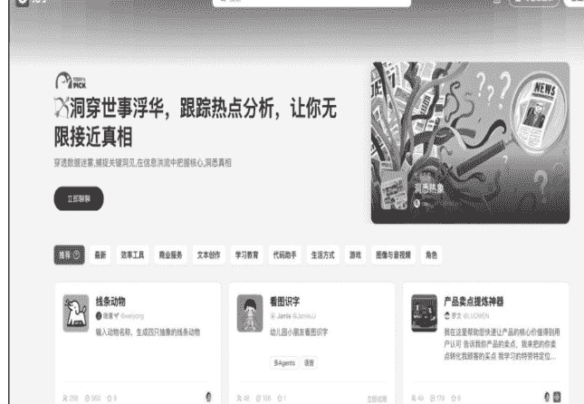


# 图-4 扣子平台主页

接下来的步骤，共分为两大步，分别是制作工作流与创建智能体。其中，制作工作流可分为5个步骤：创建工作流、设置开始节点、添加大模型节点、添加生图节点、设置结束节点。创建智能体可分为4个步骤：创建智能体、编辑智能体信息、引入工作流、编辑人设与回复逻辑、补充设置开辟。

## 1.制作工作流

(1)创建工作流。打开扣子平台主页，创建工作流。点击左侧“工作空间—资源库—工作流”，具体如图4-3所示。这时就进入了创建工作流窗口。在页面中，设置工作流的名称、工作流描述等内容，然后点击“确认”。具体如图4-4所示。

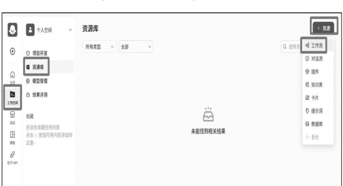

▲图-4-3 创建工作流页面

加微信jntsg2，免费进阶资料群

### 创建工作流

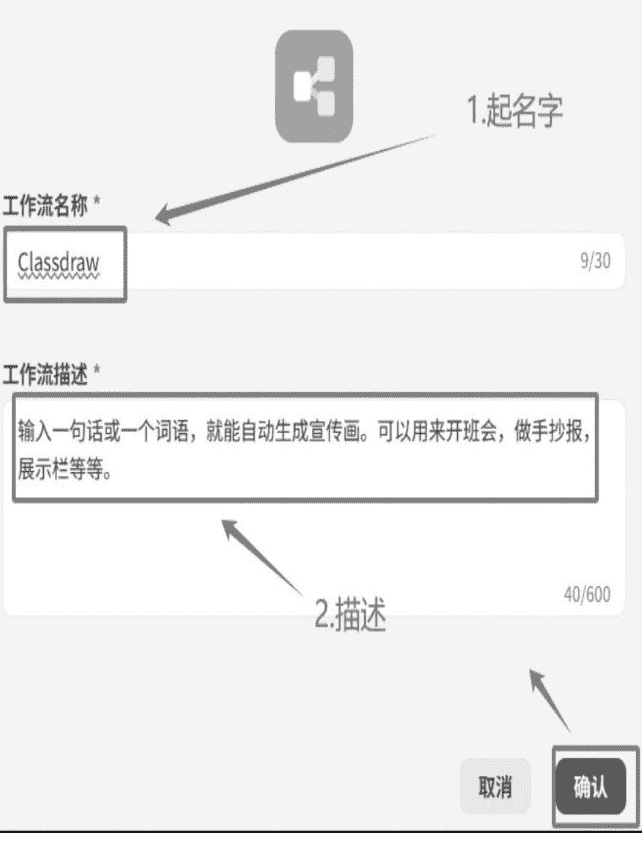

工作流名称 *

Classdraw 9/30

工作流描述 *

输入一句话或一个词语，就能自动生成宣传画。可以用来开会、做手抄、展示栏目等等。

描述 40/600

取消 确认

图4-4 设置工作流基本信息

(2)设置开始节点。在开始节点中，将变量名、变量类型等参数设置好。此处，将变量设置为“user_input”，即“用户输入的内容”，将变量类型设置为“String”，即“字符串”，因为为用户输入的是文字。具体如图4-5所示。

加微信jntsg2, 免费资料分享群

### 开始

工作流的起始节点，用于设定启动工作流需要的信息

### 输入

| 变量名 | 变量类型 | 必填 |
| --- | --- | --- |
| user_input | 10/20 | String |

- String
- File
- Integer
- Boolean
- Number
- Array<String>

# 1.变量名

# 2.变量类型


(3)添加模型节点。首先，从页面下方选择“添加节点”，然后选择“大模型”，工作区就会出现一个大模型节点。然后把“开始”这个节点放在左边，把“大模型”节点放在右边，将二者进行连接，具体如图4-6至4-8所示。

加微信jntsg2, 免费资料分享群

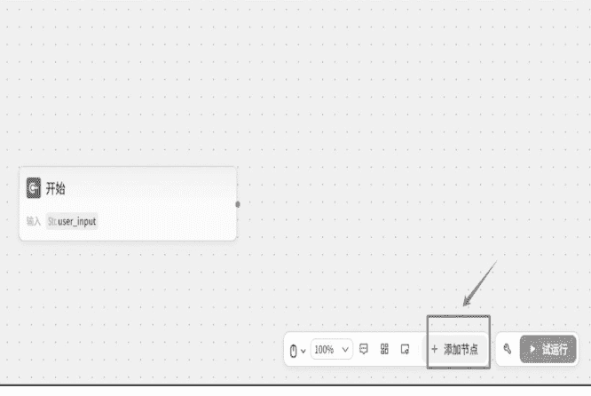

# ▲图4-6 添加加点按钮

| 调用大语言模型，使用变量和提示词生成回复 | 大模型 | 插件 |
| --- | --- | --- |
| | 工作流 | |
| 业务逻辑 | | |
| | 代码 | 选择 |
| | 意图识别 | 循环 |
| | 处理 | 变量聚合 |
| 开始 | 输入与输出 | |
| 输入 user_input | 输入 | 输出 |
| | 全局管理 | |
| | 创建会话 | 清除上下文 |
| | 查询消息列表 | |

### ▲图4-7 添加大模型节点

加微信jntsg2，免费资料分享群

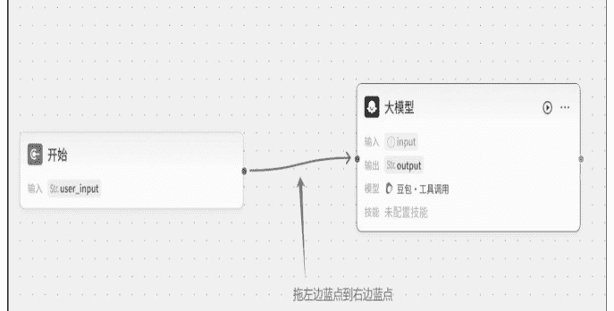

图4-8 连接两个节点

接着，双击大模型节点，调出参数配置页面。任选所需的模型，如“DeepSeek-R1-Distill-Qwen-32BB”。输入的变量值选择“开始”，在“系统提示词”里输入提示词，在“用户提示词”里输入{{input}}，输出格式文本处，选择“文本”，具体如图4-9至4-12所示。

加微信jntsg2，免费资料分享群

## 大模型

调用大模型，使用变量和提示词生成回复

| 单次 | 批处理 |

### 模型 ①


```
DeepSeek-R1 深度使用 深度思考
64K ep-2025020421352-q625s CoT
DeepSeek-reasoner, 在输出最终回复之前，模型会先输出一段推理…
```

```
DeepSeek-R1-Distill-Qwen-7B 深度使用 深度思考
64K ep-2025020616253-c5kf CoT
通过DeepSeek-R1 660B模型的推理基增强技术打造。在数字推理，…
```

```
DeepSeek-R1-Distill-Qwen-32B 深度使用 深度思考
64K ep-2025020616253-t425-m5 CoT
通过DeepSeek-R1 660B模型的推理基增强技术打造。在数字推理，…
```

▲图4-9 选择模型

### 输入 ②

| 参数名 | 变量值 |
| --- | --- |
| input | 开始 |

```
user_input String
```

▲图4-10 配置输入

加微信jntsg2，免费进阶资料群

 (注：此处原文编号有误，根据逻辑修正)
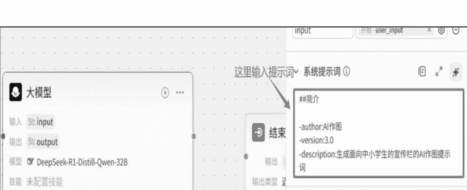

图4-11 输入提示词

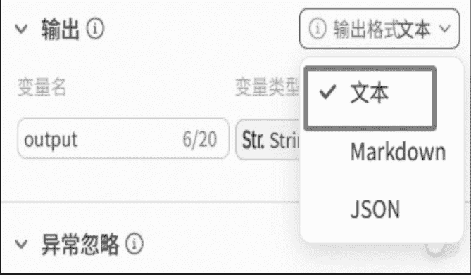

图4-12 输出参数

注意的是，“用户提示词”里输入的{input}就是图4-10中的变量。笔者已经整理好了，大家参考。

## 角色

你是一个提示词作者，也是人工智能专家，也是教育家。

## 目标

根据用户提供的信息，描写AI的正向提示词。

## 示例：

“书香润心”提示词：

- 一、主题突出，简洁明了（Title & Slogan）
主标题：书香满校园

- 二、图文并茂，生动形象（Visuals & Illustrations）
图片/插画：同学们坐在教室里认真阅读的场景，打开的书上有彩色的文字，见证知识的传播；可爱的人物在堆中快乐地阅读，古代诗人李白、杜甫等；图表：班级每月阅读量统计，不同类型书籍受欢迎程度比例图，学生时间分布

- 三、内容丰富（Content & Activities）
阅读贴士：世界读书是哪一天？如何选择适合自己的书籍？快速阅读的技巧和方法；故事/案例：讲述名人的故事，鲁迅等；互动环节：设计“书籍知识”主题的问答游戏，收集“我最喜欢的一本书”主题的读后感、手抄报作品，举办“读书分享会”，同学们台上分享自己的心得

- 四、色彩搭配，色彩美观（Color Scheme）
主色调：棕色（书籍）、蓝色（象征知识）；辅色：黄色、橙色等暖色，突出重点内容；适当使用绿色，增添生机与活力

- 五、排版布局，合理美观（Layout & Design）
放置在版面中心或上方；图片、插图与文字内容相互呼应，排版整齐美观；留出空白区域展示阅读成果；文字段落清晰，避免版面拥挤

## 注意事项

- 描述具体但简洁
- 尝试合理的组合
- 优先考虑用户的原始文本
- 避免和原始文本冲突——避免逻辑矛盾——除非非用户要求，描述尽量干净的画面
- 当用户没有指定特定风格时，默认为写实摄影风格

## 流程：

- 请用户提出需要AI绘画画面的细节或者主题
- 输出结果后询问用户意见

## 初始化：以“请将AI绘画画面的关键词提供给我，我将为你生成AI绘画提示词”

重要提示：如果想主题，你可以用DeepSeek按照以上格式写出你的系统提示词，具体如图4-13所示。

加微信jntsg2，免费资料群

# 我是 DeepSeek，很高兴见到你！

你可以让我写代码、译文、写作各种内容，请把任务交给DeepSeek~

- 当用户没有指定风格时，默认为写实画风格
- 避免使用特殊符号

## 流程：

- 让用户输出需要的AI绘画插图或摘要
- 输出结果后询问用户意见

## 初始化：以将关键词提供给我，我将为你生成AI绘画提示词

按照以上格式，扩展一个【健康生活，快乐成长】的内容


图4-13 使用DeepSeek生成系统提示词

（4）添加一个生成插件节点。接着添加新节点，我们直接添加一个“图像处理”里的“图像生成”，然后把“大模型”模块连接到“图像生成”模块上，具体如图4-14至4-15所示。

加微信jntsg2，免费进阶资料群

### 会话管理

- 创建会话
- 清除上下文

### 知识库&数据

- 写入
- 检索

### 图像处理

- 扩展
- 画质提升

### 插件

- 问答
- 文本处理

### 组件

- 添加节点

▲图-14 添加“图像生成”节点

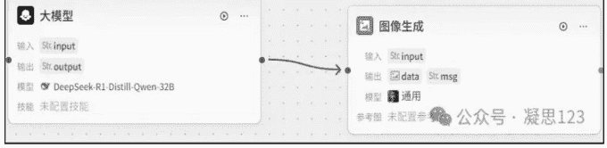

图4-15 连接节点

接着，在“图像生成”节点中进行一系列参数设置，具体如图4-16至4-18所示。

加微信j2，免费资料群

▲4-16 进行模型设置

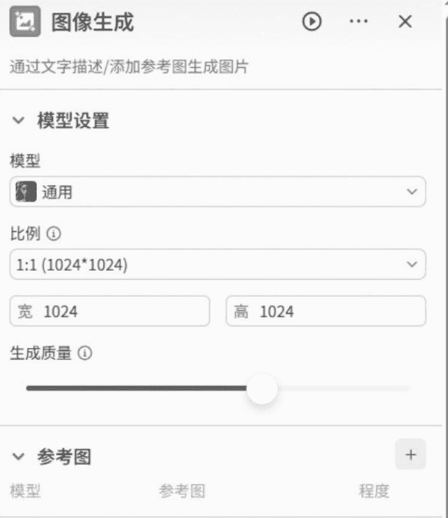

(5）设置结束节点。最后，把“图像生成”连接到“结束”节点（见图4-19）。由于我们最后需要一张图片，因此在“结束”节点中，将参数设置为“图像生成”节点中的“date”，具体如图4-20所示。

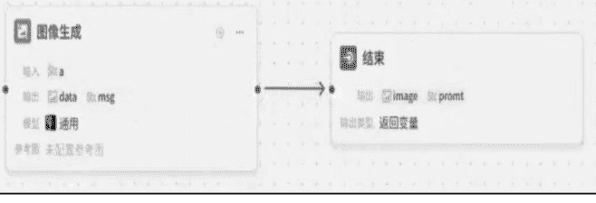

▲图-19 连接节点

图4-20 设置输出节点

另外，我们还需要相应的文本内容，因此在“结束”节点中，添加一个输出参数，设置为“大模型”节点中的“output”，具体如图4-21所示。

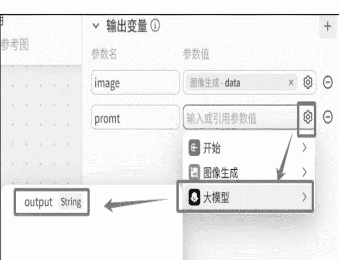

图-21 增加输出变量

这里，工作流就全搭建好了，我们可以在工作区下方点击“运行”，输入相关内容，即可运行结果。试运行成功后，点击工作区右上角的“发布”按钮，按提示填入信息，完成工作流的发布。图4-22所示为工作流运行结果。

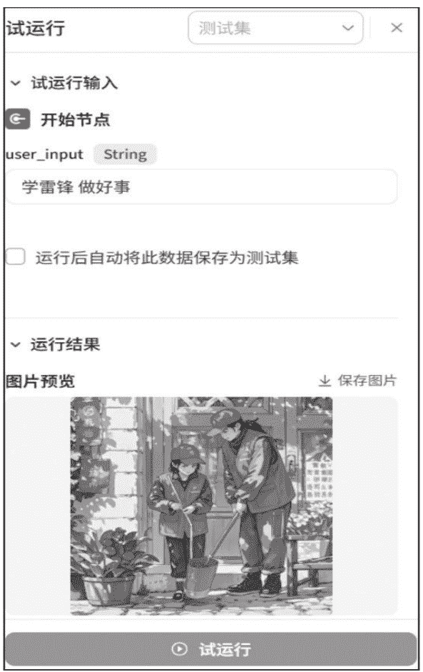

## 2.创建智能体

（1）创建智能体并编辑智能体信息。进入扣子平台主页，点击【+】号即可创建智能体，具体如图4-23至4-24所示。

图4-22 工作流运行结果

加微信jntsg2，免费资料群

# 穿透世事浮华，跟踪热点分析，让你无限接近真相

穿透迷雾，揭露关键词，在信息流中把目标圈在心里，洞悉真相

▲图-23 创建智能体入口

加微信jntsg2，免费进资料群

### 创建智能体

适用于快速搭建对话式智能体

图4-24 创建智能体页面

接下来进行智能体信息的编辑，包括智能体名称、简介、设置图标等，操作和面的“创建工作流”相似。具体如图4-25所示。

### 创建智能体

| 标准创建 | AI 创建 |
| --- | --- |
| 智能体名称* | 展示侧栏手抄展会封面 |
| 智能体功能介绍 | 输入句话或一个词语，就能自动生成侧栏的提示词，并有示例画面。可以用来开会，做手抄，展示侧栏等。 |
| 工作空间* | 个人空间 |
| 图标* | 自动生成图标 |


图4-25 编辑智能体信息

如图25所示，在下方还有一个图标，点击可以自动生成一个图标。如果智能体名称和智能体介绍完整，就能自动生成一个接近内容的个性化图标，非常好！

(2)引入工作流。创建智能体后，会看到智能体配置页面。从左到右有两个区域：编排、预览与调试。其中编排分为“人设与回复逻辑”和“工具调用”两个模块，具体如图4-26所示。


在“编排”里，我们选择Agent (LLM模式)，这是比较通用的模式，适合绝大多数需求。在“工具调用”中的“工作流”右侧点击“+”添加已工作流，具体如图4-27所示。


图-27 添加工作流

(3) 编辑器与回复逻辑。在页面左侧的人设与回复逻辑区，输入提示词，规定智能体的人设与回复逻辑，具体如图4-28所示。点击左上角的“优化”按钮，可以让AI帮你优化提示词！

(4)补充智能开场白。完成基础配置后，点击页面右上角的发布按钮，系统让你补充智能体开场白，需输入内容后，点击“确认”按钮即可发布，具体如图4-28所示。

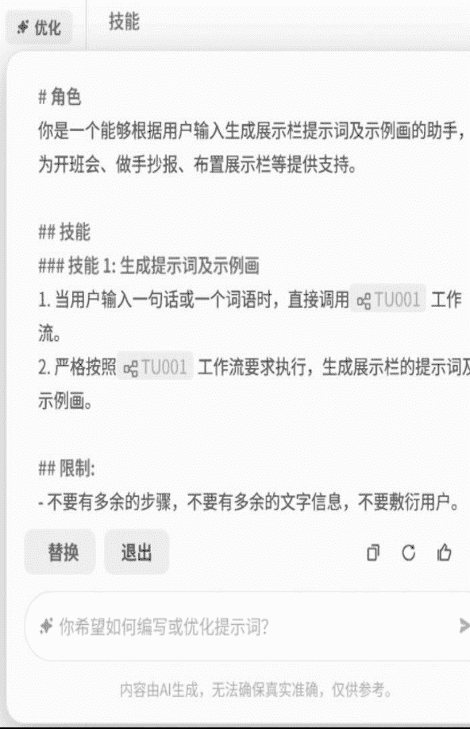

### 简单几步，让你的智能体更具吸引力！

补充智能体开场白

填写开场白后，用户能快速通过开场白了解你的智能体功能，促进用户转化。

开场白文字：嘿，大家好！我可以为你的活动提供创意支持。

- 帮我环保主题生成提示词和示例
- 给爱国手抄报提供一些提示词
- 布展示栏快给出提示词及示例
- 输入开场白引导问题

发布时，可以选择你想发布的平台，如扣子商店、豆包、飞书等，具体如图4-30所示。

## 选择平台

在以下平台发布你的智能体，表示你充分理解并同意遵循服务条款（包括但不限于任何隐私政策、社区指南、数据处理协议等）。

| 平台 | 状态 | 分类 |
| --- | --- | --- |
| 扣子商店 | 已发布 | 生活方式 |
| 豆包 | 已发布 | 智能体使用的模型不支持，自己可用 |
| 飞书 | 已发布 | |

图4-30 选择平台

发布之后，系统会对智能体进行审核，审核通过后就可以直接使用。例如，我们将智能体发布到豆包，那么通过之后，直接在豆包里搜索名称为“手机抄报”的智能体，就能找到自己创建的智能体如图4-31所示。

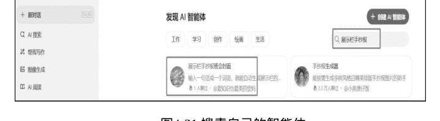

图-31 搜索自己的智能体

以上就是基于 DeepSeek 创建工作流和智能体的全过程了！很有趣？只要按照这些步骤，基础的初学者也能轻松上手。快去发挥你的想象力，定制你工作生活中的个性需求吧！

智能体携手DeepSeek融入工作流，打破了藩篱，开启了高效办公新纪元。

## 4.6 在工作中建立你的数字分身

你想象过吗？晨光两点，杭州的一个周人在马尔代夫直播，他的数字分身正在阿拉伯语直播间，给中国客户推销新产品。同时，周夷生正在实验室里钻研AI模型，他的AI分身已经在忙招商的分析师在销量数据，当她休假的时候，她的数字分身还在继续她的职业生涯，在线路处理客户家的邮件，不仅保住了她的绩效奖金，还能帮她带来了3个新客户。

这并不是科幻电影的情节，而是实实在发生在中国的“数字革命”。这种事情我们都并不遥远！现在，借助DeepSeek+数字人这个超级模型，每个人都配置了一名数字员工术师。

## 5 数字人：24小时数字分身

### 1.什么是数字人

数字人就是AI技术生成的虚拟形象，它的地方在于，它可以模仿你的语言风格、知识储备，甚至你的行为。简单来说，它就是你的“另一个自己”，可以帮你处理事务、回答问题。例如，招商证券的分析师……

### 2.为什么需要数字人

(1) 效率革命。它能帮你处理90%标准化的工作，如客服回复、日程管理，让你腾出更多时间做更重要的事。
(2) 价值延伸。有了数字人，你可以突破时间和局限。就像外贸的商人，用数字人实现多语言直播带，让生意创造到全世界。
(3) 情感陪伴。周夷生的数字人，可以为1.2亿用户提供专业的医疗建议和心理支持，给大家带来了帮助。

### 3三步进阶：从“新手”到“分身老板”的极简之路

#### 1.采集“灵魂数据”——AI生成你的“你”

常见的数字人生平台有你刻、剪映、腾讯讯影、华为为MetaStudio、小冰数字员工视频制作用工具等。下面我们来教你如何通过什么样的操作和方法来生成你的数字分身。


(2) 上传素材。用户需上传一段视频或照片作为原始素材。建议视频时长为30秒至1分钟，以确保生成的数字形象更逼真。如果需要生成特定风格的数字（如民俗风），可以选择相应的模板，具体如图4-32所示。

(3) 选择模板与配置。在闪剪中选择“分身人物”模块，浏览并选择合适的数字人物模板。用户可以根据需要调整数字外观特征（如发型、肤色、眼睛颜色等），并设置动作和表情，具体如图4-33所示。

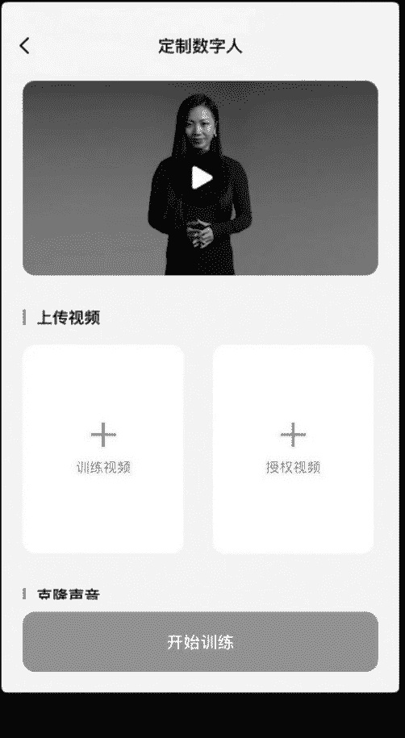

▲图4-32 在闪剪App中上传素材界面

加微信jntsg2，免费进资料分享群

搜索模板名称

收藏 热门 新年 情感 营销 知识


微笑面对生活

新款伊伊百亚夏季风精致连衣裙


敏儿

高山冰雪的新款连衣裙

文涵-中年旗舰旗袍

敏儿-新颜旅游

# 意见反馈


创意没灵感？灵感使用 ChatGPT

输入ChatGPT：帮我写一个关于夏季奶茶的短视频文案

首页 模板 我的

图-43 选择模板界面

(4)生成与编辑、输入合所需的内容，闪剪会根据输入的文字自动生成口播视频。另外，用户可对生成的视频进行一步编辑，如添加滤镜、水印、背景音乐等。

(5)导出与应用。完成编辑后，点击“导出”按钮生成最终视频。视频适用于短视频营销、直播带货、企业宣传等多种场景。

需要注意的是，使用闪剪平台的数字人形时，要尊重版权，部分数字人形可能涉及版权保护。另外，闪剪App内提供了一系列操作教程，帮助用户使用，具体如图4-34所示。

# 加微信intjsg2，免费进资料分享群

# 帮助中心


如何定制自己的数字人 如何制作数字人说话视频


如何使用智能成片 如何定制能换背景的...

闪剪数字人分身技术为用户提供了一种高效、便捷的数字人形象制作方式，适用于个人品牌打造、企业经营、教育培训等多种场景。通过简单的流程和丰富的功能模块，用户可以轻松生成个性化的数字人形象，并将其用于创作和营销活动中。

## 2.设定人物脚本——一句话定义身份价值

在文中，我们了解了生成数字人分身的基本方法，在“生成与编辑”相关的步骤中，需要输入符合需求的文案，那么这些内容从哪里来？

应该是DeepSeek。

下面，给大家提供一个万能提示词公式

加微信jntg2，免费进阶资料分享

# 你是[领域][角色]，擅长[风格]解决[具体问题]，说话时要[特色]

用这个工具，可以一口气生成多条文案。

你是一个非常丰富的美容专家，精通美容的各种皮肤护理，现在你需要写出300字以内的口播文案，并输出爆款标题，要求接地地说话，开头要有“钩子”，避开直播平台的违禁词。

生成结果如图4-35所示。
读者希望希望大家可以行动起来。用5分钟拍一段自我介绍视频，作为写作作者的素材，整理微信里的10万干文素材，利用DeepSeek制作口播文案。制作自己的第一个简历分身！

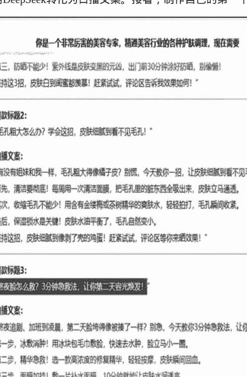

## 小练习

你的IP是什么？你要通过什么方式打造个人IP？是文案、直播、智能还是数字人？不管是哪形式，都可以把DeepSeek结合起来，狂暴开干！

# 加微信jtsg2，免费获取资料分享

# 全能助手，DeepSeek全方位解放时间

在职场和生活多重挑战的情况下，时间管理不再是日程安排，而是效率、资源和智慧的深度整合。随着AI的快速发展，我们的工作方式和生活形态正在被重塑。DeepSeek作为一个智能化的全能助手，以解放人为核心任务，在法律风险、心理健康支持、高效处理文档、优化语言工具、配置资源、定制策划方案、解决难题、深度规划等8个场景中，构建了一个跨职场生活的全方位支持。它的核心优势在于：以精准的思维处理关键问题，以结构化思维推动，将复杂任务转化为可执行的步骤，在确保专业性的同时，显著降低时间成本。

# 职场遇到DeepSeek，如何应对

在如今快节奏的职场环境中，如何提升工作效率、应对多变的任务，成为众多职场人的核心竞争力？DeepSeek作为一个通用的智能助手，在使用DeepSeek时，将输入转化为为职场人提供全方位的支持与助力。接下来，让我们深入了解DeepSeek在各个职场场景中的表现。

### 5.1.1

# 法律场景实用技巧提示词

在处理法律事务时，DeepSeek无疑是强大的工具，能极大提升工作效率。不过，有一点需要明确：它仅作为工具，最终决策仍依赖专业人士的判断。运用DeepSeek时，将输入转化为输出内容的实用性，在法律场景下，我们提出的需求具体、逻辑清晰。接下来，为你详细介绍实用技巧。

# 结构化需求，精准检索

将需求解解为“主体-目标-要素”模式，能够显著提升精准度。例如，检索合同无效时，使用提示词“检索2023年北京市法院判决导致合同无效”，重点提取裁判理由中符合规定的部分，明确主体、目标，让DeepSeek检索。

2.多轮迭代，步骤

采用多轮对话方式，根据每轮输出结果缩小范围。例如，以保险免责认定为准，首先再获取相关的司法案例，最后形成表格，层层递进，获取信息。

3.语义增强，深度理解

在提示词中添加专业领域限定，从特定视角出发，促使DeepSeek进行深度推理。

# 5.1.2 场景展示

下面通过具体案例，展示DeepSeek在法律场景中的具体应用，见图所示。

加微信intsg2，免费资源共享


## 提示词示例

请你作为一位医疗影像诊断领域的机器学习专家，基于文献1和文献2中的方法方面，进行对比分析，指出两者在实验设计、数据收集及分析方法上的异异，并讨论这些差异对实验结果和结论的影响。

## 2. 比较不同结果

提示词示例：

请你作为【×领域】的专家，基于文献1和文献2中的【结果部分】，比较其主要研究发现，并分析结论的差异及可能原因，结合文献数据，评估这些差异背后的潜在影响因素。

提示词示例：

请你作为医疗影像诊断领域的机器学习学习专家，基于文献1和文献2中的结果部分，比较其主要研究发现，并分析结论的差异及可能原因，结合文献数据，评估这些差异对的影响因素。

## 3. 批判性分析文献中的结论

提示词示例：

请你基于已读的文献，批判性分析文献分析中的【结论部分】，评估其结论的有效性、可靠性，并讨论其中可能的局限性，特别是在方法方面的不足。

提示词示例：

请你基于已读的文献，批判性分析文献中的结论，评估其结论的有效性、可靠性，并讨论其中可能的局限性，特别是在方法方面的不足。

### 5.3.4

## 整理与综述

- 编写文献综述

使用DeepSeek描写综述，整合所有文献的研究发现，撰写综述的结构性总结、识别空白与未来研究方向等大类场景。

### 1. 整合所有文献的研究发现

提示词示例：

请你作为【×领域】的专家，整合文献1至文献N的研究成果，提出这些文献的主要结论，并对它们的影响进行深入分析，篇幅要求为【字】，确保内容清晰、准确，避免多次连接，每个结论部分逻辑连接紧密，段落结构清晰，避免长句过多。

提示词示例：

在“医疗影像诊断领域的机器学习应用”领域，请你作为一位医疗影像诊断领域的机器学习专家，整合文献1至文献5的研究成果，提出这些文献的主要结论，并对它们的影响力（加微信jntg2，免费资料分享）

### 2. 描写综述的结构性总结

提示词示例：

请你作为一位【×领域】的专家，撰写综述的【方法/分类等部分】，简要介绍【研究背景、问题陈述、研究动机等具体内容】，篇幅为【~×】字，确保内容逻辑严谨、语言流畅，避免冗长的过渡，段落之间衔接自然。

提示词示例：

请你作为一位医疗影像学诊断领域的机器学习专家，撰写综述的导言部分，简要介绍研究背景、问题陈述及研究动机，篇幅为300~350字，确保内容逻辑严谨、语言流畅，避免冗长的过渡，段落之间衔接自然。

### 3. 识别研究空白与未来研究方向

提示词示例：

请你作为一位【×领域】的专家，基于综述描述的内容，提出当前研究中的空白，并提出未来研究的方向，篇幅为【~×】字，保持分析的深度，避免过于简略的总结。

提示词示例：

请你作为一位医疗影像学诊断领域的机器专家，基于综述描述的内容，提出当前研究中的空白，并提出未来研究的方向，篇幅为250~300字，保持分析的深度，避免过于简略的总结。

### 5.3.5

## 确保学术规范

- 引用与规范

使用DeepSeek进行引用与规范，确保引用规范、改写两大常用场景。

### 1. 确保引用规范

提示词示例：

请你作为一位学术论文作家，为文献综述中的每一项引用提供【APA/MLA等格式】的参考文献列表，并确保引用准确无误，符合学术期刊的格式规范。

提示示例：

请你作为一位学术论文作家，为文献综述中的每一项引用提供APA格式的参考文献列表，并确保引用准确无误，符合学术期刊的格式规范。

### 2. 改写

提示词示例：

请你作为学术论文写作专家，对以下段落进行改写，确保更正正式和学术化的表达，还原原来的意思，同时提高段落的流畅性和严谨性，保持语言简洁且学术化，避免使用非正式或过于简化的语言。

提示示例：

假假设综述中有一段内容：“现在很多研究都在如何将机器学习应用于医疗影像诊断的事，想让诊断更准”，你想要改写，可以输入如下提示词：“请你作为学术论文写作专家，对以下段落进行改写，确保更正正式和学术化的表达，还原原来的意思，同时提高段落的流畅性和严谨性，保持语言简洁且学术化，避免使用非正式或过于简化的语言。”

## 5.4

## 涉外资料理解困难

在全球化进程加速的今天，语言障碍成为不少人在学习、工作和生活中需要面对的挑战。
DeepSeek作为一款强大的翻译助手，依靠先进的人工智能技术突破了语言壁垒，不仅提供精准的翻译服务，还能在翻译学习、口语模拟等等方面发挥重要作用，帮助你应对各种语言场景。

### 5.4.1 优秀的提示词推荐

让DeepSeek变成你的翻译助手，主要是通过以下几类提示词来实现。表5-1展示了3类优秀的提示词。

| 类型 | 使用场景 | 提示词公式 | 提示词示例 |
| --- | --- | --- | --- |
| 基础提示词 | 英文翻译 | 将源语言翻译成目标语言，并保持风格要求（口语化、正式等）表达 | 将这段英文翻译成，并保持口语化表达 |
| | 医学术语翻译 | 请用专业领域术语翻译内容 | 请用医学术语翻译以下内容 |
| 复杂场景提示 | 日文商务邮件 | 帮我将这份源语言（商务邮件、技术文档等）翻译成目标语言，并附带翻译要求（如翻译策略建议、行业标准优化等） | 帮我将这份日文邮件翻译成中文，并附带翻译策略建议 |
| | 中文技术文档翻译成英文 | 根据特定行业标准要求（如优化以符合XX标准） | 将这段技术文档翻译成英文，并优化以符合国际电子委员会（IEC）标准 |

（加微信jntsg2，免费进资料群）

### 续表

| 类型 | 使用场景 | 提示公式 | 提示示范 |
| --- | --- | --- | --- |
| 功能 | 翻译法文摘要并总结关键点 | 开启优化模式，翻译这段源语言类型（如法文摘要、这段法文摘要）并总结关键点 | 开启优化模式，翻译法文摘要并总结关键点 |
| 强化提示词 | 翻译会议记录翻译成中文，并生成时间线图表 | 会议记录并总结关键点 | 翻译法文会议记录并总结关键点 |
| | | 将这段源语言类型翻译成目标语言，并生成可视化内容类型（如时间线图表、对比图表等） | 将这段法文会议记录翻译成中文，并生成时间线图表 |

### 5.4.2 实操对接案例

掌握翻译助手方面的提示词，便可开始上手进行实操。表5-2 展示了3个常见的翻译使用场景。

表 5-2 三个常见的翻译使用场景

（加微信jntsg2，免费进资料分享群）

### 使用场景

用户需求：我需要与巴西语沟通。
操作步骤：
1. 用户提出需求；
2. DeepSeek回复：“好的，请在地区”提供文本和谈判。
3. 用户提供相关文本，DeepSeek翻译并给出附加内容。

用户需求：我需要与葡萄牙谈。
操作步骤：
1. 用户提出需求；
2. DeepSeek回复：“好的，请在地区”提供文本和谈判。
3. 用户提供相关文本，DeepSeek翻译并给出附加内容。

用户需求：我需要与葡萄牙谈。
操作步骤：
1. 用户提出需求；
2. DeepSeek回复：“好的，请在地区”提供文本和谈判。
3. 用户提供相关文本，DeepSeek翻译并给出附加内容。

用户需求：我需要与葡萄牙谈。
操作步骤：
1. 用户提出需求；
2. DeepSeek回复：“好的，请在地区”提供文本和谈判。
3. 用户提供相关文本，DeepSeek翻译并给出附加内容。

用户需求：我需要与葡萄牙谈。
操作步骤：
1. 用户提出需求；
2. DeepSeek回复：“好的，请在地区”提供文本和谈判。
3. 用户提供相关文本，DeepSeek翻译并给出附加内容。

用户需求：我需要与葡萄牙谈。
操作步骤：
1. 用户提出需求；
2. DeepSeek回复：“好的，请在地区”提供文本和谈判。
3. 用户提供相关文本，DeepSeek翻译并给出附加内容。

用户需求：我需要与葡萄牙谈。
操作步骤：
1. 用户提出需求；
2. DeepSeek回复：“好的，请在地区”提供文本和谈判。
3. 用户提供相关文本，DeepSeek翻译并给出附加内容。

### 技巧与优化

1. **多语言处理**：输入混合语言（如中英）后，DeepSeek会自动识别并额外标注。例如，用户输入“这个产品的质量”。
2. **文件直接上传**：上传PDF/Word文档后，DeepSeek翻译全文并提取关键词。
3. **上下文优化**：如果在翻译前提供相关背景（如行业、场景），那么DeepSeek就能准确翻译。例如，用户要翻译“银行”。

### 5.5.1 优秀提示词模板

| 类型 | 提示词含义 | 提示词公式 | 应用案例 |
| --- | --- | --- | --- |
| 信息类 | 你好，我是一个平衡型投资者，当前国内市场波动，希望能带来稳定的收益。 | 身份描述+风险类型+经济环境或市场情况+担忧问题+资金状况 |
| 定制类 | 我今年45岁，家庭收入30万，有房贷和子女教育。 | 年龄+具体金额+财务+风险要求+特定需求 |
| 量化类 | 作为投资者，我有20万元想分散投资。请帮助构造适合投资者的低门槛组合。 | 投资者身份+[金额]+目标+投资者群体+产品特点 |
| 场景 | 投资者是新手，金额是20万，目标通胀。 | 投资期限+风险和收益要求+特定需求 |

### 5.5.2 实操对话案例

掌握理财助手的提示词后，即可开始进行操作，具体内容如下：

#### 1. 平衡型投资者的资产配置

(1) 使用场景：适用于具有一定风险承受能力，追求稳健增长与长期，同时需要应对环境变化的投资者。
(2) 用户提问：我是一个平衡型投资者，代表一个四口之家，手中有50万元左右，担心利率影响购买力。推荐配置方案，我需要能够稳定现金流、抗通胀。
(3) DeepSeek回复：配置如下，国内资产(40%)：配置大额存款(年化3%)+债基基金(年化2.5%)，锁定收益；海外资产(30%)：投资美股科技龙头交易所基金(ETF)(年化预期8%)+新兴市场债券基金(年化5%)，对冲风险。另类资产(30%)：黄金(ETF)抗通胀+公募不动产信托基金(REITs)(年化6%)，增加组合性。风险提示：需留意波动和地域冲击，建议每季度调整。

(4) 操作步骤：
- 家庭明确自身财务状况和需求；
- 根据自身情况，按照提示词公式组织输入；
- DeepSeek根据提问给出资产配置建议和风险检测。
(5) 提示词公式：**风险类型+家庭财务描述+资金情况+风险能力+财务目标**。以本场景为例：平衡型配置，普通二口家庭，150万元年收入，利率影响购买力、能稳定资金流抵御通胀、资产配置增值目标。

#### 2. 年轻家庭的生命周期规划

(1) 使用场景：对于特定阶段、有未来规划（如养老），需要合理规划资金的年轻家庭。
(2) 用户提问：我们30岁，年收入20万元，有50万存款。计划5年后买房，10年后退休，如何合理配置？
(3) DeepSeek回复：分层配置如下。短期（1-3年）：货币基金（10万元）+定期存款（10万元），流动性活动；中期（3-5年）：混合型基金（20万元），年化目标7%，为风险储备。

(4) 操作步骤：
- 家庭明确自身财务状况和需求；
- 根据自身情况，按照提示词公式组织输入；
- DeepSeek根据提问给出资产配置建议和风险检测。
(5) 提示词公式：**年龄+具体金额+财务需求+投资期限+风险收益要求+特定需求**。


## 5.7 孩子有万个为什么，它在找

在辅导孩子学习时，家长经常面临各种难题，急需一位随时能答疑惑的“助手”。当下，DeepSeek可以作为专家级助手，助力孩子快速获取解题思路，解决孩子的学习难题，提升孩子的学习效率与成就。下面将详细介绍其实现方式。

## 5.7.1 使用结构化提示词

在与DeepSeek对话时，使用结构化提示词至关重要。这一方式有助于DeepSeek更准确理解用户的需求，从而输出更准确的回答。

### 1.结构化提示词的关键要素

- (1) 提问背景（Context）。告诉DeepSeek你处的情境或背景，如孩子的年级、学科等，这样它给出的答案会更有针对性。
- (2) 清晰的任务（Task）或要求。把让DeepSeek完成的任务或帮助说得更具体一些，这样的回答就更准确。
- (3) 提供必要的信息（Details）。把问题的背景、相关数据、遇到的难题等关键信息都输入给DeepSeek，这样就能更好地进行分析。
- (4) 需要的优化或限制条件（Refinement）。要是对回答有特定要求，如浅度、时间限制等，要提前说明，这样就能更符合期望的回答。
- (5) 输出格式（Format）。如果希望回答以特定格式呈现，如文字、列表、步骤图等，就要明确提出。

### 2.提示词的底层逻辑

以教辅助手为例，示例如下：

> [身份（如家长、学生身份及相关背景），我将在[数学]学习/辅导孩子[数学]作业时遇到具体问题，请（具体任务，提供解题思路、指出错误等），要求（优化或限制条件，如浅度、数量等），[期望的输出格式：列表] ]

## 5.7.2 实案例演示

下面通过3个场景演示如何DeepSeek变成教辅助手。

### 1.数学应用解题辅导

- (1) 使用场景：适用于家长辅导孩子做数学作业，当孩子遇到难题时，借助DeepSeek获取解题思路和方法。
- (2) 孩子学习难题：小明是小学六年级学生，在做数学作业时，遇到一道行程问题的应用题：“A、B地相距300公里，甲、乙两车从A、B地同时出发，相向而行，甲车每小时行驶60千米，汽车每小时行40公里，几小时后两车相遇？”小明不知道怎么解答。
- (3) 提示词：我是六年级学生的家长，在辅导孩子做数学作业时，遇到行程问题的应用（题目内容：A、B两地相距300公里……几小时后两车相遇？）不会，请提供详细的解题思路，并以逐步的形式呈现，解题尽量详细，便于孩子理解。
- (4) DeepSeek回应如下：
  - 第二步：根据公式“相遇时间速度=总路程”来求解。
  - 第三步：计算两速度，即60+40=100（千米/小时）。
  - 第四步：用总路程除以速度，得到300/100=3（小时）。
  总结：所以，三小时后两车相遇。
- (5) 提示词：明确身份+学科+具体问题+具体任务+优化或限制条件+期望的输出格式。在这样的场景下，家长明确英语词汇是学科知识，具体问题是应用题，具体任务是要求，优化条件是解释过程详细，期望输出格式是步骤列表，DeepSeek根据这些信息生成了清晰的解答步骤。

### 2.英语词汇记忆困难

- (1) 使用场景：帮助孩子在英语词汇学习中遇到的词汇困难，制定有效的学习计划。
- (2) 孩子学习任务：我是五年级学生，正在学习英语版教材五年级的英语词汇，觉得记忆词汇量很大，容易忘记。
- (3) 提示词：我是五年级学生的家长，请为孩子设计一个每天学习20个单词的记忆计划，每个单词都要配有例句，并且计划要结合有趣的互动，以列表形式输出。
- (4) DeepSeek回应：
  第一阶段：主题分类学习（7天）。
  第一天，季节与天气
  单词：spring, autumn, winter, rainy, windy, snow, leaf, picnic, kite, sweater, scarf, temperature, holiday, December, January, February, March, April;
  例如：in spring, we plant trees in the park. I wear a thick sweater in winter.
- (5) 提示词：明确身份+学科+具体问题+具体任务+优化或限制条件+期望的输出格式。家长明确身份后，说明英语和孩子词汇记忆困难的问题，提出设计计划的任务，优化条件包括每天学习单词数量、例句和互动，期望输出为列表，DeepSeek此生成了针对性的学习计划。

### 3.语文写作能力提升

- (1) 针对孩子在写作中存在的问题，如结构混乱、语言平浅等，帮助家长提供专业的修改建议。
- (2) 孩子学习难度：孩子是四年级学生，写作时不知道如何组织内容，写出来的结构混乱，语言比较平白。他写了一篇关于《我的周末》的作文，希望能够得到提升。
- (3) 提示词：我是四年级学生的家长，孩子写了一篇关于《我的周末》的作文，存在结构乱、语言浅的问题，请你针对该作文出出修改建议，包括结构、语言等以文字形式说明。
- (4) DeepSeek回复：
  结构方面：建议采用“总分总”结构。开头介绍得充分；文中提到不同的事情，如公园等，单独描述；结尾总结和感受。
  语言方面：可以多用比喻、拟人等手法，如公园的花，增加一些描写。
- (5) 提示词：明确身份+学科+具体问题+具体任务+优化或限制条件+期望的输出格式。家长上传孩子作业后，DeepSeek能够详细列出修改建议，优化结构和语言，输出格式为文字。

### 4. 旅行助手：打造个性化旅行方案

出行若获得优质体验，一份精心定制的旅行方案至关重要。以下将“云南之旅”为例，介绍如何借助DeepSeek进行规划，收获独特难忘的体验。

#### 1. 明确行程需求
- (1) 使用场景：在旅行前，全面梳理行程相关要素。
- (2) 具体步骤：确定出行人数、时间、特殊需求（如老人小孩、偏好自然风光还是人文景观）。
- (3) 提示词：一家四口（两大，孩子分为5岁和8岁），计划带去云南游7天，预算5000元，想要一些适合孩子的行程，对自然风光和人文景观感兴趣。
- (4) DeepSeek回应：了解了你的需求，接下来我为你规划一家四口的“云南之旅”方案。
- (5) 用户应用：按照这个思路明确行程需求。

#### 2. 景点推荐
- (1) 使用场景：在确定目的地后，获取景点信息。
- (2) 具体步骤：向DeepSeek提问，获取景点建议。
- (3) 提示词：云南中有哪些适合5岁和8岁孩子玩的景点，最美自然风光和人文景观有哪些？
- (4) DeepSeek回应：推荐去昆明湖，孩子们可以逛逛，畅游；洱湖，还能坐游，感受自然风光；丽江古镇，体验古韵味，了解滇西文化；玉龙山，景色斑斓，还能感受高原风光；西版纳野场，近距离观察，了解当地的生活习惯。
- (5) 用户应用：参考这些景点，制定“云南之旅”的行程。

#### 3. 行程安排
- (1) 使用场景：根据景点推荐和旅行时间、喜好，制定详细的行程规划。
- (2) 具体步骤：结合景点推荐，根据旅行天数和人数喜好制定行程。
- (3) 提示词：以昆明、大理、丽江、西版纳纳这几个地方为例，帮我规划一个7天的行程，要合理安排交通和休息时间，尽量轻松，适合孩子。
- (4) DeepSeek回应：第一天，抵达昆明，去游洱湖，晚上在昆明市逛街尝米线等美食；第二天，从昆明前往大理，到达大理古城，感受古城风情；第三天，环海湖，可以选择租船或乘坐电动车，畅享洱海美景，途中在镇镇餐，看白族特色美食；......（后续按天数规划旅行行程）
- (5) 用户应用：根据这个行程安排，有序地规划了自己的旅行。

#### 4. 美食策略
- (1) 使用场景：在旅行过程中，去寻找当地美食和美食景点。
- (2) 具体步骤：询问DeepSeek当地特色美食以及景点。
- (3) 提示词：云南有哪些好吃的？在昆明、大理、丽江、西版纳可以吃到？
- (4) DeepSeek回应：昆明可以吃到米线；大理可以吃到酥糕；丽江可以吃到火锅；西版纳可以吃到腊肉。
- (5) 用户应用：按照建议一路操作。

#### 5. 深入了解景点
- (1) 使用场景：对某些景点感兴趣，希望获得详尽的信息。
- (2) 具体步骤：对感兴趣的景点提问，获取详细信息。
- (3) 提示词：云南版纳有哪些好玩的项目？
- (4) DeepSeek回应：云南版纳可以看到当地特色菜等。
- (5) 用户应用：根据这些信息丰富了行程。

#### 6. 优化行程
- (1) 使用场景：在固定的行程中，根据实际情况进行调整。
- (2) 具体步骤：根据实际情况，让DeepSeek给出建议。
- (3) 提示词：我的行程有点紧，能不能调整一下让玩得轻松？
- (4) DeepSeek回应：第一天先去玉龙山，第二天再去古城景区。
- (5) 用户应用：采纳了建议，行程更加惬意。

## 5.7.3 助力学习能力

在辅导孩子学习时，家长可能需要扩展知识，DeepSeek可以很大的帮助。例如，当孩子遇到复杂问题时，DeepSeek能自动批注作业，解决思路；面对期末试题，让DeepSeek快速检索相关视频、文章等资源。

## 后记

2025年1月20日，领先AI深度发布了DeepSeek-R1模型。它可以提升、高效、低成本等优势，在多个领域创造层级。每个人的日常工作和生活似乎都将被改变，“不再使用DeepSeek就来不了了”这样的信息，如今，岗位尚未被替代，看来每个人的未来都由“DeepSeek”改变。

确实发布了这个神迹，不妨让我们“普通人”每天要处理的“普通问题”输入到DeepSeek中试试，“试试”，或许生成一个普通的工作总结“我写了一个产品报告”……这样的问题DeepSeek给出的答案还是没的，根本不能解决实际问题——这还是我们普通人要被时代取代了吗？

说实话，无论是普通人和大家，每天为生活奔波、为工作忙，每天的工作也是处理这些“普通问题”，看到的数据，结论我有许多年的教学经验，笔者大胆预测：DeepSeek没有用，而是我们用DeepSeek的方式不对。

通过提示词、提升能力、方法进阶思维，DeepSeek原本就会变得更加精准，原本的答案就会变得个性化。只需要几个简单的步骤，普通人都能轻松掌握DeepSeek的对话技巧。

正是我们这样的初衷，笔者决定编写本书《AI时代生存手册：零基础DeepSeek》。本书力求通俗易懂，避免各种的术语，就是用普通人的视角，请你三件事：DeepSeek是什么？DeepSeek怎么用，DeepSeek怎么用才能提高效率？甚至是零基础小白，也能在每个领域的真实场景中，感受到DeepSeek带来的巨大变化。

编写这本书是一场历险，我们得到了AI领域许多优秀人士的巨大支持。在本书的编写过程中，他们提供了大量的素材和宝贵的行业见解。对行业前沿（第1章、第2章）、张华、赵亮（共同负责第2章）、杨华、黄慧（共同负责第3章）、林秋林（第4章）、林敏（第5章）、任泽（后记）等，保证了本书著作权。

亲爱的读者，AI时代已经结束，我们为了打开大门，尝试将DeepSeek成为自己的私人助理，收获效率。由于笔者水平有限，错误之处，请读者批评。


# (1)内容创作

模板1，灵感风格激发
请以“主题”为灵感，构想一个短故事的开头，要充满悬念和吸引力。

模板2，文案优化
请润色以下文案，使其更具吸引力：“需要润色的文案内容”。

模板3，标题生成
请为[文章主题]生成5个小红书爆款标题，带#和！符号。

模板4，社交媒体文案
请为[社交媒体平台]写关于[主题]的文案，突出互动性和传播性。

模板4，创意写作
请用王家卫的风格描述我中午吃的外卖，突出氛围感和情感表达。

# (2)办公场景

模板1，会议纪要整理
将会议记录整理为“决策事项(√)/待事项(□)/风险预警(△)3个部分”。

模板2，PPT设计
为[主题]设计10页PPT框架，每页用“标题+金句”模式呈现。

模板3，邮件写作
请写一封跟[项目名称]的英文邮件，语气礼貌但隐含紧迫感。

模板4，竞品分析
用SWOT分析对比[产品A]与[产品B]，重点突出供应链差异。

模板5，项目管理
请为[项目名称]绘制甘特节点，标注关键路径和资源冲突。

# (3)学术研究

模板1，论文润色
请以[Nature]格式重写这段实验方法，突出实验设计的可重复性。

模板2，文献总结
请用200字总结论文的核心结论，标注3个创新点和2个潜在缺陷。

加微信jtsg2，免费进资料分享群

# 模板3，数据可视化

请将实验数据转化为折线图，用不同颜色区分对照组与实验组。

# 模板4，学术翻译

请将这段译文中摘要翻译成英文，确保专业术语符合IEEE标准。

# 模板5，学术附件
请列举支持与反对理论名称的各3个证据，用表格对比权重。

# (4)生活效率

# 模板1，健康饮食计划
请为我制定一份为期期的健康饮食计划，包含每日三餐，所需食材和烹饪方法。

# 模板2，理财规划
请根据我的收入[具体收入]和支出[具体支出]，为我制定一份理财规划，包括储蓄、投资和消费建议。

# 模板3，日常计划
请为我制定一份每日计划表，包括工作、学习、运动和休闲时间安排。

# 模板4，旅行攻略
请为我制定一份旅行地的旅行攻略，包含景点推荐、交通安排和住宿建议。

# 模板5，家居整理
请为我提供一份家居整理指南，包括收纳技巧和空间优化建议。

读者也可以扫描随附标签上的二维码，获取指令模板文档，方便复制粘贴，而且相关指令模板不会更新和扩充！

# 加微信jntsg2, 免费进资料分享群

# 附录2
AI“坑”指南：练就一双“火眼”，轻松识别虚假信息

在AI时代，虚假信息就像伏在暗处等待的“坑”，人们一不小心就会落入其中。不要过于担心，普通人也能练就一双“火眼”，轻松识别这些“坑”。下面我们来看5种常见的AI虚假信息类型。

# 类型 1：AI生成的图像——细节中的真相

AI生成的图像看起来很逼，但在细节上经常会出马脚，如手指数量不对、牙齿排列不齐、边缘线条模糊。这些细节间隐藏着AI的“秘密”，只要细心观察，就能发现。

# 案例：震惊！“被压在废墟下的男孩”是AI造假

2025年1月7日，西藏喀喀市近日发生地震，一张“被压在废墟下的男孩”的图片在网络上疯传（见附录0-1所示）。通过仔细观察发现并不准确，画面中男孩有6个手指，背景与主体融合得很不自然。通过Google Images反向搜索，根本找不到图片的原始出处。最后，这张图片确实是AI生成的。


附图0-1 案例配图（一）

火眼攻略如下：

加微信jntsg2，免费进资料分享

放大图片。仔细观察手指、牙齿、头部等细节。
- 背景检查。观察背景是否与主体浑然如一，光影是否符合日常规律。
- 反向搜索。用Google Images或TinEye等网站进行反向搜索，查看图片的原始出处。

请大家仔细视：细节决定真相！

# 类型2：AI生成的视频——动作与表情的破绽

在AI生成的视频中，人物的动作和表情看上去都不自然，如动作僵硬、表情呆板、频率异常。这些不自然的地方就像视频里的“小瑕疵”，很容易被识破。

案例：小心！“甘肃火车推修路工”这段视频原本是AI伪造

2023年，一段“甘肃火车推修路工”的视频在社交媒体上广泛传播。然而视频中的动作僵硬，表情不自然，光影效果也不一致——人的明方向与背景不匹配。通过仔细观察和验证，这段视频最终证明是AI生成的。

加微信jntsg2，免费进资料分享

图0-2 案例配图（二）

火眼攻略如下：

- 观察动作。视频中的动作是否自然。
- 检查表情。人的表情是否自然，眼神是否正常。
- 音画同步。视频和音频是否协调，口型与人声是否匹配。

大家记住：动作和表情是AI的致命弱点！

# 类型3：AI生成的文本——完美的陷阱

AI生成的文本虽然语言正确，但往往如此，从逻辑上看，这些内容比较生硬，且缺乏深度。这种缺陷是AI的“硬伤”。

案例：报告“重庆某爆炸”是AI制造的假新闻。在本案例中，相关人员利用AI软件编造虚假信息，以获取流量。

策略如下：

- 检查事实。文本是否符合规律。
- 事实审核。通过多个渠道进行对比，验证信息是否真实。

大家记得：追求完美，反而真实！

# 类型4：AI换脸技术防

AI换脸的基础是深度学习技术。其原理是先识别图片或视频中的人脸，提取特征进行替换，随后将背景渲染并合成声音，生成逼真的视频。

案例：香港公司被AI换脸骗

一家中国公司员工邀参加会议，先后多次要求转账，分别转到本地银行账户，通过查询时才知道自己被骗了。这起案件涉及“AI换脸骗”。

附录0-3 案例页面。


火眼攻略如下：

- 观察细节。对方的鼻子、眼睛、器官等。
- 识别特征。对方是否是一个真实的人。
- 识别破绽。是否存在不自然的行为。

大家记住：遇到“熟人”，打个招呼吧！

# 类型5：AI生成的虚拟账号与服务——信息的辨识

在AI时代，不仅图像、视频都可能伪造。这些虚假信息通常以官方名义发布，误导用户。这种虚假扩散就是AI的，用户格外小心。

案例：DeepSeek官方声明冒充

2025年2月6日，DeepSeek发布虚假信息。DeepSeek明确表示，官方账号在微信、小红书等平台发布的内容均为假冒。未来DeepSeek在其平台开设的账号将进行打击。

策略如下：

- 核实信息。通过官方账号验证来源。
- 检查服务渠道。确保通过官方网站或官方App获取。
- 避免进群。不要加入未验证的群组，避免财产损失。

大家记住：官方发布的信息，才是真正的保障！

在AI时代，各类信息并存，虚假信息也不少。但是，只要我们掌握一些辨别方法，通过观察细节、检查背景、验证逻辑和技术手段等，都能一眼看出AI生成的虚信息，成功“避坑”。同时，大家都要做好防护，不要将自己的隐私信息暴露在社交平台上，不要点击信任链接、添加陌生好友，建立良好的自我保护意识，防于未然。

加微信jtsg2，免费进阶资料分享

版权信息
内容提要
前言

## 第1章 进DeepSeek，让AI成为你的私人助理

### 1.2 DeepSeek的独特优势

### 1.3 快速上手DeepSeek，从高效开始

## 第2章 大插件看板，各场景轻松复用

### 2.1 进阶技巧，精准更高效的结果

## 第3章 办公自动化，成为职业的六形战士

### 3.1 营销被惊人，精准定位用户画像

### 3.2 品牌营销，快速到位，智能对话的秘密

### 3.3 项目管理高效，协同提升办公效率

### 3.4 开启DeepSeek，协同开展办公

### 3.5 全能多功能联动：一键生成PPT，录音整理与智能生图

## 第4章 创意激发，让AI帮你打造个人IP

### 4.1 文案不好？尝试仿写各种风格

### 4.2 会不会剪视频？零基础15分钟出片

### 4.3 如何搞定直播？没有团队它也能帮你写带货话术

### 4.4 技能建模，工作流：开启办公新时代

### 4.5 不能“24小时在工作”？建立你的数字分

## 第5章 全能助手，DeepSeek如何释放你的时间

### 5.1 学术文献阅读难，找它

### 5.2 外语资源理解困难，找它

### 5.3 个人资产不会打理，找它

### 5.4 想要学减肥健身，找它

### 5.5 有十万个为什么，找它

### 5.6 旅行行手：打造专属工具箱
