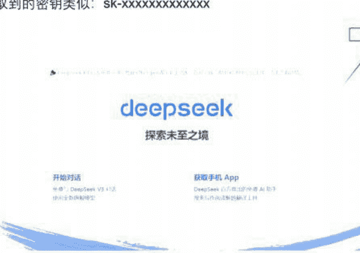
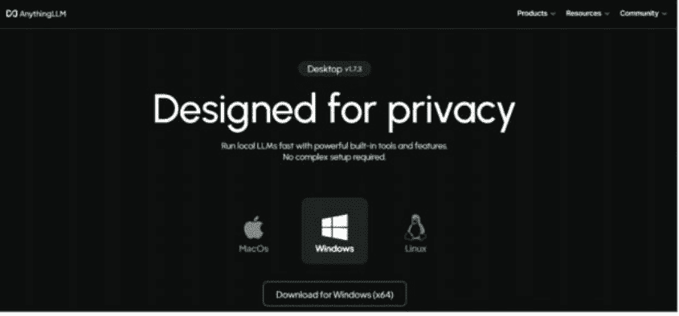
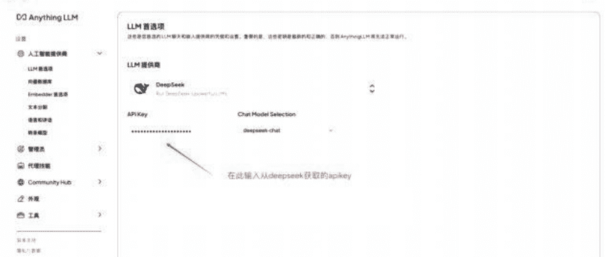
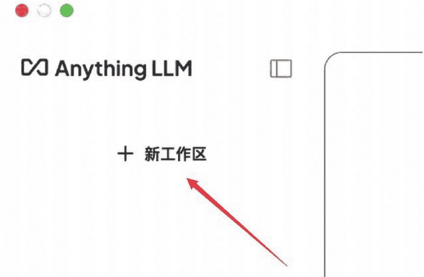
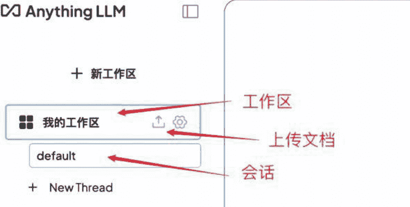
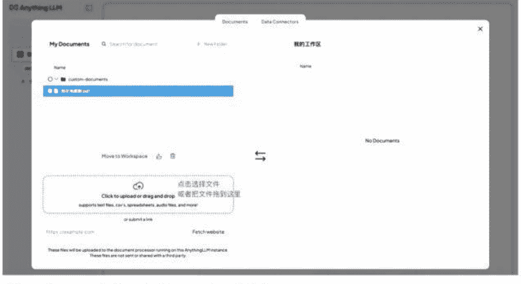
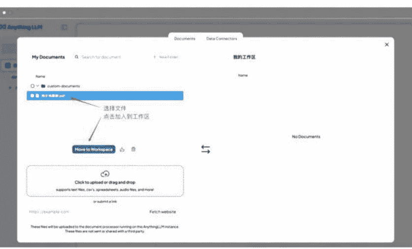
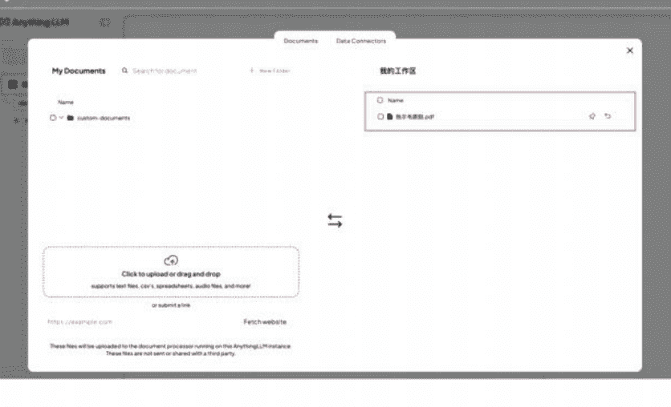
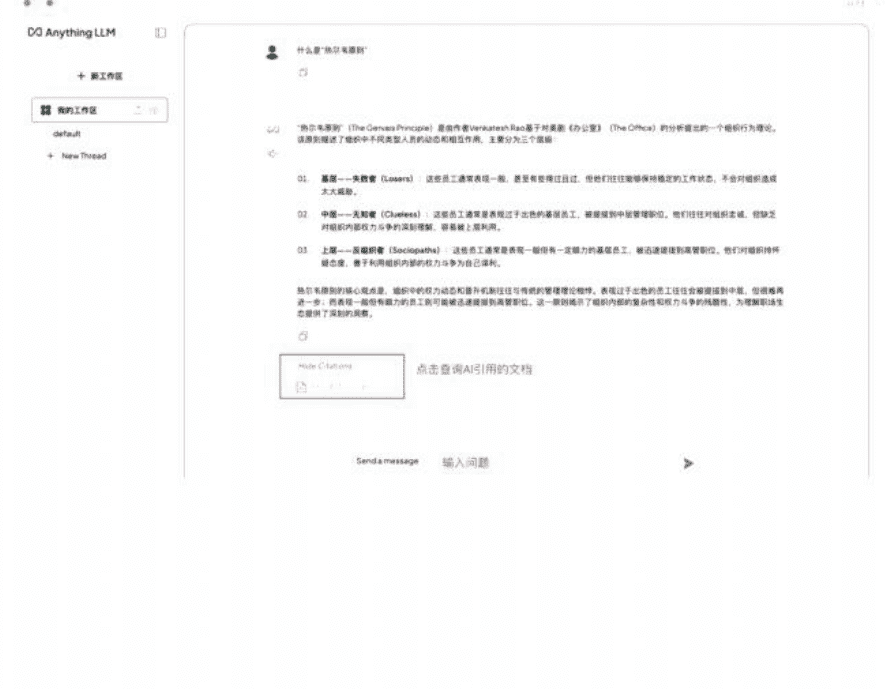
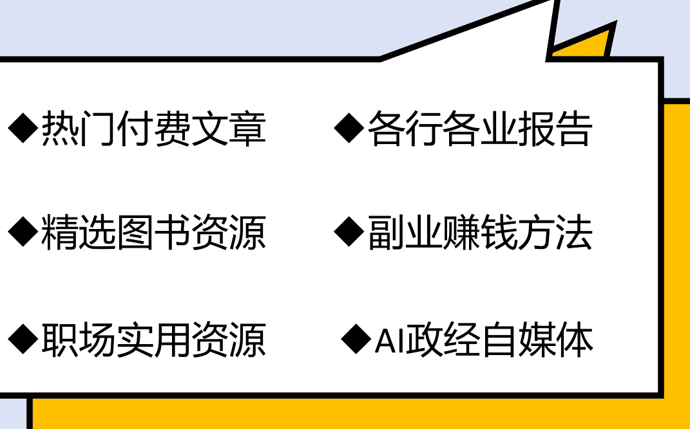

# DeepSeek V3 搭建个人知识库教程

## 前置准备

注册一个 deepseek 账号获取密钥（api key），后面 anythingLLM 会使用这个密钥接入 deepseek

1. 打开 deepseek 官网
2. 点击右上角 api 平台，登录或者注册一个新账号
3. 注册自己的账号，新注册的账号会赠 10 元免费额度（约 500w tokens）
4. 点击 apikeys，创建一个新的密钥，并复制
5. 最后获取到的密钥类似：sk-xxxxxxxxxxxx

## 下载安装 anythingLLM

浏览器打开 anythingLLM 官网，选择对应的系统下载，下载完成后直接安装即可。AnythingLLM 官方下载地址：https://anythingllm.com/desktop

AnythingLLM 是一款功能强大且高度定制的企业级应用程序，允许用户将任何文档、资源或内容转化为上下文语言，以便与大型语言模型（LLM）进行交互，本地部署所有数据和会话存储在手机上。

加微信 jntsg2，免费进资料分享群

点击进入配置页面

## 选择 deepseek 作为 AI 供应商

在 LLM 首选项，LLM 选择 deepseek，输入前面得到的 deepseek 密钥，模型选择 [deepseek-chat]

模型说明 (Chat Model Selection)：
- deepseek-chat: 即 deepseek-V3 模型，响应快，价格相对便宜
- deepseek-reasoner: 即 deepseek-R1 推理模型，思维比较密集，思考时间长，效果最好，费用较高

加微信jntsg2，免费进资料分享群

## 创建自己的工作区

返回首页，在左上角点击新工作区，建立一个属于自己的工作区，输入工作区名称

创建后的工作区如下：

加微信jntsg2，免费进阶资料分享群

## 导入文档

点击导入文档，进入文档管理界面，拖拽文档/电子书/会议纪要/论文等所有碎片化内容

选择已导入的文档，点击导入到工作区并保存

加微信 ntssg2，免费资料分享群

看到出现以下提示，表示文档导入完成，系统正在对文档进行解析

导入成功的文档可以在右侧窗口看到

加微信jntsg2，免费进资料分享群

## 开始聊天

至此，所有准备工作已经完成，返回此页面，点击【New Thread】试一试吧

加微信jntsg2，免费进阶资料分享群

# 免费 价值 专注

# 扫码加入 知识星球TOP 免费资源群

- 每日免费获取有价值资源
- 可提供各类资源搜索服务

◆ 热门付费文章 ◆ 各行行业报告

◆ 精选图书资源 ◆ 副业挣钱方法

◆ 职场实用资源 ◆ AI政经自媒体

公众号:知识星球TOP 微信信号:jntsg8 微信信号:jntsg2

分享资料仅供内部交流，请勿转发、群，切勿商用传播
