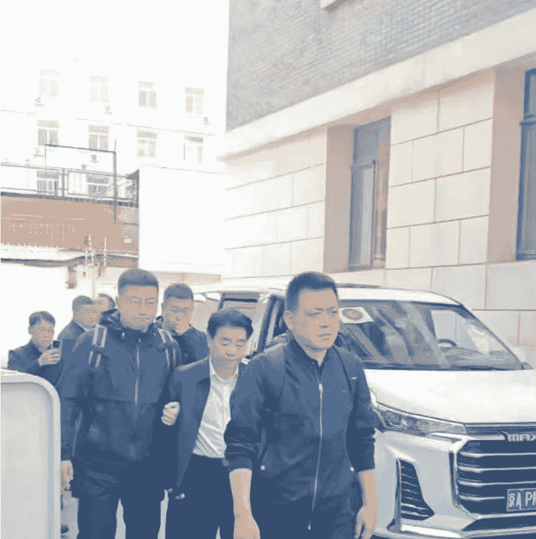
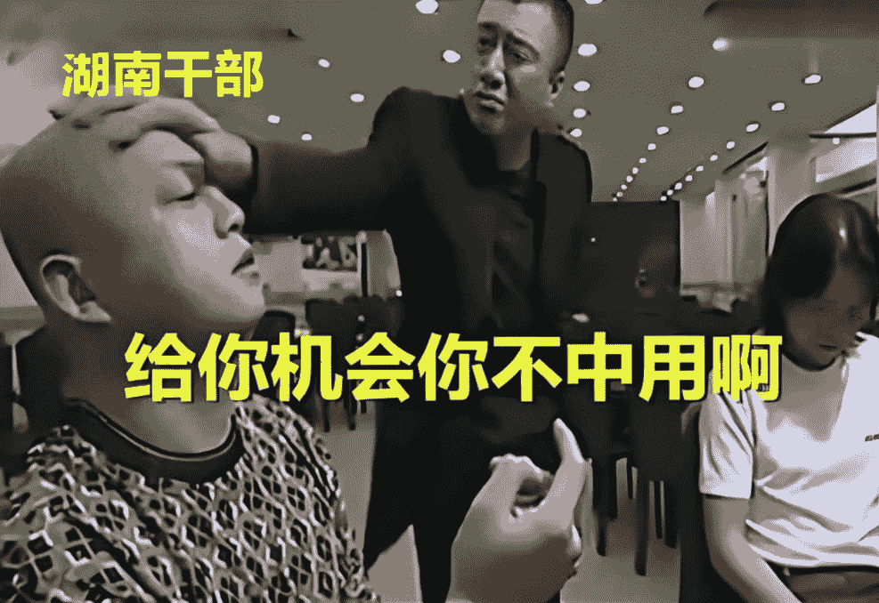

# 财政部农业农村司司长吴奇修被带调调查

原创 雄韬视线 2025年04月27日 17:01 广东

【消遥】

日前，财政部农业农村司司长、乡村振兴办公室主任吴奇修被中纪委人员案件带走。

## 吴奇修

财政部农业农村司长

吴奇修，男，汉族，1966年6月出生，湖南涟源人，1993年2月加入中国共产党，1987年8月参加工作，1987年毕业于北京大学经济学院经济系，管理学博士，北京大学应用经济学博士后。

吴奇修是湖南涟源人，被誉为省驻京办“地下主任”，与湖南籍在京员要交往频繁甚深，能协调对接京湘资源，跑遍“钱”进。

## 湖南的驻京办地下主任，落马。

干洁将重用的湖南女干部，中组部副部长，也在近期被带走了。

## 李小新

第二十届中央委员会，中央组织部副部长、中央机构编制委员会主任。李小新，女，汉族，1962年10月出生于湖南，1983年毕业于湖南农学院，中共党员。

而干洁，的确前几天就被带走了。

现在看干洁是体面还是不体面了。

不体面，直接落马。

体面，和刚子一样——撸到底。

湖南贯的干部，未来十年都不会有好的发展机会了。

从年龄层次来看，湖南正级干部基本为50后出生，60后干部仅生态环境部长干洁1人（1964年生）；副部级干部基本为60后出生，70后副部级仅银监会副主席周亮1人（1971年生）。

现在湖南硕果仅存的高级干部，只有一个。

那就是70后的周亮。

## 周亮

国家金融监督管理委员会委员、副局长、中国金融工作委员会书记。1996年参加工作，1995年加入中国共产党，研究生学士，经济学。

周亮，汉族，1971年10月出生，湖南湘州人，1996年参加工作，1995年加入中国共产党，研究生学士，经济学。

现国家金融监督管理委员会委员、副局长。

| 中文 | 周亮 | 湘州人 | 1971年10月 |
|---|---|---|---|
| 国籍 | 中国 | 出生日期 | 中共党员 |
| 民族 | 汉族 | 政治面貌 | 中共产党 |

- 1. 人物履
- 2. 担任职务
- 3. 职务任免

就是那个和老同志情同父子的秘书周亮。

这位湖南全村人的希望，但肉眼可见会被压抑发展，很难再上一样，能不落马就不错了。

加上朱王系之前的明日之星，蒋超良，也是湖南人。

可以说，湖南籍干部其实横跨新时代和朱王系。

湖南干部在新时代以干洁、易脸红为首，在朱王系以蒋和周为首。

干脸红接连出事，蒋早就出事，周自保都难。

本来要崛起腾飞的湖南干部，这下未来十年都不会有好的发展机会了。

一张图送给他们

## 免费 价值 及时 专注

## 扫码加入 知识星球TOP 免费资源群

- 每日免费获取价值资源
- 可提供各类资源搜索服务

| ◆热门付费文章 | ◆各行行业报告 |
|---|---|
| ◆精选图书资源 | ◆副业赚钱方法 |
| ◆职场实用资源 | ◆AI政经自媒体体 |

公众号: 知识星球TOP 微信号: jntsg8 微信信号: jntsg2

分享资料仅供个人学习，请及时删除，切勿商用传播
