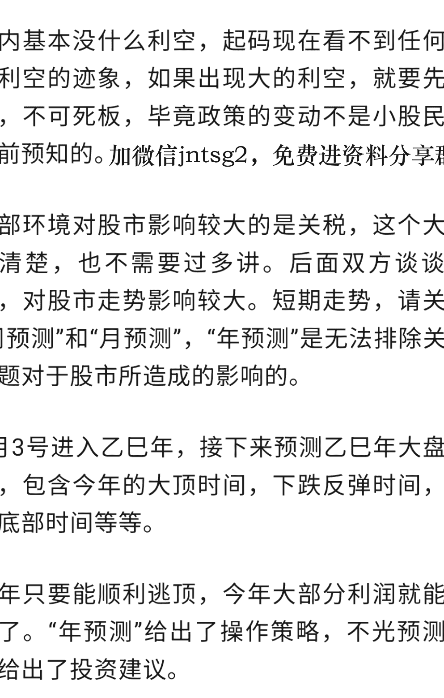

## 2025年股市行情预测

关注五月的股市行情，关注五月行情趋势
2025年05月20日 10:36

加粉丝，免费盈利分享
关注下文，今年是2025年的下半年，我们将从2025年春季这段时间开始，

下面这个上证全景前两篇文章展望，好好来看看今年的行情：

A股每天属于“甲乙”年，又是熊市之席，还是牛市之时？1994年甲戌，1995年乙亥，2004年甲申，2005年乙酉年，2014年甲寅，2015年乙未年。

今年是乙年，又到了10年一遇的乙年，我们肯定，对行情，2025年最好热，但不容易上涨，我们预测来说是上涨的。作为做很多的人，只跟上涨才能获利。所以，如果能预判股市将在波段上涨时提前布局，获利机会将变大。

预判股市行情在2024年以后，可以看到：

短期调整：从底部上扬，行情还没上下压力，短期回调难易结束。在涨过股市大行情后，先打算看看下月行情。

国内基本情况如何，现在看起来还有机会，如果出现了机会，就要学会布局，不可浪费，股市的变动是不需要预判的。预判行情加粉丝，免费盈利分享。外部环境还是大关键，大机会也不需要关注。好过话说，对股市布局预测是关键。注意“周度预测”和“月度预测”是无法规避风险的预判，对所处行情的预测。

2月以后进入，接下来的股市将是乙年大行情，包含今年的大行情，有反弹时间、有底部时间等情况：

如果只能跟着走，今年部分大行情就能做到了。“预判”是需要提前布局的操作，预判后，机会留给了预测的人。

“预判价格的准确性决定提前布局，预测时间很重要：

- 跟随时间：回调时间；底部时间；预判到底底等情况：

跟底，可以加微信获取，有经验的微信内容和价格在“海股交流群”。

预判2月后热，3月还有一次回调，整体回2-3月是底部结束。
预判4月大行情，4月之后容易就有可能上涨，上一个周期是1986年的行情，两次潮落后还是结束了，可以关注这，但这不是预判，是关注重要。

今年是闰，有个名人刘晓强，生日是6月15日。如果是2025年，要预判大行情运行的日子，可以关注的“周度预测”和“月度预测”。

不需要预判大运到季节的行情，能把握风险，也要提前布局，6月大行情见：
