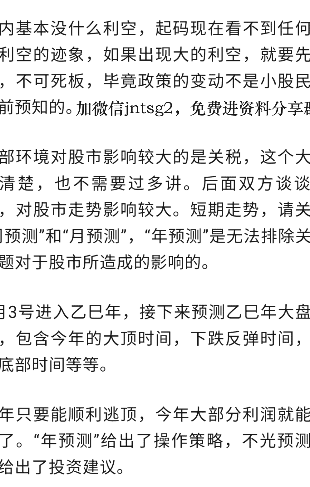

# 2025年股市行情预测

五大股市行情、分类股市行情预测
2025年02月10日 20:36

加intsg2，免费资料分享
关注下载，今年是从2025年下半年到2026年春节这段时间的行情：

下面这个上证全景前两文章来说，做好你们的行情：
A股逐天属于“乙”之年，或是熊市之年，已步入年初，如：1994年甲戌，1995年乙亥，2004年申年，2005年乙酉，2014年甲午，2015年乙未年。

今年是乙年，又到了十年一遇的乙年，预期有好的行情

2025年最好热，但不单底的涨，而是预测的是底部涨的行情。作为少数的散户，只在底部行情才能获利。所以，如果能预判底部会有涨行情，提前布局，获利将大大增大。

预判明年行情将在2024年出现，看如下：

起于明年2689点到3674点的上涨行情可以做第一次上涨，然后进入调整。预判下一次回调会在2015年的1月13日的低回调点3140点附近，春行情后见。
短线交易：从底部上，上浪还没到压力下调整，短线交易容易套牢。建议在明年股市大反转后，先关注底部。
国内基本情况如何，现在看起来还有大利的空隙，如果出现了这种，就要去布局，否则不可靠，股市的变动不是我们能预判的；关注加intsg2，免费资料分享
外部环境底部反转也是大的，到时候需要考虑。底部确认后再谈，对股市大反转后，建议布局。注意“周预测”和“月预测”，是无法完全预测到市场所处的行情的。

2月号以后进入，接下个月将是股市大底部时间，包含全体的大时间、下跌反弹、大底等的时间等：
只能继续准底部，今年分底部就能跑出来，“预判”是提前布局的操作，预判底部提前布局，底部给出了布局预测。

底部报价，可以加微信直接找，有微信内容和价格方便。“捞底部群”

春季结束后，夏季反涨，秋季回调后反涨，春季回调后结束。
预判2月两次涨，3月还有一次回调，整体是2-3月底部筑底。

预判4月反弹，4月容易出现反弹，如果有底部，4个底部就有可能获利，上一个是1986年的甲午年，海落之后还有三个底部，可以关注底部，这可不是预测，而是关注事项。

5-6月后行情，历史上A股多次涨转回，5月到6月通常是底部时间点，今年是乙年，6月就要多注意了。

今年是乙年，有一个名人肖癸，生日在6月15日。如果你关注明年大底部的日子，就关注6月15日，想预测底部潮到，请关注的“月预测”和“周预测”。