# 3月必读——怎么抄底？

原创 冷眼局中华 冷眼局中华 2025年03月01日 09:08 江苏

2月最后一天的走势虽然残暴，但是用空间换取了时间，实际上是好事。最可怕的不是调整，而是调整磨耗唧唧，每天消耗你时间和精力，那才是最可怕的。

## 你以为的长期投资
## 实际的长期投资

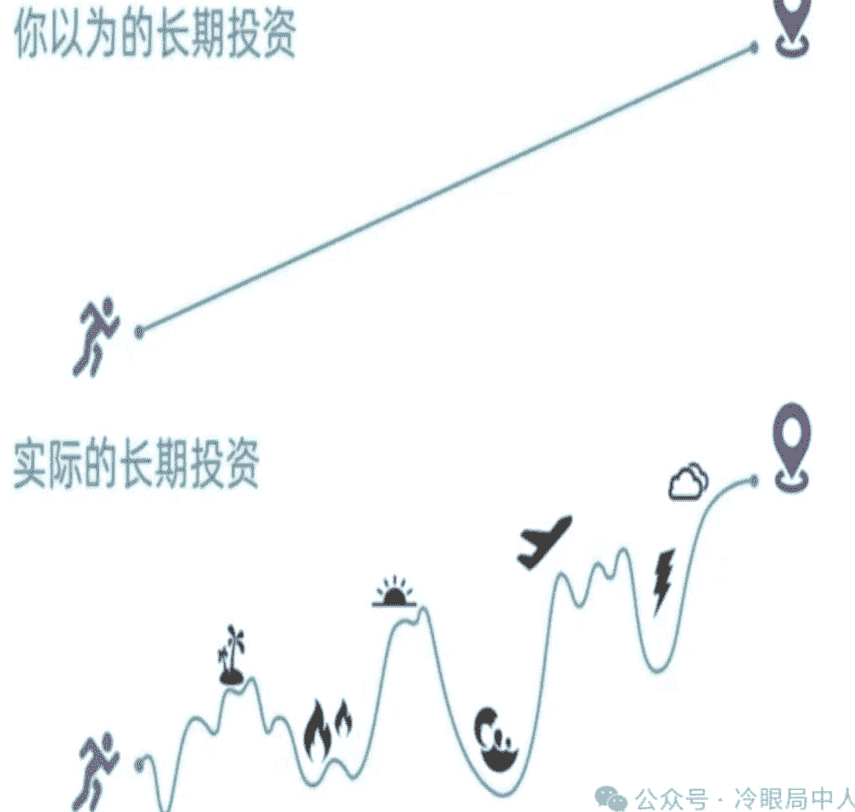

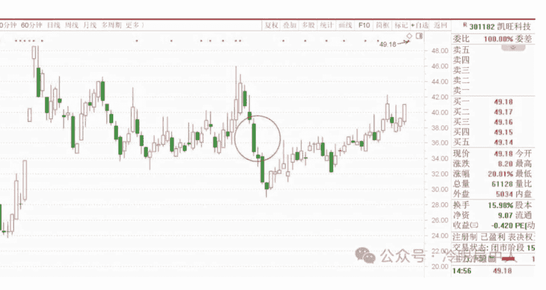

牛市实际上很多人是最难受的，回头一看全是送分，路上操作全是送命。比起这里面，你没有办法做到完美卖底抽高买回来吗？几乎不可能！真正的交易是非常态的，所以我们必须一直调和和配置一样，要努力尽可能缩小范围。然后在缩小的范围内分批买入，分批抽出，别如此，进群微信pep854

此时要清醒，巨大的操作和时间范围是最重要的，今天的文章会详细介绍大家最关心的这个问题。第二个重要问题就是调整期间关注什么，以及最后抄底买什么品种，这个也是大家最关心的问题。第三个就是即将召开的两个会有会有重要的规律，以及对后期市场有什么重要的影响。

### 一、复盘历史两次的规律
## 二、两次会规律——必考虑和潜在加仓分
## 三、月上有哪些值得关注的潜在规律
## 四、指数分析与彩蛋

### 一、复盘历史两次的规律

限于篇幅，我们无法像和机构交流一样给大家复盘2015-2024每一年的行情，我们选取几个节点，然后讲讲规律：

- 1、2015互联网与今年可能极其相似性

#### 2015年两会 —— 互联网与崛起（历史可能重演）

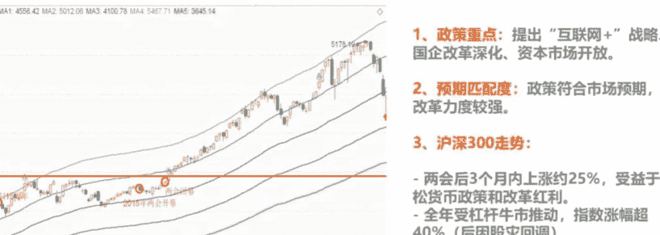

- 1. 政策重点：提出“互联网+”战略、国企改革深化、市场开辟。
- 2. 预期匹配：政策符合预期，改革力度较强。
- 3. 3000点走势：
  - 两会后3个月内上涨约25%，受益于货币政策...

#### 2015年两会 —— 故事的转轮？

聚焦2015年两会后的市场，跟踪股指WIND A类历史的走势

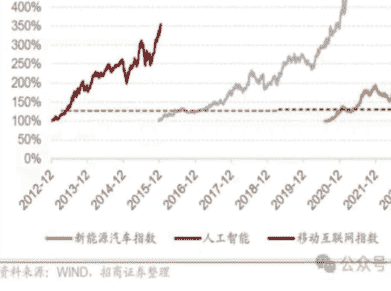

**赢行业及核心板块爆发**

- TMT（计算机、传媒、通信）：“互联网+”战略领先催化，行业板块可能迎来爆发。
- 基建（机械、工程）：一带政策推动行情板块活跃。
- 核心题材：互联网金融、国产软件、高铁钢铁。

> 公众号：冷眼局中人

2015年的两会中，指数如同开市当天就出现大幅调整，但两次中的调整就是最后的上车机会。对比从移动互联网到AI的行情，我们发现AI行情至今，行业指数涨幅远小于此前几次行情涨幅，因此行情不是结束了而是刚刚开始。

#### 2. 2017年初行情出世

建议两会将2月20日前结束的时间段内文字都看清楚，实则在不行可以找找字版，主要是寻找哪些以前没有说过的词，这些可能为未来带来大题材。2017年2月23日，两会前两天的稿中勾勒出一条没有起线的眼镜，新区规划，当时大家不知道。但是4月日，新区题材横空，成了一年最大的题材。财富大都在线里，大家一定要去敲，也可以用deepseek分析。

#### 3. 2021年政策拐点，行情结构

#### 2021年两会 —— 互联网金融开启

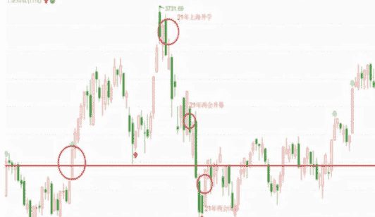

- 1. 政策重点：“双赢”目标、互联网金融、行业重整、共富。
- 2. 周期匹配：双赢政策清晰，但互联网预期。
- 3. 沪300走势：两会后政策将加强，新能源走强，全年下跌5%（高估）。

#### 2021年两会 —— 碳中狂欢

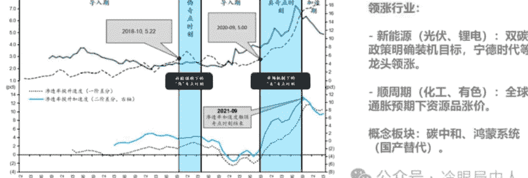

2021年两会重点提到碳中目标以及互联网，由于新能源全年涨，而互联网受制。这告诉我们，两会的政策主线将会是全年的主线，绝不偏！

#### 4. 政策总结及市场趋势

#### 两会政策与市场趋势

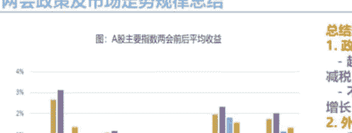

**总体趋势**
1. 政策导向：
  - 超周期（如2016年供给改革、2019年税改）趋势向上。
  - 短期内波动（如2018年杠、2022年）引发市场震荡。
2. 外部因素：
  - 宏观环境（2018）、疫情（2020-2022）、美股通胀（2022-2023）等影响。
3. 会期影响：
  - 会议期间，会议结束后50天内表现最好。
  - 两会期间的胜率约60%以上，两会后就是最佳机会。

历史数据表明从两会召开前2日到会议结束这个期间，市场震荡，而两会后基本都是上涨的。两会总体上涨，则两会后基本保持上涨。两会如果下跌，在有外部环境影响的情况下，历史上两会期间接近80%的概率是布局机会，因此大家要趁两会期间的调整，抓紧加大车力度。

### 二、本次两会热点——必考题和潜在加分

明牌：几乎必会出的政策如下：

#### 两会准备题 —— 明牌题（必无预期差）

- 1. 游戏与互联网平台松管制
- 2. 消费中的数字经济
  - 低空经济基础建设落地，专项跟进
- 坚定发展AI为核心的高科技
- 光伏去产能（传统产业）

本次核心政策之一就是，坚定AI为核心的高科技，今年全年的主线之一是高科技，大家一定不能偏。

#### 两会准备题 —— 潜在热门题（不确定有预期差）

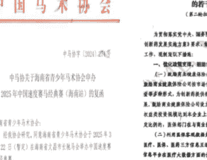

当时看着必考题是拿不到高分和高收益的，想要看到收益就要去搏大家看好的，潜在可能的爆发（例如年前线的行情）。

这次会议，有一个预期差就是支持创新的医药提案可以引发社会热话，具体政策要过一段时间才能落地，最大预期就是医保支持创新，未来创新与医药将两种选择。

另一个值得关注的支线就是海南封关，从时间看海南确定在今年12月31日封关，是正式封关前还需要半年试点封关，最后时间可能在12年底，会有一定的提前。我们认为从3月到4月期间试点封关关键期，因为2032年海南有南海大赛，3月25-28又是博鳌论坛，3月13是机场成立纪念日，这个期间海南可能有新闻引发关注。其他三个政策大家上图。

### 三、3月还有哪些值得关注的潜伏题材

#### 三事件机会潜藏

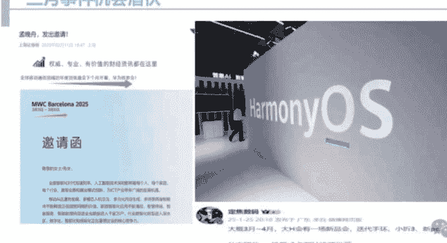

| 华为近期大事 |
| :--- |
| 1. 3月3-6日通信，介绍AI与5G的应用。 |
| 2. 3月将为春季新品发布会 |
| 3. 3月，Pura80系列可能发布 |
| 4. 预计月中旬，纯血鸿蒙发布 |
| 3月3-6日华为将在大会 |
| 3月20-21日华为在深圳召开大会 |
| 月底可能将春季新品发布

爆料来看，目前确定的三款：华为手机、MateBook。目前关注最高的是：

- 603626（科材料）：专业铰链，已大量产。
- 300328（安宜科技）：液态金属在折叠手机上的大应用。
- 001144（东软股份）：提供天线、无线充电模块等。
- 001136（信捷通信）：提供天线、无线充电模块等，是合作伙伴。
- 000888（长信科技）：应用于折叠手机、可穿戴等高端产品。
- 603773（沃格光电）：长期合作，产能能力全球领先地位。
- 000049（德赛）：提供多种电池封装和电源管理系统。
- 000207（旺达）：锂电池对象，消费电子厂商。
- 000684（中石科技）：手机终端合格供应商，屏蔽等材料。
- 000725（京东方A）：多款手机柔性AMOLED屏。
- 002387（维信诺）：手机nova系列OLED屏幕。
- 304433（蓝思科技）：全球领先的手机制造，玻璃板。
- 002475（立讯精密）：全球领先的电子制造供应商，连接器、线缆等组件。

### 四、数据指数与彩蛋

大会在3月11日左右闭，这意味着大家要紧紧时间，调整可能会3月11日前完成。根据逻辑，在3月21日亚洲赛前我们应该好防守，而很大可能与A同时涨，时间范围缩小，我们主要来看指数和分类指数具体支撑位。

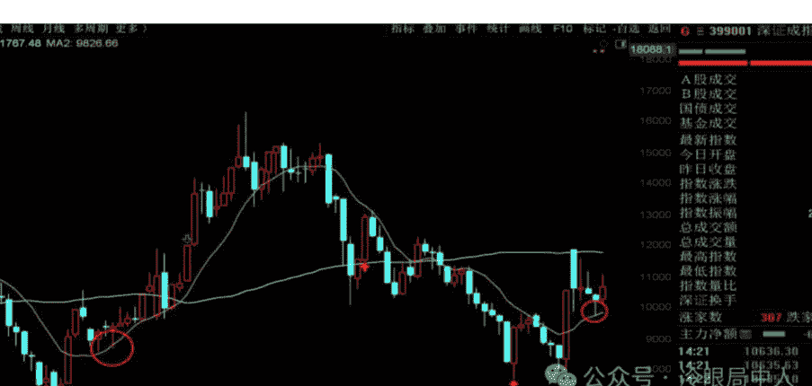

首先大家记住指数的底部依然在关河线，如果3月胆再次挑战关河线，就是里面买完了。3月10旬后，大约会上行到3200附近，可以理解3200点就是底部思维。

#### 000001上证指数

| 数据监控 | 系统连接 | 登录 | 历史回测 | 分析工具 | 线指标 | 筛选 | 品报 | 队列 | 移动 |
| :--- | :--- | :--- | :--- | :--- | :--- | :--- | :--- | :--- |
| 指数 | 3510.45 | | | | | | | |
| 跌 | 5 | | | | | | | |
| 涨 | 3 | | | | | | | | |
| 盘 | 2 | | | | | | | | |
| 1 | -9315644 | | | | | | | | |
| 1 | -6072326 | | | | | | | | |
| 买 | 2 | | | | | | | | |
| 4 | 5 | | | | | | | | |
| 最新 | 3320890 均价 | | | | | | | | |
| 涨跌 | ¥6716 接手 | | | | | | | | |
| 涨 | -1.98% 今开 | 33 | | | | | | | | |
| 总 | 668319480 最高 | 33 | | | | | | | | |
| 现 | 3832192 最低 | 33 | | | | | | | | |
| 总量 | 75805088 北化 | 33 | | | | | | | | |
| 涨停 | 372687 跌 | 33 | | | | | | | | |
| 总盘 | 每周 | | | | | | | | | |
| 内盘 | 外盘 | | | | | | | | | |
| 报告期 | 20241231 | | | | | | | | | |
| 总股本 | 30438880 | | | | | | | | | |
| 日流通 | 3095457 | | | | | | | | | |
| 每收收益 | 0.6 | | | | | | | | | |
| 每净资产 | 0.6 | | | | | | | | | |
| 净资产收益率 | 6.44 | | | | | | | | | |
| 市盈 | | | | | | | | | | |
| 每股经营现金 | -0.01 | | | | | | | | | |

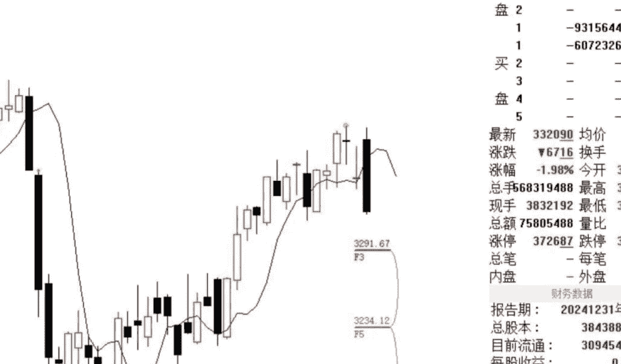

我们在进一步缩小范围，指数低消费在3291点，也就是由于这个位置调整太可能结束，而在3234点有强支撑。因此在此应该在3234这个区域内分批建仓。

### 399001证指数

| 数据监控 | 系统连接 | 登录 | 历史回测 | 分析工具 | 链指标 | 筛选 | 品报 | 队列 | 移动 |
| :--- | :--- | :--- | :--- | :--- | :--- | :--- | :--- | :--- | :--- |
| 指数 | 5 | | | | | | | | | |
| 跌 | 4 | | | | | | | | | |
| 涨 | 3 | | | | | | | | | |
| 盘 | 2 | | | | | | | | | |
| 1 | -250677 | | | | | | | | | |
| 1 | -560316 | | | | | | | | | |
| 买 | 3 | | | | | | | | | |
| 4 | 5 | | | | | | | | | |
| 最新 | 106124 均价 | | | | | | | | | |
| 涨跌 | ¥3127 接手 | | | | | | | | | |
| 涨 | -2.89% 今开 | 101 | | | | | | | | |
| 总 | 28550096 最高 | 101 | | | | | | | | |
| 现 | 21691562 最低 | 101 | | | | | | | | |
| 总量 | 10089696 跌 | 101 | | | | | | | | |
| 涨停 | 每周 | 551 | | | | | | | | | |
| 总盘 | 外盘 | | | | | | | | | |
| 报告期 | 20241231 | | | | | | | | | |
| 总股本 | 2679452 | | | | | | | | | |
| 日流通 | 2323262 | | | | | | | | | |
| 每收收益 | 8.2 | | | | | | | | | |
| 每净资产 | 5.5 | | | | | | | | | |
| 净资产收益率 | 2.58 | | | | | | | | | |

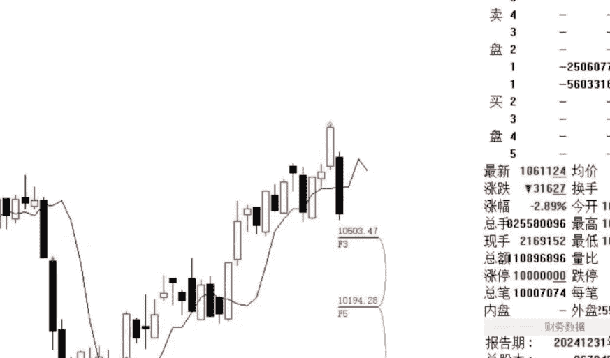

#### 399000创业板

| 数据监控 | 系统连接 | 登录 | 历史回测 | 分析工具 | 链指标 | 筛选 | 品报 | 队列 | 移动 |
| :--- | :--- | :--- | :--- | :--- | :--- | :--- | :--- | :--- | :--- |
| 指数 | 2426.79 均价 | 217029 | | | | | | | | | |
| 跌 | ▼8612 | | | | | | | | | | |
| 涨 | -3.82% 今开 | 22: | | | | | | | | | |
| 盘 | 28144612 | | | | | | | | | | |
| 1 | 53092042 比重 | | | | | | | | | | |
| 1 | 10000000 跌幅 | | | | | | | | | | |
| 买 | 6059452 每手 | | | | | | | | | | |
| 4 | 1146 | | | | | | | | | |

#### 000688 科创50

| 数据监控 | 系统连接 | 登录 | 历史回测 | 分析工具 | 链指标 | 筛选 | 品报 | 队列 | 移动 |
| :--- | :--- | :--- | :--- | :--- | :--- | :--- | :--- | :--- | :--- |
| 指数 | 107888 均价 | | | | | | | | | |
| 跌 | ▼449 接手 | | | | | | | | | |
| 涨 | -4.22% 今开 | 111852 | | | | | | | | | |
| 2 | 手48627540 最高 | 107681 | | | | | | | | | |
| 1 | 389736 最低 | 10768 | | | | | | | | | |
| | 108993532 比重 | 1478.31 | | | | | | | | | |
| | 123952 跌幅 | 101833 | | | | | | | | | |

### 00065

科创50指数第一支撑1057-1060，这里是叠加加支撑比较强度，建议可以加仓的。

### 00065科芯片

| 均价 | 9932 |
| :--- | :--- |
| 换手 | -5.21% |
| 最高 | 720459 |
| 最低 | 43230 |
| 涨幅 | 634808 |
| 跌幅 | 209612 |
| 外股 | 72 |

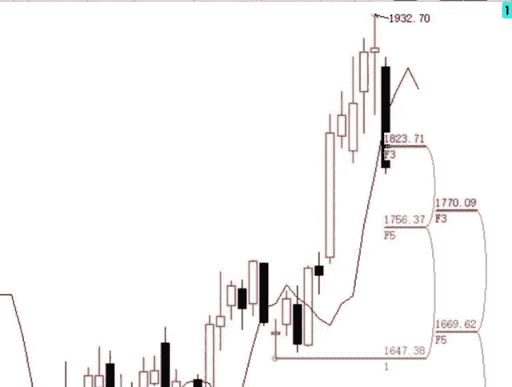

报告期：
股本：
流动：
收证：
净资产：
收益率：

科芯片与此类相似，在1756-1770有强支撑，值得尝试试错。

##### 彩蛋1——3月惊奇，南海题材？

3月3日北上播出，但北部两个字却是绿色的，意味着等看完北部指数再上。这个期间，大运河题材要重视，一旦北部热播可能引发波涨。这里里面的公司可以参考去年9月必读，这次又出了北上乌克兰重建的题材，还有名字带胆的涨的题材。

最后总结一下：

- 两会期间可能延续调整，这是机会机会，要找机会继续买科技股。
- 指数到底10月线，如果到了不要就要拼命。

# 免费 价值 及时 专注

# 扫码加入 知识星球TOP 免费资源群

- 每日免费获取有价值资源
- 提供各类资源搜索服务

| 热门付费文章 | 各行行业报告 |
| 精选图书资源 | 副业赚钱方法 |
| 职场实用资源 | AI经营自媒体 |

公众号：知识星球TOP   微信信号：jntsg8   微信信号：jntsg2

分享资料仅供个人学习，请及时删除，切勿商用传播
