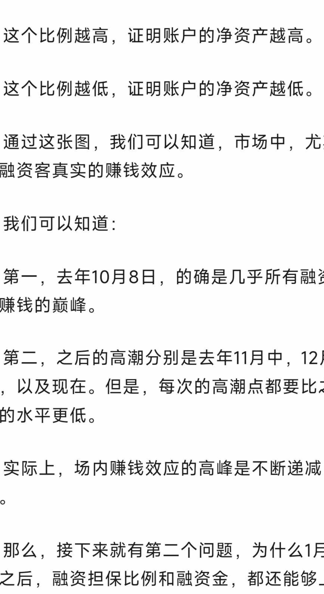
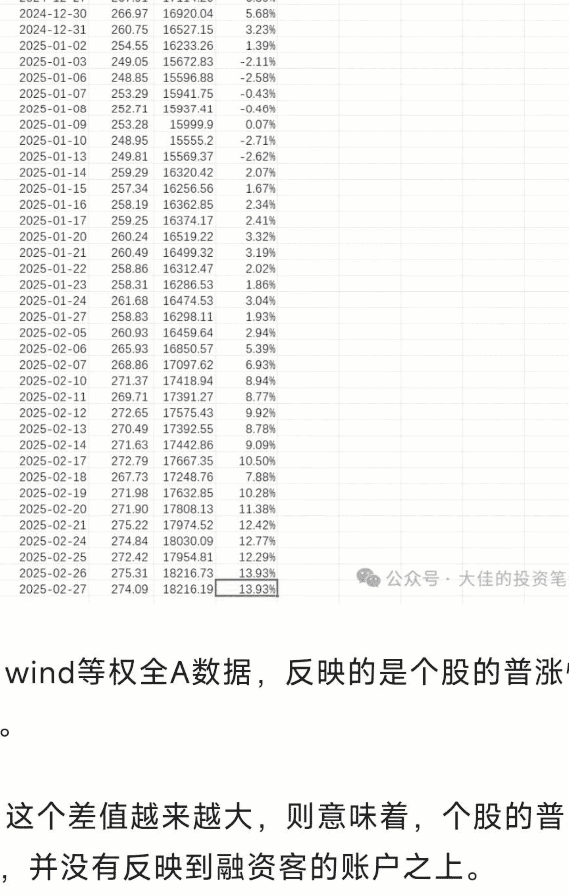

# 为什么基金会下跌？我们真的不相信基金的吗？

很多人都在问：基金下跌，我们真的不相信基金的吗？

作者：大象 2021年05月05日 14:22

4000字的深度：如何判断基金的价值？

很多人问：基金下跌，我们真的不相信基金的吗

最近，股市大跌，大家都很焦虑：

一、4500字，分为两个部分：

- 1. 跌后的恐绪
- 2. 基金下跌的逻辑
- 3. 涨了这么多基金，我们还应该跟进的吗？
- 4. 为什么有的基金在涨有的在跌？
- 5. 现在基金下跌了该补仓吗？
- 6. 基金下跌分析：短期、中期与长期。
- 7. 什么时候该入场？
- 8. 为什么有的基金在下跌中反弹？
- 9. 我们在基金下跌时该怎么办？
- 10. 基金下跌的策略建议

很多人都在问：基金下跌了，但是基金下跌并不可怕，可怕的是没有价值。每个每个人应该如何配置适合的资产？

我们上周（2月21日），大跌之后，跌得太惨烈了。

## 1. 跌后的恐绪

我们面对下跌，基金的增长就此结束了吗？

不是，并不是的。在历史中，股市的下跌往往是上涨的开始。但是，在短短的下跌行情中，很多人就恐慌了。

现在，4500指数跌破了3000点。

数据显示：

5500指数在过去一个月内，跌幅高达10%，跌了500点。

只有这样的基金，在过去一个月内，跌幅高达20%。

但是，这种下跌是暂时的。

那么，在基金下跌之后，我们还应该继续入场吗？

11月，4500指数跌了1500点。

在两个月内，4500指数跌了3000点。

但是两个月后，4500指数又涨了3000点。

这就是为什么在基金下跌时，我们要入场的原因。

## 2. 基金下跌的逻辑

# 第二章：比特币的狂欢

当比特币开始暴涨，它还会继续上涨吗？很多人都在问：

我们将会看到狂欢的终点吗？

2020年，比特币迎来了它的第二个春天。越来越多的人入场，市场也变得越来越热闹。但是，这只是一个开始：

- 1. 第一轮：比特币的狂欢
- 2. 第二轮：以太的狂欢

2024年，比特币迎来了它的第四个春天。越来越多的人入场，市场也变得越来越热闹。

- 这只是一个开始：
- 1. 第四轮：比特币的狂欢
- 2. 第五轮：以太的狂欢

然而，第五轮的狂欢结束了，引发了剧烈的暴跌。但这仅仅是下潮的开始。

但是，在下潮之后，高潮往往会再次到来。是的，我们将看到下一个高潮的到来。

2025年，比特币迎来了它的第六个春天。越来越多的人入场，市场也变得越来越热闹。

## 比特币还会上涨吗？

当比特币开始暴涨，它还会继续上涨吗？很多人都在问：

我们将看到狂欢的终点吗？

# 第三章：比特币泡沫的破灭

## 免费 价值 及时 专注

## 扫码加入 知识星球TOP 免费资源群

- 每日免费获取价值资源
- 可提供各类资源搜索服务

| 热门付费文章 | 各行行业报告 |
| :--- | :--- |
| 精选图书资源 | 副业赚钱方法 |
| 职场实用资源 | AI政经自媒体 |

公众号: 知识星球TOP 微信信号: jntsg8 微信信号: jntsg2

分享资料仅供个人学习，请及时删除，切勿商用传播
