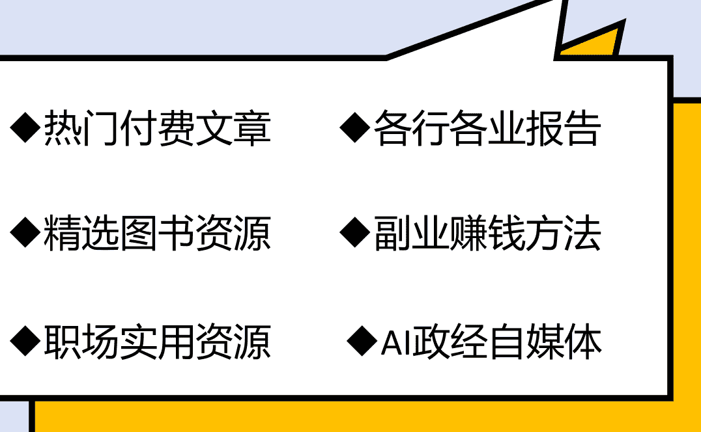
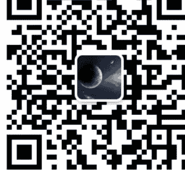

# 群聊

2025年3月1日

张宪芬被查路

这种会议会有关系，反而对着记者的局面全公开，很反常，司机就应该留有心防

果然，司机一举还是普普米亚值得信任后，万斯看辩论不是，直接连接就是最好的，司机抗人坝挺前线

张宪芬

司机媳了，本来继续普普米值得信任就是优势在他，他被司机激怒了，开始和万斯互喷，甚至喷到了美国

张宪芬

司机优势全无，红温吵架，彻底搞砸，懂万斯套路成功

司机后来被白宫赶出去了，不欢而散

万斯懂王者可以把甩锅给司机了，对欧洲和美国内部来说，是司机太无礼了

张宪芬

这对司机是坏的，对我们是好事，司机还是挺硬的，值得我们加大支持力度

张宪芬

普普当面感谢朝鲜支持

张宪芬

三胖的人是24号就来的，放炮是26日放炮的

普普是27日在克里姆林宫闪电会面的的

张宪芬

我打司机牌，你打半岛牌就看谁技高一筹

张宪芬

群里对兔熊，大家心里知道就行，不多聊这方面面了这段时间

张宪芬

[动画表情]

张宪芬

视频
5*

王玥

这个是加工的吗？🙈

# 免费 价值 及时 专注

# 扫码加入 知识星球TOP 免费资源群

- 每日免费获取有价值资源
- 可提供各类资源搜索服务

公众号: 知识星球TOP 微信号: jntsg8 微信信号: jntsg2

分享资料仅供个人学习，请及时删除，切勿商用传播
