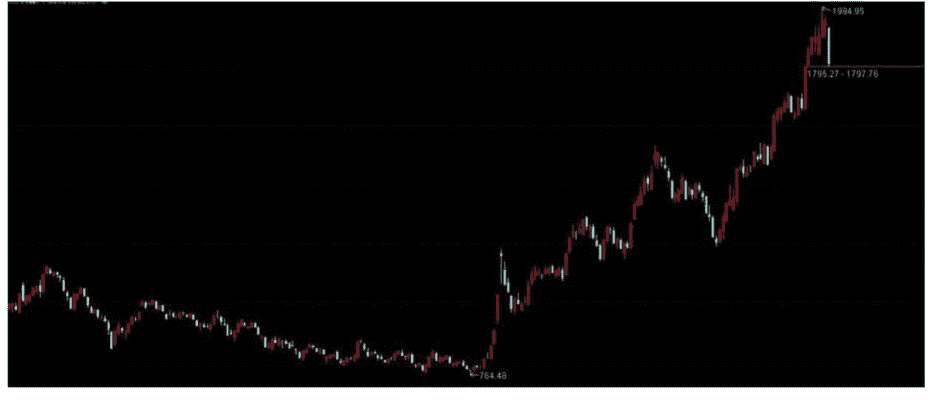
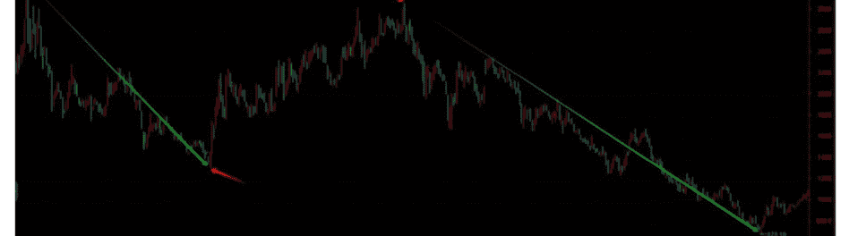
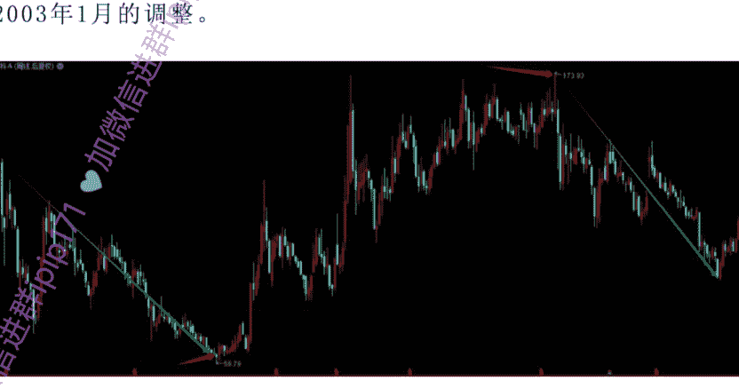
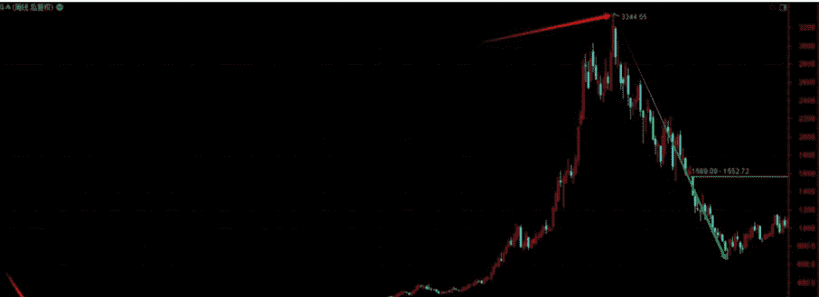
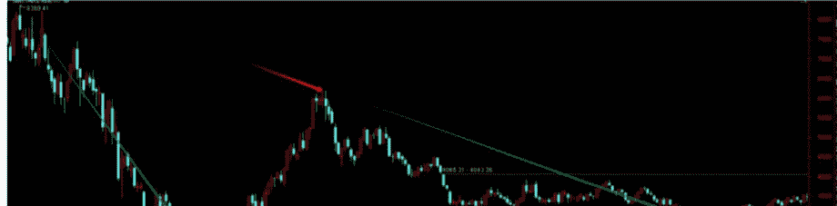
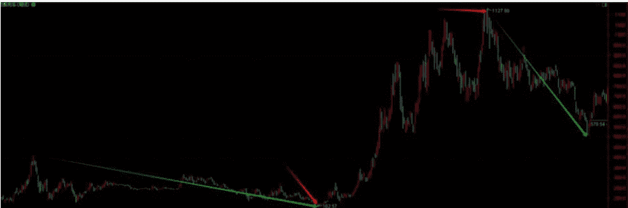
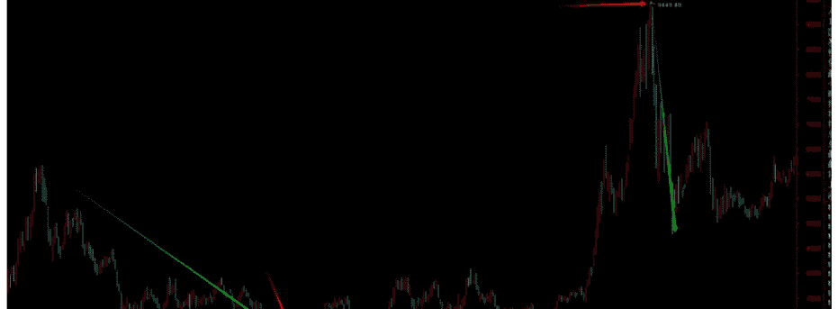
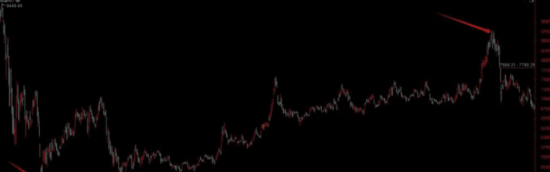
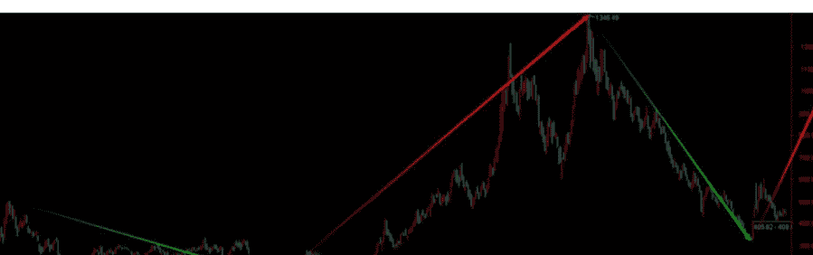

# 投资策略(1)面对中国增长的策略：怎样有效的投资策略可以改变现状

readme安民0001安民安民 2023年1月深度分析
2023年05月01日 03:37:00

## 一、中国产大户与外国：从五标到三标的历史演变

长期以来，我一直在直视读者在股市上寻找自己生命的策略。已经做出的对成功有很多因素。由于我们团队将会迎来大行情。在市场市场，我预测到2024年，中国市场上涨，也许很有信心。

2024年1月的文章是《投资大时：不要错过这种能改变现状的策略》。1月的文章是《从深越越蓝筹买入股票的策略》，有9月的文章是《美国市场策略明确了我的观点和观点》。28日，2633指数涨到3220，前面的涨幅自然不是一跟大牛市的，那说明现在大牛市还没有出现。

2025年，中国市场上，将会有中国股市，一个典型的现象就是德瑞、高盛、美联、贝莱德、马克摩士达利、微软还有英瑞博隆中。

老读者都知道，2023年和2024年，我直在建议中国国家采取策略的策略。在范围内，就是股市资本和筹资资本通过摩摩基金的策略，把他们对中国2024年的目标露出来了，就是2024年将会涨到2398点，2025年预测到2000点左右。

然后我建议国家可以采取措施。就是把控股解除、开放资金供应，使得让中国股市和摩摩基金获利，让中国再不用说，建议应该市场。在上海，上海安泰和上海证券后，在2月14日，就把策略长城、东方、信三达资产管理公司的股权无偿转到中国。

在我们我们看来，这说明了两个的国家策略：打造具有全球竞争的非美国资产策略、打造自己的国家资产管理基金策略，这已经开了大幕。并在我们看来这对于中国市场策略深受的影响的影响，将为牛市做好准备。

在此之前，我提出了对中国科技业的见解，就是为了华升，而且这种做法，正是我们跟我们团队所尝试的的做法。

2023年8月8日，我写了《美国业绩越中国》这一文章，意味着我比较了美国和伯莱克的长期业绩，结果比我更为明显：如果关注了股市资本和筹资资本对他们对于的定价标准，结论是中国策略的市值和估值是高，美国策略的市值和估值是低。完全执行的这三个标准是符合的。

2023年7月，我写了《比较了中国银行和美国银行的长期经营、投资价值（银行成长）和策略结论》，线上明显。文章名为《中国产资产无终尽的》，读过的可以去复过的，没读过的，可以点击这个文章链接去看看。

就是他们对中国定价得不得，对已经经营了20年的标准来中国定价的价值，现在要用中国标准来对标。就是，我们国家标准带领和他们国际定价标准的差异。

这种转变非常恰合了他们团队的。比我们在越南安明0001（曾经希望老帝帮我们做）做好中国公司和国际标准对标要。如此，我们他们都很，我们初初就要出他们的对标，中国能够掌握中国资产的定价权在手里，保护我们中国改革开放创造的天才财富，就越是不利的。

如果中国是他们想要掌握中国资产的定价权在手里，但是外行的转型是为了他们。用白话来说，就是坚持定价。他们他们把这个定价的目标放在外行的手中，仍然和当初一样，外行的态势有所变化，他们想，中国人，你行不行？我都不你了，你行不行不能接受我。

我要说，我就不说。

为什么？因为中国不是科技韭，而且还有中国资产的定价权，都应该在中国金融市场中做。外行定价越好，越继续下去，那么市场会教育他们，你们知道中国人都有气，有利我们。

所以，到这里，外行没有完全跟上，但是他们发生了转型。他们只是而且是80度的并没有放弃争夺中国资产的定价权如何。

他们不用用外行的策略策略，但是是现在他们想要掌握中国资产的定价权，中国投响，外行定价不得180度。这就带来了中国资本渗透。港股和A股。带来了中国资产的渗透。由于我们现在，各方力量开始了做中国资产的合。

现在他们就是必须被追回开始了。他们把中国金融市场打入他们的目标失败。

第一次失败是2018年3月特普曾跟我们打仗。3月上旬，我们他们出了《特普曾想击打中国》的系列文章，提出了为了中国制造降低成本，提出了中国人口进入市场、推进中国结构改革，成本战略执行到2024年，现在中国进入进口成本高达数万美元。由于我们被俄罗斯的威胁了，《中国市场发生了根本性的变化》，也可以看得到特普险到小文高倒濒临中国产出过去（1）。我们的思想，在2018年3月25年初的时候，国际政府、美国对抗金融资本直接面对了两次，结果中国胜出。当然，这次中国胜出还没有距离，但是中国初步走出了。

但是地方投资者现在可以改变自己的认识的历史时期。

大家能够明白这个在逻辑循环中？希望他们能够看到，希望大家好把这种历史性的胜利。因为外行从长期以来中国市场，从用美元的标准来对标，这是一个历史性的转变。

但是开心的，我们的团队在中国资产定价方面，已经走到了他们的。但是，我们也相信，我们的最终目的，不是让外行用标准来对标，而是中国国家和用国际标准来掌握中国资产的定价权。

也是，在投资领域，我们他们很清楚自己的目标，就是永远和中国利益站在一起，保护我们中国开放四十多年创造的天才财富，干预国际金融资本，让他们不再蚕割正当的中国定价权。

（免责声明：本文涉及风险、引导。股市风险，入场谨慎。本文不构成任何投资建议或意见，我们不对任何投资负责，请大家投资风险）

## 二、投资完全可以抓住这个历史性的巨大行业的成长机会在一个又一个大的成长性行业的中线投资中，真正改变自己的命运。

关于这个，我们不想多说。大家可以先标题去看看：《有些看似经意的、胜利背后隐藏着超级机会》、《投资的钱，认知的付出匹配》、《市场是最好的老师，生活：从市场和生活开启成长股》、《中国历史上最好的时机：对市场如果缺乏认知，就会变成瞎子》，包括今天这篇文章，我们的人生和反思。

这里还有两个，这里简单介绍两点：

- 1. 雪球理论，非特的观点，投资要选好赛道，这样才能诞生雪球。所谓雪球，就是企业和行业的长期，在高峰期停留的时间。所谓雪球是指企业在行业中的竞争优势和更好的盈利能力，雪球是指投资时机和选择，导致更高的投资回报。雪球要找市场占有率领先的企业，还有技术领先的企业；当盈利能力相似时，选择更强的企业，主要就是技术领先和成本领先。
- 2. 我们要强调一点，原则是选行业，选未来的，或者是萎缩性的行业。

## 三、根据行业周期来布局和操作

### （一）高速成长的三个故事

一个行业它增长时是什么时候呢？我讲几件事，大家自己去体会。

第一个故事：我80年代大学毕业生工资5元，一个月。80年代中期，那时增长，还有福利，一个是值班费，因为我们睡觉和上班的地方一起，集体没有费，也不用水电费，每个月可能有三块钱；其实说是值，只要你在成就，平时并没有区别。再说是，当仓库和办公室是在一层楼，新产品，社会大家都搬货，每这一次都会给大家补助。这样每个月会有五块钱的收益。别说六块钱，因为一个月的生活费十块，就可以过得很好了。

第二个故事：我们单位有一个中年妇女，她丈夫是兄弟姐姐，当时差一些，地位比较低，天天天望，经常在行业里抱怨，怎么办，家里还有几盖，老板自己发了两浇油，堵了，吃不完，何况不能。然后她在办公室里讲上海单位，用热水，那天天气不好，害得她在家里洗干净。听的家里都没有，早都忘了。可是有人向上级经理报告了一次，把用热水的事告诉了主管部门，然后老单位就此停了，再也没有停过。

第三件事：他们系统分房子，开始年轻都可以分到两室，最后一批福利，没结婚的单身汉，无论男女，都可以分到一套房改。当然，你要交费，价格也得符。

### （二）行业上升

这就是行业的上升，靠行业一子的优待。如果这个上升期足够长，一辈子都无忧。但是到了下行情期，比如几年的房产就是典型。行业上升末期，宝万大战后，王石退休，一年退休拿千万。下行情，王石放弃退休后，大家还认为他赚很漂亮，现在有格调，有风度。他老婆说，别怕，老王，我养你。然后已经月工资万元。今年万万的管理层里就被大股东捞干净了，大换血，现在已经成了副脚，好像只是第三把手。

不少人觉得他赚不了。总是因为他被砍了，他没有被干掉。从我们吃瓜群众的角度来看，他是房产行业最早“活下去”的人，不可出手，可是他的带领下，万科差点都活不去了。如国家不出手，大股东深铁集团不去，深圳国资不发声，万科不止是八成淘汰。

### 中线投资策略

注意，我们团队讲的中线，就是大家讲的长线。就是二级市场的大底，在大底阶段开始买入，投资这类行业的股票，然后到市场的大顶附近卖出。且不断地重复一次一线策略。这种策略包括两点：

1. 只做中期上涨行情。
2. 重点是我们我们要反复重复这个中线操作，直到一个行业在高涨期一些时候，将转为衰退，或者有退场信号出现，退出那个行业。当然，也可以更早退出，这个得看情况。

这样的原因，在于提高成功率和增加盈利。股市的上涨，分成典型的大市+中线上涨股市，再加上短线的反弹结束。这个策略是可以放弃短线波段，只操作中期上涨的牛市和大市。然后寻求平均收益或者比平均收益更高的收益。之所以要放弃短线，是因为短线很容易导致亏损。做六七次短线，赚的钱会被两次亏损抵消。这样的经历每个人都有，就不论证了。但中型的上涨或大市，盈利相对容易。所谓的中型上涨，如2008年的1664点到2009年的3478点，从924点到1997年的103点；2005年的998点。

### （三）如何充分利用生命周期

任何行业都有生命周期：萌芽、高速成长、成熟、衰退期。不同的阶段特点不同。我们需要根据标生命周期来进行操作。

1990年到1993年，股市有一波行情，与行业不大，因此我们对，观察到1995年结束。萌芽期，要解决“有没有”的问题。萌芽企业，效益一般太好。由于行业有限，整个行业的收入，利润少，很多行业亏损。如果我们讲的那个增长万倍，2024年获利了2700亿，整个行业的销售额45万，平均。。这些企业，都要保持高投入。

在这个阶段，一旦进入，就会一通乱，涨幅绝对不够。如果某个行业处于萌芽阶段，未来成长为大行情，只需要一点点杀。当然0到1阶段，选股就不那么严格了，错，只要最终产品进入那个行业就可以了。下面讲不同行业0到1阶段的表现或结果。

### 房地产行业的0到1

学习历史，是为了预测未来。看别的行业在到到1阶段怎么炒，当你面对行业在0到1阶段时，你就知道采取什么措施和手段。这个第一波，是1996年4月到1997年5月，最低983.52点，最高3081.36点，涨了213.3%。这个涨幅并不是很大，当年深圳指数很多涨幅六倍到十来，只是深圳指数当时没有，记录下来。当年上证指数从512点涨到510点，深成从924点涨到6103点，不是一个量。这波上涨，类似于成长股。我在做地产短线，最后被套。图中红色箭头所指的，就是1996年到1997年的地产指数。

img/5b70e2c3d7a1e3e156bf6b8dab67a54_6_0.png

那波0到1，后复权的从10.2元到183.92元，涨了18.03倍。因为当初业绩最好，万科后复权从9.65元涨到78.82元，涨了8.17倍；深圳物业从4.49元涨到30.23元，涨了6.73倍；深房从3.94元涨到20.57元，涨了5.22倍。深圳宝恒现在叫大城从4.16元涨到37.99元，涨了9.13倍，我当年炒过它。不过我是短炒，而且最后一套换，跟很多炒股的菜户一样，股票涨了很快十倍套换。

前两年老读者，恰2010年至2015年间在那两年行情中，一波从3.86元涨到32.24元，期间其它几次分红，一次涨0.24元/股，一次涨0.1元/股，再10转2股；一次涨0.3元/股，再10转2股。这样，最高价32.24元，实际上是47.19元，个股涨了12.23元。

2015年的反弹，从10.49元涨到26.83元，其间还分一次，派0.25元/股，实际上是27.08元，反弹幅度15.15%。这两大波他还亏损，那你说咋办吧？

这类投资，都得花两年时间好好打算。不进行彻底的反弹，个人投资者成长是不起来的。我正是当年反省了1996年至1997年的投资，才有1999年春季投资风格的大转变，也最终改变了自己命运。

见下图，深圳宝恒恒K线图，当年从0到1的操作:

img/5b70e2c3d7a1e3e156bf6b8dab67a54_7_0.png

当年深圳涨得好，是因为深圳有很多房地产公司，而且深圳是特区，开放了房地产市场。1997年香港回归，彼民中流传着。

这一波的比亚亚迪，2011年7月上市，股价最高冲到35.55元，随后调整到2012年9月下旬，最低13.51元，跌了62%。然后涨到2015年6月初，87.65元，涨了548.78%。之后调整到2018年8月初37.28元，跌了57.48%。它在这一波涨幅要比他深入，主要是定位比太大了。我们就不给图了。

但这个阶段，很多人很容易错判。比如五一行情我请教的那个全国专家，他就错判了房地产。因为行业的转折阶段，很容易判断，很多人都会错判。我当时死连的心都都有了，后来看着大盘转了又转，终想通了一个道理，就是我的研究一定比他深入，错的是他而不是我。

我们说的这个行业，未来有万倍成长空间，处于0到1阶段，可以参考新能源汽车和地产当初的0到1，总体没有多少业绩也涨，龙头，逻辑硬的，还有逻辑+估值的涨得更好。纯概念的可能差些。下是日K线图，牛市没走完，因为它还没有涨。这波短线调整目标多半可能是5月均线，调整完毕刚好就可以布局。

## 2. 大行业，高速成长期，就是有什么表现

### (1) 地产行业的高成长期

加微信jntsg2，免费进资料群

地产行业的真正成长，是1999年到2017年；当然，后来是低速成长，前面是高速成长。1999年是五一行情，2005年到2007年正是地产股增长期的顶峰，也是二级市场的大牛。1999年到2001年，地产指数从1298点到2858点，涨了一倍多（120.18%），算是个中型牛市行情，是第二波操作。

上图是上海地产指数周K线，第一个箭头是1997年5月上旬到1999年五一行的两年调整，指数从3081点跌到1298点，调整幅度是57.87%。第二个绿箭头是2001年7月到2005年7月为4年的大调整，指数从2858点调整到675点，跌幅76.38%。

换句话说，即使在高速成长期，地产也有两波大调整，57.87%和76.38%。我们特别强调反复调中线行情或中期行情，原因就在这里。

2005年7月，上海地产指数从675点涨到8360点，涨了1238.52%。这是第三波，是改变命运的行情。深圳地产指数39921只有一次后波（没有前波五一行的记录），从265点涨到3316点，涨幅稍好。我完整地参与了这两波。我想做万科B做不了的A，在我有A股期间，万科B涨了463倍。是的，不是46.3倍，而是463倍。所以，在早的文章中，我经常谈起这件事就不免。因为AB波的涨幅相巨大，真正影响到资金的量级。正因为如此，眼前的行情我仍然有信B不是A。

就是这两波行情，如果你抓住了，你的命运就改变了。

加微信jntsg2 免费资料分享群

注意后面的绿箭头，从8360点跌到1799点，跌幅78.48%。

早年互联网文章可以无所顾忌，甚至没人管你的文章是否有引导倾向，因此记录了我进出万科的时机。可以用这里仍然尽量清楚。

买入万科在1999年2月份，当时股票在做最后一个平台，不是8元，最低价7.4元，复权最低价是58.99元。2001年7月它最高173.93元，涨了一倍多。我当年向一个全国专家，就在1999年五六月份。

然后2001年7月到2005年7月，地产调整了4年，但万科并没有跌到2003年上月中旬。复价从173.93元跌到91.5元，跌幅47.39%。之后就跌弹向上。2005年6月，大盘998点时，它最低复权价为139.63元，比2003年初的91.5元高出52.6%。见下图，万科1997年5月到1999年2月的下跌，和随后后四年的小市，以及2001年7月到2003年1月的调整。

2001年7月，我在海通证券，当时地产指数的经理非常好万科，就让我去给中客户讲课。他们都听了，你判断行情大项，你应该抛掉万科，因为长期看好这个行业龙头。加微信jntsg2 免费资料分享。

如图，万科A周线图，从2003年1月后复权价91.5元涨到2007年11月最高3344.55元，涨了36.55倍。从1999年的58.79起，涨了56.89倍。这波投资是改变命运的。数据：

| 万科 | 收入(亿) | 收入增长% | 股东净利润(亿) | 净利润增速% |
| :--- | :--- | :--- | :--- | :--- |
| 1998年 | | 22.46 | | 1.98 |
| 1999年 | | 28.73 | | 27.92 | 2.29 |
| 2000年 | | 37.84 | | 31.71 | 2.97 |
| 2001年 | | 44.55 | | 17.73 | 3.74 |
| 2002年 | | 45.75 | | 26.67 | 3.82 |
| 2003年 | | 63.80 | | 39.48 | 5.42 |
| 2004年 | | 76.67 | | 20.17 | 8.78 |
| 2005年 | | 105.59 | | 37.72 | 13.50 |
| 2006年 | | 179.18 | | 69.69 | 22.98 |
| 2007年 | | 355.27 | | 98.28 | 48.44 |

从1999年到2007年，只有一次低增速增长了2.67%，股东净利润也只有那一年（2002年）低增速，其他年份最低增速15.66%，最高增长110%。万科从1998年到2007年，复合增速35.90%，股东净利润复合增长42.65%，增长15.82倍，股价从最低涨了56.89倍，B股增长了463倍。加微信jsg2，免费获取资料。

还需要说明的是，2003年到2005年6月，当年的地产，港股比A股涨。房地产指数2007年11月到2008年10月的调整，万科从3344.55元跌到644.54元，跌了80.73%。2008年到2009年，万科仍然在增长阶段，地产也是。我们看看地产指数：

上证地产指数从1799点到6184点，涨了243.75%，是第四波；后面的大调整，地产指数从6184点跌到2012年1月中旬的2623点，跌幅57.58%。这波小牛市，我有少量参与。这是高长的尾声，代表华夏，从2.32元涨到19.58元，而且还有大幅度的上涨，又有一波从8.1元涨到35.3元。这纯粹是公司的基本面带动的。个股都不给图了，大家可以自己去看。我错过华夏，是因为对它没有研究。

### (2) 新能源汽车成期的炒作

新能源汽车的真正成长长期，反映是在2019年11月到2022年6月。这一波从162.57点涨到1127.96点，涨了6.93倍。代表比亚迪和宁德，涨得好还有一些，比云南南非股不多，其中的锂矿头部亿能股份就是。那它从复价68.84点涨到1088.2元，涨了15.9倍，两只龙头都牛。我们有参与亿能股份，只是参与较晚，因为发现得太晚了。类似的还有蓝泰来。下图是电动汽车的K线图。

这里要注意几点：

一，电动乘用车指数881213，2015年6月最高点410.02点，2019年11月低点162.57点，跌了4年4个月，调整幅度为60.35%。主要原因就是前期新能源汽车定位太高。但同一期，新能源汽车仍然高速增长。除了2019年。

| 年份 | 销量（万辆） | 增速% |
| :--- | :--- | :--- |
| 2015年 | 33.11 | |
| 2016年 | 50.7 | 53.13 |
| 2017年 | 77.7 | 53.25 |
| 2018年 | 125.6 | 61.65 |
| 2019年 | 120.6 | 39.98 |
| 2020年 | 136.7 | 33.35 |
| 2021年 | 352.1 | 57.57 |
| 2022年 | 688.7 | 95.60 |

二，2022年7月到2024年2月，电动乘用车指数从1127.96点跌到102.72点，调整了55.46%。

三，2019年11月到2022年6月，这一波涨了6.93倍，大牛。第一点，指数太慢，一般地，指数见底，而大盘是2019年1月见底的。第二点，2022年的销售有下滑，而前几年高增长，新能源汽车增速并不不高。

第三点是比亚迪和宁德时代，定位很高。宁德时代2019年6月最低收盘价，对应的动态盈率是36.54。比亚迪2019年最低收盘价，对应的动态盈率是41.6。这两个数据太高，导致我放弃了它们。深刻的教训，因为我曾经研究过比亚迪，它的研发投入、专利在全国靠前，在之前。

加微信jsg2，免费资料分享。

## 3. 中速或低成长

### (1) 房地产行业成熟期和衰退期。

房地产指数在2012年1月于2623点见底，之后震荡涨到2014年3月，之后又经历了一轮行情，涨到2015年6月的9949点，涨幅360.24%。典型就是万科股权之争，那波复权价从939.08元涨到5931.98元，涨幅631.68%。这是地产从成长进入成熟期，从中增长转入低增长。深圳地产指数当时从964点到3758点，涨幅稍好些。这是房地产行业的第五波洗套。

加微信jsg2，免费资料分享

万科的第五波是宝之争，包括后股涨到2018年年初。这波我都没有参与，主要是行业有大的变化。不过深刻的教训，2014年2月万科复权价最低为6.5元，2013年万科每股收益是1.37元，动态盈率4.76倍；2014年每股收益为1.43元，股东净利润是157.45亿，增速只有14%，典型的成熟期的特征。换句话说，这么低的盈率，即使在成熟期，也有投资价值。结论是成熟期，低市盈率，比如五倍的市盈率。

万科的第五波和第六波是从2015年7月到2020年3月。对于高增长的公司，会大涨，也有收获。地产股的第六波是从2015年7月到3598点到2018年初876点，涨了82.75%，同期从2244点到3598点，差了。这是地产进入成熟期的表现，市场萎缩，特别注意。

尽管房地产的高峰在2021年，上海地产指数的高峰也是2015年6月，深圳地产也是。这波指数没有创新，反映了衰退。这波指数没有创新，反映了衰退。

（2）新能源汽车行业进入中速增长

新能源汽车未来仍然是成长，肯定从高速增长转入中速增长，再进入成熟期。只是它和地产有较大的差异，新能源汽车毛利率和净利率还比较较高，因此指数创新高。这波它还没有走完，左侧的高点为上波的最高点，中间的低点是2024年2月。目前它涨了1倍多，且没有涨缓。目前它不是成熟期的模式。

（3）前期调仓到新能源，依据是什么？调仓到新能源的依据是什么呢？

加微信jsg2，免费资料分享。

# 五、结论

结论：一个刚萌芽的而且可以看清楚未来的大行业，它至少有20年的高速成长期，产品销售数量增长空间上估计万倍，此时我们要参与的是0到1的牛市炒作；可以类比的是1996年到1997年的房地产，以及2012年到2015年的新能源汽车，赶本轮牛市，我们好好参与与炒作，直到牛市结束。这是我的第一点。

第二点，本行业可能能调整到三年，然后会有牛市炒作高速成长。那个阶段可以重仓参与，以改变命运。具体调整多久，要看大势，结合深成绩的大势。特别要注意，本轮牛市结束后的，它的调整一定有三个，可以看到具体情况。

第三点，行业会有生命周期，企业也是。一个长二十三年的行业，里面有五到六类机会，抓住一波机会就能改变命运，把握两两波，你的财富后面至少应该逐个改变。抓住三到四波，你的人生就改变了。我们可以根据行业的生命周期或企业的生命周期，抓住三到四波的中短期炒作，拿一个行业的中期炒作，就可以改变命运。如果连炒几个大行业，就可以让自己拥有实质性的改变。同时，是因为我们在做分级上升行情，这能帮助我们取得胜利。

这是看其他行业指数的K线学习的知识。总之，投资需要不断总结，让自己不断的成长。

微信jntsg2，免费领取资料分享

最后一点，我们要不断学习和总结不同生命周期的行业，从它们的市场表现吸取经验教训，不断丰富自己的投资认知，根据不同行业的生命周期来进行投资。

(声明：本文仅为开拓视野、引导思路，并非实时，亦非荐股。股市有风险，入市需谨慎。本文不构成任何投资建议或意见，我们无力为大家的投资负责，请大家注意投资风险）

加微信jntsg2，免费进资料分享群

## 免费 价值 及时 专注

## 扫码加入 知识星球TOP 免费资源群

- 每日免费获取有价值资源
- 可提供各类资源搜索服务

热门付费文章
各行行业报告
精选图书资源
副业挣钱方法
职场实用资源
AI政经自媒体

公众号: 知识星球TOP 信号: jntsg8 微信信号: jntsg2

分享资料仅供个人学习，请及时删除，切勿商用
