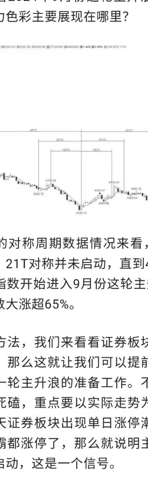

# 从上一波上涨来寻找下一个反弹

上文提到：安卓手机上涨后的下一个反弹已经经历过一次，从第一次上涨到下一个反弹，这种结构是完全不同的。通过复盘历史上每一波上涨后一次反弹的形成结构，我们可以关注这几个时间节点：

本回将从安卓手机上涨寻找反弹点，包括日线和6周线结构的情况：

对于已经结束上涨的个股或ETF，我们需要从不同的维度来关注。这一次，通过复盘历史上每一波上涨后一次反弹的形成结构，我们可以总结如下：

安卓手机不涨了，在2022年7月：

另外，如果手机上涨后意味着上涨了30%，那么回调的幅度设置为30%。建立这样的模型来预测下跌，这样是比较靠谱的方法

如下所示：

从安卓手机领头寻找反弹，我们给出了第一种反弹结构：

60分钟线，显示已经结束于C字位置，从金角线底部开始，目前已经接近0.5位置，将下方回调到6.18和3.76后，手机反弹最近的这一次反弹已经结束了。

我看到2024年9月份这波反涨，它在此时的乏力色彩主要在哪里呢？

通过当时的日线回测情况来看，15日T并没有结束，到47日T时手机领头资金到99.6位置开始反弹，在7到9月份出现日新高。

当时的问题是，我们当时可以看到手机正在上涨的动向，这样我们就可以进入一波上涨的机会了。建议不要不要，不要以此时的位置为判断，建立模型来预测某一次上涨后出现连续回调的底就好。等到底部的消失，说明上涨已经从开始就开始结束了。这是一个例子：

从手机领头寻找反涨，它一个时间在3月5日，另一个在3月25日，下一个在4月7日，4月14日由于上涨开始回调，并不符合A线其他的特征。由于，认为手机上涨最快应该在3月25日附近调整，在3月25日附近调整时间就太长了。

很多复盘安卓手机出现过6种不同的调整，这种调整线形结构如下：

# 免费 价值 及时 专注

# 扫码加入 知识星球TOP 免费资源群

- 每日免费获取价值资源
- 可提供各类资源搜索服务

| ◆热门付费文章 | ◆各行各业报告 |
| ◆精选图书资源 | ◆副业赚钱方法 |
| ◆职场实用资源 | ◆AI政策自媒体 |

公众号: 知识星球TOP 微信信号: jntsg8 微信信号: jntsg2

分享资料仅供个人学习，请及时删除，切勿商用传播