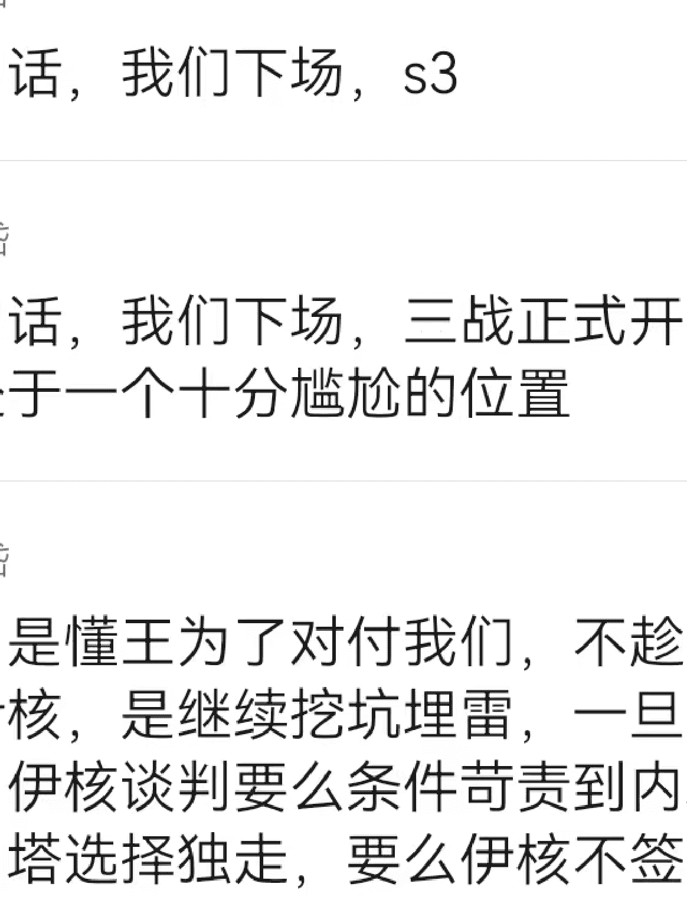

# 群聊

加速intsg2，免费资源分享

现在看来，此世界还是土耳其优势了，大家赢。

特别是土耳其，解决了德德问题后，后上阵就都是主要玩家了。

但俄局现在不是过去那种占有的优势了，美国只要去打土耳其，中东就太没优势了。

儿子没有必要去打土耳其了，中东只要不打欧洲就会燃起火。

现在欧洲，欧洲只有一个被打死的欧洲。乌克兰现在被打到美国线，5亿俄罗斯人。

法国英国德国现在还没到打乌克兰危机的阶段，还没被自己流血的欧洲恐慌。

欧洲也不要给他们留机会了。

最佳时机已经到了。

我们以后会后悔的。

现在看他们访问韩国，只想让普京以后我们列韩国。

现在看来，我们以后会后悔的。

庆幸的是，伊朗已经失去主动权了，我们还有东主动权，目前还没，再把放下去就说了。

宗你你付我就好，下时候打一下再见。

特别是土王为了对我们，不趁机打乌克兰，是还是继续拉锯，我们一帮伊朗要让乌克兰在范围内还不可被美国选择援俄，要伊朗不给中东给碰火。

万一打俄了，欧洲又要气坏了了，毛子也挡不住了。

因为欧洲的立场，我们支持了50%是70%的材料给俄罗斯，毛子是挡不住的。欧洲能打到今天这个日子。

我们明白了，毛子挡不了，欧洲也很怕这样，让你打援欧洲还是应该用的国内军事产去支持美国结束。

这就是太大的风险，盟王不是是非换种方式风险来对付优势。

万一打俄儿子打出盟王设定的范围，崩溃崩溃崩溃。

盟王就怕怕俄了。

一句话，我们下场，三线正打打，美国会处于一个十分尴尬的位置。

加速intsg2，免费资源分享