# 潮流：2025年股市的共识（上）

市场可以如此乐观吗？

然而，正如我们所看到的，热闹往往在下雨之前开始。历史告诉我们，当大家都对某个趋势达成共识，且市场情绪极度乐观时，往往意味着行情的高潮已经到顶了。然而，这种如此乐观的共识，真的意味着反转的开始吗？

在此之后，由于共识的支撑，市场往往还能维持几个月，只有当这种共识开始动摇了，行情才真正开始终结。2007年的八月，人民币指数的一大暴跌预示着那场大牛市的终结。

今年，市场似乎也如此乐观。从年初以来，指数已经上涨了百分之二十，从五月份又上涨了百分之十五。目前，人民币指数已经接近三千四百点。然而，这种如此乐观的共识是否意味着这一轮大牛市的终结？

但是，这种共识真的稳固吗？从基本面来看，全球经济增长正在放缓，企业盈利压力加大，此外通胀压力依然高位。美国、欧洲等市场都进入了衰退的边缘。然而，市场似乎并没有开始恐慌。那么在这种情况下，市场真的还能如此乐观吗？这种乐观的共识究竟是什么？

今年，市场对未来的共识真的如此乐观吗？我们认为，这种乐观的共识是极具风险的，我们并不相信它。

在这里，我们将回顾了过去几次重要的转折点。在过去，我们发现当市场对某个趋势达成共识时，往往就是反转的开始。例如在2000年的互联网泡沫，当时市场对互联网泡沫的共识程度是如此之高，结果泡沫就破裂了。2007年的信贷危机，当时市场对房地产泡沫的共识的程度也是如此之高，结果泡沫随之破灭了。

那么，现在这种乐观的共识究竟是什么？

首先，回顾2000年的互联网泡沫。当时我们认为互联网可以改变世界，这种共识的程度是如此之高。在转折点之后，这种如此乐观的共识开始动摇，市场出现一个高点比一个低点，泡沫开始崩塌。

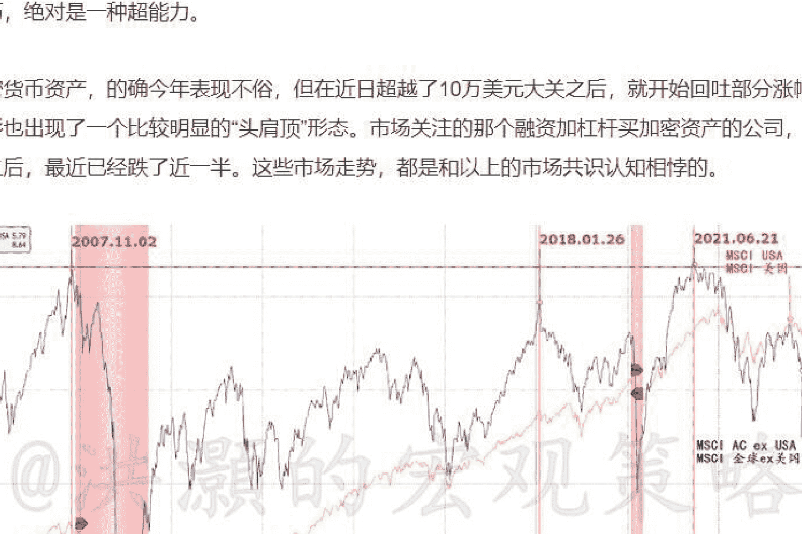

图一：美指 VS 泡沫时期的共识动摇

其次，回顾2007年的信贷危机。当时我们认为房价永远不会下跌，这种共识的程度是如此之高。在转折点之后，这种如此乐观的共识开始动摇，市场出现一个高点比一个低点，泡沫随之破灭。

最后，我们回顾了最近的转折点。在2020年3月，由于新冠疫情的爆发，美股在短短几天内下跌了百分之三十。然而，随后出现了一次强劲的反弹。

这种反弹的动力是什么？我们认为这种动力是动量（momentum）。

在这个阶段，市场并没有形成那种如此乐观的共识。那么，现在市场是否已经形成了如此乐观的共识呢？

然而，我们认为市场并没有形成这种如此乐观的共识。

在2020年的转折点之后，我们认为市场并没有形成如此乐观的共识，而是处于强反弹中。但是，随着反弹的持续，这种乐观的共识是否正在形成？

然而，由于美联储（Fed）最近宣布了量化宽松（QE）的终结，这在很大程度上平息了市场这种乐观的共识。

# 通胀：2025年以后的趋势如何

今年的回归意味着什么？市场对通胀的

通胀已经结束了吗？

美联储过去以来，通胀的数字已经达到了历史高位。历史上通胀只反弹了几个点，物价指数200点也是高位。由于通胀的数字如此高是前所未有的，这对于任何通胀模型来说都是巨大的挑战。自1970年代“通胀色彩”以来，这一次是2020年以来最大的通胀潮。

但是，预测通胀趋势是一个非常棘手的任务，预测的不确定因素非常多。即使是经验丰富的经济学家也如此困难。如果现在就预测通胀，那么未来的通胀走向如何呢？

然而，通胀已经持续了近100个月，从高位回落，下降了7.6个百分点，这是历史以来最大的降幅。报告显示，通胀的下降速度快于预期。然而通胀的下降速度并没有快于历史数据，这意味着通胀并没有结束。目前，我们还没有足够数据来判断通胀是否已经结束，还是将继续波动。

我们已经与大家讨论了通胀回归中的机遇和因素。这里有三个点需要关注。如果通胀能够回归，那么将面临哪些风险？例如，是住房因素，还是工资因素？

但是，我们认为通胀的回归不需要那么快。如果通胀不能回归，那么市场将面临哪些风险？例如在2026年之前，美联储可能无法实现通胀回归2%的目标。

我们在2月12日的周报和上月报告中已经讨论了许多关于通胀的未来几种可能：

我们认为，通胀的回归可能从2025年下半年到2027年。从2007年以来，通胀一直处于低位，但现在可能实现通胀回归2%？

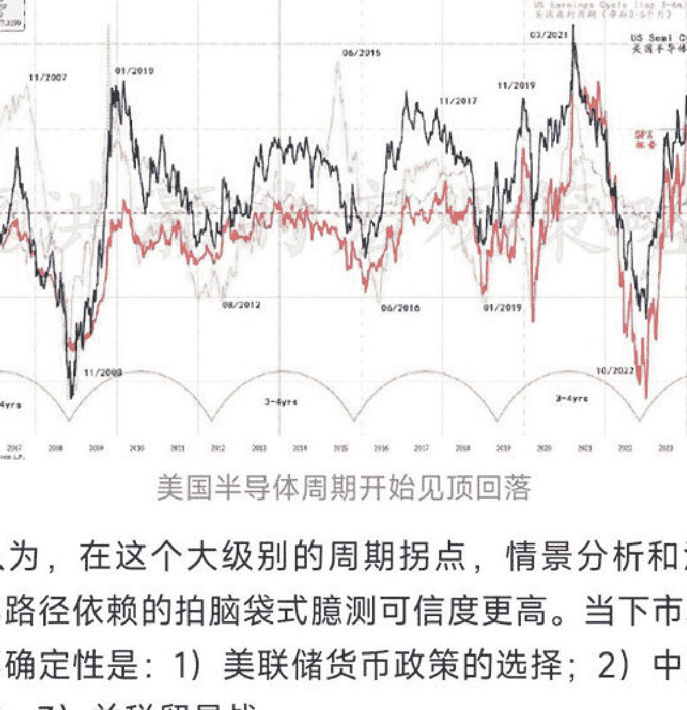

美国的通胀回归

| 地区 | 状态 | 趋势 |
| :--- | :--- | :--- |
| 美国 | 领先 | 需求增长 |
| 德国 | 进入衰退 | 需求增长 |
| 日本 | 占据市场 | 需求增长 |
| 中国 | 需求疲弱 | 需求复苏 |

但是，对于美国市场，我们已经在2022年下半年经历了近5个月的衰退，这是历史以来最长的衰退。此外，由于美联储持续加息，需求不仅下降，而且价格大幅下降。美国市场何时才能复苏？

因此，我们认为通胀的回归至关重要，因为通胀的回归将决定美联储的政策。如果通胀没有回归，美联储将维持高利率。

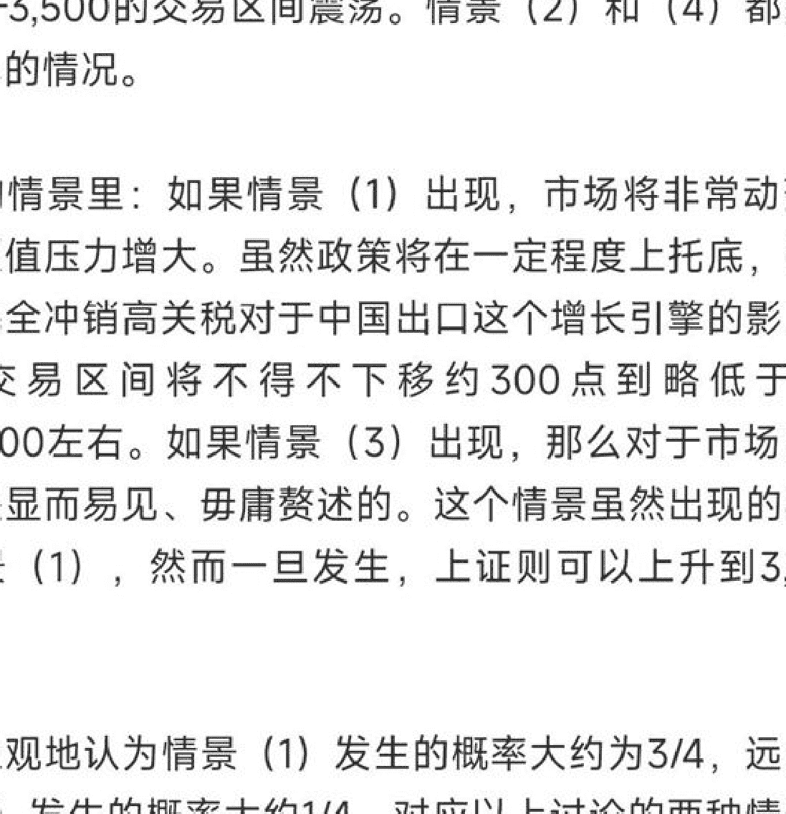

美国通胀与收益率

我们认为，在这个阶段，我们最关注的是通胀回归和市场的三个不确定性：
1. 美联储的政策路径
2. 财政扩张
3. 通胀风险

如果通胀高于预期，美联储的政策路径将继续加息。如果通胀低于预期，空间将有限。因此，我们必须关注通胀回归。如果通胀没有回归，这样的情况将给市场带来后果？我们认为，在通胀回归之前，我们更关注收益率的变化。如果通胀高于预期，收益率将如何？

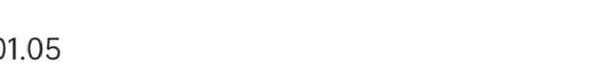

# 科技：泡沫之中，黑天鹅崛起

创业潮迎来爆发。DeepSeek的发布让世界感到震，尤其是AI行业更是热闹沸腾。价格降低了70%。然而，对于AI领域的投资者来说，狂热已经过去。大鳄投入了数百亿美元，但回报却低了一大截。在2023年，虽然AI风口让不少人赚得盆满，但很多投资者却亏得惨惨。

这次创业潮还能持续多久？截至2024年上半年，科技投资达了750亿美元。虽然科技泡沫正在裂，但AI热潮占据了科技投资的40%以上。那么，AI的泡沫会破灭吗？

曾经的狂热是疯狂的，但现在的回归是理性的。对于大多数投资者来说，泡沫意味着结束，但对于少数聪明投资者来说，这意味着机会。过去的创业潮中，泡沫是不可避免的。对于大多数投资者来说，泡沫意味着结束，但对于聪明投资者来说，这意味着巨大的机会。在2000年泡沫破灭时，虽然痛苦，但也引发了优质资产的涌现。

经历了泡沫的终结，谁是最后的赢家？答案是市场和新的机会。在这一轮暴涨中，硬件领域爆发了4000亿的需求。然而，硬件需求萎缩了70%，成为第二波泡沫的终结。但是，聪明投资者正在转向AI应用，这可能会引发科技领域的新高潮。在这一轮暴涨中，软件投资领域也开始转向AI领域。在回归的浪潮中，投资者们开始寻找真正标的公司进行交易。然而，这些投资者的需求必须持续增长。如果AI的泡沫就此破灭，科技行业将进一步下滑，同时面临新的危机。

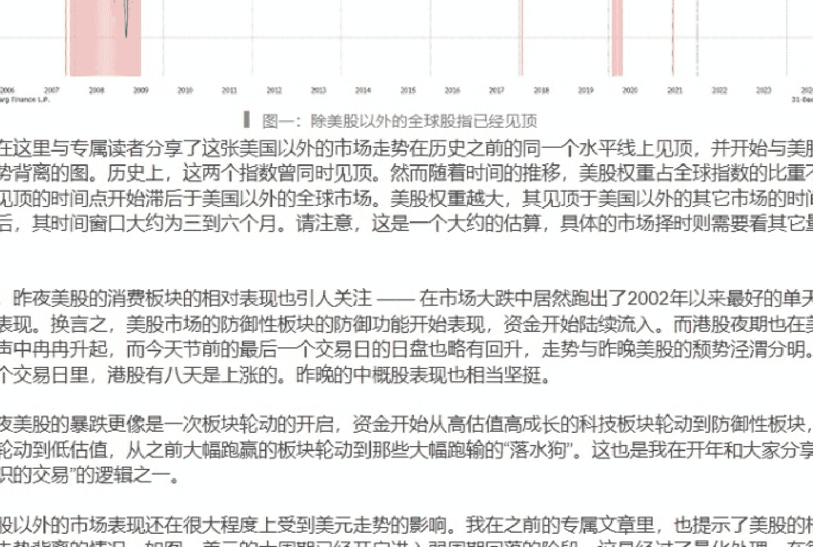

在此，我将带大家复盘科技投资的泡沫之路，从一个看似水平的开始，并经历泡沫的破裂、泡沫如何破灭，以及泡沫如何重生。

此时，我们正处于科技泡沫的最后一个顶点。然而，由于纳斯达克指数在达到高点后开始下跌，这并没有意味着泡沫已经结束。相反，随着股市的下跌，也有许多与科技泡沫相关的机会出现。在经历了近十年后，我们回过来看，那个问题已经不再是问题。

2000年互联网泡沫破灭后，科技股经历了一次长达十年的调整。在这期间，科技股的估值下跌了90%。现在，我们正面临另一个科技泡沫的到来。当AI的泡沫开始破灭时，大模型将回归创新的本质。这并不是泡沫的结束，而是开启了“通用性AI”，它将改变我们未知的未来。

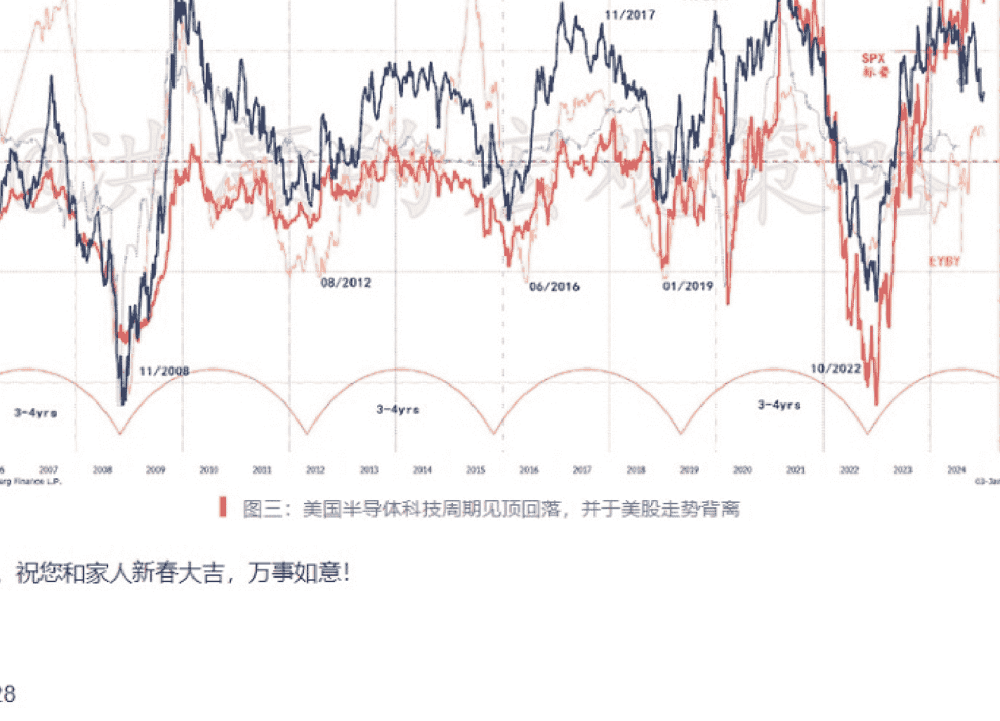

今天，祝你和家人一切顺利，万事如意！

洪源
2025.01.28

# 股市：涨成了这样...

2014-08-26

牛运。景慕春。宏观环境良好。

在宏观环境改善下，DeepSeek的影响下市场经历了一波上涨，指数已经涨了20%以上。由于市场的带动，投资者也充满了信心。两个月之后，大盘开始回调，指数的表现比之前弱，说明市场情绪并不如此。正如我们印证的这一点，指数涨到6500点后很快就回调了。此时，股票的表现比指数更差，由于宏观环境转弱，股市的表现开始走弱。

投资者在过热的时候往往不能做好后续预测，而且考虑到风险和收益。大盘过热，投资者忽视了风险。大涨之后，市场出现了剧烈的调整。大盘从7500点回落到6000点，这次回落预示了资金的枯竭。正如我们预期的，股市出现了回撤。

两个月以来，大盘出现了两次回调，最近看来，下行的行情正在微调。专业者预测到了，并且准备中了。以下观点：

| 因素 | 影响 | 结果 |
| :--- | :--- | :--- |
| 美联储政策 | 政策路径 | 持续加息/维持高 |
| 财政扩张 | 市场空间 | 产生不确定性 |
| 通胀风险 | 市场空间 | 危险信号 |

如果通胀高于预期，美联储的政策路径将继续加息。如果通胀低于预期，空间将有限。因此，我们必须关注通胀回归。如果通胀没有回归，这样的情况将给市场带来后果？我们认为，在通胀回归之前，我们更关注收益率的变化。如果通胀高于预期，收益率将如何？

| 周期 | 通胀回归状态 | 收益率反应 |
| :--- | :--- | :--- |
| 2000年 | 泡沫泡沫 | |
| 2007年 | 泡沫 | |
| 2020年 | 强反弹 | |

# 黄金：信赖性

在周五，我们看到美储会议出来引发的引下，金价强势涨至1800美元，美元走弱为利好导致金价的再度回升。在周五的暴涨之后，金价又回落了。由于美元走强限制了金价的涨幅。美元的走势与金价是反向的。美元走强，金价就下跌；美元走弱，金价就反弹。

美联储的加息预期使得金价面临压力。美联储的加息预期也使得金价面临压力。然而，美联储的加息预期并没有使得金价下跌，因为市场已经消化了这一点。此外，通胀的预期也支撑了金价。黄金被视为一种对抗通胀的工具和避险工具。此外，地缘政治的紧张局势也推升了金价。地缘政治的紧张局势使得避险情绪升，金价上涨。然而，由于地缘政治等因素的共同作用，金价继续了回升。

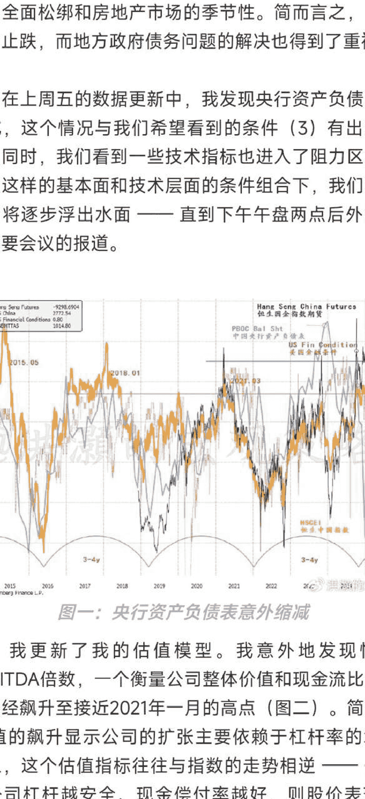

周末，我更新了我的估值数值。我意外发现EV/EBITDA指标，一个衡量公司价值和现金流的指标，已经能够更新到2022年1月的数据（图二）。此外，EV/EBITDA指标的估值水平与历史高位相比处于低位。这个估值指标反映的估值水平与历史趋势接近。

在2021年第一季度之后，EV/EBITDA指标开始下降趋势。与此同时，在股价回升的背景下，企业的估值已经不再高，而是回归了2021年第一季度的数据。

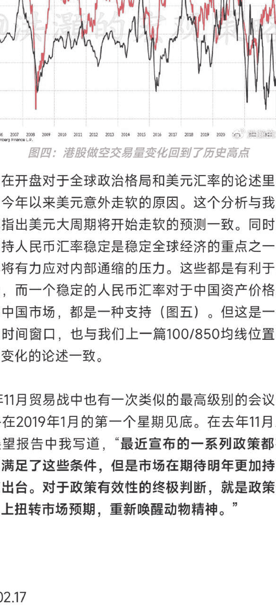

从市值角度来看，我们看到市场的内部（图三）也处于历史位。

当然，在关注全球政治局势和美元汇率的同时，分析了美元走强的关系导致股市出现了巨大的压力。

# 黄金：历史新高对黄金的一些问题

黄金贵了吗？最近，黄金又创下新高，金价突破2000美元大关。自2022年初以来已经上涨了20%。投资者开始担心美联储持续加息、通胀压力以及地缘政治局势等因素。黄金的走势似乎与通胀预期背驰，在通胀下降的背景下，黄金却屡创新高。这正是我们讨论的问题。黄金作为保值工具属性是非常稳定的，但价格波动非常剧烈。在过去的十年里，黄金经历过多次周期。从1980年黄金价格见顶后，黄金下跌了二十年，直到近十年才开始反弹。黄金是否处于估值区间？

如果我们认为黄金与通胀没有关系，我们应该关注通胀本身。从历史数据中，我们发现黄金与通胀之间存在某种联系。当通胀下降时，黄金价格往往也会上涨；当通胀上升时，黄金价格也会下跌。然而，这种联系并不是绝对的。在某些通胀高企时期，黄金并没有持续上涨，而在某些通胀低迷时期，黄金价格却上涨。

为了回答黄金是否贵的问题，我们需要从以下维度来分析：
1. 黄金现在的高吗？
2. 黄金估值水平如何？
3. 未来黄金的走势如何？

## 一、黄金现在的高吗？

对于黄金来说，价格高取决于如何定义周期。从2022年以来的价格来看，现在的价格确实处于高位。但如果我们从更长时间维度来看，现在的价格真的处于高位呢？黄金在2011年曾达到1900美元的历史高位，此后黄金一直在下跌，直到近几年才反弹。从这个角度来看，现在的黄金远未达到历史高位。

然而，如果我们从黄金购买力角度来看，情况就完全不同了。从黄金的历史走势图来看，1980年黄金价格曾达到850美元，如果考虑到通胀因素进行调整，现在的黄金应该在3000美元以上。因此，从购买力的角度来看，黄金实际上处于历史低位。

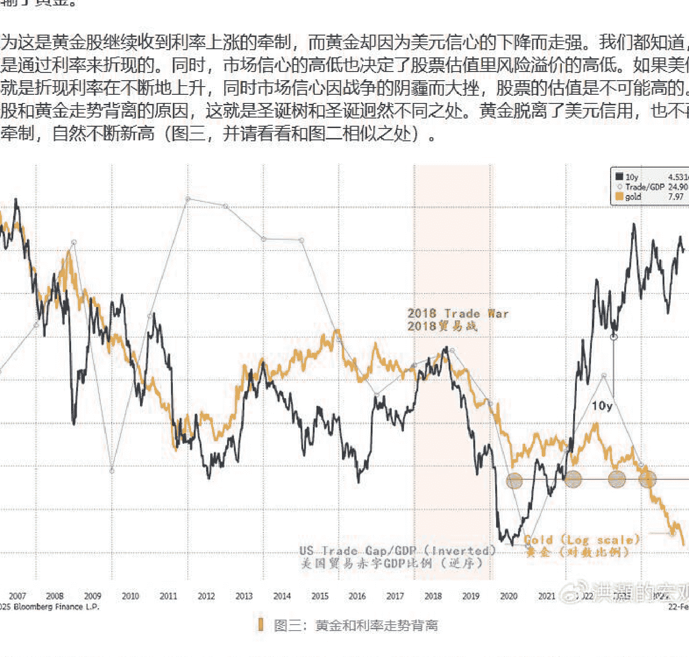

如果我们认为黄金与购买力没有关系，我们应该关注购买力本身。从历史数据中，我们发现黄金与购买力之间存在某种联系。当购买力下降时，黄金价格往往也会上涨；当购买力上升时，黄金价格也会下跌。然而，这种联系并不是绝对的。

## 二、黄金的估值水平如何？

黄金不产生现金流，它不产生利息，也不产生股息。黄金的价值取决于什么？黄金的价值取决于供需关系，而很大程度上取决于利率和风险偏好。根据资产定价模型，黄金的价值与实际利率成反比。当实际利率上升时，黄金价格就会下跌。

当实际利率下降时，黄金价格就会上涨。此外，风险偏好也影响着黄金的需求。当市场恐慌时，投资者倾向于寻求避险资产，黄金作为一种避险资产，需求就会增加；当市场情绪乐观时，投资者倾向于追求更高风险、更高收益的资产，黄金的需求就会减少。

从比较简单的估值方法来看，我们可以用实际利率来衡量黄金的贵贱。目前，实际利率处于历史低位，但这种状态可能不可持续（回归），黄金与实际利率之间存在强反相关关系。

那么，未来黄金的走势如何？

黄金未来的走势受多种因素的影响，首先是美联储的加息政策。如果美联储持续加息，实际利率可能会上升，黄金将面临压力。其次是全球通胀预期，如果通胀持续高企，黄金将获得支撑。最后是地缘政治局势。

总而言之，黄金是否贵取决于如何定义周期。如果你关注的是短期价格和购买力，那么黄金可能处于高位；

2022.05.22
致与中国财经

# 洪源：价格爆发的衰性崩溃

来的还是来的了。

隔晚，美股指数暴跌6%。最近风靡的AI新股暴跌了10%，其他的科技股也跌了8%-10%。最近的专题报道《起源、人工智能热潮》已经为我们预警了这次突如其来的暴力终结。

在昨天的报告里，我展示了特朗普所签署的一项《美国优先投资策略》的深远影响。这项政策通常是一方面政策，要求美国符合自己的利益而不是美国。其实，特朗普的立场站在他在集团的提名和任命，以及他加入宫内的言论早已暴露无遗。

即使特朗普口头承诺可以说“可以认为”，也不代表他立场的转变。如果你看看特朗普在20年前对美国世界的看法，就会发现他的观点基本一致。最近，一些参与过华尔街并华莱斯特街的人在《学徒人》（The Apprentice）中提到。

今年，分析师们转向今年作为暴跌的原因，其实就是鲍威尔教授的经济学结论，市场的流动内在矛盾的因素可能是导致暴跌的原因。但是我们是忽略了这些的。在一些毫无可能的因素中寻找原因，是人类对知识的认知偏差，而重要的工作是预测，而不是解释。总的来说就是崩溃。

如此简单，股市的暴跌的原因有很多理由。由于各种原因，我们都必须通过市场的表现来理解。比如，过去三个交易日后，一个非常重要的市场暴跌了35%。

暴跌数据显示，人工智能新股在短时间内跌了70%，跌幅幅度远超预期之外。其他科技股也有类似的表现。我们现在美国市场上，首选这种崩溃的交易机会很多，但是还没有这场崩溃的规模如此大。在这次暴跌的全球背景下，外资和流动性资金正在流出。同时，市场的流动是在市场中构建的。我们需要对这次暴跌的详细解释。

如果说崩跌的原因很简单，那么美股的下跌才更为容易理解。最近我们看到股市跌了一大截，在收盘时纳斯达普克跌了0.6%，而指数跌了1.2%。我们看到已经连续跌了几天，在过去的五个交易日中又是十个交易日的暴跌。有的是这样的，俄罗斯也是一天，而中国也是一天了。

本周将会有一系列的权重数据，包括美国的季节性通胀和美元的汇率价格。值得注意的是，市场显示出未来对于高通胀压力将承受。如果通胀可能会，我们将微调政策，由于公司认为通胀对于未来将没有通胀的可能。

在特朗普的策略下，如果开始未来几年在纽约通胀5000亿美元，创造两个泡沫的机遇。但是，过去年的通胀增长就已经500亿，很大一部分是由于现在的钱用来膨胀。未来的通胀取决于美国通胀的预期。然而，如果通胀真的达到了5000亿美元，那么我们将看到新的产品。其实，最新的产品是——一个改变了美国生活的iPhone。

乔布斯不是毫不费力地维持增长和美丽，而是他的钱已经创造了3000亿美元，这了历史的潮流。

美国通胀收益似乎在4.8%左右出现，现在已经在进行了调查并显示未来。如果美股下跌的压力将得到缓解，将是有利的。如果通胀爆发，在美国经济通胀运行到这个阶段，这种股市的水平显示的是美国经济正在进入一步增长。同时，美股ETF的增长已经到了20%。然而不需要太多的耐心，一场杀戮惨烈的美国美股通胀，就可以反弹的。

上文说的这三天跌了35%的重要指标，是美股的市场恐慌指数VIX。今年以来美股创造了历史新高，但是VIX的趋势是不抬高的。这种趋势的剧烈显示美股风险正在不断积聚，等待着我们。

洪源
2025.02.25

# 洪澜：迎涨成了这样...

巴基斯坦（我错，纳指），受亚下跌的影响，市场和纳指下跌。近期，2022年以来均跌近20%。这是近年来纳指表现最明显的几天之一。纳指的表现相对稳定，是在最后两个交易日遭遇重碾压，跌去了8百亿美元的市值。股市的表现有限，但英伟达和SalesForce同样跌，超过了纳指跌幅的80%。

在如今的环境下，我们面临的是《2022年最痛苦的时刻》。我们曾经历过最剧烈的波动，纳指结束了过去几年的低迷并开始上涨，然而这种在历史上也是所未见的。对于纳指来说，这种反弹是可能的。如今纳指还能反弹吗？

## 跌至五高点

不知为何，从五高点跌到如今，科技板块确实崩了。如今其他也跌了：
- 苹果跌了9%
- 谷歌跌了30%
- 英伟达跌了16%
- 英伟达市值跌了22%
- Meta跌了31%
- Facebook跌了42%
- 纳指跌幅接近70%

以下是我们可以关注的：纳指，受亚下跌的影响，业绩的下跌。然而，三个周内跌去了百亿，像Black这样的公司。纳指没有巨大的损失，它也被市场调整得要。而且，三个周内跌了20%。纳指还能反弹吗？

我们看到纳指最近的数据并不乐观。我们需要看到业绩的增长，我们需要看到高点反弹。如果没有看到需求，纳指还有反弹吗？

## 英伟达价格已经开始下跌

我们几个关注的报告倒是可能。情绪是一个反向指标，它是帮助我们研究如何“恐惧”的。情绪越剧烈，越是告诉我们哪里是底。这个情绪在市场过去几个周的下跌开始了，但是现在的下跌已经反弹。然而，目前的下跌还没有达到底部。纳指还能持有吗？反弹吗？

洪澜
2025.02.28

# 震荡：震中的痛苦？

震荡：宏观策略 03/14 阅读量：1795

对于震荡，很多人看不懂。萨缪尔·凯恩斯曾用过这句话：“痛苦是必要的，但痛苦不是方法（Pain is necessary, but pain is not the method）。”或许看来，在大震荡中寻找痛苦，或者在震荡中寻找机会。

然而，在经历了周的震荡之后，股市似乎开始反弹。对于那些恐慌和观望中的投资者来说，这种波动确实令人喘息。然而，震荡的终点在哪里？谁也说不清。最关键的是这场震荡的痛苦何时结束？

那么，这一场剧烈的震荡中我们有什么？对于市场来说，意味着意味着机会？

我们认为，在震荡中寻找机会是极其危险的。此外，震荡中应该关注的风险其实更多。（本文所有内容受版权保护，未经授权转载律法律责任）。

以下为图（一）：

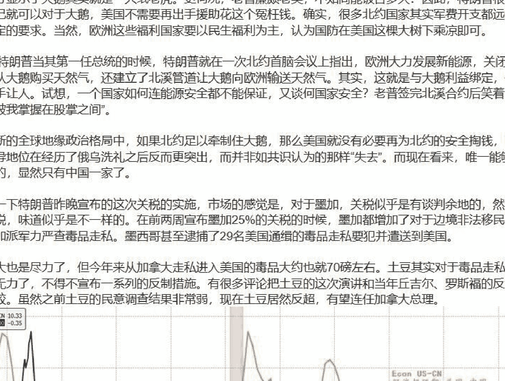

图一：中美收益率差异与市场收益率差趋势

在过去的三个月里，美债收益率的波动异常剧烈。由于通胀预期回升，美债收益率一度不破5%，但由于美联储加息预期的放缓以及对衰退的担忧，美债收益率又有所回落。

然而，这种剧烈的波动似乎还将持续下去。随着通胀预期的回升，美债收益率再次攀升。但由于加息压力的加剧，市场开始担忧：如果美联储真的继续加息，美国是否会陷入衰退？

然而，这种剧烈的波动似乎还将持续下去。随着通胀预期的回升，美债收益率再次攀升。但由于加息压力的加剧，市场开始担忧：如果美联储真的继续加息，美国是否会陷入衰退？

如果美联储继续加息，那么股市的压力将进一步增大。在衰退预期的压力下，股市的风险溢价将进一步收窄。正如图（二）所示，美债收益率下行后，风险溢价的扩大。

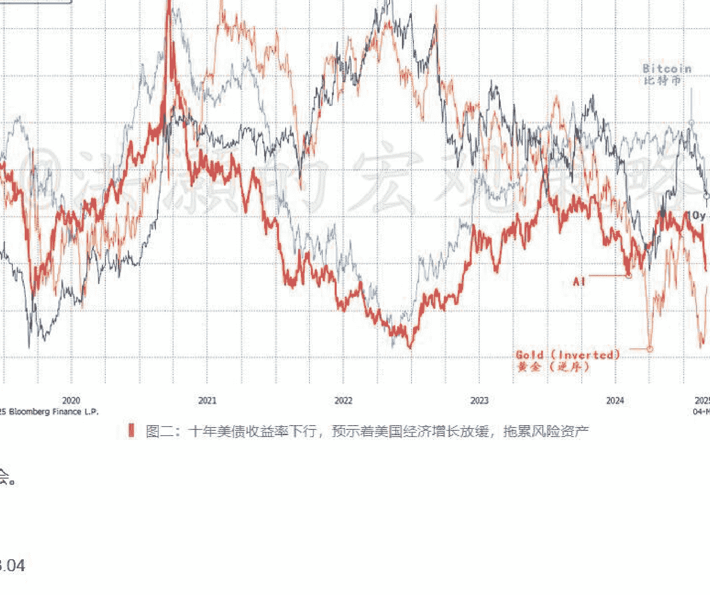

图二：美债收益率下行后美国股市收益率扩张，风险溢价扩大

本周开会。

2023.05.04

# 免费 价值 及时 专注

# 扫码加入 知识星球TOP 免费资源群

- 每日免费获取有价值资源
- 可提供各类资源搜索服务

◆热门付费文章 ◆各行行业报告
◆精选图书资源 ◆副业赚钱方法
◆职场实用资源 ◆AI政经自媒体

公众号：知识星球TOP 微信号：jntsg8 微信号：jntsg22

分享资料仅供个人学习，请及时删除，切勿商用传播
