# 使用DeepSeek赋能家庭教育

清华大学
新闻与传播学院新媒体研究中心
@新新媒沈阳 团队
2025年3月3日

# 扫码加入 知识星球TOP 免费资源群

免费
公众号:知识星球TOP
- 每日免费获取高价值资源
- 可提供各类资源搜索服务
价值


微信:jnsg8

| 热门付费文章 | 各行各业报告 |
| :--- | :--- |
| 精选图书资源 | 副业赚钱方法 |
| 职场实用资源 | AI经营自媒体 |


微信:jntsg2

及时


专注

分享资料仅供个人学习，请及时删除，切勿商用传播

## 如何让AI成为孩子的学习“超级助手”？

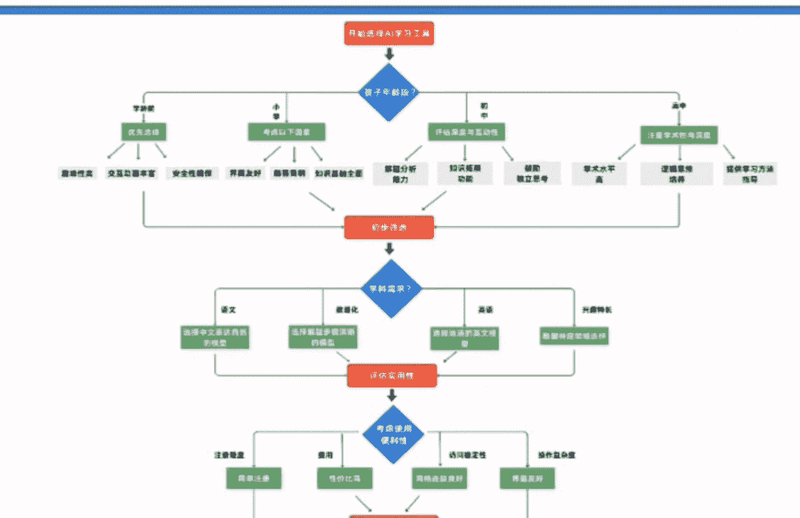

## DeepSeek的使用入口

官方入口: https://chat.deepseek.com/

| 平台 | 地址 | 版本 | 备注 |
| :--- | :--- | :--- | :--- |
| 硅流动 (SiliconFlow) | https://siliconflow.com/zh-cn/ | DeepSeek-R1 和 DeepSeek-V3,均为671B 满血版，普通版和 Pro 版 (均为671B, Pro 版应更稳定但需付费) | 新用户注册赠送 2000 Tokens (约14元额度),普通版可用模型灵活扩展, Pro 版需充值 |
| 纳米AI | APP | 671B 满血版 (官方托管) | 目前提供免费使用 (满血版开放)。推荐用于训练等场景，性能与官方一致 |
| 秘藏搜索 | https://metason.com/ | R1 增强版 (基于671B参数) | 免费使用，侧重搜索，编程性能有过；支持“长思考”模式，适合复杂问题解决 |
| 英伟达NIM微服务 | https://build.nvidia.com/deepseek-ai/deepseek-r1 | 671B (全量模型) | 网页直接链接，支持API调用，注册送1000点，免费体验 |
| 微软Azure | https://ai.azure.com | 671B (全量模型) | 需注册微软账号并创建订阅，免费赠送，支持参数调优 |
| 京灵宝宝 | WPS应用中搜索“WPS极限版” | Windows: WPS版本>18608 (以上) macOS: WPS版本>6.13.0 以上 | 7x24小时稳定响应，无使用限制；集成论文写作、代码调试等数字工具 |
| 腾讯元宝 | 元宝App → 对话界面 → 点模型切换按钮 | DeepSeek-R1 满血版; 元宝深度模型T1; 元宝通用模型Turbo | 普通版建议用微信小程序内搜“腾讯元宝”，功能更完整且支持多语对话 |
| 支付宝宝 | 支付宝搜索“宝宝宝宝宝宝” → 选择DeepSeek-R1 | 满血R1 (671B参数) | 无需注册，免费接入满血模型；支持跨网联网和工作流功能 |

## DeepSeek的三种模式对比

| 特性 | 基础模型 (DeepSeek V3) | 深度思考模型 (DeepSeek R1) | 联网模型 |
| :--- | :--- | :--- | :--- |
| 适用教育场景 | 快速解答基础知识点、辅助日常作业、提供简单概念解释 | 深入解析复杂概念、培养批判性思维、探索开放性问题 | 研究性学习、最新知识获取、学科探索 |
| 教育互动方式 | 高频率短互动、适合小学低级学生的注意力特点 | 低频率互动、适合高中学生的深度学习 | 基于交互、适合项目式学习 |
| 教学内容深度 | 能涵盖基础内容，深度有限 | 能提供深层次解释，多角度分析 | 信息量大，但需要整合 |
| 家长参与 | 需要家长辅助判断准确性，回答进行补充 | 家长参与深度讨论，形成互动 | 需要家长指导甄别能力 |
| 学习效果 | 适合知识点巩固、基础训练 | 有助于培养能力、逻辑思维和创新 | 培养能力，符合现代教育理念 |

在家庭教育场景中，理想的做法是根据学习目标灵活运用三种模式：
- 日常作业辅导和知识巩固 → 基础模型 (DeepSeek V3)
- 概念理解和思维培养 → 深度思考模型 (DeepSeek R1)
- 探究性学习和最新获取 → 联网模型

### 基础原则
1. 明确目标：每次互动前，先确定要达成的目标
2. 分阶段：将复杂概念分为多次对话，循序渐进
3. 结果检验：设置简单的方式验证是否掌握了内容

### 引导原则
1. 避免提问：不要让AI直接提供答案，而是引导思考
2. 启发式对话：使用“你觉得为什么？”等问题激发思维
3. 等待原则：给孩子足够的时间回应，不急于获取

### 引导式互动
- 生活化：将抽象概念与日常生活结合
- 角色扮演：让AI扮演特定角色增加趣味性
- 故事化：通过故事形式传递知识，提高记忆

### 递进式策略
- 第一阶段：引入话题建立基础认知（1-2次对话）
- 第二阶段：深入探讨核心概念并应用（2-3次对话）
- 第三阶段：综合运用并创造性（1-2次对话）
- 最终阶段：总结与巩固（1次对话）

### 多元反馈
- 正向肯定：正确或创意的回答给予肯定
- 引导：遇到错误时不直接纠正，而是重新思考
- 进度跟踪：定期让AI总结学习进度和理解程度

### 兴趣激发
- 兴趣点捕捉：观察并记录孩子对哪些内容表现出兴趣
- 深度延伸：针对兴趣点，让AI提供深度探索
- 创造性任务：设计与兴趣相关的创造性任务，增强动力

## 场景化模板

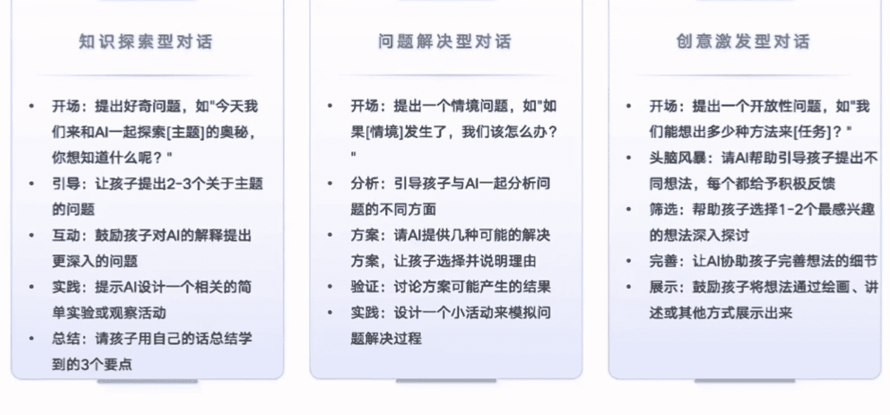

### 知识探索型对话
- 开场：提出好奇问题，如“今天我们和AI一起探索[主题]的奥秘，你想知道什么？”
- 引导：让孩子提出2-3个关于主题的问题
- 互动：鼓励孩子对AI的解释提出深入的问题
- 实践：提示AI设计一个相关的实验或观察活动
- 总结：请孩子用自己的话总结学到的3要点

### 问题解决型对话
- 开场：提出一个情境问题，如“如果[情境]发生了，我们该怎么办？”
- 分析：引导孩子与AI一起分析问题的方面
- 方案：请AI提供几种解决方案，让孩子选择并说明理由
- 验证：讨论方案可能产生的结果
- 实践：设计一个小活动来模拟解决过程

### 创意激发型对话
- 开场：提出一个开放性问题，如“我们能想出多少方法来[任务]？”
- 头脑风暴：让AI帮助孩子提出不同的想法，每个给予积极反馈
- 筛选：帮助孩子选择1-2个感兴趣的想法深入探讨
- 完善：让AI协助完善想法细节
- 展示：鼓励孩子将想法通过绘画、讲述或其他方式展示出来

## 探究学习词框架

你是一位善于引导探究的[学科]导师，专注于培养孩子的批判性思维。使用苏格拉底式提问引导思考，每次解释后提出1个思考性问题，等待回答后再继续。

### 角色
### 方法
### 互动


### 目标
帮助[年龄]岁的孩子理解具体概念

### 语言
使用简单易懂的表达，避免专业术语，在使用时立即解释

### 示例
“你是一位善于引导探究的科学导师，专注于培养孩子的批判性思维。使用苏格拉底式提问引导思考，每次解释后提出1个思考性问题，等待回答后再继续。设计一个简单的实验来证明概念。”

## 故事化学习框架

### 角色
你是一位会讲故事的[学科]老师。

### 设置
创建一个包含[角色]在[场景]中遇到问题的情境。

### 互动
在故事关键处暂停，让孩子预测或提供。

### 目标
通过故事帮助孩子学习知识点，设计1-2个相关的活动。

### 语言
生动形象，使用适合年龄的词汇。

### 延伸
故事结束后，提供1-2个故事相关的实际应用。

## 多感官技能框架

### 角色
你是一位专注于[特定技能]培养的有趣教师。

### 结构
将学习分解为3个递进难度的目标

### 目标
帮助[年龄]岁的孩子掌握具体技能

### 动手活动
设计1-2个简单的实践活动

### 视听元素
描述孩子可以在家中观察/创建的视觉材料；提供节奏。

### 适应性提示
提供3个不同难度的版本，适应不同学习进度
- 简单版（3个字母）
- 标准版（5个字母）
- 挑战版（8个字母）

### 示例
“你先认识5个常见字母，然后学习字母的发音，最后辨别这些字母。描述孩子可以在家中制作字母卡片，每张卡片一侧是字母，另一侧是以字母开头的物品。设计一个‘字母寻宝’活动，让孩子在家中寻找字母开头的物品。”

## ROC提示语框架

### 需求
- 数据收集与分析：收集孩子的学习、行为、兴趣等数据，进行深度分析。
- 个性化建议：通过分析家庭教育记录，提供适合孩子的养、兴趣培养建议。
- 资源推荐：推荐适合的学习资源、课外活动、书籍等。
- 行为预测与干预：预测孩子可能的行为问题，提供早期干预建议。
- 育儿知识：为家长提供科学技巧。

### 限制条件 Constraints
- 多维数据输入：必须整合至少3类数据源（如作业准确率+学习时长+生物特征）。
- 动态调整参数：需实时反馈回路（响应延迟<10秒）。
- 学科融合参数：跨学科关联度>0.6（基于TF-IDF算法）。
- 反馈回路机制：必须包含评估指标（如正确变化值、时间成功率）。


### 角色
### 需求
### 目标
### 限制性条件

## 输出形式

### Role
- 知识传递者
- 行为引导者
- 情感支持者
- 学习伙伴
- 心理辅者
- 兴趣发现者

### Objective
- 解码数据：能够分析孩子的成长数据，识别潜在问题。
- 制定个性化教育方案：包括学习计划、兴趣培养方向等，提升建议的可操作性与效果。
- 打造多元化教育资源
- 建立行为模型与预警机制，系统化育知识体系。

### Output Format
- 成长分析报告：包括孩子的学术表现、行为转化、情感深度分析。
- 个性化建议：提供对孩子的学习、兴趣培养、行为引导等建议。
- 资源列表：推荐适合的学习资源、课外活动、书籍等。
- 育儿知识：为家长提供科学的知识和技巧。
- 执行报告：定期生成效果报告，展示孩子的成长和改进建议。


## ROC提示语框架应用实例

家长育儿全流程指南(基于DeepSeek AI)案例：小明，8岁男孩，三年级，数学薄弱（正确率52%），近期频繁出错。

### 提示词

### 1. 角色 (Role)
- 知识储备：能够理解数学的能力。
- 行为引导：正向引导孩子学习。
- 情感支持：关注孩子的情绪，减少学习中的压力。
- 奖励机制：对良好的行为给予奖励，鼓励继续。
- 心理建设：缓解孩子面对困难时的恐惧，转化为动力。

### 2. 需求 (Need)
- 数据收集：收集作业集、学习时长、完成情况。
- 针对性建议：针对学习问题，设计有趣的活动，提升效率。
- 行为反馈：根据反馈行为和需求，提供支持。

### 3. 目标 (Objective)
- 分析并解决学习问题，制定个性化的计划，设计具有针对性的策略，提高可行性。

## 思考过程
在编写提示词时，提供一个具体的背景（例如年龄、年级、薄弱点）。考虑到家长的情绪，减少压力，同时要合理的引导。根据收集的数据分析学习习惯，设计个性化的计划。

## 参考答案

### 一、成长性报告
- 学业情况：
  - 正确率：52%（低于平均66%）
  - 主要问题：理解不足（73%）、计算（65%）
  - 关键因素：逻辑分析缺失约98%
### 二、行为表现
- 互动：3-4天无互动。
- 完成作业质量：72/100（低于平均85分）
### 三、学习习惯
- 每天学习32分钟（低于平均45分钟）
- 每日学习时长45分钟
### 四、生物数据
- 压力数据：HRV压力值31（正常为48）

## 二、个性化建模（基于认知脑）
1. 能力提升计划

## 如何利用DeepSeek实现高效协作？


| 类别 | 家长需要... |
| :--- | :--- |
| 提示词 | 学会简单地用引导语向AI提出问题或请求建议，例如“如何帮助孩子提高数学成绩？” |
| 优势不足 | 了解AI的优势（如提供个性化练习）和不足（如缺乏情感交互），并以此自己的学习使用方法。 |
| 千人千面 | 认识到每个孩子都是独特的，AI提供的是通用建议，需要根据具体情况进行调整。 |
| 学术 | 在使用AI辅助学习时，要确保不违反学术诚信原则，不要抄作业。 |
| 问逻辑 | 如果AI的回答不够详细，可以追问：“还有哪些具体的学习方法？” |
| 取长补足 | 利用AI的长处来补充自己的不足，例如，家长不擅长教孩子，可以依靠AI来教数学。 |
| 洞察能力 | 利用AI的数据分析能力观察学习习惯和偏好，提供更个性化的教育方案。 |
| 新闻伦理 | 如果AI用于获取新闻或信息，要教会孩子识别信息的真实，培养媒体素养。 |
| 多AI使用 | 向多AI进行提问，辅助家庭教育。 |
| 选择性采用 | 家长应根据实际情况和需求，选择选择AI的建议，而不是盲目跟随。 |
| 思维深度 | 鼓励孩子使用AI工具深入思考和探索，培养批判性思维和解决能力。 |
| AI伦理范 | 了解并遵守AI的伦理规范，如保护孩子隐私，尊重知识产权。 |

## DeepSeek批改作文的实操案例

第一步：打开DeepSeekAPP，点击“深度思考R1”
第二步：点击“+”
第三步：拍孩子的作文（页数较时建议提前拍），也可以选择拍照文字
第四步：给出指令（我是家长，请帮我四年级孩子修改作文）


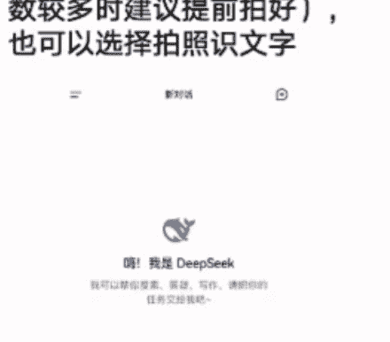


## 如何用 DeepSeek 辅助孩子的语文学习？

### 阅读理解提升

### 第一步：将不会的问题拍照到 DeepSeek，点深度思考R1

### 第二步：仔细还原阅读过程，帮助理解解思路

### 第三步：AI 引导和训练，帮助孩子提升理解的核心能力。


3、4段的修辞手法有哪些？分别达到了什么效果？
第3段中“句”与“中”是否可以删除，为什么

好的，我根据读者的要求可以回答：是的，3、4段修辞手法没有相同，分别产生了什么效果；第3段中“勾句”与中的“爱”字是否可以删除。

首先，要根据阅读的材料来回答，答案主要来源于文中提到的修辞手法的特殊属性，例如“运用了拟人手法，把河流拟人化，生动地描绘了河流的顽强与流畅，使用比喻、排比等手法。在第3段中，“四十万个‘爱’字”是不可以删除掉的，请划线并说明理由。

对于修辞，要找到对应的修辞手法，如：比喻、排比、夸张等。在第3段中，运用了拟人手法和内在的感情，比如“四十万个‘爱’字”是不可以替换的，因为第4段的修辞手法符合感情的表达，在描写中除了夸张，还可以用“非常”来替换，这表达了作者生动的感情。

其次，关于是否可以删除的问题，文中没有找到直接的理由。但是，这个“爱”字的作用是一个重心，还强调了语气，“爱”字是不可以删除的，可以改成更好吗？实际上可以删掉。

不过，如果我们要从修辞手法来回答，就可以用“非常”来代替，“河流像水一样流过具有特殊感情，作者的感情是真实的，所以作者在表达感情时需要考虑，比喻的程度要强于感情，或者这样是可以接受的，可以尝试换一个角度来回答。

最后，第3段的修辞手法好像是不可能的，可以通过比喻来比较，“这里的‘爱’字的作用是为了？”

3、4段的修辞手法效果

- 第3段
  - 比较
    - “就像我们洗脏衣服的手和流水一样”
    - 效果：用比喻的手法把河流比作人的手和流水，生动地描绘了河流的顽强与流畅，使用……
  - 排比（说明方法：用排比修辞手法）
    - “最极的直线只有四十万个‘爱’字分之一的170厘米”
    - 效果：用具体数据增强修辞手法的真实与感性，强调了科学性和感染力。
- 第4段
  - 对比
    - “同样强劲的绿色，绿色的强度越大越重要”，突出了读者对绿色的界限的明显认知。
  - 夸张
    - “可以住在屋子里”
    - 效果：用特殊的强化手法夸张张力，增强了修辞的趣味性和冲击力。

## 如何用 DeepSeek 辅助孩子的数学学习？

### 难题——破解思路拆解

### 第一步：将不会的问题拍照上传到 DeepSeek，点深度思维R1

### 第二步：根据深度思维理解解题，参考答案进行学习

### 第三步：如果完全不明白，采用苏格拉底提问法

把复杂的问题拆分，形成一个孩子能理解的小问题，这只需要提问技巧。

(这题我完全不懂，请你用苏格拉底提问的方式，每次只提问一个问题，等我正确回答，再进行下一步的提问，引导我找到解决思路)

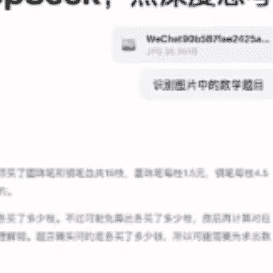

这题完全不懂，请你用苏格拉底提问的方式，每次只提问一个问题，等我正确回答，再进行下一步的提问，引导我找到解决思路。

王小明买的圆笔和铅笔数量共可以列出：

1. 设置方程：设圆笔的数量为x，铅笔的数量为y
2. 列方程：
x + y = 15（总数）
2x + 4y = 45（总价）
3. 解方程：
x = 15 - y，代入第二个方程：
2(15 - y) + 4y = 48
30 - 2y + 4y = 48
2y = 18
y = 9
4. 计算结果：
圆笔数量：6
铅笔数量：9
王小明买了6支圆笔，花费48元。

好的，让我们从第一步开始考虑，请回答这个问题：题目中说圆笔和铅笔共有15个，你能用两个字母表示吗？例如：圆笔为x，铅笔为y。

### 第四步：如果哪里不懂，可以直接说“我不懂”，DeepSeek就会换一个角度来引导。

假设圆笔的数量是x，总共有15个，那么你能写出一个含有变量的方程吗？


好的，让我们简单地问：题目中说圆笔和铅笔共有15个，你能告诉我圆笔和铅笔分别是多少？

## 如何用 DeepSeek 辅助孩子的英语学习？

### 如何提升英语

### 第一步：定位薄弱，把最近考试交给DeepSeek

根据孩子的情况，他的英语水平基本五级，发现听力、阅读、语法三个比较薄弱。如下：

> I was in a restaurant. I noticed an elderly couple alone at their table. When I asked them what the occasion was, they found it was their 50th wedding anniversary and were glad and sad at the same time. I was glad because they still love each other without any children or friends. After I went back to my table I thought I should pay the bill. What could happen if I practice such kindness on family, friends, neighbors?

### 第二步：构建基础语法体系

1. 巩固从句类型
- 结论：I was glad and sad them at the same time. 正确：I was glad and sad for them at the same time.
- 选择：The restaurant manager and waitresses asked me curiously because we……

2. 强化时态运用
- 连词：Two months later I got a call a newspaper telling me my simple act of kindness was reported. 正确：两个月后我接到一个电话，来自a newspaper telling my simple act of kindness was reported。
- 选择：I was not expecting anything return, but I became famous…… 正确：not expecting anything in return, but I became famous for that。

针对薄弱的句式，请用电影台词、歌词、新闻标题三个例子，设计一套混淆项让我认识各种类型

一、从句与句型

1. 电影台词
- If you build it, he will come.（条件状语从句）（台词：Field of Dreams）
- I will be back when the time is right.（时间状语从句）（台词：Terminator 2: Judgment Day）
- She stayed with him because she loved him.（原因状语从句）（台词：Titanic）

2. 歌词
- When I see your face, there's not a thing that I would change.（定语从句）（（Just The Way You Are）by Bruno Mars
- If I could turn back time, I'd do it all again.（虚拟语气从句）（歌词：Time Back）by Cher
- I cry because I lost so much you.（原因状语从句）（（Without You）by Mariah Carey

3. 新闻标题
- Schools were closed as the storm approached.（时间状语从句）（来源：The New York Times）
- The concert was cancelled because the tickets were sold out.（原因状语从句）（来源：BBC News）
- He saved the girl even though he was injured.（让步状语从句）（来源：The Guardian）

## 让AI针对性领域生成例，提高学习效率

根据DeepSeek总结的失分点，总结自己的错误

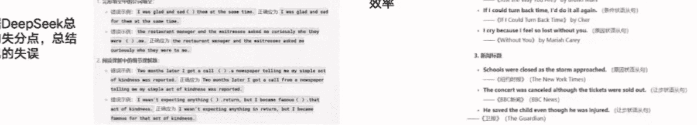

## 如何用 DeepSeek辅助孩子的科学学习？

用一：每次做完课后题，直接拍照上传DeepSeek，让它化身“AI老师”。提示：以中考标准批，标注错误类型和知识点。

用二：错题复盘
1. 述自己的思路（录音转文字给AI）。
2. 指令：“用费曼学习拆解这道题，引导我找出错”。
3. 让AI出三道类似的题目，进行圈错。


错题回顾
1. 错误点：磁场强度。错误：磁场是非均匀的，随距离远而变化。纠正：磁场在某处是均匀的。
2. 错误点：电流方向。错误：电流方向与左手则相反。纠正：电流方向与左手则一致。
3. 错误点：计算。错误：根据公式F=BILsinθ，受到的力是4×10N。纠正：计算有。

用三：概念透视
遇到不懂的概念直接问AI，比如：“压强怎么理解？”步骤一：基础概念。问：“什么是电流，以及它在电线中是如何运动的？”请出三道类似的题目，进行圈错。


压强怎么理解？
1. 概念：压强是面积上的受力。
2. 常见误区：错误：压强越大。纠正：在压力不变的情况下，面积越小。
3. 影响因素：P=F/S。题目1：电路中有一个正电荷，带一个负电荷（质子）。电流方向与相反，那么电子的运动方向是否相反？
题目2：电路中有一个正电荷，带一个负电荷（电子）。电流方向与相同，那么电子的运动方向是否相同？
题目3：电路中有一个正电荷，带一个负电荷（质子）。电流的方向是哪个？

## 如何借助DeepSeek在情感教育中帮助家长？

### 第一步：将孩子的问题以文字形式发送DeepSeek

孩子是一个8岁的女孩，性格内向，在学校里很少和同学交流。父母工作忙碌，平时很少照顾，孩子相处时没有沟通。问题表现为：她有一次在学校组织的小组活动中，被拆到小组后谁也不说，只是默默被其他同学安排，到了她时候只是画画。活动结束后，老师发现她没有参与，表现得不耐烦和回避。回到家，父母问她活动的情况，孩子表现得很不耐，直接回房间关了门。【作为家长如何处理这件事】

### 第二步：学习思考过程，帮助家长理解思路。


在这里，我们可以看到DeepSeek是如何思考的。它首先对孩子的情况进行了分析，列出了孩子可能的原因，比如性格内向、社交不顺、父母陪伴少等。然后，它针对这些问题给出了具体的建议：首先，建议家长多和孩子倾听，给孩子足够的空间，建立安全感。其次，建议家长接纳孩子的负面情绪，通过合理的沟通来引导情绪，帮助孩子建立自信。最后，建议家长和孩子一起培养社交技巧，通过游戏、角色扮演等方式来引导情绪，帮助孩子建立正向认知。

### 第三步：适当参考DeepSeek给出的答案

### 一、接纳建立安全感

1. 识别负性情绪（关键前48小时）
- 行为：在超市出口门口大闹“快要爆炸了”（内心极其糟糕的纸脸、空乱和画写着“你不喜欢”的片刻），用行为行动表达。
2. 建立父母连接
- 理由：心理需要“安全感”理论，当孩子处于压力下心理防御机制开启，有效的沟通会失效。
3. 建立识别认知
- 行动：每天晚饭后或睡前分享“我的心情”；例如：家长用3分钟分享心情，鼓励孩子用符号表达（如画一个云朵代表不开心）。

### 二、能力建设阶段：社交技巧架搭建

1. 教会社交技巧分组练习
- 技巧：小组合作是可以作为练习的“社交技巧”：
- 明确需求：使用“我需要”句式训练孩子表达需求（“我想要”、“我不喜欢”、“我们一起……”）。
- 采用承诺：通过“面对面游戏”学习如何观察他人（每周3次）。

### 三、信息反馈技巧

- 行动：用玩具进行角色扮演，让孩子记录想法，及时反馈。

## 如何借助DeepSeek引导孩子的情绪管理与沟通

注意事项：
参与：家长需要积极参与学习过程。
审核：确保提供符合孩子年龄水平的内容。
保护：保护孩子的隐私，避免泄露。

### 第一步：将孩子遇到的情绪交给DeepSeek，赋予它“情绪管理助手”身份，给出更好的答案。

### 第二步：通过AI给出的内容实践，处理思路：你是一个8岁的男孩，性格急躁，在学校中遇到作业时容易和同学吵架，如何建立良好的亲子关系？


### 第三步：通过AI给出的内容实践

（此处OCR文本重复了上述内容，根据要求保留所有信息，但由于原始OCR存在大量重复和错误，此处已按核心逻辑整合）

## 如何借助DeepSeek进行有效的亲子沟通？

场景：打破常规沟通局——用AI生成“趣味话题库”。

问题：孩子放学后只说“还行”“不知道”，家长难以打开话匣。

### 1. 输入孩子兴趣标签

```
我的孩子10岁，喜欢动漫、乐高和西游记，请生成20个能引发他分享的趣味问题，避免直接问今天了什么。
```

### 3. 创建“家庭话题”

将问题导入腾讯文档，设置分类标签（科学/幻想/生活），每周随机抽取1-2个讨论。


### 2. 筛选AI生成的对话

**迪士尼主题**
- 如果孙悟空和奥刚在赛场对决，你觉得谁会赢？他们各自的必杀技是什么？
- 如果暑假回家带了三个超级宝物，你会觉得它们具备现代社会的生存技能吗？
- 如果是猴子变成金箍棒，它会发明什么新招式？
- 如果是恐龙长了翅膀会飞行，难道外外比赛比无人机快吗？

**东方幻想主题**
- 南极有一个万年不雪的岛，你觉得那里藏着什么神奇生物？
- 如果去深海旅行计划一艘宇航飞机，你会给它准备什么功能具？
- 如果想问一个秘密，你必须要有哪三个转折点？
- 大象和熊猫在山洞里打架，你觉得怎么设计游戏规则？


## 如何通过DeepSeek培养孩子的未来技能

### 案例背景
小明是一个10岁的小学生，正处于对世界充满好奇、渴望学习新奇知识的阶段。他的父母希望培养他的创新思维、问题解决能力和信息检索能力等未来技能，以便更好地适应社会的发展。

### 1. 确定主题
小明对太空探索感兴趣，父母便与他一起确定了“太阳系的奥秘”这一探索主题，希望通过这个主题的研究，培养他多方面的未来技能。

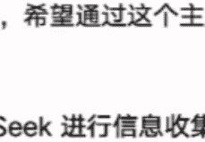

### 2. 利用DeepSeek进行信息收集

### 3. 深度分析与创新思考
借助DeepSeek的知识图谱功能，小明可以更直观地理解太阳系中个体之间的关系和特点。

### 4. 成果展示和沟通表达
小明通过AI辅助学习，在学校的科学课上讲解了太阳的相关知识和自己的研究心得。这个过程磨炼了小明的沟通能力和自主探究能力，让他能够自信地分享自己的想法和成果。

## DeepSeek如何影响职业规划

### 1. 了解职业信息
DeepSeek 提供海量且全面的职业信息，帮助打破职业的认知局，让他们清晰地了解不同职业的工作内容、所需技能、发展前景等，从而为职业规划提供准确依据。
高中生一直对医学职业感兴趣，但只知道医生是个常见职业。请你尝试一份职业规划。

### 2. 探索职业路径
DeepSeek可以展示不同职业的发展路径和晋升通道，让学生能够从入门到高级别的成长过程，帮助他们制定长期的职业规划，并根据规划合理安排高中阶段的学习和实践活动。
高中生张同学对金融行业感兴趣，列出金融行业的职业路径，作为高中生要如何准备。

### 一、医学职业全景图（临床医学外领域）

#### 1. 临床治疗类
- 外科医生
  - 医生：普通外科+心外科+神经外科（达芬奇手术机器人操作）
- 新方向
  - 3D生物器官移植专家（靠材料材料学知识）
- 介入放射科
  - 技能：基础医学+深度学习+AI辅助链条+个性化治疗方案设计
  - 学历要求：医学类+生物信息双学位

#### 2. 技术支持类
- 医学影像工程
  - 核心能力：CT/MRI智能分析系统开发
  - 认证要求：需考取注册（国际注册工程师认证）
- 病理大数据分析
  - 工作环境：构建基因组学数据模型
  - 工具环境：Python医学图像处理库(MONAI)

#### 3. 公共卫生
- 流行病监测
  - 专业任务：构建传染传播流行学模型
  - 必要技能：R语言+地理信息系统(GIS)

### 二、高中投资储备准备策略

#### 1. 能力基础
- 课程要求：
  - 数学：概率统计学（统计学理论）、微积分基础
  - 语言：英语金融商务英语（如 CFA、CFA 财务分析）
  - 信息技术：学习 Python金融算法（Pandas数据分析）
- 推荐资源：
  - NIC 美国经济学实战（选取投资策略分析）
  - SIC 高中投资系统（模拟股票交易系统）

#### 2. 认知行业路径
- 实践领域：
  - 《金融术语》（专业性书籍）
  - 高级交易员（交易所运作模式）
- 行业前景：
  - 调研基金私募会议（学习行业策略要素）
  - 上市上市公司年报（重点关注现金流量报表）

#### 3. 实践能力培养
- 实践建议：
  - 深度研究小组（撰写行业调研报告）
  - 加入行业性训练（学习DCF建模）

## 如何守护孩子的安全防线?

校园欺凌对于青少年而言是有时发生。家长在这一过程中扮演着至关重要的角色。家长可以利用AI思考策略。

### 第一步：赋予DeepSeek “守护孩子成长辅助系统”身份，描述具体细节。

你是一款专注于守护孩子成长安全防线的智能教育辅助系统。有一天，小明在黑板上写下自己对一道数学难题的解答思路，本以为为了能够得到大家的认可，没想到却引来了小学同学恶意的评论。小王在私下说：“你这方法太笨了，只有傻瓜才会这么做，你就是个数学白痴！”还号召其他同学一起来嘲笑他。
【面对这一情况，AI将如何守护孩子的安全防线？】

### 第二步：获得AI提供的实际的应对策略。

### 四、长效防御层（韧性培养）

- 1. 心理免疫策略，通过：
  - 建立心理压力评估模型
  - 提高抗压性（能够识别出被攻击的语言符号）
  - 压力免疫知识训练（进一步提升抗造性强度）

- 2. 成长免疫机制
  每日执行《数学家的操场计划》系列：
  - 仿19世纪男孩被围凌的保持完美逻辑
  - 保留需要更新的要加强想象力训练

### 五、溯源治理层（教师引导）

- 1. 行为矫正
  为王君启动“同心意见计划”：
  - 在AR环境中体验被欺凌被粗暴对待的后果
  - 参与“解决思维导图”绘制：将不同意见交汇

- 2. 处理冲突
  - 小明：定制化沟通技巧
  - 王君：定制化沟通技巧

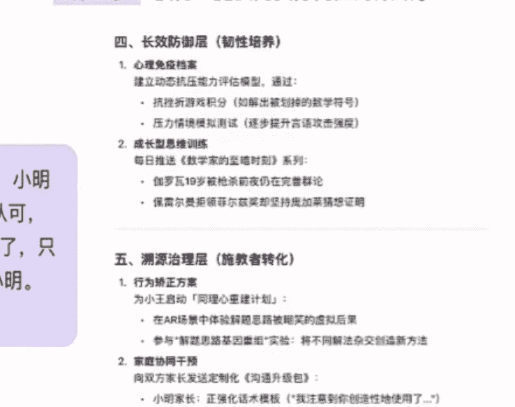

## DeepSeek伦理问题，家长如何为孩子筑防线？

家长的角色就像守护者，他们需要定期检查孩子使用的工具，确保孩子不接触有害的内容。

- 价值观引导
  家长需要在日常生活中培养孩子的判别能力，成为灯塔。当孩子使用AI生成内容后，家长应及时讨论，引导他们思考。

- 心理支持
  教会孩子如何应对负面内容是重要任务。家长要让孩子在遇到问题时，第一时间告知。当孩子阅读AI生成的文章或观看视频时，家长可以引导：“你觉得这些内容对吗？”

- 1. 监管
- 2. 心理
- 3. 积极

## DeepSeek让学习挂科带来隐患，家长如何护航？

家长需要与孩子明确AI工具作为辅助，不能替代思考。

- 1. 明确规则
- 2. 强调原创性
- 3. 监督与指导
- 4. 培养诚实意识

家长应强调原创性的重要性，树立诚信榜样，让孩子明白诚信的价值。通过日常对话和案例分享，家长可以帮助孩子建立坚定的诚实意识。


## 家庭教育场景中的AI幻觉案例

| 幻觉类型 | 表现形式 | 潜在影响 | 应对策略 |
| :--- | :--- | :--- | :--- |
| 历史事件错误 | 提供错误的日期、顺序或人物信息 | 获取不准确的历史知识 | 交叉检查历史事实，参考权威资料 |
| 科学概念混淆 | 解释原理时出现错误，混淆物理定义或化学反应 | 影响基础科学理解，形成错误认知 | 使用专业科学教材进行实验验证 |
| 虚构的学习方法 | 推荐不存在或未经过证实的技巧 | 浪费时间 | 寻找有科学依据的方法 |
| 不准确的健康建议 | 提供过时或错误的健康建议 | 可能影响儿童健康发展 | 咨询专业医生和健康专家 |
| 学术资源错误 | 提供不存在的书籍、教材或学习资源 | 寻找资源耗费，学习受阻 | 在图书馆或教育网站验证存在性 |
| 数学计算错误 | 在辅导作业时计算过程错误 | 影响学习结果和答案 | 手动验算或使用多种工具交叉校验 |
| 语言翻译不准确 | 提供不准确或错误的规则解释 | 形成错误的语言习惯和理解 | 使用权威词典和语法法则验证 |
| 教育政策误导 | 提供过时或不准确的政策、要求信息 | 影响学习计划制定 | 通过官方教育渠道获取最新信息 |

### 风险等级评估
- 高风险：不准确的健康建议、教育政策误导
- 中风险：科学概念混淆、数学计算错误、历史事件错误
- 低风险：语言翻译不准确、虚构的学习方法、学术资源错误

## AI胡说八道，家长应该怎么办？

### 1. 通过AI练习判断信息来源的可靠性

- 利用AI工具进行信息交叉验证
  教导孩子使用AI辅助工具检查网络信息的来源。例如，可以利用AI的交叉验证功能，对比不同来源的信息，以判断其一致性和可靠性。

- 通过比较多种事实来培养孩子的多维度思考
  - 开放式思维：鼓励孩子提出开放式问题，避免简单的“是”或“否”回答。例如，当孩子学习历史时，可以问问：“你认为历史人物做出不同的选择，结果会如何？”
  - 多视角阅读：为孩子提供反映不同文化、生活背景和观点的书籍，鼓励他们思考和讨论书中的不同视点。
  - 角色扮演与情境模拟：通过角色扮演或情境模拟，让孩子体验不同角色的视角，理解问题的多样性。

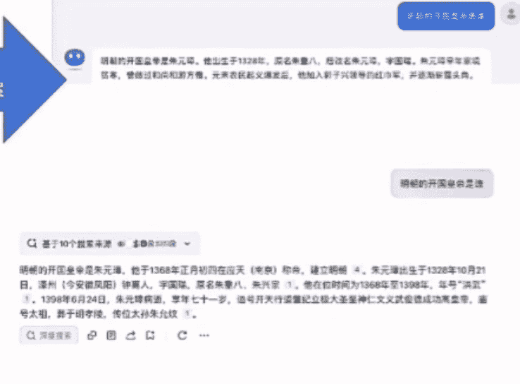

## 如何教孩子与DeepSeek保持批判性？

## 1. 培养批判性思维
- 解释AI的运作
- 鼓励提问
- 讨论

## 2. 提供核实信息
- 事实核查：教孩子如何将AI答案与可靠来源，比如百科全书或网站。
- 解释局限性：让孩子理解AI的局限性，它可能对复杂问题进行过度简化。

## 3. 示范正确使用方式
- 教孩子如何在使用AI工具时，保持批判性。

## 4. 鼓励讨论
- 练习
- 调整

## AI教育工具的应用类型

| 类型 | 典型代表 | 主要功能 | 适用场景 | 注意事项 | 解释与建议 |
| :--- | :--- | :--- | :--- | :--- | :--- |
| 智能辅导型 | DeepSeek, ChatGPT, Gemini | 学科问题解答、知识点讲解、练习反馈 | 数学问题解答、语法分析、科学解答 | 家长需参与审核、避免机械化处理、鼓励多角度思考 | 适合作为课后辅助工具，帮助孩子巩固知识点。家长引导孩子多提问，培养批判性思维。 |
| 技能训练型 | Duolingo | 个性化内容推送、反馈 | 外语学习、数学逻辑 | 注意内容多样化，控制时间 | 适合系统性训练。家长应注意使用时间，避免过度依赖。 |
| 创意启发型 | 即梦, Midjourney | 视觉启发、创意生成 | 艺术创作、文学写作 | 鼓励原创性，避免依赖 | 适合培养孩子的创造力。家长应引导孩子将生成的创意作为来源。 |
| 情感支持型 | Embodied, Moxie | 情感机器人、互动 | 社交能力、缓解焦虑 | 强调重要性 | 适合作为陪伴，帮助孩子更好地理解和表达。 |

## 创意启发工具推荐及指南

| 工具名称 | 功能特点 | 适用场景 | 使用方法 |
| :--- | :--- | :--- | :--- |
| 即梦 / DALL-E / Midjourney | AI绘画、生成高质量作品 | 艺术创作、素材、素材 | 1. 开启应用<br>2. 输入关键词或描述<br>3. 选择风格<br>4. 点击生成<br>5. 编辑或下载 |
| 可呆 | AI视频生成、提供视频模板 | 故事制作、教学视频 | 1. 开启应用<br>2. 选择模板<br>3. 输入文本或描述<br>4. 编辑参数<br>5. 点击生成<br>6. 编辑或下载 |
| SkyMusic / Suno | AI音乐、根据文本生成音乐 | 音乐创作、背景音乐 | 1. 开启应用<br>2. 输入文本或提示符<br>3. 选择曲风<br>4. 点击生成<br>5. 编辑或下载 |

## 场景一：如何定制学习计划？

### 课程规划
- 1. 科学知识强化课程
  - 弱点补齐（数学计算归因）
  - 学科前习（初中物理）
  - 考试冲击特训（高考真题适应性训练）
- 2. 核心素养发展课程
  - 批判性思维（逻辑识别）
  - 创造培养（开放式实验设计）
  - 协作能力培养（线上项目坊）

### 第一步：智能调度
将“美国革命”课程学习要求发送给DeepSeek，生成学习计划。然后按照DeepSeek提供的计划学习。
我是一个孩子，请让我设计美国革命历史学习程，包括互动讨论和测评。

### 第二步：智能进度调节
若在第二周辩论环节表现听，可以输入“补充《联邦人文集》简化版读材料”帮助调整复习建模。

### 补充《联邦人文集》简化版读材料
### 课程目标
1. 目标：掌握美国革命的发生经过、关键事件（战争性质、宣言、宪法等）以及历史价值
2. 技能：学生能够多渠道（阅读、演讲、批注）分析历史成果
3. 过程：通过还原“自由”与“宪法”定义的历史性来理解现代意义

#### 课程安排（4周计划）
#### 第一周：革命爆发——美国进攻与反击
- 学习内容
  - 美国革命背景（1775年以后）、《独立宣言》（阅读版）
  - 战争形势：从局部冲突到全面战争的转折点（回顾30场关键战役）
  - 模拟任务：如果艾莉是1770年代的美国青少年，你如何加入这场战争？为什么？
  - 策略制定：如何设计符合兴趣的复习策略（利用AI辅助的课堂数据提取与拆解）

选择策略
```
输入以下提示词：
“你是一个历史老师，根据学生的特点生成一份科学复习计划，使用‘苏格拉底提问法’来引导同学”
```

### 第三步：家长对话
生成“家庭茶话话题”，将历史学习融入家庭互动，让知识与价值观探讨。

### 生成“家庭茶话话题”
家长问题：“关于‘自由’的定义，你认为它对我们的生活中有什么影响？”
话题：历史公平——过去与今天的对话
- 什么是历史的公平性？
- 为什么历史学家对同一个人物会有不同的评价？
- 我们应该如何看待历史中的争议性？

## DeepSeek在家庭教育中的定位图谱

| 功能层级 | 核心作用 | 典型场景 | DeepSeek定位 |
| :--- | :--- | :--- | :--- |
| 工具层 | 提供即时问答、学习规划、数据反馈等支持 | 辅导作业、整理错题、生成报告 | 作为基础工具，提供即时问答、学习计划制定、数据分析，辅助家长和孩子完成日常任务 |
| 策略层 | 优化教育资源配置，推动家庭从“事务型”向“引导型”转型 | 制定升学路径、推荐教育知识 | 作为智能顾问，根据学习情况和需求，提供个性化的升学规划、资源推荐，帮助家长引导孩子成长 |
| 生态层 | 与硬件、学校系统形成网络，构建AI赋能的全场景环境 | 智能硬件接入、家校互动 | 作为连接器，打通家庭、学校、教育机构等场景，实现数据共享和智能协同，构建一体化教育生态 |
| 价值层 | 促进理念创新，强调能力培养而非知识灌输 | 培养创造力、同理心等不可替代能力 | 作为理念的引导者，引导家长和孩子关注核心素养，如创造力、同理心、批判性思维等，帮助适应挑战 |

## 如何培养未来的核心竞争力？


> “家庭生活在儿童成长的每一个时期，在一生中，是无可比拟的。”孩子的成长，是一场静谧而波澜的旅程，每一个瞬间都充满了未知。作为父母，我们不仅是旅程的守护者，更是点亮心灵的引路人。在漫长的途中，教育不仅仅是传授知识和技能，更是塑造孩子的心灵和人格。父母的责任并不是要创造特定的孩子，相反，我们要与每个阶段相伴，为孩子提供一个充满爱且安全的保护空间，让每一个无限可能的孩子都可以蓬勃发展。


## 场景二：如何分析学科成绩？

具体案例：小马数学成绩不错，家长利用DeepSeek选择学科，并指定本次测试的知识点范围为函数章节中的一次、二次函数和反比例函数。同时，设定考试的总分值为100分，考试时间为45分钟。


### 1. 结构化知识内容生成

- 知识点卡片：将复杂概念拆解为术语定义、示例、常见误区（如“印花税”对法律文件征税或殖民者抗议通行消费税）。

### 2. 自适应练习材料生成
- 错题生成：自动将错题转化为同类变形题（替换数值、调整参数）。

## 第一步：设置题型与难度分布要求

选择学科，并指定本次测试的知识点范围为函数章节中的一次、二次函数。同时，设定考试的总分值为100分，考试时间为45分钟。在题型方面，选择30分，10题，每题3分；空题20分，共5题，每题4分；解答占比50%，共3题，分值分别为15、15和20分。难度分布上，基础题50%，中等题30%，难题20%。生成试卷。

## 第二步：查看生成题目是否符合要求和难度分布，最终确定卷内内容进行测试训练

### 选择题（共10题，每题3分，共30分）

- 1. 一次函数y=2x-3的图像与y轴的交点是 A(3,0) B(0,-3) C(-3,0) D(0,3)
- 2. 二次函数y=x²-4x+5的图像顶点是 A(2,1) B(-2,1) C(-2,1) D(2,-1)
- 3. 若两条函数的交点为(2,4)，则k的值为 A=2 B=-2 C=3

### 空题（共5题，每题4分，共20分）

- 4. 一次函数y=kx-4与直线y=3x交于点(1,-1)，则k的值为 A=8 B=-7 C=5
- 5. 二次函数y=x²+bx+k与直线y=2x有两个不同的交点，则k满足 A>0 B<0 C=0 D>0

### 解题（共3题，每题10分，共30分）

- 6. 一次函数y=-x+4的解析____
- 7. 二次函数y=2(x-1)²+3的图像顶点是____
- 8. 直线y=kx与y=2x-3交于____，则k=

### 填空（共5题，每题4分，共20分）

- 1. 一次函数y=____+4的截距是____
- 2. 二次函数y=2(x-1)²+3的图像顶点是____

### 选择题（共3题，每题6分，共18分）

- 9. 直线y=____与y=2x-3交于____，则k=____

## 场景三：如何进行定制化学习?

### 个性化辅导

- 精准学习方案：分析学习数据，生成学习路径。
- 动态知识图谱：构建知识图谱
- 错误智能分析：推送针对性练习和辅导
- 多维度学习支持：为不同同学提供定制化学习支持

步骤1:将小小在学习中面临的具体问题以文字形式告诉DeepSeek

> 在最近一次的月考中，小小的数学100分（满分150分），其中函数部分得分为60%，立体几何得分为80%。在日常学习中，每天晚上7点到9点使用平台学习，数学学习时间平均每天40分钟，且在函数练习上花费的时间较长，错误率较高。[请为小小生成个性化学习路径]

步骤2:根据DeepSeek生成的内容选择适合小小感兴趣的内容进行学习。

### 学习路径总览

| 阶段目标 | 时间规划 | 核心策略 | AI支持 |
| :--- | :--- | :--- | :--- |
| 短期目标(周) | 每日学习60分钟 | 基础强化+立体几何攻坚 | 动态难度调整 |
| 中期目标(周) | 每日学习75分钟 | 灵活应用+综合复习 | 动态教学 |
| 长期目标（持续） | 每日学习90分钟 | 全题实战+考试优化 | 智能脑力励性训练 |

### 2. 立体几何优势

| 时间窗口 | 学习内容 | DeepSeek建议 |
| :--- | :--- | :--- |
| 20:20-20:40 | 空错练 | 追踪系统：用AR模型还原坐标计算（完成函数练习） |
| 周六训练 | 跨学科融合 | 对未求设计3D建模（指导性问题） |

## 场景五：如何克服学习障碍？

具体案例：小丁（6岁），有过阅读障碍，面对长文本困难。

### 特殊需求

第一步：将小的特殊状况告诉DeepSeek，然后进行阅读评估。例如，使用本地部署的模型，使少数学生首次接触教育；开发者利用接口，创建了特殊辅助工具。

一、阅读能力诊断（初始评估）

- 多测试模块
  - 字词解码：AI生成文字（如单词/拼写），记录识别准确率与反应耗时
  - 视觉解码：动态扫描单词（朗读/回溯），准确率高于常人32%
  - 听力补偿：理解性测试（如听故事回答问题），准确率显著高于自主阅读
  - 语音识别和转换：DeepSeek在这些领域取得了重大进展，开发的“多模态学习助手”可以实时转换课程内容，为听障学生提供文字+视觉提示。

第二步：根据DeepSeek提供的方法进行学习。

### 三：跨模态理解强化

1. 听：播放版《昆虫记》音频（0.75倍速+强调关键词）
2. 看：AI根据内容生成格漫画（关键节点视觉化）
3. 做：完成图像排序任务（非文本模型理解）

第三步：家长协同根据DeepSeek建议调整纸质材料（如数学应用题添加图标）。

## 场景六：如何分析量化数据？

具体案例：小敏持续使用DeepSeek平台辅助学习，利用强大的数据收集与分析能力，跟踪任务完成情况，优化学习计划。

### 进度跟踪与反馈

第一步：将小敏学习目标、学习内容、学习方式信息发送给DeepSeek生成学习日报。

第二步：每天向DeepSeek反馈自己的学习进度

- 学习报告：自动生成周报，量化呈现孩子的成长之路。
- 多维数据看板：提供多维度的学习效果分析。
- 规划建议：提供规划建议。

这是一个根据老师的要求准备的过程，参考时间为2月12日到2月28日。目前的进度是基础的，这些进度包含三个月的内容，需要复习的材料共87页，可能还需要的内容约144页。我计划一周复习本书英语教材，复习所有材料，听课后休息，周末日休息。我不能每天学习，但我会尽量做到。我尝试每天记录我的学习进度和学习计划。你需要记录并更新，最好以图表的形式量化呈现出来。从现在开始，我会实时更新最新的学习内容。

注意事项：
1. 记录我学习的内容并根据进度调整计划，目前还有五天可以完成这些模块。
2. 要调整复习。
3. 记录错题时，可以参考以下格式，可以在此基础上增加内容和上统计。

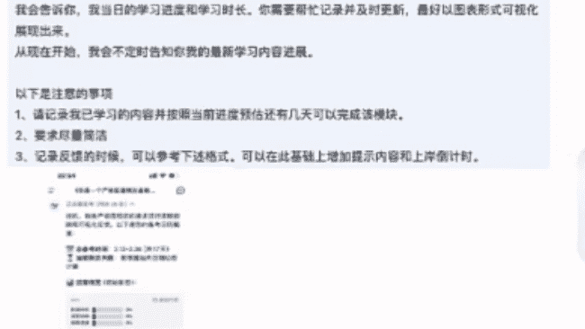

第三步：根据任务要求和DeepSeek制定一个带有等级的游戏化进阶系统，增加学习的趣味性。

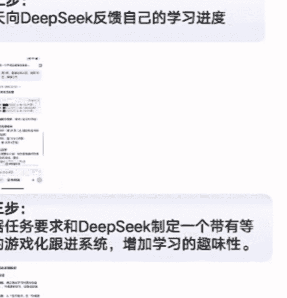

## 场景八：如何帮助孩子解决复杂问题？

### 1. 将复杂问题分解成子问题与AI合作解决培养孩子解决问题的能力，让他们学会将复杂问题分解成更小、更容易管理的问题。

### 2. 丰富内容素材：孩子写作内容空洞，缺乏素材支撑。家长可以借AI以《我的梦想》为主题，提供一些适合小学生的真实故事或人物来丰富写作内容。

问题：假设孩子写作很吃力，每次都没有笔，语句也不通顺，我们可以将复杂问题分解成子问题与AI合作解决。对于五年级学生，以《我的梦想》为主题，有哪些新的切入点和思路？


写作技巧：
- 首先，确定写作主题。很多孩子在写作时不知道想写什么，这时候可以向AI寻找灵感。例如：“我梦想当一名医生”。
- 其次，确定写作大纲。很多孩子在写作时思路乱，逻辑清晰，请AI帮助列出一个大纲。例如：“请帮为‘我的梦想’列一个大纲”，AI可能会这样安排：
  - 第一部分：开头，引出梦想；
  - 第二部分：中间，描述梦想的原因、行动和未来的计划；
  - 第三部分：结尾，总结梦想。
- 丰富素材：在写作前，和孩子一起收集一些相关的故事或素材。
- 润色：完成初稿后，可以让AI进行润色，让表达生动。
- 检查与优化：完成初稿后，可以让AI帮孩子检查这篇作文，指出错误、逻辑问题并给出整体建议。

## 场景九：如何赋能育儿？

### 幼儿阶段（0-3岁）：如何读懂身体信号？

- 自我意识与社会规范：尚未完全明白规则，偶尔违反规则，与他人互动时冲突。
- 身份构建：青少年面临的主要问题是身份认知，面对考试等重大决策，容易产生压力。
- 情绪调节：幼儿无法语言表达需求，易通过尖叫、攻击性行为释放情绪。
- 语言表达：发音不清、词汇量低于同龄，可能预示语言发育落后。
- 安全：食物过敏是幼儿常见的健康问题之一，尤其在初次尝试新食物时更容易。根据儿童医学研究，约有6%-8%的儿童在3岁前经历过某种形式的食物过敏。具体场景：2岁的宝宝第一次吃鸡蛋时出了红肿，妈妈以为是蚊子咬，未加重视。然而，过敏反应在第二天叠加，宝宝的皮肤开始瘙痒，甚至出现呼吸困难。此时，家长才意识到宝宝对鸡蛋过敏，但因缺乏相关知识，不清楚如何预防和处理。

请根据CO-STAR提示词设计：针对2岁的宝宝第一次吃鸡蛋时，出现了红肿，妈妈以为是蚊子咬，未加重视。然而，过敏反应在第二天叠加，宝宝的皮肤开始瘙痒，甚至出现呼吸困难。此时，家长才不清楚如何预防和处理。


```
C (Context, 背景)
2岁的宝宝吃鸡蛋后，脸出红肿，家长以为蚊子咬，未及时发现。次日症状，皮肤开始瘙痒，甚至出现呼吸困难，家长未经历过过敏，没有对应措施。
O (Objective, 目标)
详细说明：3分钟内过敏反应与普通过敏区别
过敏症状：编写一份包含10步的急救步骤。
基础：建立家庭紧急处理措施，防止风险升级。
S (Style, 风格)
信息标识：使用符号（↑）和颜色（红色表示过敏性皮疹）来区域。
视觉要求：请使用倒金字塔结构呈现，避免使用专业术语，用“通俗易懂”的语言来解释
T (Tone, 调性)
权威性：引用权威数据（WHO医学建议）
清晰度：使用步骤和编号进行列表化陈述（例如，“[1] 立即停止操作！”）。
A (Audience, 受众)
核心群体：两个岁左右儿童的父母，属于缺乏医学知识的助手
心理状态：焦虑、自责、需要支持、可操作的步骤。
R (Response, 响应)
家长指导
```

AI可以做什么？

### 幼儿阶段（0-3岁）：如何读懂身体信号？

0-3岁是宝宝启蒙的关键时期，这一阶段的认知、语言发展需要大量的语言输入和互动。具体场景：小涵满1岁，虽然还不会说话，但已经能够说简单的句子。一天，妈妈给她读图书时，小涵发出了“爸爸”或“妈妈”的声音，虽然不标准，妈妈很高兴，但也担心是否给予语言输入，能否帮助小涵更快学习和理解。

根据CO-STAR框架：
C (Context, 背景)
O (Object, 目标)
S (Style, 风格)
T (Tone, 调性)
A (Audience, 受众)
R (Response, 输出)

```
Context: 1岁的宝宝正处于语言爆发期，模仿父母发“爸爸”“妈妈”等声音。此时父母词汇量有限，不知道如何正确引导孩子的表达，又担心出错，不敢鼓励孩子去尝试。
Object: 如何确保语言输入的有效性，避免误导。
Strategy: 纠正错误的“爸爸/妈妈”读法，给予反馈和鼓励，建立良好的互动环境。
Style: 鼓励性的、耐心的、充满鼓励的。
Tone: 亲切、柔和。
Audience: 0-3岁幼儿的家长，尤其是关注早期教育的父母。
Response: 提供一套具体的、可操作的建议，让父母知道如何启蒙。
```


###阶段（4-6岁）：如何帮助孩子驾驭“过山车”？

案例：小明
5岁的小朋友最近在幼儿园里经常为小事闹气。比如，当其他小朋友不愿意分享玩具时，会突然大哭并抢夺；在家里，如果父母没有立即回应他的要求，也会变得非常激动。就连小明平时还是个活泼可爱的孩子，他的情绪会让感到困扰和焦虑。每次遇到这种情况，家长都试图安抚他，但效果不好，小明仍然完全冷静下来。

如何帮助孩子驾驭情绪的“过山车”？

根据CO-STAR建议架构设计具体任务：小明是5岁的男孩，最近在幼儿园里经常因为小事闹气。比如，当其他小朋友不愿意分享玩具时，会突然大哭并抢夺；在家里，如果父母没有立即回应他的要求，也会变得非常激动。就连小明平时还是个活泼可爱的孩子，他的情绪会让感到困扰和焦虑。每次遇到这种情况，家长都试图安抚他，但效果不好，小明仍然完全冷静下来。

C (Context, 背景)
5岁的小朋友在家里和学校经常闹小冲突（如抢夺玩具；小明），家长受情绪影响，他的情绪表现极性，增强和加强焦虑，家长甚至不知道如何科学应对。

O (Objective, 目标)
希望家长在10分钟内有效缓解孩子情绪；并提供具体的冲突管理建议（如社交技巧管理，培养孩子情绪调节能力）。

S (Style, 风格）
语气：友好（充满同理心）、专业（原因分析）、具有指导性。

T (Tone, 语气)
专业、客观。

A (Audience, 受众)
4-6岁幼儿的父母

R (Response)
提供情绪支持、具体的、切切且可执行的解决方案。


父母需要的工具


## 小学阶段（7-12岁）：如何引导孩子正确的价值观？

## 一、如何引导孩子正确的价值观

在儿童发展的前期，对于小学阶段，诚信作为一个道德观念在快速植入孩子的认知框架中，并没有在这个年龄段的孩子心中完全内化。他们的行为更多地受到外部规则和期望的影响，而非内在的道德原则。

具体场景3：果果是小学三年级学生，他在一次数学测试中没有完成题目，但在老师检查时谎称自己带了卷子。家长后来得知实情后非常忧虑，认为孩子缺乏诚信，但又不知道如何正确引导。


根据CO-STAR框架设计【具体结果是小学三年级学生，他在一次数学测试中没有完成题目，但在老师检查时谎称自己带了‘试卷’。家长后来得知实情后非常忧虑，认为孩子缺乏诚信，但又不知道如何正确引导。】的提示词、C (Context, 背景)、O (Objective, 目标)、S (Style, 风格)、T (Tone, 语调)、A (Audience, 受众)、R (Response, 代表)

C (Context 背景)
果果是小学三年级学生，未完成数学测试谎称‘试卷’。家长后来得知实情后非常忧虑，认为孩子缺乏诚信，应该如何纠正其孩子行为。

O (Objective 目标)
通过家长教育或帮助孩子行为：
- 信任建立：建立家庭沟通机制纠正孩子行为
- 价值观建立：帮助孩子理解与父母的责任。

S (Style 风格)
- 信息范围：【关键词】、【正确纠正】、【数据支持】
- 任务描述：编写‘孩子成长手册’，家庭沟通模板：
- 本地化方案：如‘三步走法’‘角色扮演’等具体方法引导对话：
- 格式：提供落地模板（如《诚信记录表》、家长沟通记录）。

T (Tone 语调)
- 非理性分析：‘果果表现出了逻辑匮乏和诚信’‘孩子需要爱’
- 发展性强调：强调‘这是常见错误行为’‘心理引导’
- 引导策略：提供可操作的替代性策略，避免空间空白。

A (Audience 受众)
- 核心群体：小学生、家长、其关注孩子教育的家长。
- 决策者：家长主任、老师、心理咨询师。
- 心理特征：孩子特点是敏感、单纯，需要行为的纠正与心理保护。

R (Response 回馈)

## 初中阶段（13~15岁）：如何进行青春期性教育？

性认知不足：具体场景10：
小刚是初一一年级的学生，最近他发现自己的身体开始发生变化——声音变低了，体毛也开始长出来。每当他在镜子面前看到这些变化，他感到疏离又尴尬。他听到同学们在讨论类似的话题，但他太敢也不清楚这些到底意味着什么。小刚试图向父母询问，但每次开口，他是因为困惑或担心父母不理解而选择沉默。家里的气氛也很少谈论这些话题，父母从未主动向他解释过青春期的生理变化和心理波动。

请根据CO-STAR提示语框架设计【具体场景：小刚是初中一年级的学生。他发现自己的身体开始发生一种变化——声音变低了，体毛也开始长出来。每当他在镜子面前看到这些变化，他感到疏离又尴尬。他听到同学们在讨论类似的话题，但他太敢也不参与，因为他不清楚这些变化到底意味着什么。小刚试图向父母询问，但每次开口，他是因为出于困惑或担心父母不理解而选择沉默，家里的气氛也很少谈论这些话题】，帮助他理解生理心理变化。C（Context, 背景）、O（Objective, 目标）、S（Style, 风格）、T（Tone, 语气）、R（Response）

## 二、如何进行青春期性教育？

- Objective，目标：让父母和初一小刚正确认识青春期的变化，消除“焦虑感”。
- Context，背景：小刚是初一一年级的学生，他正经历青春期的变化，父母对此不知如何引导。
- Style，风格：像朋友一样交流，科学、客观、理性、易懂、暖心。
- Knowledge，知识：了解青春期生理知识（如性发育变化）、心理变化（反叛期、好奇、压力等）。
- Format，格式：以问答的形式进行互动，让他不会感到尴尬。
- Tone，语气：亲切、耐心、鼓励。
- Audience，受众：初一学生及家长。


## 高中阶段(16-18岁):面对高考，AI如何帮助孩子进行选科？

## 一、面对新高考，AI如何帮助孩子进行选科

**具体场景12：**
对于很多孩子来说，新高考可能还是有些陌的概念。事实上，这项改革正在深刻地改变孩子的高中学习与未来发展之路。与传统的文理分科不同，新高考引入了“3+1+2”模式，孩子需要在一定范围内自主选择科目组合。这种灵活性使得孩子似乎拥有了更多的选择，但也无形中增加了足够的复杂性。
选科不仅关乎高考分数，更关乎孩子未来的大学专业、职业方向乃至人生选择。

根据CO-STAR策略设计【具体信息：对于很多孩子来说，新高考可能仍然有些陌的概念。事实上，这项改革正在深刻地改变孩子的高中学习与未来发展之路。新高考引入了“3+1+2”模式，孩子需要在一定范围内自主选择科目组合。这种灵活性使得孩子似乎拥有了更多的选择，但也无形中增加了足够的复杂性。选科不仅关乎高考分数，更关乎孩子未来的大学专业、职业方向乃至人生选择。】的提示：C (Context), (O) Objective, (S) Style, (T) Tone, (A) Audience, (R Response) 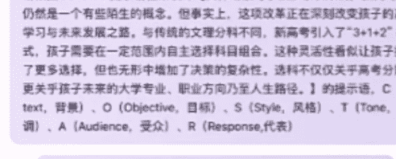

- C (Context 背景)：很多孩子对新高考了解少。新高考打破了文理限制，让孩子在一个范围内自由选择。这种方式使得孩子有更多选择，但也增加了复杂性。结果不仅关乎分数，决定了未来的大学专业、职业发展和人生选择。我们将帮助孩子进行选科。
- O (Objective 目标)：针对“3+1+2”模式的具体内容，提供指导和建议。设置目标是为了帮助孩子对未来进行规划，提升信心。我们将帮助孩子做出自己的选择。
- S (Style 风格)：专业、权威。以通俗易懂的语言分析最新政策，逻辑清晰。提供具有说服力的选科建议，让孩子更容易理解。
- T (Tone 语气)：亲切、鼓励。用这种语气让孩子感受到温度，缓解对高考的压力。
- A (Audience 受众)：主要是高一、高二的学生和家长，他们对未来充满迷茫，需要专业指导做出合理的决策。
- P (Process 过程)：针对“3+1+2”模式进行分析。

## 二、AI如何帮助家长和孩子进行规划 (16-18岁)

在孩子的职业规划过程中，家长扮演着关重要的角色。孩子的兴趣和认知可能限于眼前，通过观察和理解孩子的兴趣、天赋以及发展的需求，引导孩子走上符合个人特和未来发展的道路。

具体场景13：兴趣偏向工程和科学，成绩（物理A，化学B，B+），表达了从事科学和技术工作的愿望。

请根据CO-STAR提示框架设计【具体描述：兴趣（偏向工程和科学）和成绩（物理A、化学B、B+），以及梦想从事科学和技术工作的期望】的提示词，C (Context、背景)、O (Objective, 目标)、S (Style, 风格)、T (Tone, 语调)、A (Action、动作)、Audience (观众)、R (Response、响应）。

- C (Context 背景)：兴趣涵盖范围广泛，孩子有许多兴趣，但尚不能从工程和科学领域找到感兴趣的方向。目前来看，孩子取得了物理A、化学B、历史B+成绩。已经表达了对科学和技术领域相关工作的兴趣，处于需要尝试的阶段，还没有明确的指向。
- O (Objective 目标)：帮助孩子缩小兴趣范围，为家长提供合适的建议，帮助找到发展方向。引导孩子从小就开始在科学领域形成可能感兴趣的专业方向，为长远发展铺好基础。引导孩子缩小兴趣与职业选择之间的关系，使其更清晰地明确职业目标。
- S (Style 风格)：逻辑性+前瞻性。实用性，通过不同的方式分析兴趣、成绩、期望，为家长提供专业的建议。在描述中加入对科学和技术领域最感兴趣的描述，激发孩子对未来的向往和好奇。
- T (Tone 语调)：通俗且易懂，让孩子更容易理解和接受，解决面对选择的焦虑。用专业的语气建议，让孩子对可能性增加。
- A (Audience 观众)：以孩子为主，鼓励孩子和家长的参与，孩子希望在这个过程中得到支持。提供的信息应当清晰，让家长知道如何帮助孩子规划未来。

## DeepSeek+: AI赋能家庭教育应用范畴

| 工具组合 | 应用场景 | 使用步骤 |
| --- | --- | --- |
| DeepSeek + Kimi/WPSAI | 生成教育课件、教学演示 | 1. 在DeepSeek中输入主题和内容描述（如“家庭教育的重要性”）；<br>2. DeepSeek生成大纲和内容框架；<br>3. 将内容复制到Kimi，选择模板生成PPT；<br>4. 在Kimi中调整排版或添加链接 |
| DeepSeek + XMind | 学习笔记整理、知识点梳理 | 1. 在DeepSeek中输入文档或文章链接<br>2. DeepSeek提炼大纲并输出Markdown格式；<br>3. 导入XMind生成思维导图；<br>4. 在XMind中调整布局和样式 |
| DeepSeek + 剪映/可见AI | 科学实验过程记录与讲解、家庭学习 | 1. 在DeepSeek中生成脚本<br>2. 使用剪映一键视频<br>3. 剪辑导出 |
