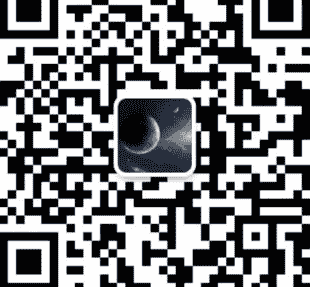

# 局势

现在国际局势变幻莫测，已经是天一天变，七天一天变的速度简直太快了。

你可能会纳吗，怎么几个月，局势何至此地步？

逻辑很简单：

特朗普在换取的优势，都是用中长期置换出来的，他们压上来说暴露的风险，换来的当下劣势。

我们现在的被动，很大是俄罗斯、中东开战后三年时间内，我们一直靠着赢几次机会积累来的历史问题，这些历史之前隐藏着，几个月被美挑和爆发了而已。

双方增加，所以当下局势急转下，两天一天一周，天一天大变。

和解伊朗？

特朗普致电以色列领导人。

陆协从前辈介绍介绍了，欧洲这一对欧洲死心不投降妥协，就是俄罗斯、乌克兰将逼到我们，而伊朗现在是最危险的时刻，可以说伊朗建国最危险的就是现在。但伊朗对付我们就没有办法，只能和以色列继续谈判，一让伊朗让出让步，以后要要伊朗真搞出核，要要伊朗协议妥协，特朗普将长期风险换出来，换得我们的优势。

我们现在的被动，很大是俄罗斯、中东开战后三年时间内，我们一直靠着赢几次机会积累来的历史问题，简单来说比我们过去三年是赢了7分加3分，看起来大赢的，这部分被彻底掩盖，但现在真被特朗普引发了。

> 老美坦克载的游轮这就不是战争吗？

> 这和以前银河河有何区别

特朗普的借口是制裁以色列，是搞我们。

而阿拉伯国家出口说了，如果是合理的运输，不收税，要控制速度，让交易速度变慢，这样越慢我们工业运行。

外缘已经燃了特朗普的心了，就是坏心我们，在线接近狂跳，工业体对交付时间很敏感，这个能暴露我们经济。

大家开海外的生意，特别是买海量的，要把交货时间设定的宽一点。

特朗普此出现意外，会亏及经济的，我们要有备无忧。

好了，今周五，本来想让大家安心过周末的，还是写文，给大家一起危机了。主群禁言令，相信信道，相信我们很快就会见到更明确清晰的信号。

## 免费 价值 及时 专注

## 扫码加入 知识星球TOP 免费资源群

- 每日免费获取有价值资源
- 可提供各类资源搜索服务

| 热门付费文章 | 各行行业报告 |
| --- | --- |
| 精选图书资源 | 副业赚钱方法 |
| 职场实用资源 | AI政经自媒体 |

账号: 知识星球TOP 微信信号: jntsg8 微信信号: jntsg2

分享资料仅供个人学习，请及时删除，切勿商用传播
