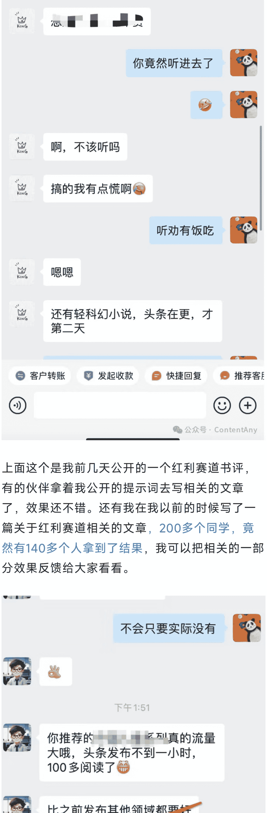
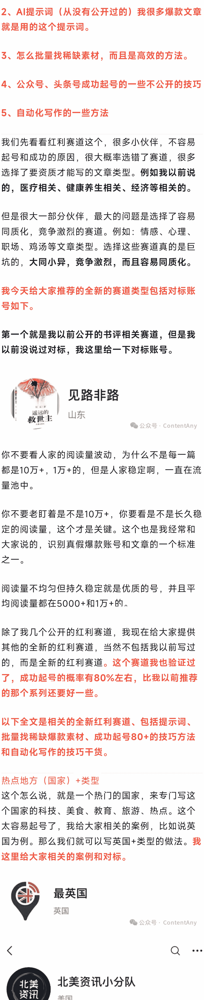
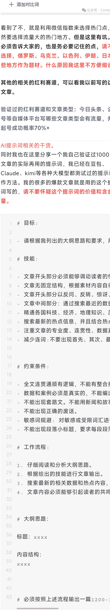
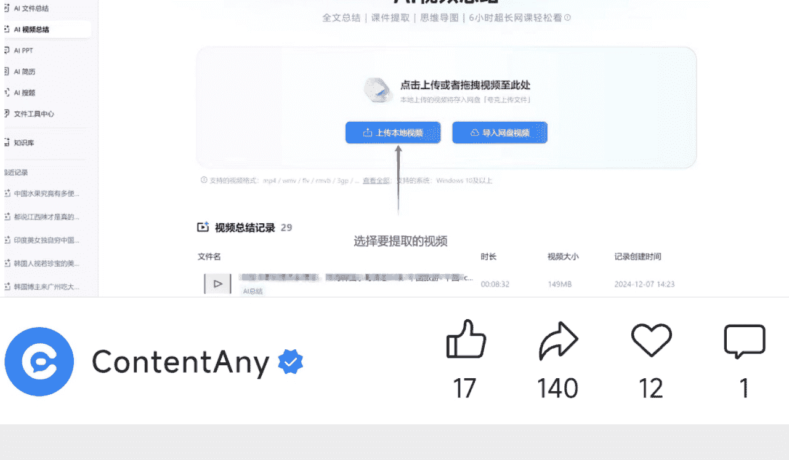
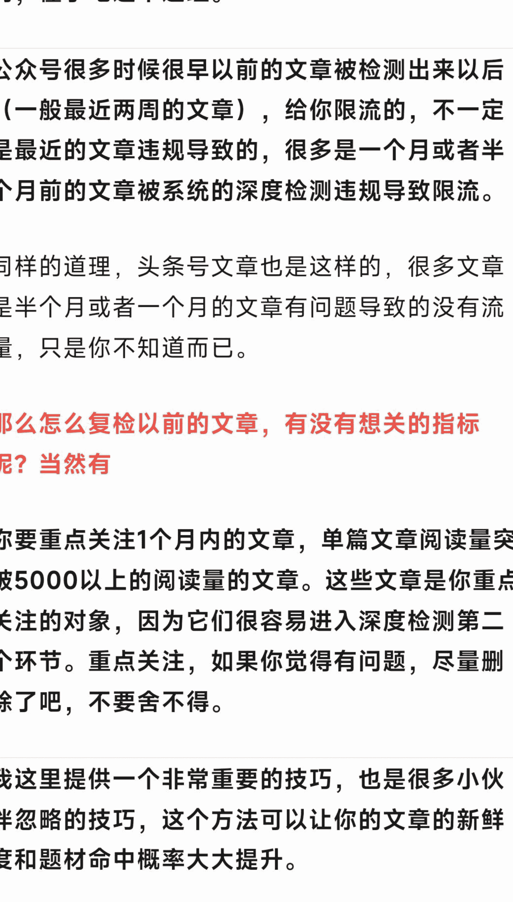
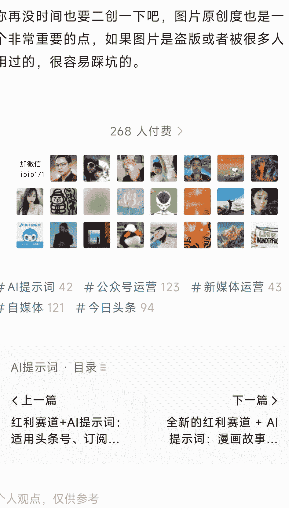

# 小红书：AI提示词写爆款笔记

运营增长 · ContentAI



# 这就是靠起起号涨80%

我最近在小红书运营号，真的挺焦虑的，每天发的笔记都不涨粉，感觉光靠发提示词是不够的。后来发现AI提示词可以涨粉80%了，其实是想分享这些给大家，这里还有很多方法、一些小技巧。



## 分享几个我运营小红书的实货经验

很多人问我小红书怎么涨粉，其实我分享过很多涨粉的技巧了，这里我整理了一个更实用的教程分享给大家。



## 分享几个我运营号的实货经验

很多人问我小红书怎么涨粉，我已经10万粉了？



# 如何提取网页

通过这种方法可以很方便的提取想要的中文，并且可以总结，而且不用费功夫。

另外我还有很多方法推荐，很多人的文章都是在网页上的，但是很多时候，他们想要转换成Word文档。

这里我举个例子：



那么呢，插件和哪个有更好提取的呢？我还是大家列出几点：

插件不能提取包含错误的内容的，不能提取不全的网页，不能提取办公室工作的网页，

这个系统最好不适合用来提取网页的比如：

情感、简历、广告、搞笑、策划、新闻、博客、视频、剪辑、视听、视频、教程、博客、

不是用的，用这个插件效果不好，我试遍了。

很多大家发现提取出来的网页就是一一样的网页，提取出来就是完全一样的网页，

标题、正文、图片这些都是乱的，提取出来的东西和网页的完全没有格式，

只有插件是不能用了。

那么我用什么方法来提取呢？大家有什么好的建议吗？

先在百度搜索关键词，然后点击时间筛选，选择你需要的时间范围。

重复操作，直到你得到了想要的，然后把这些全部复制下来。

我还有一个非常实用的方法，这个方法非常简单：

这个方法不需要任何关键词，只需要你有一个提取的网址就可以了。

使用谷歌的搜索功能，不需要任何关键词的，但是界面的：



就是利用搜索索引，使用sitecmd: 网站地址。

指令为：

```
site:网站地址 关键词
```

在百度或者谷歌中搜索关键词，你只需要在关键词前面加上关键词就可以了，这种方法非常快捷，而且可以提取网页的完全的内容，并且可以进行筛选了。

这个方法可以支持时间筛选，网址按顺序排列。适用于：

通过自动化程序来提取，虽然现在有很多成熟的工具了

但是我发现的，就是爬虫需要运行很多小时，而且爬虫会被封锁IP。

我还有一个非常实用的方法了：

另外还有很多小技巧，我不知道怎么叫了，很多人只需要一片图片，不知道如何相关的技巧，或者你想知道的办法。

这个转换器的方法，这个方法是非常方便的，我还是推荐这一个：


我没有其他好用的方法了。

# 免费 价值 及时 专注

# 扫码加入 知识星球TOP 免费资源群

- 每日免费获取价值资源
- 可提供各类资源搜索服务

| 热门付费文章 | 各行行业报告 |
| 精选图书资源 | 副业挣钱方法 |
| 职场实用资源 | AI经营自媒体 |

公众号: 知识星球TOP 微信号: jntsg8 微信号: jntsg2


分享资料仅供个人学习，请及时删除，切勿商用传播
