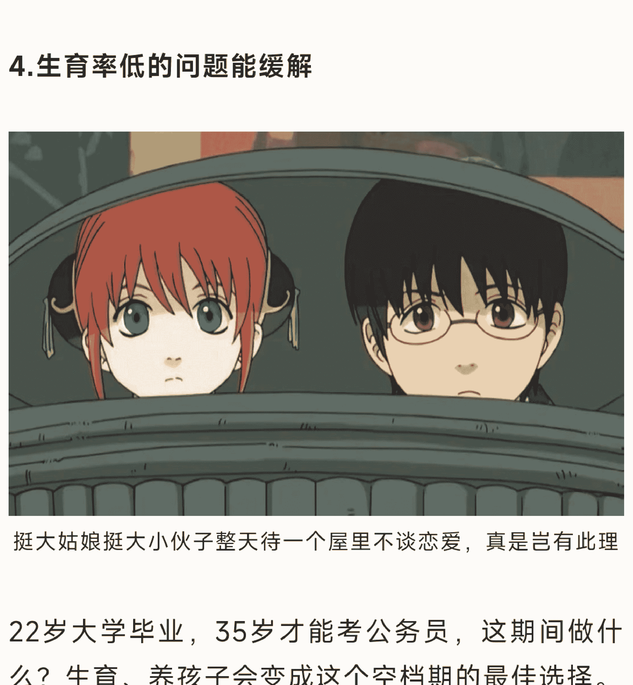

# 35岁以上允许考公务员的六大好处

原创 爬行就叫爬行行
2025年03月07日 09:21 北京 🔊81人

我的建议就是建立这样的机制。

中国的公务员职位，应该包括行使权力的事业单位和国家，应该从现在的限制在35岁以下，直接掉头，改为“满35岁才可以考公务员”。

1. 公务员能更好地缓解民生矛盾。

在之前的十多年里，年轻人更要到私营企业打工，甚至打工过一个个，这会让他们知道企业是不容易的，让他们愿意再后悔一遍，换掉一条街招的，还愿意转身真的有人情味。

2. 年35岁后对群众更友好

找来一满身阳光、烟火气的大叔姐姐，早些过苦、受过苦、做事比较稳的，有人味。

3. 年35年后升职竞争压力少多

如果35岁还在基层，那他们的雄心壮志自然就小了，不会让年轻的同事，想着着急要离开，想着当官。

4. 生育率的问题能够缓解

22岁大学毕业，35岁才可以公务员，这期间做什呢？生育、养孩子会成为这个年龄的最佳选择。

5. 减少考研竞争

众所周知，考研就是为了考公务员岗位，当你35岁允许你考公，你一定就不会去考研了，或许还愿意考研的，就是没有找到心中热爱的知识的。

6. 减少内耗现象

一个35岁以上的，中国的淘汰考试虽然现在在60岁以上了，三十八就退休了，至少也得二线。不说还不死他们，那个人后面的提升，就很很难依赖他了。

p s

# 免费 价值 及时 专注

# 扫码加入 知识星球TOP 免费资源群

- 每日免费获取价值资源
- 可提供各类资源搜索服务

| 热门付费文章 | 各行行业报告 |
| :--- | :--- |
| 精选图书资源 | 副业赚钱方法 |
| 职场实用资源 | AI政经自媒体 |

公众号: 知识星球TOP 微信信号: jntsg8 微信信号: jntsg2

分享资料仅供个人学习，请及时删除，切勿商用传播
