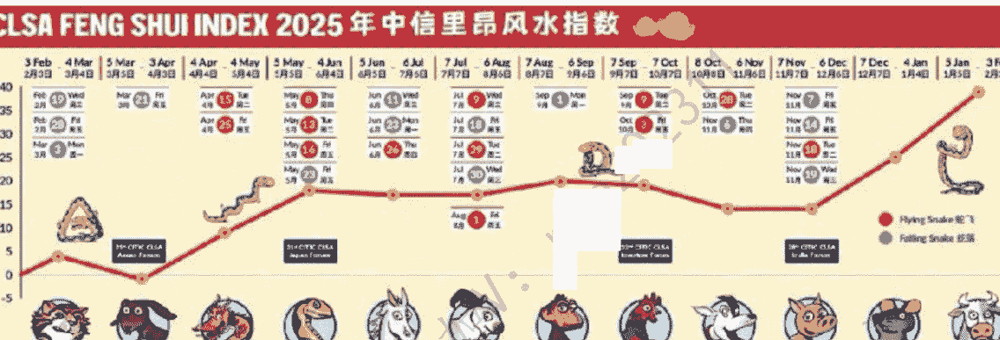
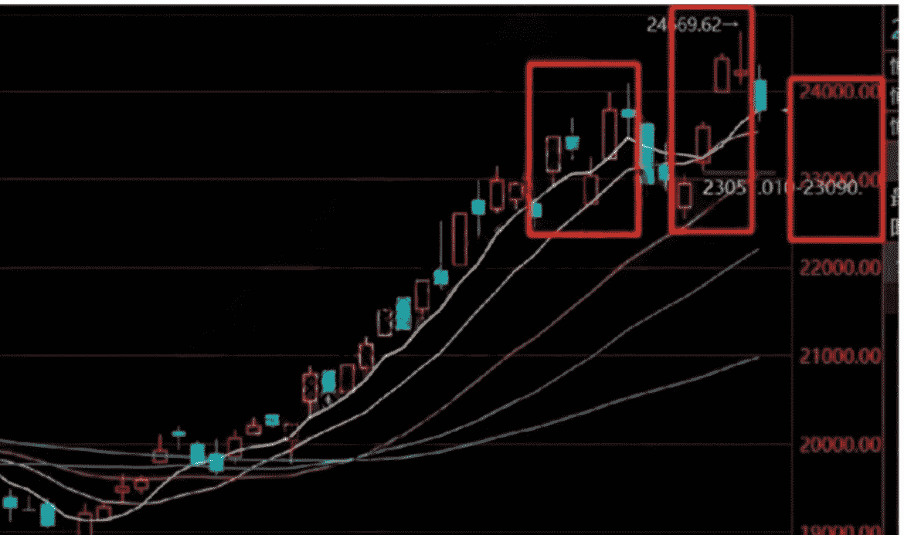

# 香港恒生指数2025年走势推演

已付费

原创五行对股市的影响 观海谈五行对股市的影响
2025年03月10日19:24 越南

先说说A股，上周已经在公众号连续两天发文提示7号短期顶顶部了，截图：

7号，短期顶部的
原创 五行对股市的影响 观海谈五行对股市的影响2025年03月07日14:36

昨天公众号已经发文《明天又是高点》，提示今天是高点，也就是短期顶部了。

今天的A股回踩3347点，探底回升了。技术上，大盘30-60分钟短线回调，今天回踩3347点了，下面还有个3342-3347缺口没补。

最好是把下方3343点缺口补了，才能更好的上冲，切勿追涨，明天先观望看看。

接下来行情如何演戏？

接下来大盘回踩后，再次蓄力，大盘有望突破3400点。今天科技股回调了，但主力还在增仓光刻机等科技股。

今年港股走势不错，涨势远超超过A股，最近就有人不断问我港股的问题。我本人没有投入金白银炒股，所以注意力全在A股上了。周末利用空闲时间，静下心来，用五行预测了一下恒生指数全年走势，特别是预测港股今年的大顶时间，炒股的朋友不妨参考一下。

预测前先评一下中信里风水指数预测，这个指标大家再熟悉错过了。

很多人看过这个预测图，感觉去年预测不准，估计今年预测也够呛，

我谈我的看法：很多人只看图，没读过预测全文，其实，预测很有水平的，只是你不细看，人家文字表达的很清楚，只是图故意画错，不这样画，估计很难通过审核发出来。

我研究了他的预测方法，用的是八字测，用恒生指数“出生时间”起的八字，用乙亥年立春时起一个八字，二者结合流月互相互作用，得出每月的涨跌节奏。

从公开信息，并与朋友交流，是这么预测的，用没用其他方法，我就不得知道了。不过，你参考他预测的2025年预测的图去操作，肯定逃不了顶的。

下面是我用五行预测的“2025年恒生指数走势推演”，不炒港股的朋友不建议付费阅读，毕竟预测的走势跟A股差异不小，特别是今年的顶部预测，预测结果跟A股完全不一样。

恒生指数2025年全年涨跌节奏：

春季上涨，冲高后，会见到一个明显的顶部，看图：

加微信jntsg2，免费资料分享

五行预测3月见顶，结合走势图，有可能形成一个头肩顶。

预测3月见顶后，4月震荡调整。

夏季(5-7月）上下震荡，呈冲高回落之势。

5月反弹，6月冲高，7月震荡调整。

秋季(8-10月)回落调整。

8月调整，9月触底，10月反弹。

冬季(11月-2026年1月)上涨，会再次冲高见到一个明显的顶部。

11-12月上涨，2026年1月见顶。

投资建议微信run202311:

我们先看几机构2025年的预测：

- 建银国际：预计2025年恒指波动区间介于18000-23000点

## 金银预测：恒生指数为2025年全球表现佳！机构：恒指最乐观升至25000点

## 中金展望2025：恒指将挑战22000点，三大行业成投资新风口!

## 凯基亚洲：2025年恒指有望升至23200点企业盈利增长逾5%

现在恒指已经接近25000点了，几家机构今年的预测恒指的目标位基本都实现了，再加上五行预测3月见顶，3月中旬冲高后就要注意投资风险了。

没有永远上涨的股市，牛市也有回调，一年参与两大大的行情足以，学李嘉诚，不挣最后一个铜板，也给别人留点机会。

加微信intsg2，免费进资料分享

## 免费 价值 及时 专注
扫码加入 知识星球TOP 免费资源群

- 每日免费获取有价值资源
- 可提供各类资源搜索服务

◆ 热门付费文章
◆ 各行业报告
◆ 精选图书资源
◆ 副业赚钱方法
◆ 职场实用资源
◆ AI政经自媒体

公众号：知识星球TOP    微信信号：jntsg8    微信信号：jntsg2

分享资料仅供内部交流jntsg2 请勿删除资料水印  切勿商用传播
