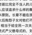
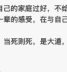

## 什么是抗炎

什么是抗炎（来自百度）

抗炎药是抗生素吗（很多人误以为）炎症是细菌引起的吗？抗炎药对病毒有效吗？

很多人认为抗炎药就是消炎药，其实这是一个巨大的误区。抗炎药并不是抗生素，抗生素是用来杀死细菌的。

如果抗炎药不是抗生素，那么抗炎药的作用是什么呢？炎症是细菌引起的吗？不是，炎症其实是身体的一种自我保护机制。

## 如何科学地抗炎？

什么是炎症？当身体受到细菌、病毒、真菌、寄生虫等病原体的入侵，或者受到物理损伤、化学物质的侵害时，身体的免疫防御系统就会产生一种反应，这种反应就是身体的自我保护机制。

炎症分为急性炎症和慢性炎症。急性炎症通常在身体受到损伤后立即发生，表现为红、热、痛、肿，当损伤因素消除后，急性炎症就会消失。慢性炎症则是指炎症持续时间很长，不愈合，甚至会损害身体的器官。

引起慢性炎症的因素有很多，比如压力、肥胖、饮食不健康、缺乏运动、吸烟、饮酒、环境污染、遗传因素、免疫系统失调等。这些因素都可能导致慢性炎症。

慢性炎症会引起多种疾病，包括心血管疾病、糖尿病、阿尔茨海默病、某些癌症和关节炎等。因此，预防慢性炎症对维持健康至关重要。

小鱼
2023-08-26

抗炎药不是抗生素，炎症是细菌引起的吗？

是的，炎症并不是由细菌引起的，它是身体的一种自我保护机制。

## 什么是炎症？

炎症是身体受到病原体（如细菌、病毒、真菌、寄生虫等）入侵，或者受到物理损伤、化学物质侵害时，免疫防御系统产生的一种反应。这种反应是身体的自我保护机制。

炎症分为急性炎症和慢性炎症。急性炎症在身体受损伤后立即发生，表现为红、热、痛、肿，损伤因素消除后会消失。慢性炎症则是炎症持续时间很长，不愈合，甚至会损害身体器官。

引起慢性炎症的因素有很多，如压力、肥胖、饮食不健康、缺乏运动、吸烟、饮酒、环境污染、遗传因素、免疫系统失调等。这些因素可能导致慢性炎症。

慢性炎症会引起多种疾病，包括心血管疾病、糖尿病、阿尔茨海默病、某些癌症和关节炎等。因此，预防慢性炎症对维持健康至关重要。

小鱼
2023-08-26

什么是炎症？

炎症并不是由细菌引起的，它是身体的一种自我保护机制。

## 如何抗炎？

炎症是身体受到病原体（如细菌、病毒、真菌、寄生虫等）入侵，或者受到物理损伤、化学物质侵害时，免疫防御系统产生的一种反应。这种反应是身体的自我保护机制。

炎症分为急性炎症和慢性炎症。急性炎症在身体受损伤后立即发生，表现为红、热、痛、肿，损伤因素消除后会消失。慢性炎症则是炎症持续时间很长，不愈合，甚至会损害身体器官。

引起慢性炎症的因素有很多，如压力、肥胖、饮食不健康、缺乏运动、吸烟、饮酒、环境污染、遗传因素、免疫系统失调等。这些因素可能导致慢性炎症。
