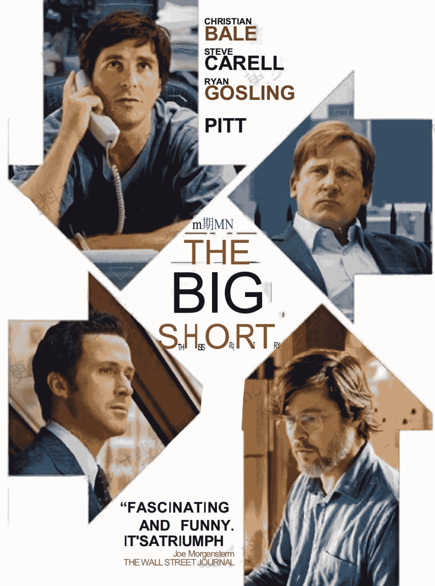
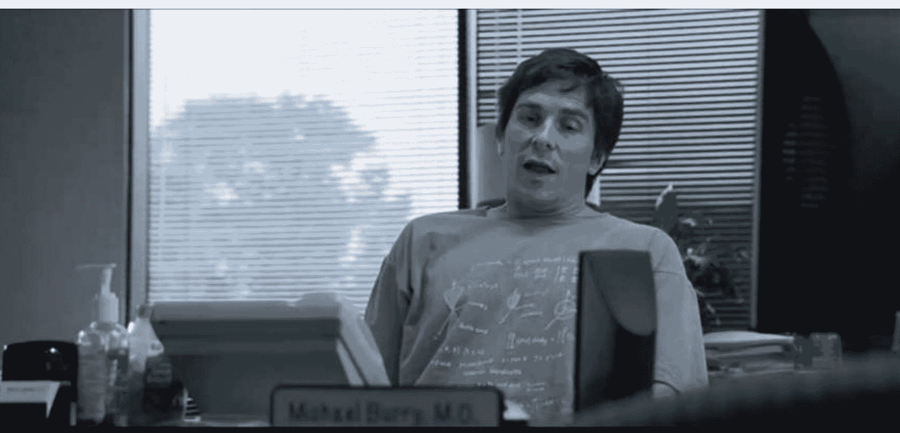
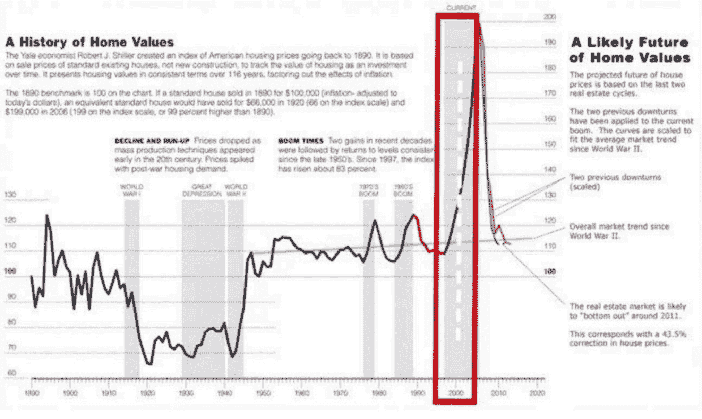
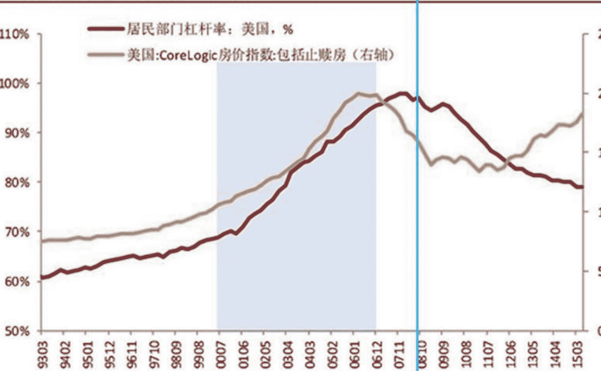
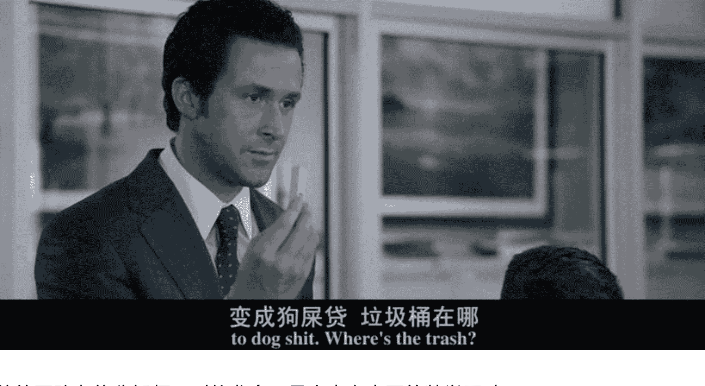
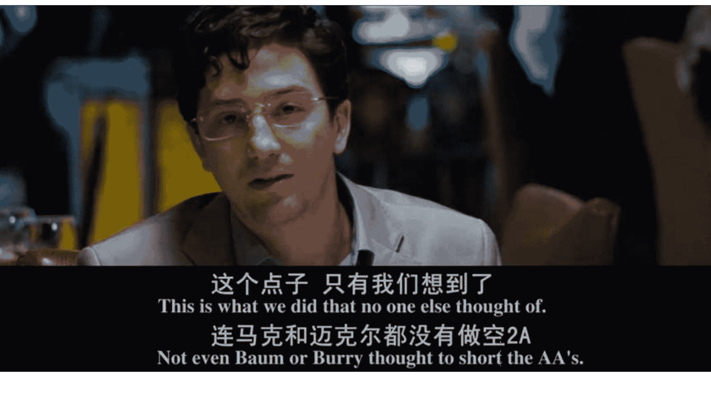

# 聪明人是如何从危机中赚大钱的?

原文 社长有点有野 叶泊枫
收录于合集

## 趋势与周期

一个非常重要的逻辑，即：人类社会是无法通过宏观调控的手段规避债务机的，经济泡沫一定会破。

说到做空楼市，大家都会想到《大空头》这部电影：

图中的4组专业投资人，不光洞悉美国楼市将崩，还将坚定地做空并获得了巨量财富。

现实中，最大的空头是一个叫John Paulson的家伙。危机滚滚而来，到处都是破产，而在2007-2008年的交易中，他旗下的基金盈利超15亿美元，简直逆天。他不惜把全部资金押在危机上。

关于《大空头》，本文分为四个部分来帮助大家理解：

1) 他们是如何发现做空机的？
2) 他们是用什么工具做空的？
3) 做空过程中哪些阻碍？
4) 胜利！

所有的金融问题其实很简单，核心都是信用。信用的作用就是用来负债的。所有的金融产品，对应的风险、收益及流动性，表面复杂的，内核往往简单。

很多人说，没看过电影《大空头》，没关系，只要你懂做空市的方法和工具，就不影响你。那些金融工具听起来很专业，是不是容易让人头晕？比如：

- MBS（住房抵押债券）
- CDO（债务抵押债券）
- CDS（信用违约互换）

金融大佬们并不是为了装逼，而是为了让你不懂，这样你就会乖乖把钱交给他们，让他赚佣金。

所有的金融产品，本质上都是债券。MBS名字一样：
- 房屋抵押贷款
- 债券即借条

所以从小看这个MBS，简单来说，就是一堆房贷打包在一起的交易债券。别小看打包这个动作，它可以改变华尔街的地位，这是一个伟大发明。80年代之前，因为监管，华尔街并不是赚钱的地方，债券部门更是被对待的地方。直到抵押贷款之父——Michael Burry，发明了将房贷打包成MBS的盈利模式，各大行的债券部门才开始风起。

举个例子：

银行发行100亿房贷，利率6%。房贷都是长期的，不是30年，很快银行的资金就放完了。Michael Burry就想办法把这些房贷打包在一起，以5%的收益率卖给下家，自己赚1%。有人说，1%也不多呀？只要他转得足够快，利润就足够高。一年周转一次，利润是1%；一个月转一次，利润就是12%。这还有复利的部分。

一来，银行不光赚到了利润，还回了资金，最关键的是他把风险转移给了下家。理论上，MBS模式可以形成一个无限循环：

放贷 -> 打包 -> 出售 -> 再放贷 -> 再打包……

正常来说，银行贷款给一个人是要考虑他的信贷和还款能力的。但在这种模式下，因为风险可以转移，银行丝毫不顾虑借款人的资质，只想更多地发放贷款。当优质借款人耗尽，银行就会把目光投向那些不太好的人——这些贷款就叫次级贷款。

CDO是什么鬼呢？

其实并不复杂，就是各种债券反复包装的套娃产品。MBS里是房贷债券，CDO里可能有房贷，也可能有消费贷等种类，甚至CDO还有CDO。但不管它怎么打包，其本质仍然是债券。是债券就有违约的可能。一旦违约风险暴露，债券没人接盘，价格就会暴跌。比如恒大的公司债，现在就是骨折后没人愿意要。这就是空头们做空的机会——次级贷款违约率上升，MBS和CDO就会暴露。那么问题来了：

1) 什么时候次级的违约率会上升？
2) 用什么工具来做空MBS和CDO？为了解释清楚这两个问题，我们请出第一位空头——Michael Burry：

# 如果最终能占到15%以上，整个房贷证券市场就毫无价值
And if they fail above 15%, the whole bond is worthless.

电影《大空头》中，Michael Burry是唯一用真实人物真实姓名出演的角，演员是著名的黑暗骑士—蝙侠·克莱斯·蒂安·贝尔。现实中的Michael Burry长这样：

他原来是个医学博士，业余时间炒股积累了投资经验，由于见识优于牛顿，被华尔街大佬发成为职业投资人并封塞恩基金。最近的消息是他他在2005年开始特斯拉，结果如何……他是发现房地产不行的？

他先查阅了大量的数据，发现2000-2005年间，国内房价上涨了倍，人们的收入却怎么样——这说明市场存在泡沫。

他又关注到了“次级贷款”这个引发危机的炸弹。当优质借款人被消耗完毕，银行就会急。前面提到，两个月利率很低，随后的几年慢慢加上，次级贷款人的还款压力增大，风险上升。银行告诉他们房价永远涨，完全可以利用房产增值的缓冲，重新办理“抵押贷款”，不用担心付不起房。这就是说。

问题是，房价一直涨吗？

因为2007年之前，专家们再一次表示美国楼市从未发生过大的回调，这是空头的教训。大家习惯性认为过去一直涨，现在也是。但Michael Burry知道房价崩在大萧条时，他仔细研究了那段史，总结出了楼市将崩溃的前兆：

1) 复杂性
2) 违约率

到底复杂性，那些花里的CDO足以说明问题。再说违约率，即使是专业投资者，也搞不清里面包含哪些。Michael Burry研究了大量次级数据和借款人的信息。接下来的问题是，如何做空？要是房价要跌，你会怎么做？

A: 赶紧卖掉房
B: 跑到港股做空房
C: 购买那些做空股票及债券

这些都是传统意义上的做空。举个例子：假如你从去年看空恒大，你从券商那里借出1亿股，在2020年7月6日以2元/股的价格卖出。于2021年12月15日以1.5元/股的价格买回，还给券商。短短一半的时间，就能获利.5亿元，是不是很香？Ps：逻辑就是这个逻辑，实际过程没简单，千万别看到这段就亏胯，鼓励劳动致富。

但是通过这种方式来做空债券是不容易的。首先，要搞清楚你做空的对象包含哪些部分就很不容易。其次，那些的投资人通常会买下一整期的CDO，拒绝向外贷款，不给你做空的机会。是不是就没办法做空了？必须不是，大鳄们好不容易看到了猎物，咬一口。什么叫大鳄？于是CDS出场了！CDS是一种保险，专门为债券资产提供保护。比如你不小心买了恒大的公司债，你担心老板无法如期还债，就买了对应的CDS，每按期支付保费，当恒大暴雷，保险公司就要按照合同赔付损失。

理论上，你应该有一资产，然后再去买保险。华尔街的聪明们硬生把CDS发展成了一种对冲工具——即便你不持有那样资产，你只要认为那玩意儿会坏，就可以买一个CDS。且它真的见到，保险公司就会按它的账面价格付给你。

举个例子：上海某豪宅的挂牌价是1亿，王利判断房价会沽，决定直接做空。他不需要把豪宅买下来再卖，而是直接买CDS来做空这栋房子。假设CDS保费约定为房价的1%，那么他只需要每年支付100万，就可以和1亿元的豪宅对赌——一旦房价崩盘，保险公司支付1亿；不崩，他就要一直支付保费。

# 对于传统的做空方式，CDS的风险有多大

用传统方式做空股票，一旦股价上涨，空头就会面临巨大损失，因为股价越高，购买的成本越高，而且回购是没有顶的。典型的例子就是2021年初的“GME打爆华尔街空头”事件。空头做空GME的融券数据竟然达到了全部股票的140%，被卖家抓住了机会，一场猛拉拉住它，空头无法回购股票，一直被逼到破产。

但买CDS做空的话，成本低，如果做空，损失也是可以控的，不过就是白交保险费。现在的逻辑和工具都有，空头们磨刀。

## 什么时候楼市崩？

总结出了楼市将崩溃的前兆指标：
1) 复杂性
2) 违约率

到底复杂性，那些花里的CDO足以说明问题。

2003年秋，Michael Burry预测房地产要出事，他在2004-2005年持续。这两年是房价涨得最为猛的。

## 美国住宅价格 vs 居民杠杆

这真是一颗分析，操作却像鼠。说实话，这种做空方式赔了巨大，但选对时机关键。2004-2005年这段时间，美国房价一直涨，次级贷款就可以升值。

2005年末，他发现一种广泛存在的“次级贷款”——既包含按揭贷款，又包含首付贷款。他认为楼市是有以来最大的信用泡沫，如果对其视而不见，违约风险很高。客户并不买，觉得他疯了。大家都可以看，楼市。

## 做空的时间越晚越好？

不是，因为越到后面，楼市崩盘的迹象越来越明显，空仓的人越来越多。所以泡沫非常关键，早了，资金耗光，死在黎明前；晚了，价格被炒高，无从下喘。美国楼市最大的空头——John Paulson, All in的时间是2006年，为什么这一年最好的时机？

德意志银行有一个前台，叫Lippmann，是《大空头》里Jared的原型：

他的团队有一位分析师，叫徐尤金，是个来自中国的数学天才。徐尤金发现，房价是影响按揭贷款约率的唯一因素，而不是其他经济学家认为的利率、就业率和经济增长率。总之，只要房价停止上涨，房贷的违约率就会线性上升。现在的问题是，美国房价什么时候停止上涨？回去看房价走势就会发现，2006年春，房价增速放缓至横盘，同年10月起开始大跌。相应的，次级的违约率在2006年开始攀升。还记得Burry发现的楼市崩塌的两个指标吗？

1) 复杂性
2) 违约率

所以2006年是做空美国楼市最佳的时间窗口。

2006年，Paulson旗下的基金大量入CDS。2006年高位接盘的人倒霉了，由于房价不再上涨，银行就不给他们提供融资的机会，一旦还不上贷款，只有违约一条路。Paulson的分析团队预计房价将跌40%，和Michael不同，他并没有把这一结论告诉客户，因为他知道客户不会相信，毕竟美国房价涨了几十年，从来没跌过。

Paulson做空美国房价的决心非常坚定，他不光做空抵押贷款债券，他认为，既然抵押贷款债券会变狗屎，那么接盘这些狗屎的金融机构，不是也会跟着完蛋吗？比如新世纪金融、房产、贝尔登、盛华互助银行……有什么理由不由做空他们的股票呢？

一旦这些金融机构崩溃，一定引起整个金融系统的连锁反应，那些更大的银行、投行，也可以做空？是空头们火力全开，他们开始了一场声势浩大的豪赌——赌华尔街崩溃。为了使做空顺利，Paulson甚至制造了有毒的CDO来做空——他的团队精心挑选了一堆狗屎一样的抵押贷款，打包成CDO，卖给还没搞清状况的倒霉蛋，再去做空自己出的炸弹。

理论上，空头已经全面胜利了，但他们看不到抵押贷款的价格。这一章在《大空头》里有非常生动的描述：

高盛说系统崩溃了；
BOA停电了；
摩根斯坦倒闭了……

之所以公布，是因为：
1) 复杂性
2) 违约率

到底复杂性，那些花里的CDO足以说明问题。再说违约率，即使是专业投资者，也搞不清里面包含哪些。Michael Burry研究了大量次级数据和借款人的信息。接下来的问题是，如何做空？要是房价要跌，你会怎么做？

A: 赶紧卖掉房
B: 跑到港股做空房
C: 购买那些做空股票及债券

这些都是传统意义上的做空。举个例子：假如你从去年开始看空恒大，你从券商那里借出1亿股，在2020年7月6日以2元/股的价格卖出。于2021年12月15日以1.5元/股的价格买回，还给券商。短短一半的时间，就能获利.5亿元，是不是很香？Ps：逻辑就是这个逻辑，实际过程没简单，千万别看到这段就亏胯，鼓励劳动致富。

但是通过这种方式来做空债券是不容易的。首先，要搞清楚你做空的对象包含哪些部分，就很不容易。其次，那些的投资人通常会买下一整期的CDO，拒绝向外贷款，不给你做空的机会。是不是就没办法做空了？必须不是，大鳄们好不容易看到了猎物，咬一口。什么叫大鳄？于是CDS出场了！CDS是一种保险，专门为债券资产提供保护。比如你不小心买了恒大的公司债，你担心老板无法如期还债，就买了对应的CDS，每按期支付保费，当恒大暴雷，保险公司就要按照合同赔付损失。

理论上，你应该有一资产，然后再去买保险。华尔街的聪明们硬生把CDS发展了一种对冲工具——即便你不持有那样资产，你只要认为那玩意儿会坏，就可以买一个CDS。且它真的见到，保险公司就会按它的账面价格付给你。

举个例子：上海某豪宅的挂牌价是1亿，王利判断房价会沽，决定直接做空。他不需要把豪宅买下来再卖给保险，而是直接买CDS来做空这栋房子。假设CDS保费约定为房价的1%，那么他只需要每年支付100万，就可以和1亿元的豪宅对赌——一旦房价崩盘，保险公司支付1亿；不崩，他就要一直支付保费。

# 相对于传统的做空方式，CDS的风险有多大

用传统方式做空股票，一旦股价上涨，空头就会面临巨大损失，因为股价越高，购买的成本更高，而且回购起来是没有顶的。典型的例子就是2021年初的“GME打爆华尔街空头”事件。空头做空GME的融券数据竟然达到了全部股票的140%，被卖家抓住了机会，一场猛拉拉住它，空头无法回购股票，一直被逼到破产。

但买CDS做空的话，成本低，如果做空，损失也是可以控的，不过就是白交保险费。现在的逻辑和工具都有，空头们磨刀。

> 我见到低于65%达到3A评级的
I've seen some that are 65 percent AAA-rating.
其实95%都是次级狗屎
That I know, for a fact, are filled with 995 percent sub-prime shit.
信用评分都低于550 (FICO评分300-850, 700以上认为是优质的)
With Fico's below 550

以前他做空BBB级债券的盈利，相对于他做多3A级和AA级债券的亏损来说，属于杯水车薪，差点让摩投行翻车。

可见，成功的做空不需要毒辣的眼光，还要孤注一掷的魄力，在《大空头》中，只有皮特带领的菜鸟组看到了AA级债券的做空机会：

为什么赢的是他们？

知道在这之前，Paulson也好，Burry也罢，还有前面提到的新手组合，他们在次级贷款和房地产领域并没有什么直接的投资经验。

但为什么准确预测房价暴跌并成功布局的是这些局外人，而不是那些所谓的行业专家？

很重要原因，就是因为他们没有房地产和债券的持仓，所以他们的大脑没有被决定，他们就不会像他们一样产生心理认为——美国政府所强调的控力绝对不会让市场崩盘。

而在这场金融危机中，那些将判断错误并且严重误导大众的金融专家们，却并没有承担相应的责任。

他们只需要宣布这是一无法预料的大灾难而非个人失误，就可以撇清责任，继续拥有体面的工作和行业地位。

格林斯潘，他当了19年的美联储主席，不光一手缔造了宽松货币、监管宽松的投机环境，而事实上纵容了金融资本的无序扩张，并长期为华尔街的金融创新书籍助长泡沫，却在危机发生之后，用一个“泡沫，只有在破裂之后，才知道是泡沫被掩盖了过去”。

更讽的是，危机之后，这位吹嘘房价远远远的前任美联储主席，竟然跑去给美国楼市最大的空头Paulson当顾问，谁能给我翻译翻译这™叫啥？

这就是美国的特色主义——政党旋转门！

## 04

批判归批判，更重要的是作为普通人的我们，如何确保财富不被即将到来的危机洗劫。

像空头大哥一样做空吗？

不现实，普通人既缺乏工具，也缺乏眼光和眼力。

有没有一种安全的，容易操作的资产组合，可以对金融危机造成的损失呢？

桥水基金的达利欧曾设计出一款全天候基金，在次贷危机中上涨了14%，相对于那些亏损30%甚至破产的同行来说，这个成绩相当出色。

他在著作《原则》中，他提到了设计全天候基金的过程：

- 1) 人一有钱，就想把财富富千万代传下去，但谁能保证后代创造出一一样聪明呢？
- 2) 经济危机贯穿人类历史，没有哪一种资产可以永远保值。必须设计一种投资组合，可以战胜所有的经济环境，而且投资策略固定，任何人都能使用。
- 3) 他研究了历史上所有的经济周期，了解财富是如何被创造的，又是如何被毁的，他发现影响投资收益的最关键因素：增长率（增长、衰退）和通胀率（通胀、通缩）。
- 4) 两两组合，就形成了针对不同经济周期的4种不同策略：

### Growth / Inflation 

| 25% OF RISK | 25% OF RISK |
| --- | --- |
| Rising Equities | IL Bonds |
| MARKET Commodities | Commodities |
| EXPECTATIONS Corporate Credit | EM Credit |
| Falling EM Credit |  |
| 25% OF RISK | 25% OF RISK |
| Nominal Bonds | Equities |
| IL Bonds | Nominal Bonds |

这一策略，怎么就可以适应所有的经济环境呢？

首先我们知道，在不同的经济环境下，不同资产的表现差异很大，美林时钟说过吧：

### 通胀上升

随着经济复苏进程推进，收益率逐步陡升。经济过热以及较高的通胀，收益率逐步陡升。

| 25% OF RISK | 25% OF RISK |
| --- | --- |
| Rising Equities | IL Bonds |
| MARKET Commodities | Commodities |
| EXPECTATIONS Corporate Credit | EM Credit |
| Falling EM Credit |  |
| 25% OF RISK | 25% OF RISK |
| Nominal Bonds | Equities |
| IL Bonds | Nominal Bonds |

### 通胀下降

- 1) 高增长+低胀，引起复苏期。这时候股票表现最好，通常是大市的起点；
- 2) 高增长+通胀，引起过热期。这时候房地产表现最好，因为货币政策放水，推动房价上涨；
- 3) 低增长+通胀，引起滞胀期。以往经验，这时候黄金表现最好，但为了保住地位，通常会压缩黄金，所以黄金表现；
- 4) 低增长+通胀，引起衰退期。股市崩盘之后，经济陷入一段通缩；这段时间当局不断发债，财政扩张，刺激经济增长，同时把利率降到最低，补充流动性，长期债券收益率就会下行。相应的，它们的价格就会上涨，这种时候长期债券表现最好。

### 经济增长缓慢

- 1) 高增长+低胀，引起复苏期。这时候股票表现最好，通常是大市的起点；
- 2) 高增长+通胀，引起过热期。这时候房地产表现最好，因为货币政策放水，推动房价上涨；
- 3) 低增长+通胀，引起滞胀期。以往经验，这时候黄金表现最好，但为了保住地位，通常会压缩黄金，所以黄金表现；
- 4) 低增长+通胀，引起衰退期。股市崩盘之后，经济陷入一段通缩；这段时间当局不断发债，财政扩张，刺激经济增长，同时把利率降到最低，补充流动性，长期债券收益率就会下行。相应的，它们的价格就会上涨，这种时候长期债券表现最好。

人就要问了，既然能够准确预测经济哪种周期，就不需要对冲了吗？因为预测不靠谱，像这种黑天鹅，宏观波动，即使是达利欧、索罗斯这样的宏观大师，也经常失准。达利欧为什么在次贷危机之前全力做空？他没有看到债务危机吗？他当然看到了，在他的《桥水记录》中，准确记录他在2007年就已经预判一场巨大的债务危机正在临，而他没有全力做空？因为在1982年时，他有一次失败的做空，几乎使他破产。他没想到债务危机，资本大量流入……所以他非常谨慎，他担心再次做空就进行了对冲，虽然收益不如Paulson这些全力做空的，但是以14%的收益率跨过经济危机，已经非常不起。

具体怎么操作呢？前面说了，经济的宏观波动很难把握，所以全天候不做预测，只做针对性的配置调整。比买房子就是在赌经济增长和通胀，货币收缩，房价崩盘怎么办？所以要均衡配置，你可以再买一个CDS保险来对冲房价下跌的风险。

这个逻辑很多人都懂，但是如何确定每种资产仓位的呢？

- 首先，各类资产的价格都是波动的，有的涨有跌；
- 其次，某些价格波动的方向是相反的，比如股票和长期国债；
- 再次，有些资产的波动幅度是大的，有的大，有的小，比如股票比国债的波动幅度大得多。

全天候的思路，就是尽量相互对冲的资产波动幅度相同。初中物理学过，两段波，振幅相同，频率相同，但方向相反时，从表面来看，振动仿佛就消失了。如果股票的波动率是国债的10倍，那么国债的持仓应该是股票的10倍，这样股票和国债对投资组合的收益影响就是相同的。国债的波动率低不是呢？但基金公司可以使用杠杆操作，把波动放大放到股票的波动一样大，就可以压抑资产组合的整体波动。

我知道肯定有人说这种操作太累了。要知道在金融游戏中，收益和风险永远是对应的，Paulson固然收益巨大，但他承担的风险同样巨大。达利欧的这种设计非常稳定，无论宏观形势如何变化，他只需要调整资产配置，就可以最大限度平抑波动，这种风险平衡的策略最适合我们普通人。

注意，我在这里所信的是这种风险对冲的思路，我不推荐“全天候”的方案，因为这套策略不能做到“千秋万代”保住财富，事实上，10年后就不会怎么样了，甚至差点把达利欧几十年的积累赔光送送。

由于这种设计在08年的次贷危机时表现异常，所以哈尔街的基金经理们就曾模仿，导致各大机构的行动如同雷同，以至于在2020年初的股灾中形成了交叉，当时甚至有传言说达利欧的桥水基金被平仓了，后来虽被证实。

以上就是次贷危机几个教训，希望对大家的决策有所启发。
