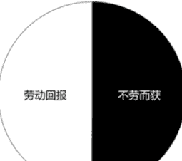
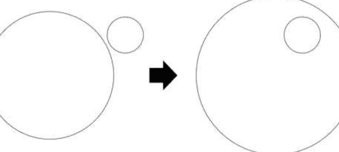
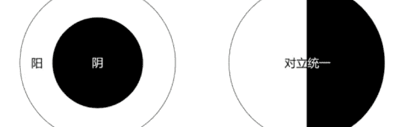
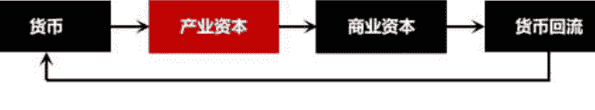
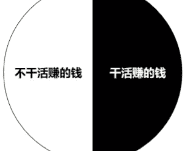

# 矛盾、阴阳与经济 (1) ... 已付费

原创：第三三观 第三三观 2025年03月06日 19:24 河北

这么应该没啥大麻烦，能够发出来，因为主要思维崩了！

不直接碰碰碰总被嘲倒，上一篇其实胀了近万多字，改到两千多字，必须要看出出无事被动、艰苦备斗、和谐发展的感觉才...

直入正题:

问：当下农场的主要矛盾是？

答：两种矛盾的矛盾！

先从矛盾思维说起...

阴阳和矛盾大体其实一回事，自然也有区别。

昨天回答星球小伙伴：易经、道德经、马克思物辩证法等都属于一个思维体系，这种体系既不是科学也不是逻辑，算是哲学吧。其实佛教也不仅仅是哲学，但就当前哲学看，要不然浅玄学容易毁。

客观区别呢?

科学和逻辑追求——统一的。

就是那种可化的、公式化的、指标化的东西。

阴阳和矛盾追求——规律的。

就是整体的、运动的、联系的发展运动，这玩法没法量化，比如矛盾有几斤啊？阴阳有多大啊？没有这种说法...

一个追求固定，一个追求运动！

哈叫规律律呢？

就是普遍存在的，例如万物万事都具有“矛盾的普遍性”或者“阴阳的普遍性”啊，这玩法放之四海皆准。

微信：jntsg2，免费进资料共享

注意：

量是不确定的变的，一切量化都是用来被推翻的，这是科学思维。

但是确定的变的，你推翻不了它，这是哲学思想!
例如：你脑子的逻辑、念头啊那个量是一直直的，但是矛盾性未变啊对吧？

这玩具和经济有关关系呢？

人类现象都是人心矛盾的呈现，唯心所能响，即一切都是人的心流！

例如每个人心不下图这样：

嗯...具有矛盾的普遍性...

别小看图，要敲的“两种钱”就是靠此矛盾而推动出来的。

○

先将一下矛盾vs阴阳，其实这俩玩意简单，3步就能清楚了：

## 1、第一步：首要有一个圆。

圆代表什么呢？

接着的、一体的、相联的，不然咋发生矛盾运动？

所以不是矛盾还是阴阳，都要先在一个“圈内”去看才行，这种思维就会产生出一个思想门派，叫做——内学（叫辩证法也）

例如中华思想中有“内圣外王”的学问，或者秃头发长打坐“内观”的技术活，或者道“一气周流”的思想，其根本本质就是把自己当成一个圈去看，即一个完整体或者叫自成一体。

此处划重点啊：事物时候不能没有“圈外”啊，当触碰到外部时候，就要把圈给扩大，这就是所谓的——宏观思维！

对了，指带手些好讲一个中文模型，强迫症犯了……

下面就是：宏。

## A模型=大之内。

B模型=动力，在《反者道之运》那篇提到过，这个力量让万事物循环运动起来。

C模型=起，这属于十二支之一，就是某个力量因素开展了的意思。

A+B+C=宏观，要把所有因素（C）都放在一个大圆（A）里面去观察的运动关系（B）。

中文思维是不是很直观呢？

那么好了！

问：在这个一体内部观察相互玩游戏出来？

答：运动关系！

## 第二步：圈内运动圈？

如下，这两种昨天都可以啊，总之一分为二，没有二如何有关关系呢？

当然了，有些人也有强迫症，左右图必须要清楚为哈不同

答：

左侧——属于道家的方法，即“象形”方法。

这种方法的好处是直观，上面的模型就很直观呀！

例如外面的白圈当天，里面的黑球当地，天地是不是二分了？然后就开始运动关系了...

中文模型大多数都是用“天人”来构建运动模型的，主直观！

右侧——属于唯物辩证法，即“哲学”方法。

这种不太直观，而是哲学是放在脑子里玩耍，就好比1-1=0这样，脑瓜子容易疼。

它还有一个小伙伴也是脑子玩玩的叫逻辑，就会有辩证矛盾vs逻辑矛盾，在脑子里还要区分分开...

区别：前者的矛盾要换着（圆圈），后者不换着。

例如：我是鸡又是鸭，鸭鸭不换着就逻辑矛盾了；我是鸡又是鸭，一边劳动又获得，这证矛盾就换着了...

## 3、第三步：阴阳与矛盾在哪里？

答：对立统一！

其实这一回事，只是角度不一样，有时候需要切换一下更灵活。

哈意思呢？就是——黑白抢地盘！

1) 辩证地盘：因为抢了地盘，所以黑白打起来了，叫矛盾对立。

2) 阴阳视角：虽然起来了，但黑白是互相面对的，如果对方没有我自己就不存在。举例：资产阶级vs无产级，资产阶级需要获取，无产级需要就业和福利。

## 4、第四步：说好的三步呢？这不算总结，即矛盾的普遍性！

回到开始不劳动而获，或者自己随便想，不可能有以下情况出现：

心里不可能一直劳动而获，总是想干点，或者说劳动而获本身就是那个干点，套娃反复落...

资产阶级vs无产级，资产阶级获得巨大胜利，那么无产级就不存在。除非农场让无产级获得，无产级一定会在纯白里产生出一个小点。

这就好比喻？必须要有人上车才行，必须有先富和后富。回到开始的“两种钱”，谁产生呢？由于不劳动而获又获得的，即钱就是人的价值。

例如看股市、看经济（哈）的本质是观察人们的。马克思说：“资本追求价值，而不是创造价值”。

这就就是逻辑。所以之前，资本主义意义也、社会主义也是理性的，都是基于某种感性的。

## 资本逻辑是啥？

最好是不劳动、不创造，就直接变多，然后买东西挥霍，这也不受苦。

这个逻辑就导致货币“泡沫”了，货币需求不是来自生产和流通，的扩张。

- 1. 干活挣的钱。
- 2. 不干活挣的钱。

叫这种钱呢？

此时货币需要在产业上“倒”一下才能增值，即于工人劳动出来的，叫实物货币。

在具体过程中：股票、债券、外汇等的虚拟资产的持有者，以这些资产作为押向银行贷款，银行把钱“生产”出来，然后市场上炒作资产价格。通过资产与货币的交换获利，资产价格膨，拿资产去银行“生产”新的货币，如此循环往复！

这就跳过了“产业创造”那一步，榨取工人剩余价值这项“干活”。因为经过了实际生产创造环节，货币增值的依赖于“账面的”，只是数字的变化而已，所以叫虚拟货币。这就是驱动出来的呀，资本主义逻辑在这，这游戏是个个人就得进去的。本来一生赚的钱，可能现在就可以；且不需要生产，只需要炒作。

资本一直留在剩余价值和产业资本这件事上，老马就批判他们，资本的真面价值应该是《政治经济学批判》，算是哲学著作。

在当代资本主义经济中，产业资本增长是不争的事实，实话是企业的弄不过金融的，产业资本家大规模的转向金融资本家。2024年国际货币贸易额为1783万亿元，2024年全球商品贸易额预计为33万亿美元，和生产与流通的货币交易仅占1%。

回到基础问题：当下农场还是矛盾的？

哈哈呦货币霸权呢？简单来说：就是这两种钱在一起使用...

这伙家伙在圈里打抢地盘吧？这不是农场内部矛盾，反而面临了矛盾普遍性，这游戏是放之四海皆准的。例如的鹰派和龙派的对立统一就是如此，而劳动派和龙派也是如此，原来是一个高端一个低端来对立统一，你也玩高低就不“抢地盘”了，矛盾就激化。

那必须想办法法则压压它，矛盾就不会显现了。赢赛游去欧洲那里了，它也是一种矛盾运动的现象。

回到国内圈，不干活赚钱是不是需要“场所”啊？人家发达资本主义把场所设定在股市和国债上，这就避免了“直接受伤”了，哈意思呢？就是在这些地方把币翻妙多大动不动动物的直接生存，“温和”地就富分化了。但地产不是个正经场所，这玩法很容易“误伤”（居住属性），所以就很“剧烈”的导致致富分化。

那之前收割，组织要“共同优”有一条路：就是再来一个给打算攒钱的小动物们保障，然后再适当的市场化，从而大家都有不干活的钱。有了不干活的钱，然后大家好才能干活，这是一种矛盾才能产生新的运动。

回到开始的“两种钱”，谁产生呢？由于不劳动而获又获得的，即钱就是人的价值。
