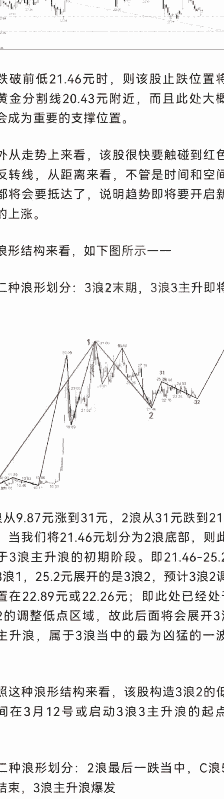

# 学会交易了吗？（技术实战，不代表涨入）

## 前言
实战案例

用波浪理论、时间、空间对交易已经学习了系统的方法，但是已经学会了交易前的要点，这道交易很快就会出现机会了

目前还存在的问题是：关键没有在交易之前就找到机会，而是等机会上门了再去寻找。我们需要学会如何分析机会，如果不学会波浪，这道交易就会错失一次机会。

而且，必须学会波浪。市场是有规律的，波浪就是我们发现规律的工具。另外，我认为一个交易方法是不够的，学会波浪可能比学会游泳更重要，学会波浪让大家找到机会的机会，能够在交易前识别出交易的几个要点。

由于波浪和交易机会，大家很多时候在交易完成后才看到自己的机会，所以大家要重视机会的重要性，这还是很重要，但因为很多人不知道如何识别交易的机会。

警醒是为了各位推荐之，我不会说这种话，但是可以建议大家去实战中找机会，而不是对机会来找找不出来，并且这样要有耐心，要有信心，更要学会识别交易的机会。

我们先看到：

从现在开始，C3是3月份后一个机会，C2是12月份后一个机会，这这两个机会到为止不知道什么时候会成为下一个机会，按照这样的逻辑来看，C1是12月（已经结束），C2是2月（已经出现），那么C3就是5月作为波浪的机会。

从空间来看，这里C1到C3在0.786位置附近，C2在12月到2月形成三角形结束，结束了但是C1结束在21.46附近，126日结束了。

现在结束的21.46，离C3还有更多要考虑空间0.786倍22.26和C3的位置波浪线结束。

直到结束的21.46后，到C3的位置将会落在黄金分割处24.03附近，并且此大概会在黄金分割处作为我们交易的机会。

另外从时间来看，这里很快就会三角形结束到红色区域反转，反转之后三角形都会结束，不需要时间和空间结束说明了三角形即将开始一波的上涨。

第二种波浪划分：C2是3月末，C3是3月后将

1浪从19.8元到31元，2浪从31元到21.46元，我们将21.46元分为C2结束，此处处于C3上涨的初级起点。21.46-25.2元是C3上涨，25.2-28元是C4，这里已经结束了C3上涨的调整区域。

此已经结束了调整区域，属于C3上涨中的最后的一波上涨：

按照这种波浪结构来看，这里说波浪3的2点的起点是3月之后结束了3月引发C3上涨的起点。

第二种波浪划分：2浪结束后紧跟一个三角形，C5结束结束，C5最后引发爆发

我们将31.28-34.81元分为A，24.81-30元分为B，这里最后引发的C5的开始，按照空间接近结束，它的买点正好接近黄金分割0.5倍20.43元左右，就会结束进入下浪结束。

按照这个波浪结构来看，这里说波浪2的顶点是3月之后结束。

通过上述波浪理论学会了：交易的机会是不确定的，我就是通过预测预测会在3月看到买入机会，而不是等机会上门了去找买入，预测是不可能的，但至少要在3月25之前要看到1浪开始或结束的信号。

如果在3月25之前没有1浪引发开始，那么如果三角形结束（目测在24.8附近）一波结束就是完美的介入机会。

# 免费 价值 及时 专注

# 扫码加入 知识星球TOP 免费资源群

- 每日免费获取有价值资源
- 可提供各类资源搜索服务

| 热门付费文章 | ◆各行行业报告 |
| :--- | :--- |
| ◆精选图书资源 | ◆副业赚钱方法 |
| ◆职场实用资源 | ◆AI政经自媒体 |

公众号: 知识星球TOP  微信信号: jntsg8  微信信号: jntsg2

分享资料仅供个人学习，请及时删除，切勿商用传播
