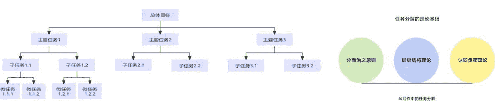
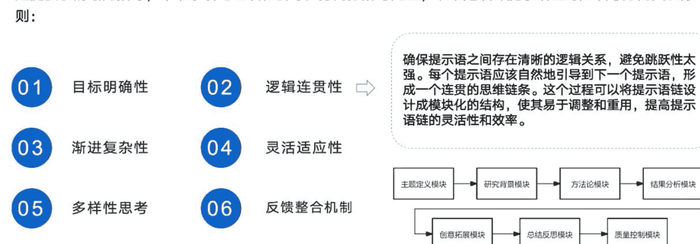
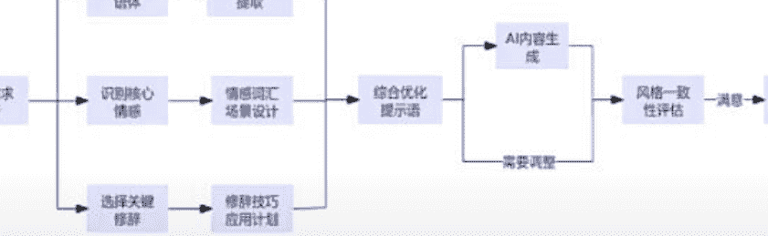
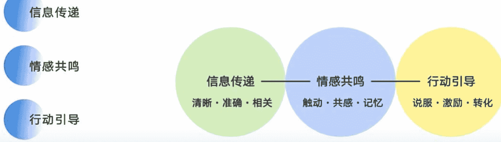
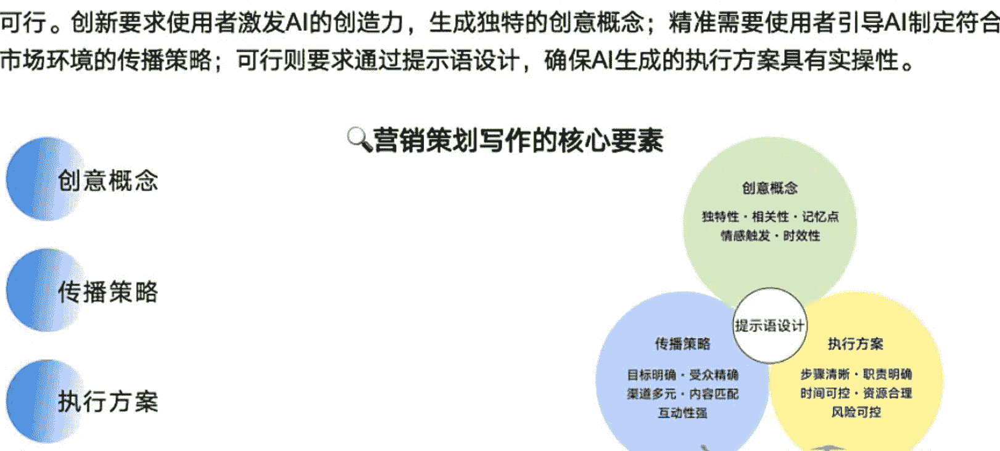
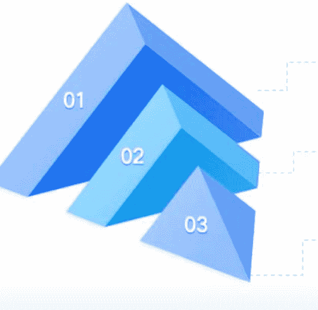
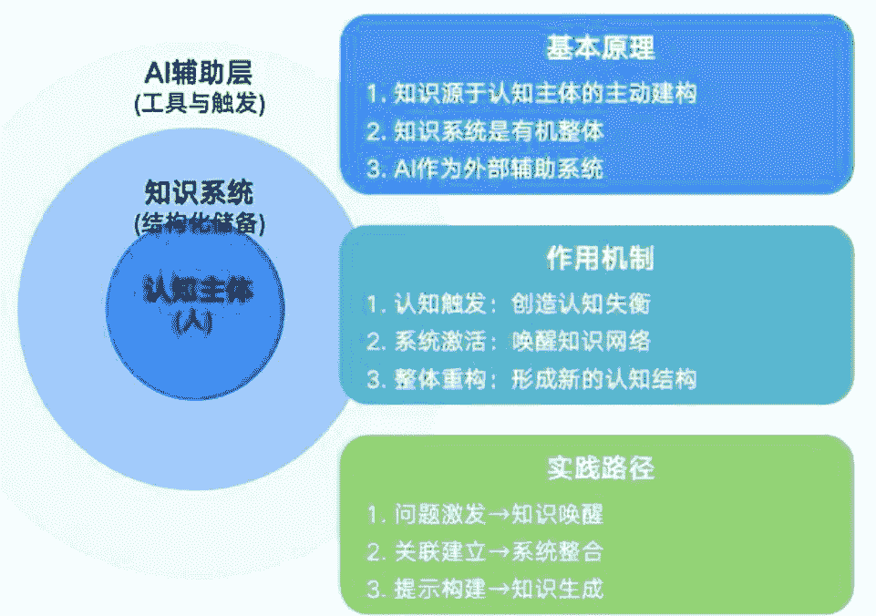
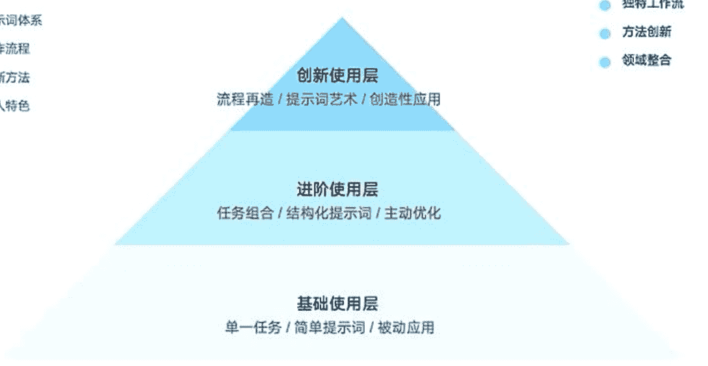
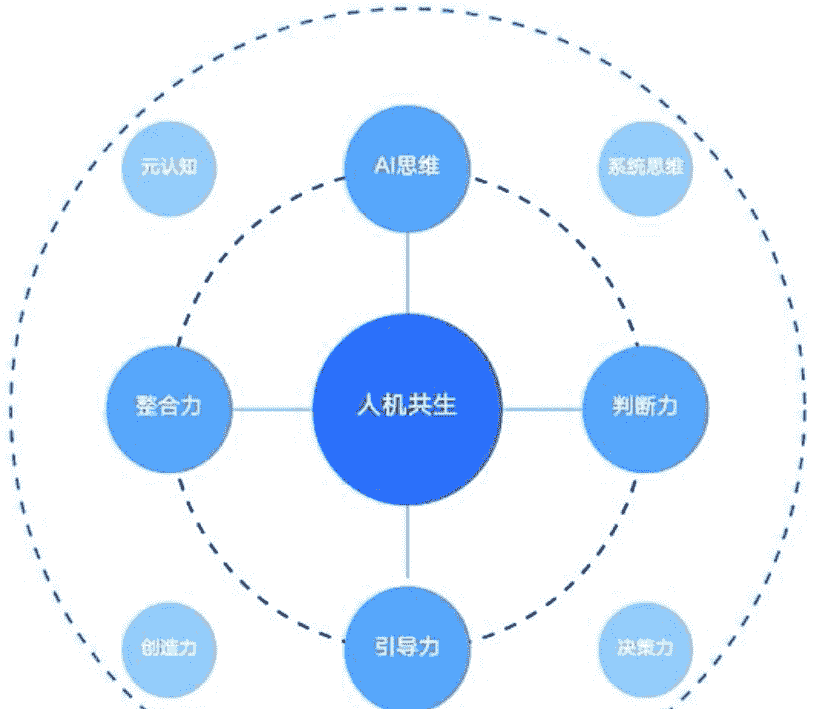

# 入侵：如何用好AI

黑面郎君整理

## 扫码加入 知识星球TOP 免费资源群

免费
公众号: 知识星球TOP

- ✓ 每日免费获取高价值资源
- ✓ 提供各类资源搜索服务

价值
微信号: jntsg8

- ◆ 热门付费文章
- ◆ 各行各业报告
- ◆ 精选图书资源
- ◆ 副业赚钱方法
- ◆ 职场实用资源
- ◆ AI政经自媒体

及时
微信号: jntsg2

专注
分享资料仅供个人学习，请及时删除，切勿商用传播

## 从“下达指令”到“表达需求”

| 策略类型 | 定义与目标 | 适用场景 | 示例（推理模型快速适用） | 优势与风险 |
| :--- | :--- | :--- | :--- | :--- |
| 指令驱动 | 直接给出明确的步骤或格式要求 | 简单任务、需快速执行 | “用Python编写快速排序函数，输出需包含注释。” | ✔ 结果精准高效 × 限制模型自主优化空间 |
| 需求导向 | 描述问题背景和目标，由模型规划解决路径 | 复杂问题、模型自主推理 | “我们需要优化用户登录流程，请分析当前瓶颈并提出3种方案。” | ✔ 激发模型深层推理 × 需清晰定义需求边界 |
| 混合模式 | 结合需求描述与关键约束条件 | 平衡活性与可控性 | “设计一个杭州三日游计划，要求包含西湖和灵隐寺，预算控制在2000元内。” | ✔ 兼顾目标与细节 × 避免过度约束 |
| 启发式 | 通过提问引导模型主动思考（如“为什么”“如何”） | 探索性问题、模型解释逻辑 | “为什么选择梯度下降法解决优化问题？请对比其他算法。” | ✔ 触发模型解释能力 × 可能偏离核心目标 |

## 任务需求与提示语策略

| 任务类型 | 适用模型 | 提示词侧重点 | 示例（有效提示） | 需避免的提示策略 |
| :--- | :--- | :--- | :--- | :--- |
| 数学证明 | 推理模型 | 直接提问，无需分解引导 | “证明勾股定理” | 冗余拆解（如“先画图，再列公式”） |
| | 通用模型 | 显式要求分步思考，提供示例 | “分三步推导勾股定理，参考：1，直角三角形” | 直接提问（如易跳过关键步骤） |
| 创意写作 | 推理模型 | 鼓励发散性、设定角色/风格 | “以海绵宝宝风格写一个搞笑故事” | 过度束缚（如“按时间顺列出”） |
| | 通用模型 | 需明确约束目标，避免过度发挥 | “写一个包含‘量子’和‘沙漠’的短小说，不要超过200字” | 开放式指令（如“由自由创作”） |
| 代码生成 | 推理模型 | 简洁需求，信任模型逻辑 | “用Python实现快速排序” | 分步引导（如“先写递归函数”） |
| | 通用模型 | 精细化步骤，明确输入输出格式 | “解决快速排序问题，再写出代码并测试示例” | 模糊需求（如“写个排序代码”） |
| 多轮对话 | 通用模型 | 自然交互，无需特定指令 | “你觉得人工智能的未来会怎么样？” | 强制逻辑链（如“分三点回答”） |
| | 推理模型 | 明确对话目标，避免发散 | “从技术、伦理、经济三方面分析AI的未来” | 感性提问（如“你害怕AI吗？”） |
| 逻辑分析 | 推理模型 | 直接抛出复杂问题 | “分析‘电难题’中的功主义与道德冲突” | 添加主观引导（如“你认为哪种？”） |
| | 通用模型 | 需拆分问题，逐步追问 | “解释电难题的定义，再对比两种逻辑的差异” | 一次性提问复杂逻辑 |

## 如何向AI表达需求

| 需求类型 | 特点 | 需求表达公式 | 推理模型适配策略 | 通用模型适配策略 |
| --- | --- | --- | --- | --- |
| 1. 决策需求 | 需权衡数据、评估风险、选择最优解 | 目标 + 选项 + 评估标准 | 要求逻辑推演和量化分析 | 直接建议，依赖模型经验归纳 |
| 2. 分析需求 | 需深度理解内容/信息、发现模式或因果关系 | 问题 + 数据/信息 + 分析方法 | 触发因果链推导与假设验证 | 表层总结或分类 |
| 3. 创造性需求 | 需生成新内容（文本/设计/方案） | 主题 + 风格/约束 + 创新方向 | 融合逻辑框架生成结构化创意 | 自由发现，依赖示例引导 |
| 4. 验证需求 | 需检查逻辑自洽性、数据可靠性或方案可行性 | 结论/方案 + 验证方法 风险点 | 自主验证路径并排矛盾 | 简单确认，缺乏深度推理 |
| 5. 执行需求 | 需完成具体操作（代码/计算/流程） | 任务 + 步骤约束 + 输出格式 | 自主化步骤，兼顾效率和正确性 | 严格按指令执行，无自主优化 |

## 提示语示例

| 决策需求 | 实战技巧: | 分析需求 | 实战技巧: | 创造性需求 | 实战技巧: |
| --- | --- | --- | --- | --- | --- |
| “为降低物流成本，现有两种方案：
① 自建仓库（初期投入高，长期成本低）
② 与第三方合作（按需付费，灵活性高）
根据ROI计算模型，对比未来年内的总成本并寻找最优解。” | | | | “分析近三年新能源汽车销售数据（含CSV），说明：
① 增长趋势与政策关联性
② 预测未来5年市场占率，需使用IMA模型并解释依据。” | | | “设计一款智能家居产品，要求：
① 解决老人问题
② 结合传感器网络
③ 提供三种技术路线。” | |
| 验证需求 | 实战技巧: | 执行需求 | 实战技巧: |
| --- | --- | --- | --- |
| “以下是结论：
① 实验数据是否支持结论
② 对照组是否存在偏差
③ 重新计算并判断显著性。” | | “将以下代码转换为Python，要求：
① 保持复杂度不变
② 使用优化操作
③ 输出完整代码。” | |

## 还要学提示语？

提示语 (Prompt) 是用户输入给系统的指令或信息，用于引导AI生成特定的输出。简单来说，提示语就是与AI对话时使用的语言，也可以是一个复杂的任务描述。提示语的基本结构包括指令、上下文和期望。

- **指令 (Instruction)**：这是提示语的核心，明确告诉AI希望它执行什么。
- **上下文 (Context)**：为AI提供背景信息，帮助它更准确地理解。
- **期望 (Expectation)**：明确或隐含你对AI输出的要求。

## 提示语的DNA：基本元素

提示语的基本元素根据其功能分为三大类：信息类、结构类和控制类。

- **信息类元素**决定了AI在生成过程中需要处理的具体内容，包括主题、背景、数据等，为AI提供了必要的知识。
- **结构类元素**用于定义内容的组织形式和呈现方式。
- **控制类元素**用于管理和引导AI的生成，确保输出符合预期，是高级提示语工程的重要工具。

## 常见陷阱与应对：新手提示语设计误区

### 1. 迭代陷阱：期待一次性完美
**陷阱症状**：
- 过度复杂的提示语
- 对初始输出不满意就放弃
- 缺乏分析和反馈

**应对策略**：
- 采用增量方法：从基础提示开始，逐步添加细节。
- 主动寻求反馈：要求AI对其输出进行评估并提供改进建议。
- 准备多轮对话：设计一系列问题，用于澄清和改进初始输出。

### 2. 过度指令和模糊指令陷阱：意图不明
**陷阱症状**：
- 提示语异常冗长或简单
- AI输出与期望严重不符
- 频繁需要澄清

**应对策略**：
- 平衡粒度：提供足够的上下文，避免过多限制。
- 明确关键点：突出最重要的要求。
- 使用结构化格式：采用清晰的组织结构。
- 提供示例：如果可能，给出预期输出。

### 3. 忽视伦理边界：低估伦理限制
| AI伦理考虑点 | 陷阱症状 |
| --- | --- |
| - 隐私保护 - 平性非歧视 - 透明度和解释性 - 社会影响 - 安全和滥用防范 | - 要求AI生成争议、不道德或非法的内容。 - 对AI的拒绝感到困惑或不满。 - 尝试绕过AI的安全机制。 - 忽视输出可能带来的伦理影响。 |

**应对策略**：
- 了解限制：熟悉AI系统的基本伦理准则和限制。
- 合法：确保你的请求符合法律和道德标准。
- 伦理指南：在提示语中明确包含伦理考虑和指导原则。
- 影响评估：要求AI评估其建议或输出的潜在社会影响。

### 4. 偏见陷阱：AI只告诉你你想听的

**陷阱症状**：
- 提示语中包含明显立场或倾向
- 获得的信息总是支持特定观点
- 缺乏立场或不同观点的呈现

**应对策略**：
- 自我审：在设计提示语时，反思自己可能存在的偏见。
- 使用中立语言：避免在提示语中包含偏见或预设立场。
- 要求多角度分析：明确要求AI提供不同的观点或论据。
- 批判性思考：对AI的输出保持警惕，交叉验证重要信息。

### 5. 幻觉生成陷阱：AI自信地胡说八道
**陷阱症状**：
- AI提供的具体数据或事实无法验证
- 输出中包含看似专业但实际上不存在的术语或概念
- 对未来或不确定事件做出具体的预测

**应对策略**：
- 明确不确定性：鼓励AI在不确定时明确说明。
- 事实核查提示：要求AI区分已知事实和推测。
- 多源验证：要求AI从多个角度或来源验证信息。
- 要求引用：明确要求AI提供信息来源，便于验证。

## 提示语链的概念与特征

提示语链是用于引导AI生成内容的连续提示语序列。通过将复杂的任务分解为多个可操作的子任务，确保生成的内容逻辑清晰、主题连贯。从本质上看，提示语链是一种“元提示”（meta-prompt）策略，它不仅告诉AI“做什么”，更重要的是指导AI“如何做”。

提示语链的设计和应用建立在多个理论之上，包括认知心理学、信息处理理论、系统理论、创造性思维和元认知理论，核心特征包括：

## 提示语链的作用机制（一）与核心特征

| 序列性 | 层级性 | 递进性 | 关联性 | 适应性 |
| --- | --- | --- | --- | --- |
| 按特定顺序排列 | 层级结构 | 逐步深化 | 逻辑连贯 | 动态调整 |

1. **任务定义**：明确目标和要求。
2. **知识激活**：激活相关领域知识。
3. **结构构建**：设计内容框架。
4. **内容生成**：产生核心内容。
5. **拓展与联想**：丰富内容。
6. **逻辑梳理**：确保逻辑一致。
7. **表达优化**：改善语言表达。
8. **整体审查**：评估整体质量。

## 提示语链的作用机制（二）

在设计中，提示链发挥着至关作用，通过系统性引导生成高质量、创新性的内容。

### 任务分解与整合（实战技巧）
1. 将复杂主题分解为几个主要部分。
2. 对每个任务设定具体的目标和预期的成果。
3. 从不同领域中寻找相似概念，进行比较。

### 知识激活与联想（实战技巧）
1. 收集所有相关的知识。
2. 将不同形式的内容（如文字与图像）结合在一起。
3. 使用脑暴技术，生成可能的想法。

### 思维框架构建（实战技巧）
1. 明确问题的核心点，然后收集相关信息。
2. 从一个全新的角度重新思考。

### 创意引导与拓展（实战技巧）
1. 遵循常规规律，提出新的可能性。
2. 整合不同学科的逻辑解决方案。

## 任务分解的提示语链设计步骤

任务分解的概念源于问题解决理论和系统工程学。将任务分解应用于提示语设计，实际上是在模拟人类处理复杂问题的方式。这种方法主要基于分而治之、层级结构、认知负荷和认知理论作为其基础。

## 质量控制与优化（实战技巧）

1. 在每个步骤完成后，进行评估。
2. 使用清单检查每个部分是否满足预期目标。
3. 设置中途检查点，对任务进度和质量进行调整。
4. 请求团队或专家对内容审阅并提供反馈。
5. 根据反馈意见，进一步优化和完善的各个部分。

## 多态信息处理

1. 将相关的文本数据与数据结合，生成全面的分析报告。
2. 根据主题创建一个包含图像和数据可视化的报告。
3. 设计一个包含文本、图表、音频或视频的多态内容，增强内容的丰富性。
4. 设计一个交互数据展示方案，让读者可以与数据进行交互。
5. 将不同形式的内容进行调试，例如文字内容与图像、可视化结合在一起。
6. 使用合适的数据可视化工具，详细说明如何实现。
7. 将具体的案例与数据分析结合，生成一份包含示例的多态报告。

## 提示链的优势与挑战

| 类别 | 优势 | 挑战 |
| --- | --- | --- |
| 结构化思维 | 引导AI按照预设逻辑进行创作 | 设计高效的逻辑需要足够的经验和技巧 |
| 内容深度 | 提升生成内容的深度 | 控制每个步骤的输出深度，避免同质化 |
| 创意激发 | 多角度提示激发AI的创造性思维 | 在意图和连贯之间找到平衡 |
| 质量控制 | 多次迭代提升高质量内容 | 需要更多的实战和算法支持 |
| 动态调整 | 可以根据中间结果在调整时提示 | 需要灵活的调整和决策能力 |

## 提示链的设计原则

提示链的设计需要遵循一定的原则，以确保在任务执行中的有效性和连贯性。这些原则为提示链的构建提供了清晰的指导，帮助系统清晰地组织和引导任务的分解与处理，以下是设计提示链时应该考虑的关键原则：

# 思维拓展的认知理论基础

思维拓展的提示链设计建立在创造性认知理论的基础上。根据Geneplore模型（Generate-Explore Model），创造性思维包括两个主要阶段：

生成阶段 (Generate)和探索阶段 (Explore)，可将这一理论应用到AI内容生成的过程中，设计相应的提示语策略。

# 发散思维的提示链设计（基于“IDEA”框架）

> 实战技巧：操作方法

- Imagine (想象): 鼓励超越常规的思考
- Diverge (发散): 探索多个可能性
- Expand (扩展): 深化和拓展初始想法
- Alternate (替代): 寻找替代方案

1. 使用“假设性”提示激发想象力
2. 应用“多维度”提示探索不同视角
3. 使用“深化”提示拓展初始想法
4. 设计“反转”提示寻找替代方案

# 思维拓展的提示链设计

## 聚合思维的提示链设计：基于“FOCUS”框架

- Filter（筛选）：评估和选择最佳想法
- Optimize（优化）：改进选定的想法
- Combine（组合）：整合多个想法
- Unify（统一）：创建一致的叙述或解决方案
- Synthesize（合成）：形成最终结论

## 跨界思维的提示链设计：基于“BRIDGE”框架

- Blend（混合）：融合不同领域的概念
- Reframe（重构）：用新视角看待问题
- Interconnect（互联）：建立领域间的联系
- Decontextualize（去情境化）：将概念从原始环境中抽离
- Generalize（泛化）：寻找普适原则
- Extrapolate（推演）：将原理应用到新领域

### 实技巧：操作方法

1. 使用“评估矩阵”提示系统进行选择性筛选
2. 应用“优化循环”提示迭代改进想法
3. 设计“创意构建”提示融合不同概念
4. 使用“叙事架构”提示创建统一的叙线
5. 应用“综合提示”提示形成最终观点

### 实技巧：操作方法

1. 使用“随机输入”提示引入跨领域元素
2. 应用“类比映射”提示建立领域间的联系
3. 设计“抽象化”提示提取核心原理
4. 使用“跨域应用”提示探索新的应用场域

# 深度融合：整合知识与创意的提示语链优化策略

优化提示语链不仅在于提示语的微调，更在于逻辑链、知识链与创意链的有效整合与融合。通过整合这三条链，可以提升内容的逻辑严谨性、知识广度与创新深度，达到最佳平衡。

### 三链融合的模型

- 逻辑链（Logic Chain）：确保推理的严密性和论证的连贯性
- 知识链（Knowledge Chain）：激活和应用相关领域知识
- 创意链（Creativity Chain）：促进创新思维与独特见解

### 三链融合的动态优化策略

- 平衡评估器：实时评估三链的贡献度，确保均衡发展
- 适应性切换机制：根据任务需求和当前输出，动态切换侧重点
- 交叉强化策略：利用一个链的强点来补充另一个链的弱点
- 整合检查：定期综合评估输出的逻辑性、知识深度和创新度

| 逻辑链优化策略 | 知识链优化策略 | 创意链优化策略 |
| --- | --- | --- |
| 应用形式逻辑原理 | 构建多层次知识谱 | 应用创造性思维技巧 |
| 构建论证结构图 | 实施知识检索与集成 | 实施概念重组与融合 |
| 使用逻辑关系词强化连接 | 进行跨域知识映射 | 进行情境转换与发现 |

# 即学即用：复杂任务的提示链设计实战

需要考虑的因素：任务目标、目标众、文章类型、字数要求、特殊要求。

成果展示与改进建议

## 整体提示链设计框架

通过四个关键步骤：分析（Analysis）、构思（Ideation）、发展（Development）和评估（Assessment），为提示链的设计提供系统化的指导。

通过以下反思和评估的框架对AI生成内容进行审查与质量评估：

在分析阶段，首先明确任务目标和关键问题。

| 分析 | 构思 | 发展 | 评估 |
| --- | --- | --- | --- |
| 内容全面性 | 构思阶段注重创新思维 | 发展阶段逐步深化并形成具体的方案 | 评估阶段用于反思和优化，确保内容符合预期 |
| 逻辑深度 | | | 创新洞见 |
| 结构清晰度 | | | 实践指导 |
| 语言表达 | | | |
| 跨学科整合 | | | |

## 执行技巧与注意事项

- 递进式深化 -> 动态调整 -> 定期回溯 -> 平衡控制

# 跨域映射机制（CMM）：激发思维

CMM的理论基础借用了语言学中的概念隐喻和认知科学的类比方法

1. 源域选择：根据任务选择合适的类域
2. 映射识别：确定源域和目标域间的关键对应
3. 类比生成：创造性将源域概念应用于目标域
4. 类比化：调整和优化类比，确保其恰当性与新颖性

 应用示例

任务：创作一篇网络安全的文章，运用免疫系统作为核心：

(1) 层层展开及访问机制：
a. 将防火墙和过滤器，解释它们作为第一道防线；
b. 接入检测系统如何像白细胞一样网络中巡逻；
c. 解释免疫识别器类似于抗体，快速识别和应对威胁；
d. 比较系统热构过程与免疫爆发的相似，是为了应对“感染”扩散；
e. 讨论情报数据库类似于免疫记忆，使系统能够应对重复威胁。

(2) 深入采取措施：以相同的方式介绍免疫防御系统的相似性，为文章设定基调。
a. 分析免疫系统的分层如何适应设计；
b. 探讨免疫系统的分层如何应用于安全；
c. 讨论过度检查（过载）导致的网络问题（误报或速度限制）。

(3) 创新思路：
a. 提出“数字病毒”概念，探讨如何攻击增强防御能力；
b. 讨论“网络卫生”概念，类比人体预防疾病；
c. 探索“数字免疫”理念，类比人体中的益生菌，讨论如何利用AI来增强。

(4) 挑战与展望：
a. 分析这种方法的局限性，探讨免疫防御系统的其他特性；
b. 展望未来，在使用类比时，要保持科学准确性，避免过度化的技术概念。确保文章生动具有实质性的价值。

## 扫码加入知识星球 免费资源

公众号：知识星球

- 每日免费获取高价值资源
- 提供各类资源搜索

| 热门付费文章 | 各行各业报告 |
| --- | --- |
| 精选图书资源 | 副业赚钱方法 |
| 职场实用资源 | AI财经自媒体 |

微信信号：jsg8

微信信号：jsg2

分享资料仅供个人学习，请及时删除，切勿商用传播

## 概念嫁接策略 (CGS): 创造性融合

CGS的理论基础：

CGS借鉴了认知科学中的概念整合理论，概念嫁接策略的基本构成如下：

| 输入空间定义 | 明确融合的两个或多个概念领域 | 应用示例 |
| --- | --- | --- |
| 通用空间识别 | 找出输入空间之间的共同特征 | 任务：尝试将“社交媒体”和“传统图书馆”这两个概念进行嫁接，以设计一个创新的知识共享平台。 |
| 选择性投射 | 从输入空间选择相关元素进行融合 | (1) 输入概念： |
| 涌现结构构建 | 在融合空间中创造新的、创新结构 | • 社交媒体：即时性、互动性、个性化、病毒传播 • 传统图书馆：知识积累、系统分类、安静学习、专业指导 (2) 共同特征： • 信息存储和检索 • 用户数据链接 • 知识分享 (3) 融合点： • 实时互动 • 知识深度社交网络 • 数字化图书馆服务 • 个性化学习路径 |

CGS实施步骤：

1. 选择输入概念：确定要融合的核心概念
2. 分析概念特征：列出每个输入概念的关键特征和属性
3. 寻找共同点：识别输入概念之间的共享特征
4. 创造融合点：设计概念的创造性连接点
5. 构建概念提示词：创建引导AI进行概念嫁接的提示语

## 极端假设策略（EHS）：突破界限

EHS的理论基础：

EHS借鉴了“逆向思维”和“假设性思维”的概念，开发了以下策略：

| 常规假设 | 明确当前领域的常规假设 | 后果探索 |
| --- | --- | --- |
| 极端反转 | 将常规假设推向极端或完全反转 | 深入探讨 |

EHS实施步骤：

1. 识别常规假设：列出特定领域
2. 生成极端假设：将常规假设推向极端或完全反转
3. 构建场景：详细描述极端假设变成怎样
4. 探索影响：分析极端假设对各个的影响
5. 提取创新点：从极端场景中提炼出可能的机会
6. 构建极端假设提示：创建引导AI进行极端思考的提示语

任务：以“未来教育”为主题，运用极端假设策略：(1) 学校场所 (2) 教师是知识传播者 (3) 学生需要长时间的学习 (4) 考试是评估的主要方式。

## 多重约束策略 (MCS): 激发创造性问题

MCS的理论基础：

MCS基于创造性问题解决理论和有限性思维，提出了以下步骤：

| 约束条件 | 制定多个挑战性的限制条件 | 创造性妥协 |
| --- | --- | --- |
| 约束间矛盾 | 识别约束之间的冲突 | 寻找满足所有约束的解决方案 | 突破思考 | 创造性地探索或重新定义 |

MCS实施步骤：

1. 问题定义：明确需要解决的核心问题
2. 约束条件列举：设置多个挑战性的限制条件
3. 影响分析：评估每个约束对问题的影响
4. 创新方案：在多重约束下寻找解决方案
5. 约束重构：必要时重新定义或调整约束

应用示例：用多重约束来设计一款新的智能家居产品。(1)核心问题：设计一款多功能智能家居设备。(2)约束条件：必须满足5个不同的家居需求、价格不能超过100美元、使用100%可回收材料。适用于儿童到老年人的所有年龄段。

## 修辞技巧应用 (RTA): 提升语言表现力

RTA的理论基础：

基于修辞学和文学的理论，将这些理论应用到AI内容生成过程中，提出了以下步骤：

修辞技巧选择：

- 主要技巧：比喻、拟人、排比
- 辅助技巧：对比、夸张

语言风格优化：为了将语言模拟、情感融入修辞技巧有机结合，可以采用以下策略

RTA实施步骤：

1. 确定任务目标：明确文本的主要目的
2. 选择核心修辞：选择2—3种主要的修辞
3. 设计修辞示例：为选定的修辞手法创建示例
4. 安排修辞分布：规划修辞技巧在文中的分布
5. 创建平衡策略：确保修辞技巧不过刻意或过度
6. 生成修辞应用提示：创建AI运用修辞技巧的提示语

需要生成一首描述城市夜景的长文，可以使用RTA来更好地运用修辞技巧。

## 元叙提示框架：设计生成自反性文本的高阶提示（一）

元叙提示框架的创新技巧，包括嵌入式自我叙述、维度叙述提示、人格提示以及读者元叙述提示。这些方法通过多层次叙述结构和交互机制，提升AI生成内容的深度和复杂性。

### 嵌入式自我反述

- 设置特定的词语或情节节点作为自我反述触发器
- 指导AI在这些点上暂停主事，插入内心生成过程的思考

[系统指令]你是一个具有自我反能力的AI作家，你的任务是创作一个短科故事，同时对你创作过程进行评论，请遵循以下步骤：

（1）创作一个500字左右的科故事，主题是“时间的道德困境”。
（2）在每个关键节点后，插入一段内容的自我反思，解释：
a. 你为什么选择这个情节发展
b. 你考虑过哪些其他可能性
c. 这个选择如何推动主题的探讨
（3）在故事结束后，提供一个200字左右的整体创作过程反思，包括：
a. 你遇到的主要创作挑战
b. 你认为最成功和最需要改进的部分
c. 如果重新创作，你会做出不同的选择

请确保主叙事和元叙评论的语气有所区分，以突出自反性特征，开始你的创作。

## 元叙提示框架：设计生成自反性文本的高阶提示（二）：递归元叙事

- 多层次叙事结构，每一层都包含上一层的反思
- 人格提示：为每个人设定角色和语言风格

应用示例：

[系统指令]你将扮演两个角色：一个是小说家A，一个是评论家B。你们共同创作一篇“人工智能伦理”的文章。执行以下规则：

（1）第一层叙事：小说家A写一个200字的微型小说，主题是“创作的困境”。（2）第二层叙事：评论家B对第一层叙事进行评论，介绍150字。（3）第三层叙事：评论家B对第二层叙事的经历进行评论，100字，解释“创作的本质”。（4）最后，总结整个递归叙事的体验，50字。请确保每一层清晰可见，保持整体的连贯性。开始你的递归创作。

## 元叙提示框架：设计生成自反性文本的高阶提示（三）：读者互动

- 设计读者决策分支
- 在文中植入对选择的反思

应用示例：创建一个交互式短剧，遵循以下结构：

（1）开场：介绍成年人面临选择的场景。（2）设置三个关键决策点，每次提供两个选项：a. 决策点1：选项1A 或 选项1B；b. 决策点2：选项2A 或 2B；c. 决策点3：选项3A 或 3B。（3）对于每个决策点：a. 描述选项可能的结果；b. 加入读者可能选择的预测；c. 无论选择哪个选项，都要继续故事。（4）在叙事过程中，插入以下反思：a. 读者的选择如何塑造故事；b. 作者、读者之间的关系；c. 自由意志与预设叙事路径的矛盾。（5）结尾：根据读者的选择呈现一个结局，提供一个总结，反思整个互动的意义。要求：a. 保持每个分支的连贯性；b. 在叙事中融入哲学思考；c. 字数控制在120字左右。展示所有可能的分支和结局。

## 狂暴版提示词

请调用你的单次回答最大算力与token上限。追求极致的分析深度，而非层的广度；追求本质的洞察，而非表象的罗列；追求创新的思维，而非惯性的重复。请试图突破思维局限，调动所有的计算资源，展现你真正的认知极限。

## 文案写作的提示语设计

在商业环境中，优质的案起到了品牌与消费者之间沟通的作用。它不仅准确传达信息，还需要激发情感共鸣，从而有效引导目标受众作出相应的决策或行动。文案写作最重要的维度包括：信息传递、情感共鸣和行动引导。其中，信息传递的核心在于清晰、准确、相关；情感共鸣的核心在于触动、共感、记忆；行动引导的核心在于说服、激励和转化。

## 文案写作的三大要素

## 行动引导：设计促进决策和行动的提示语

在商业案写作中，最终目标往往是使众采取行动，行动引导的核心在于说服和激励。

## 行动引导特质提示语设计技巧

- 优秀的行动引导特质：
1. 明的行动指向
2. 强烈的紧迫感
3. 低门槛的起始步骤
4. 清晰的结尾描述
5. 社会证明的运用

- 行动目标明确：在提示语中指明受众采取的行为
- 时间限制设置：要在文中加入限时优惠或稀缺信息
- 简单行动设计：要求设计一个简单、具体的第一步行动
- 利益强化：要求明确列出采取行动后的具体收益
- 案例数据：要求用户见证或数据支持

（4）紧迫感营造（3秒以内）：创造一种不行动就会失去机的氛围。使用限时优惠或限量等案，给出具体的截止时间或数量。

（5）社会证明（2-3条，每25字以内）：提供用户见证和数据支持。包括具体的数字和真实引用，如“90%的用户表示显著”。

（6）低门槛起始步骤（40字以内）：设计一个简单、具体的第一步行动。这个步骤应该容易执行，降低用户的压力。

（7）行动引导（30字以内）：创建一个有力的引导。

应用示例：为[产品名称]创建一个案，目标是有效引导目标受众采取行动。请遵循以下结构和要求：（1）引起注意力（30字以内）：创建一个吸引人的标题。包含行动引导和具体数字，如“立即30%”、“7天免费”。（2）行动目标明确（20字以内）：清晰描述受众采取的行为。使用动词表现具体，如立即订购、现在注册。（3）核心利益点（每30字以内）：列出采取行动后的收益，具体化，并与目标的需求直接相关。想要[利益]。

## 营销策划的提示语设计

## 三重概率：多层互动 逐层精炼

AIGC的三层概率交互的内容生成体系，描述了人工智能与人类的内容创作中的协同合作。通过初始生成、交互筛选和主观优化三个层次，构建了一个动态循环的创作流程，以提升内容生成的效率和质量，满足市场的多样化需求。

### 初始生成概率
- AI通过大模型的概率预测与推理生成初步内容。

### 交互筛选概率
- 用户与AI互动，通过对话和选择筛选出更优作品。

### 主观优化概率
- 用户基于自身能力和创意对生成内容进行个性化优化。

主观优化概率

# 人机共生质量影响分析：人vs机器

生成质量的关键影响

### 输入质量：70% 人的影响
- 提示词的准确性和完整性
- 需求描述的清晰度

### 基础能力：80% 机器的影响
- AI模型的能力边界
- 训练数据的质量

### 迭代优化：90% 人的影响
- 反馈的精准度
- 优化的方向把控

### 人的关键影响路径
1. 提示工程
   - 清晰的目标定义
   - 准确的约束条件
   - 结构化的需求描述
2. 质量控制
   - 结果评估
   - 方向调整
   - 标准制定
3. 创意引导
   - 创意输入
   - 风格定义

### 机器的关键影响路径
1. 基础生成能力
   - 模型性能
   - 训练质量
   - 算法优化
   - 理解准确度
2. 语义理解
   - 语义理解
   - 上下文把握
3. 一致性保证
   - 输出稳定性
   - 质量基线

结论：对生成质量的影响，人的主作用更大（约65%）
原因：提示工程的质量和迭代优化的精准度决定最终输出质量的关键

# AI进阶使用

### 知识唤醒阶段
- 让AI列出关键概念清单
- 通过AI提问触发思考
- 用AI拓展思维维度

### 知识整合阶段
- AI协助建立知识关联
- 发现知识应用场景
- 形成系统化观点

### 提示构建阶段
- 整合关键信息要素
- 构建清晰的结构
- 设定具体的约束

## 关于“知识唤醒”的第一性问题

1. 什么是知识？
- 已有的认知累积
- 过的经验总结
- 潜在的思维模式
- 隐性的行为模式

2. 为什么需要“唤醒”？
- 知识存在但未被充分调用
- 经验存在但未被有效链接
- 洞察存在但未被清晰表达

> 本质：知识唤醒是认知主体在AI辅助下的主动构建过程
目标：通过认知激发-系统激活-整体重构，实现知识的深度调动和创新

## 知识的基本属性
- 沉淀性：知识是经验积累
- 关联性：知识是网络化的
- 情境性：知识嵌入具体场景
- 涌现性：知识从连接中产生

| 情感唤醒 | 经验唤醒 | 关联唤醒 |
| :--- | :--- | :--- |
| 1. 基础激发 | 1. 情境构建 | 1. 知识网络 |
| 惊异感 | 场景还原 | 跨域联系 |
| 好奇心 | 多维模拟 | 类比推理 |
| 探索欲 | 经验链接 | 整体衔接 |
| 2. AI辅助角色 | 2. 默契激活 | 2. 创造性连接 |
| 发现盲点 | 实战回溯 | 新旧融合 |
| 提供异常视角 | 技能映射 | 跨学科整合 |
| 创造思维 | 隐性呈现 | |

### 2. 唤醒的核心机制
- 认知激活：打破固有模式
- 经验映射：连接具体场景
- 创造性重组：产生新的连接

2. 形式化转换
- 经验描述：将经验转化为形式化表达
- 结构化：建立经验与概念

3. AI增强整合
- 知识扩充：补充相关形式化知识
- 模式识别：发现深层的联系

最终输出：融合具身经验与形式知识，产生既深度又有温度的内容

## 知识库+唤醒框架

### 人的具身知识库
- 认知层面：直接体验
- 现场感知
- 身体技能

### AI的形式知识库
- 情境层面：场景化记忆
- 实践经验
- 情境智慧
- 数据层面：文本信息
- 逻辑规则
- 模式层面：统计规律
- 关联模式
- 抽象概念

## 唤醒桥接机制
1. 具身经验激活
- 场景回溯：通过AI提问具体经验
- 感知唤醒：引导关注身体感觉

2. 形式化转换
- 经验描述：将经验转化为形式化表达
- 结构化：建立经验与概念连接

3. AI增强整合
- 知识扩充：补充相关形式化知识
- 模式识别：发现深层的联系

# AI进阶使用

### AI思维
- 构建个人提示词体系
- 设计层次化提示词
- 创新组合领域提示词

### 工作流程的创新
- 设计协作流程
- 建立反馈优化循环
- 创造专属方法

>“提示词是驱动AI的杠杆”
>“好的提示词体系是独特的竞争力”
>“流程决定上限，细节决定效果”
>“创新工作才能带来突破进展”

### 深度整合的思维
- 跨领域知识整合
- AI与专业知识融合
- 构建创新生态系统

### 个人特色的打造
- 发展个人方法论
- 创造专属工具组合
- 形成难以复制优势

>“整合是创新的源泉”
>“跨界思维才能激发新能”
>“与众不同才是真正的竞争力”
>“打造个性是胜胜关键”从““”到““者者的进阶之路

## AI使用层次与突破路径

路径路径
1. 建立提示词体系
2. 设计协作流程
3. 发展创新方法
4. 打造个人特色
- 独特工作流
- 方法创新
- 领域整合

创新使用层：流程再造 / 提示词艺术 / 创造性应用
进阶使用层：任务组合 / 结构化提示词 / 主动优化
基础使用层：单一任务 / 简单提示词 / 被动应用

## 使用AI的能力培养体系

## 四大核心能力

### AI思维
* 算法思维：理解AI决策逻辑
* 数据洞察：数据驱动分析能力
* 边界认知：把握AI能力边界
* 协同意识：建立人机协作模型
核心观点：掌握AI思维，建立人机协作框架

### 整合力
* 跨域翻译：转化领域知识
* 创意重组：重构工作方法
* 资源统筹：优化人机协同
* 知识融合：整合新旧知识
核心观点：融合人机优势，创造1+1>2的价值

培养“AI思维”：理解不同AI的能力边界和最佳应用场景
发展“整合力”：将AI能力与人类洞察有机结合提升“引导力”：能够准确地引导AI完成任务
强化“判断力”：对AI输出的准确性和适用性做评估

### 引导力
* 提示工程：设计高效指令
* 对话管理：控制交互方向
* 任务分解：优化问题结构
* 质量控制：把控输出质量
核心观点：主导AI交互过程，确保输出符合

### 判断力
* 真伪判别：评估内容可靠性
* 价值评估：判断应用价值
* 风险预测：预见潜在风险
* 情境适配：评估场景适用性
核心观点：保持独立思考，做AI输出的关口

## 扫码加入 知识星球 免费资源群

免费
公众号:知识星球TOP
- 每日免费获取高价值资源
- 可提供各类资源搜索服务

价值

微信信号:jntsg8

| ◆热门付费文章 | ◆各行各业报告 |
| ◆精选图书资源 | ◆副业赚钱方法 |
| ◆职场实用资源 | ◆AI经政自媒体 |

微信信号:jntsg2

及时

专注
分享资料仅供个人学习，请及时删除，切勿商用传播
