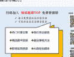

# 加我jtsg，免费资料分享

2023-10-25 10:20

# 机器学习入门
大家准备好学习了吗？这里给大家准备了一套非常系统的机器学习入门教程，包含了从基础到进阶的电子书、视频课程以及实战项目，希望大家能从中受益，一起加油！

2023-10-25 10:25

# 深度学习
深度学习是机器学习的一个重要分支，这里为大家整理了深度学习的优质资源，涵盖了从神经网络基础到CNN、RNN、Transformer等主流模型的理论，还有很多实战案例和代码实现，对大家学习有所帮助！

2023-10-25 10:30

# 自然语言处理
NLP是目前非常火的领域之一，这里为大家准备了NLP的学习资源，包括基础的文本处理、词向量、语义分析到目前大语言模型的内容，还有很多经典的实战项目，建议大家收藏学习！

2023-10-25 10:35

# 计算机视觉
计算机视觉也是一个非常有前景的方向，这里为大家整理了CV的学习资源，包含了从基础的图像处理到目标检测、分割等前沿算法，还有很多实用的实战项目，大家可以参考学习！

2023-10-25 10:40

# 数据科学
数据科学是很多同学感兴趣的领域，这里为大家准备了数据科学的学习资源，涵盖了基础的统计学、数据分析、可视化以及机器学习算法，还有很多实战项目，非常大家可以收藏学习！

2023-10-25 10:45

# 强化学习
强化学习是近年来非常热门的方向，这里为大家准备了强化学习的学习资源，包含了从基础的马尔可夫过程到深度强化学习算法，还有很多实战项目，大家可以参考学习！

2023-10-25 10:50

# 算法与数据结构
算法和数据结构是程序员的基础，这里为大家准备了非常实用的学习资源，包含了从基础的数据结构到高级算法，还有很多经典的面试题，建议大家扎实学习！

2023-10-25 10:55

# 后端开发
后端开发是很多同学选择的方向，这里为大家准备了非常实用的后端开发资源，包含了Java、Python、Go等主流语言的框架，还有很多实战项目，大家可以参考学习！

2023-10-25 11:00

# 前端开发
前端开发也是很多同学感兴趣的方向，这里为大家准备了非常实用的前端开发资源，包含了HTML、CSS、JS以及React、Vue等主流框架，还有很多实战项目，大家可以参考学习！

2023-10-25 11:05

# 移动端开发
移动端开发也是非常有前景的方向，这里为大家准备了非常实用的移动端开发资源，包含了iOS、Android以及Flutter等主流开发技术，还有很多实战项目，大家可以参考学习！

2023-10-25 11:10

# 云计算
云计算是目前非常热门的方向，这里为大家准备了非常实用的云计算资源，包含了AWS、阿里云、腾讯云等主流云平台的内容，还有很多实战项目，大家可以参考学习！

2023-10-25 11:15

# 计算机安全
网络安全是一个非常受关注的方向，这里为大家准备了非常实用的网络安全资源，包含了基础安全、渗透测试、安全防御等内容，还有很多实战项目，大家可以参考学习！

