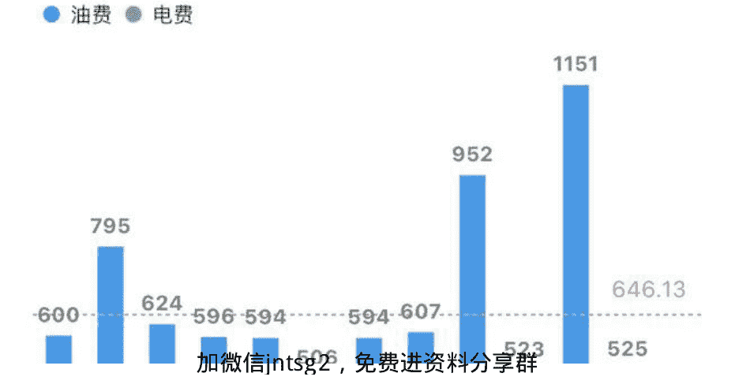
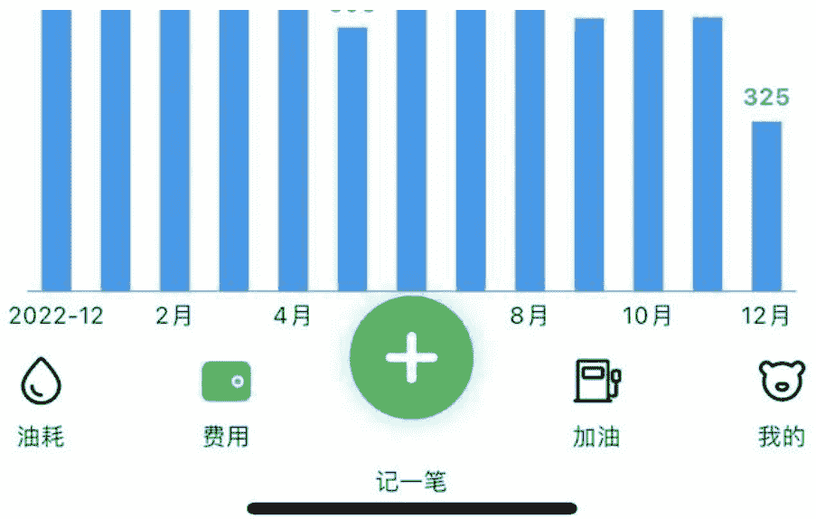

因为我觉得这个问题我来回答再合适不过了！

七八年前我跟人辩论车成本/用车成本的事，辩到后面几乎打架也辩不下。

为了用事实证明自己的对错，我在18年买车后，就坚持一分不落的记录养车费用！直到今天整5年6个月7天！

# 接下来我将详细展示一辆11万不到的买车五年半的买车、用车成本。

## 1. 首先是买车成本：

我的车是2018年5月的北京现代酷蓝+2016款，1.6L自吸中配，指导价12万多，加了一些配置，又优惠两万大几，贷款5万三年免息。首年保险5900，落地几乎刚好13万元。

## 2. 然后是费用大头，加加油钱：

加微信jntg2，免费进资料分享群

# 我的领域

已坚持记录 5 年 6 月 7 天 ?

| 总支出 | 油费总计 | 费用总计 |
| :--- | :--- | :--- |
| 74527.3 元 | 33010.6 元 | 41516.7 元 |
| 支出/公里 | 油费/公里 | 成本/天 |
| 1.17 元 | 0.51 元 | 36.86 元 |

# 支出月度统计 (自然月)

我每天上班通勤来回40多公里，一半快速速度，一半半城区绕堵路，平均油耗7.5，平均每年12000公里，目前表显里程64000公里。5年来我一次不落，一分不差的记下加油的费用，如上所示，目前多年总的加油费用33010.6元。

### 3. 保险费用：

加微信intsg2，免费进资料分享群

# 2018/06/01 - 2023/12/14

保险税费 总计:17829.06元

| 04/26 保险税费 | 2269.36元 |
| 平安汽车三者300万+司机乘客 | |

## 2022年4月 支出:2299.11元

| 04/24 保险税费 | 2299.11元 |
| 2022年保险总费用:665+380+1254.11=2299.11 | |

## 2021年4月 支出:2021.63元

| 04/24 保险税费 | 2021.63元 |
| 2021年保险总费用:665+190+1166.63=2021.63 | |

## 2020年4月 支出:2385.70元

| 04/24 保险税费 | 2385.70元 |
| 2020年保险总费用:665+intsg+1720.7=2385.7 | |

加微信intsg2 免费进资料分享群

## 2019年4月 支出:2953.26元

04/01 保险税费 2953.26元
2019年保险总费用:855+2098.26=2953.26

## 2018年6月 支出:5900.00元

06/01 保险税费 5900.00元
2018年保险总费用:300+900+4700=5900

买了六年的平安险，第一年比较费将近5900元，第二年开始没出险就便宜很多了，几乎是第一年的半半不到，五多年来我没出过一次险，只有三次轻微刮蹭，还是别人全责。保险总费用如上图总共17829.06元。

### 4. 停车费:

加微信jntsg2，免费进资料分享群

2018/06/01 - 2023/12/14

支出 收入

停车费

总计:17900.00

2023年11月 支出:4200.00
2022年12月 支出:4200.00
2021年11月 支出:3300.00
2020年12月 支出:2400.00
2019年12月 支出:2400.00
2018年12月 支出:2400.00
加微信intsg2，免费进资料分享群

我每天上班通勤来回40多公里，一半快速速度，一半半城区绕堵路，平均油耗7.5，平均每年12000公里，目前表显里程64000公里。5年来我一次不落，一分不差的记下加油的费用，如上所示，目前多年总的加油费用33010.6元。

### 5. 养费用：

加微信intsg2，免费进资料分享群

2018/06/01 - 2023/12/14

支出 收入

停车费

总计:17900.00

2023年11月 支出:4200.00
2022年12月 支出:4200.00
2021年11月 支出:3300.00
2020年12月 支出:2400.00
2019年12月 支出:2400.00
2018年12月 支出:2400.00
加微信intsg2，免费进资料分享群
