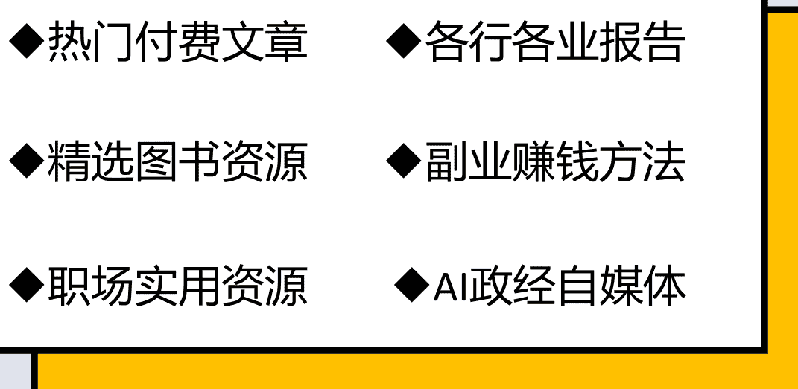

# 2025年（创业板，科创50，中证1000）创业板的影响

原五大市场的影响 观海等五大市场的影响

主板的高息成长股票天然容易受过利率影响，股息并不够涨跌，对于小资金来说，股息收益是看不上的，所以小客户倾向于炒小蓝板，股票活跃性，短期内获得高收益，同时也伴随着高风险。

周末预测一：创业板，科创50，中证1000指数“2025年每月的顶部和底部时间”，供大家参考。

定价100，关注两个维度：

微信(gdqjs88)发预测文件给你；或直接点击下方付费阅读

打赏60继续每周更新。

## 一、创业板：

创业板是一种反映创业板股票整体趋势的指数，它通过特定的一组在创业板上市的股票进行加权平均计算，得到一个整个创业板市场趋势的指数。

创业板指数是用于衡量创业板股票的表现，它反映了创业板市场的活跃程度和投资者的信心。

创业板涨跌周期：

- 预测3月先后跌，下月回高见跌性高点，4月调整，5-6月上涨，7月高年底，8月下跌，9月下跌中有反弹，10月到11月见底部，12月。

注：如3月低后回调，回退到底部。

## 三、中证1000：

中证1000指数由全部中小A股中中证300指数份股组成，规模小且流动性好的100只股票组成的指数。它综合反映了A股市场中一批中小市值的股票价格表现。

中证1000涨跌周期：

- 3月上涨，4月震荡，5月回高回调，6月调整，7月上涨，8月高顶，9月震回落到12月见底反弹。

备注：由于中小型指数不像主板指数那样厚重稳定，容易受到政策等外部环境的影响。在参考预测时，还要考虑当时的政策等外部环境有无变化。

五行对市场的影响

> “观海 ”

45人付费 > 写留言

# 免费 价值 及时 专注

# 扫码加入 知识星球TOP 免费资源群

- 每日免费获取有价值资源
- 可提供各类资源搜索服务

| 热门付费文章 | 各行业报告 |
| :--- | :--- |
| 精选图书资源 | 副业赚钱方法 |
| 职场实用资源 | AI政经自媒体 |

公众号: 知识星球TOP 微信信号: jntsg8 微信信号: jntsg2

分享资料仅供个人学习，请及时删除，切勿商用传播
