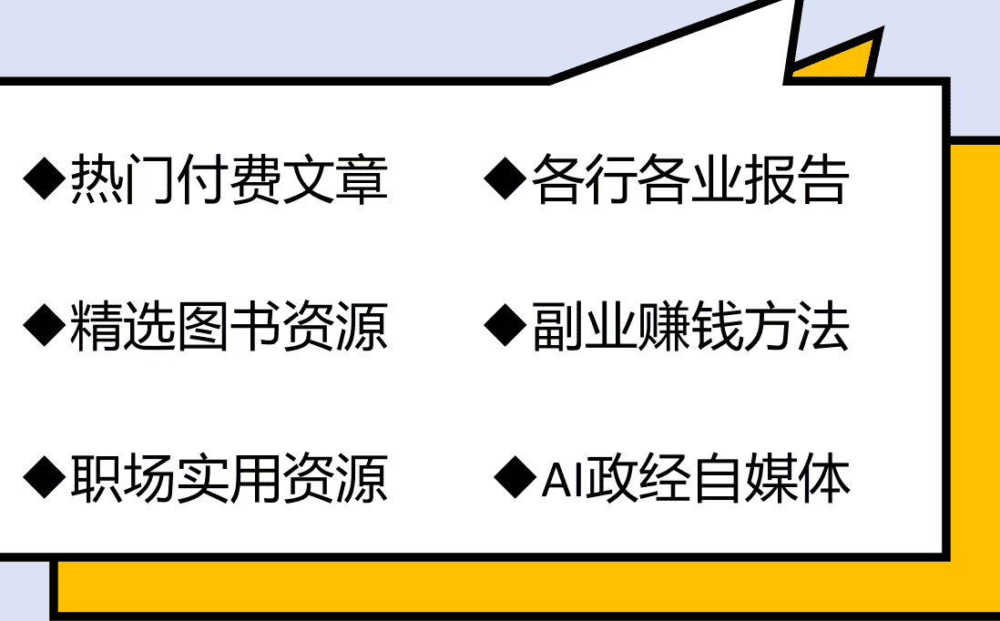

# 职场中的5条建议

## 1. 有要求和底气

职场中的决定，取决于你的实力和竞争力。只有想要要求，才有底气，而这种底气是建立在实力之上的。

在职场中不要害怕，竞争力不会在某一天偶然失去的，从你开始失去竞争力，从你失去底气开始，就会失去100%的你。

## 2. 做好职业规划

在工作中要学会思考，对自己的未来要有打算，而不是交给公司来规划。如果你做好了职业规划，那么在入职公司之前，就要让公司决定你的未来。

没有规划的未来是模糊的，容易陷入“低级重复”，职业成长的空间太小了。

## 3. 不要情绪化工作

永远把工作和情绪分开。公司的业务是公司的，工作是你自己的。不要用公司的困难来惩罚自己，更要不要用自己的情绪去影响工作。

## 4. 学会拒绝

在职场中要学会拒绝，从一开始就学会拒绝，让别人尊重你的价值。如果你不会拒绝，那么别人就会认为你很廉价。

你的价值是靠工作能力体现的。如果你接受了很多不合理的要求，就会失去深度工作的机会。很多人试图用感动换取回报，最后还是失去了自己的机会。

## 5. 凡事有度

不要为了眼前的利益放弃长远利益，不要为了一时的快乐而忽视长期的发展。工作是生活的全部，但生活不只有工作。

## 6. 利益于自己

凡事都要站在对自己长远有利的考虑。不要为了眼前的利益而牺牲了未来的成长。

## 7. 终身学习

在这个快速变化的时代，终身学习是唯一的竞争力。无论在什么位置，都要保持学习的状态，否则就会被时代淘汰。

# 免费 价值 及时 专注

# 扫码加入 知识星球TOP 免费资源群

- 每日免费获取有价值资源
- 可提供各类资源搜索服务

公众号：知识星球TOP 微信信号：jntsg8 微信信号：jntsg2

分享资料仅供个人学习，请及时删除，切勿商用传播
