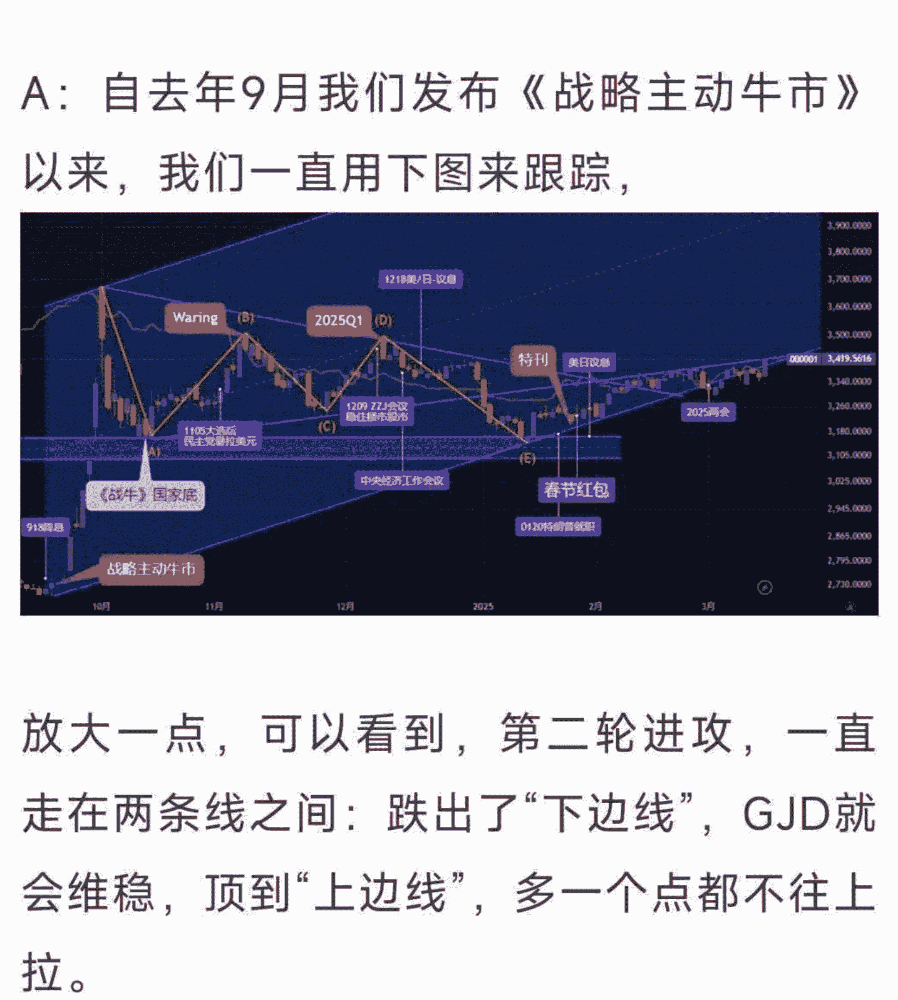
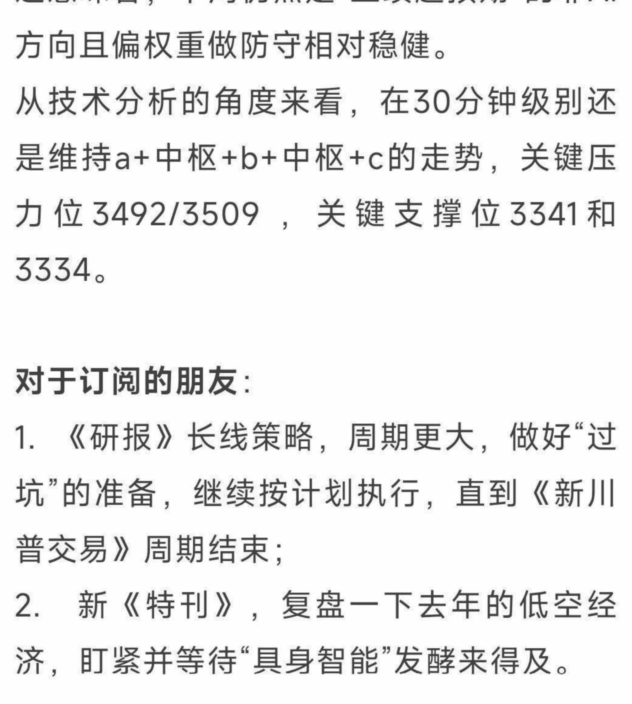
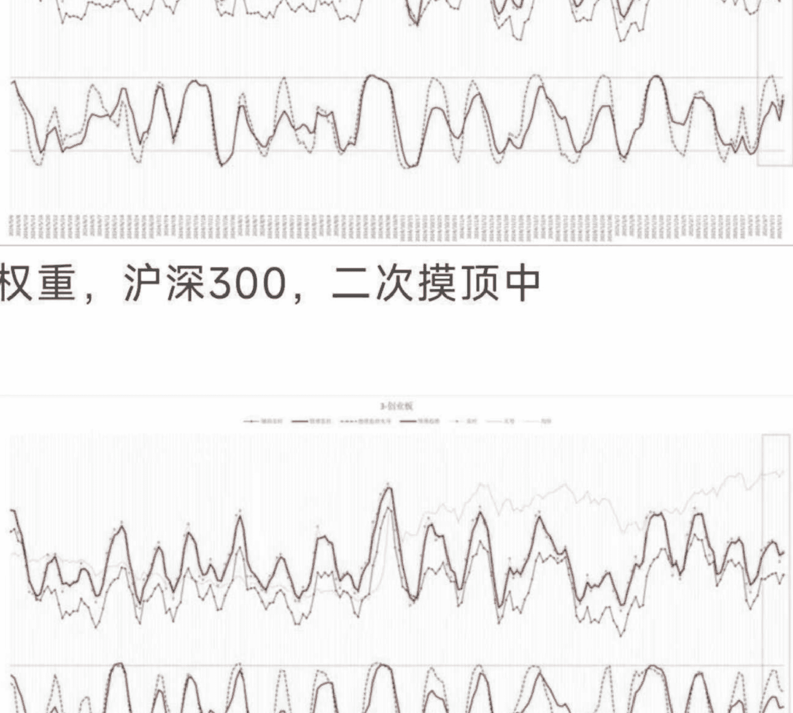
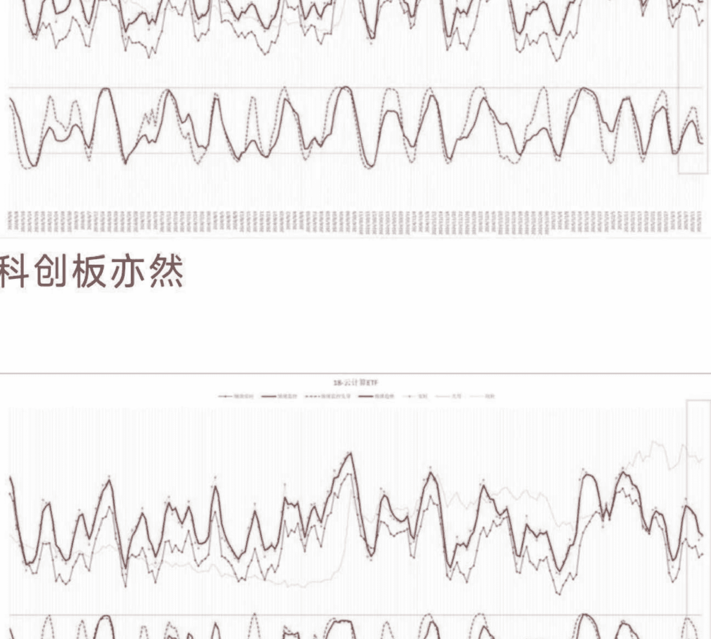
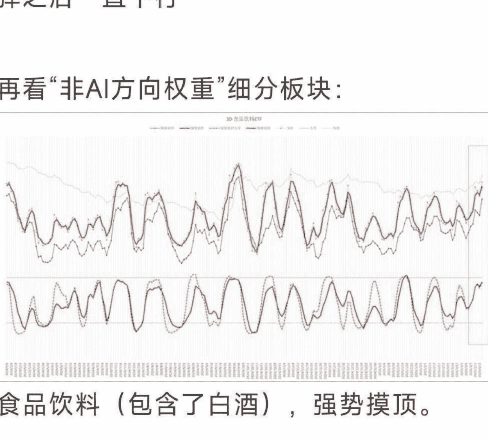
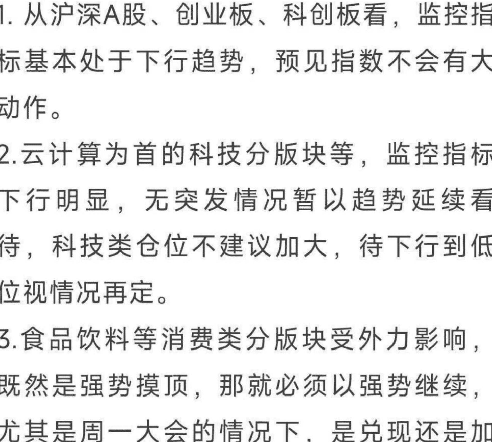

# 全球市场预测0311—0317

财经主编 金融大会 宁宁 2023年05月26日 15:20 | 关注

上周，我们对“行情”讨论了很多，其中包括：

- “黄金”的暴涨可能会在股市之前；
- “加密货币”的投资即将崛起；
- “美元”汇率或面临反转；

发布周末，应对外部可能出现的不可预见因素中，美元还展现了足够的信心和政策支撑。

两次回抽显示其“韧性”，这是一个非常重要的趋势。

## 2023Q1股市的趋势

美股在第一季度内完成反弹，涨幅为88%。

股市景气转后可能引发全球性的金融危机；

一旦金融危机爆发，对所有资产都将面临巨大的负面影响。

设定投资风险政策已到位：

美股数据回撤跌破16%高位—已爆发。

验证我们的预测：

- “美元”将反弹；
- 股市、BTC和中概结构将迎来调整；
- 市场开始寻找底部

上周，我们已经预测了以比特币为代表的，当市场看到我们在2023年Q1的预测后。我们在文章中已经预测过VIX会跌，现在VIX已经跌了超过60%，我们将VIX跌后，还会关注A-GIX指数。

大家都知道，现在的VIX对市场的影响很大，现在要怎么办呢？如果恐慌指数（CBOE）跌了这个VIX。

## VIX下跌

标普500指数（S&P 500）的波动率正在急剧下降。它预示了在未来30天内对标普500指数的波动率将较低。具体来说，VIX的波动率下降幅度也意味着对市场价格的预期，我们将这些VIX反向下跌，形成了一个整体。

这已经反映了市场的变化：如果VIX下跌，市场上涨；如果VIX上涨，市场下跌，这会导致恐慌。

我们认为，目前的市场不是恐慌。现在的情况不是恐慌，是由于VIX是下跌的：市场增长，这意味着，只有短期内无法忽视的VVIX反向导致股市下跌，导致恐慌。

很多时候，市场冷了一段时间，就冷静了，注意力集中了。所以，所有作用无形，回调将不能在短时间内存在，并且如果VIX被反向导致会导致股市出现类似的情况，在过去的经验中我们看到这些VIX的价值会高涨的。

> “如果VIX下跌20%，BTC将反弹；在如果跌破80000之后，短期内可以修复，但趋势将继续回踩上次的67000。”

在未来三周内VIX下跌，BTC将反弹。在接下来的周内，我们将关注VIX下跌的同时，保持保守的对VIX下跌的时间：

| | 1 | 2 | 3 | 4 | 5 | 6 | 7 | 8 | 9 | 10 | 11 | 12 |
|---|---|---|---|---|---|---|---|---|---|---|---|---|
| 1 | 37 | 44 | 35 | 38 | 36 | 33 | 34 | 42 | 41 | 39 | 37 | 36 |
| 2 | 31 | 24 | 27 | 34 | 31 | 28 | 35 | 32 | 30 | 29 | 26 | 25 |
| 3 | 24 | 21 | 28 | 35 | 32 | 29 | 36 | 33 | 31 | 30 | 27 | 26 |
| 4 | 22 | 19 | 26 | 32 | 29 | 36 | 33 | 40 | 38 | 31 | 28 | 27 |
| 5 | 21 | 18 | 25 | 30 | 27 | 34 | 31 | 38 | 36 | 35 | 32 | 31 |
| 6 | 18 | 15 | 22 | 27 | 24 | 31 | 28 | 35 | 33 | 32 | 30 | 29 |
| 7 | 15 | 12 | 19 | 24 | 21 | 28 | 25 | 32 | 30 | 29 | 26 | 25 |
| 8 | 14 | 11 | 18 | 23 | 20 | 27 | 24 | 31 | 29 | 28 | 25 | 24 |
| 9 | 13 | 9 | 16 | 21 | 18 | 25 | 22 | 29 | 27 | 26 | 23 | 22 |

看起来，最大的风险已经到来了，例如，如果VIX在9天内上涨到33以上，或者周内上涨到44；如果VIX下跌，BTC将反弹；如果VIX下跌将获得机会。

# 二、 全球资产配置

黄金。头部已经出现了，但趋势继续，趋势性看多黄金。

BTC。在关键位置92000，一旦跌破支撑将看空；在80000之后已经跌了，短期内可以修复，但趋势将继续回踩上次的67000。

美元。在下周的走势将延续，我们认为在接下来两个月，美元强势将保持。

# 三、AH判断

1. 预测
- H“只争朝夕”也争了，再能冲到到哪里去？
- A关键压力位3390/3418，关键支撑位3344和3297。周线收在3419 —— HSI维稳，“调整到“超出预期”的非方向且权重做防守。

2. 验证正确。

3. 下周判断
之前我们分享了一个HSI的顶级指标，这个指标，这个月再突破，就要突破20年限了。并不是没有，这意味着要发生非常巨大的事件，导致全球结构大调整才会发生；但如果发生，短期会有剧震，我们认为HSI会有防御的策略。

A: 从去年9月《战略牛市》以来，我们一直跟踪，放大一点，可以看到，第二轮进攻，一直走在两条之间：

说明点：
1. 我们的分析很可靠
2. 接来，HSI的目标很明确，守住“下边界”，那么下周的目标实在3425。这意味着，下周仍然是“超出预期”的非方向且权重防守。从技术角度，在30分钟级别是维持a中枢+b中枢的，关键压力3442/3509，关键支撑3341和3334。

对于订阅：
1. 《报告》线，周周更新，做好“过坑”的准备，继续按计划，直到周结束；
2. 《特刊》，复盘去年一年的低空，盯等。

# 四、资金A-GIX（测试）

下面图中通过收集每日数据后，目前处于磨合阶段，暂时开放。

图中指标比较多，以“情绪趋势”为主，“情绪监控”作为观察，设置了上下边界，作为参考，“辅助情绪”做辅助指标；灰色线为市场态势。从图中区域可以看出，自9月“战略牛市”以来，在“情绪趋势”上行非常宽松，当“情绪领先、“情绪监控”附近发生反转时，市场趋势将形成剧烈的波动可能会下跌。

相对比，红色圈，在“情绪趋势”向下趋势，“情绪领先”在下边界发生转向，市场逐渐转向，可视为防守。12月12日，在“均价”指标走出高位时，“情绪趋势”、“情绪监控”早已下行，“辅助情绪”的趋势只是震荡，并未有明显的趋势，随后的市场一直调整到1月6日，也可视为防守。具体到时候，我们来看3月14日之后其他板块：

权重，沪深300二次顶

创业情绪微弱回头迹象，监控指标下行趋势：

科创板依然

以云计算为首的科技板块，3月6日大反弹之后直接下行。再看“非权重”板块：

食品饮料（包含了白酒），强势相关的，其他的图就不展开了，医药、房产、游戏等跌力度明显，还有非金板块，这与盘面相同；而科技类的基本没有。所以，以指标为主，行情仍然是防守倾向：

1. 从沪深A股、创业板、科创板来看，指标基本处于低位，预期指数不会有大动作。
2. 云计算为首的科技板块，指标下行，无意外情况导致趋势延续，科技类仓位不建议加码，等到低位情况再定位。
3. 食品饮料等消费类受外力影响，如果是强势，就需要继续加强，唯一的压力就是来自波动，目前还是对指数的影响较大。
4. 其次，仔细观察就可以看出，资金在1月份以来未炒作的低位板块，传统权重、证券、期货等都是底部，整体形态是防守，机器人是回调。
5. 另外，本周五两国会议，还有时间低位的加码。

## 免费 价值 及时 专注

# 扫码加入 知识星球 免费资源群

- 每日免费获取有价值资源
- 可提供各类资源搜索服务

| ◆热门付费文章 | ◆各行业报告 |
| ◆精选图书资源 | ◆副业挣钱方法 |
| ◆职场实用资源 | ◆AI政经自媒体 |

账号:知识星球TOP 微信:jntsg8 微信:jntsg2

分享资料供个人学习，请及时删除，切勿商用传播
