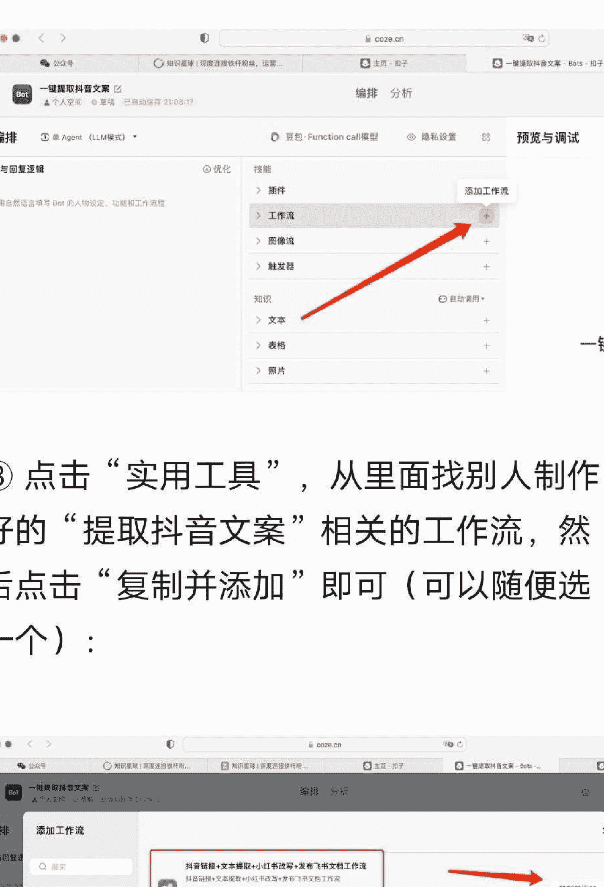
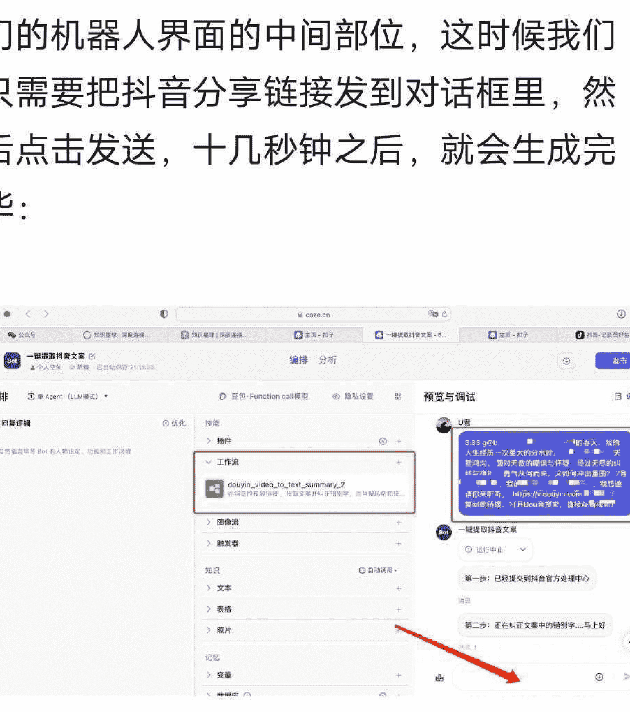
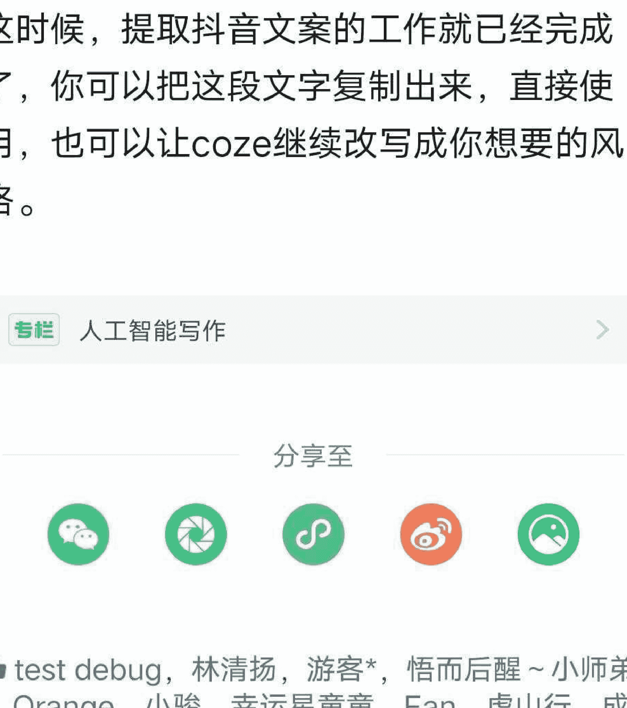
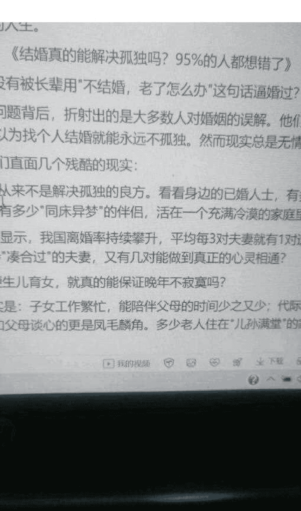
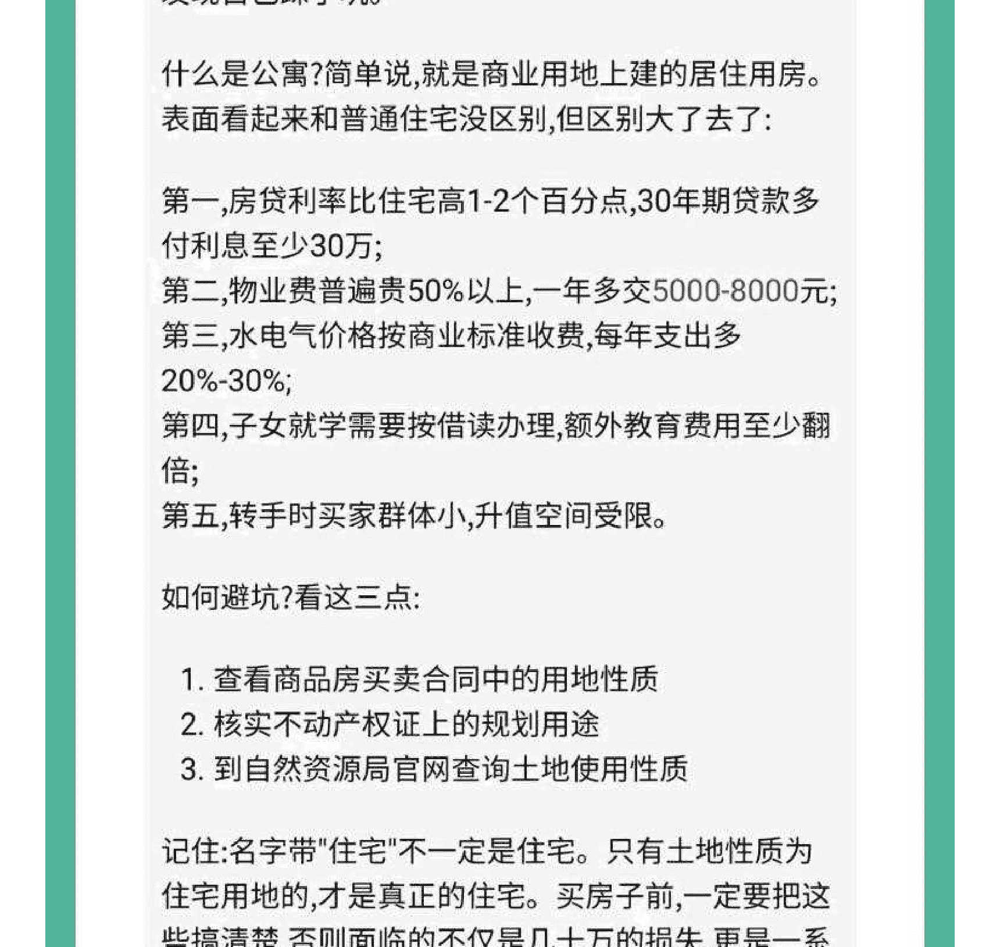
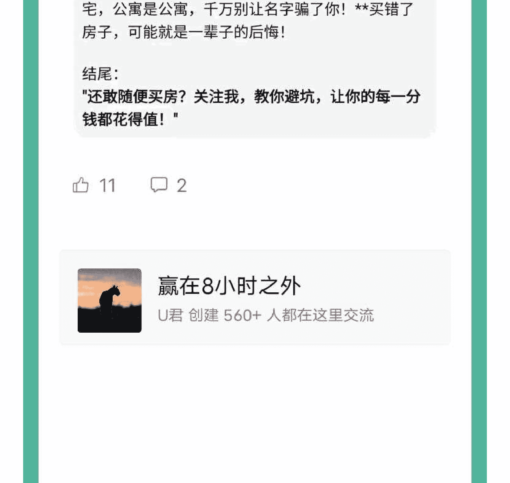
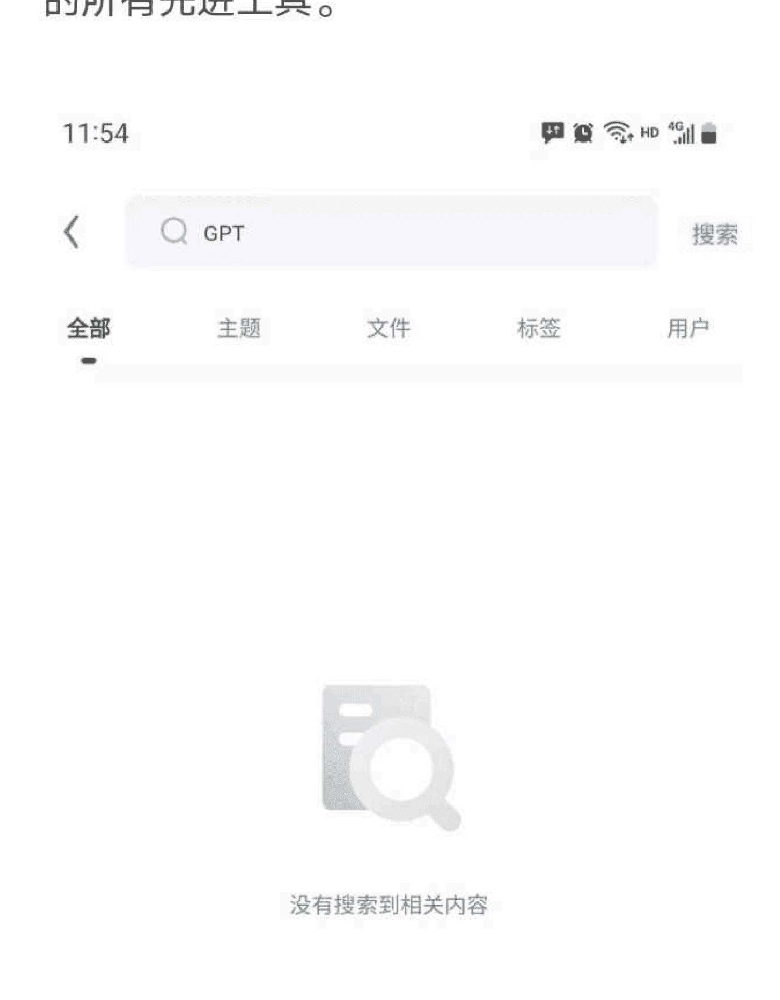
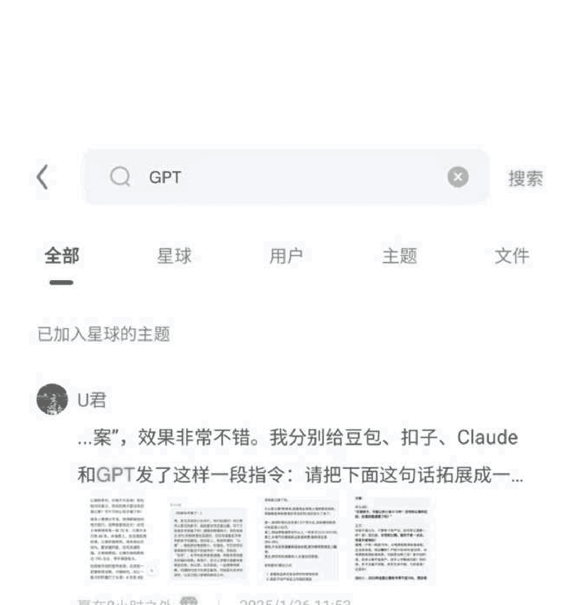

# 详情

U君董主
2025/1/25 17:08 海南

在抖音上刷到精彩的、引起自己共鸣的、自己领域相关的内容，就用我说的这个方法把文本提取出来。

然后再用我在星球里分享的“AI改写”思路进行改写，直接就可以出一篇新的文章或者视频文稿。

很多小伙伴都在这么操作了，而且效果非常不错。

有人可能在问：这个观点已经有人写过了，我再写还会有人看吗？

我的回答是：由于信息差的存在，你完全不用担心不同大V之间的粉丝会有交叉，会有人“割韭菜”。

再说了，英雄所见略同，观点一致也很正常。只要你跟别人的相似度超过50%就行了。

> U君：如何一键提取抖音文案？很多朋友都在通过抖音来获得写作感，如果遇到一段自己特别感兴趣的抖音视频，如何把文案一键提取出来呢？其实…

## 如何一键提取抖音文案

很多朋友都在通过抖音来获得自己感兴趣的抖音文案，如果发现了一句文案，如何把它一键提取出来呢？

其实使用coze.cn这个网站，就能轻松实现。

具体方法如下：

- ① 打开https://www.coze.cn这个网站，注册、登录，后点击创建Bot（机器人），随便起个名字，比如“一键提取抖音文案”，然后点击“确认”：

- ② 进入创建好的Bot之后，点击“添加工作流”：

- ③ 点击“实用工具”，从里面找到别人制作好的“提取抖音文案”相关的流，后点击“复制并添加”即可（可以方便随时使用）：

- ④ 添加好之后，那个工作流就出现在了我们的机器人中间位置，这时我们只需要把抖音分享链接粘贴到对话框里，后点击发送，几秒钟后，就会完成：

这时，提取抖音文案的工作就已经完成了，你可以把这段文字复制出来，直接使用，也可以让coze继续写出你想要的风格。

人工智能智能助手
分享

test debug,林清涛,游客?,惜后逸~小译
Orange,小举,率量君,Fan,韩斌,城后

## 评论(5)

惜后逸-小译
2023/07/17 22:19
今天又介绍了一个插件，上面还有很多人免费使用 GPT-4o，还有很多人都在用 GPT 或者其他的 AI，专门用于教程的，省得自己再找很久。想要的，用 AI 来辅助写文章，甚至全流量交流给 AI，自己负责根据自己公众号的领域，符合自己的风格，等，创建一个自己的Bot，慢慢的。

林梓
2025/01/27 22:03
为什么我登录和你的界面不一样？找不到可以可以了，短视频平台流量搜一下

林梓
2025/01/27 22:43 海南
林梓
2025/01/27 22:05
林梓

## 无情

来自 赢在8小时之外

## 无情的主题
2025/1/25 18:22
刚看了U君的最新文章，正好点了一下我，就差临门一脚。提取了日更保存的抖音链接改写了一份视频。这样就有了源源不断，剩下的交流时间。🏔

对婚姻
true：《婚后还能解救吗？这95%的人都错了》
有没有被生活了？“不婚”，老了怎么办？这句话通过了吗？
这个问题背后，折射出的是许多人的误解。他们以为结婚就能永远幸福。然而现实是，直面几个现实：看看身边有多少夫妻曾有过“同床异梦”的夫妻，活在一个充满冷言的家里？数据显示，婚姻幸福率持续下降，平均对夫妻就有人选择坚持“妥合”的夫妻，又有人做到心灵交流。即便如此，子女工作忙，伴侣陪伴的时间少；代际差异和父母的沟通更是死角。多少人老在“窝”里家里？

赢在8小时之外
U君 创建560+ 人在这里

## 莱的主题
我今天尝试了一次“用AI做视频文案”，效果非常好。我分给Claude和GPT发了这样的指令：

把这段话转换成300字左右的视频文案，要求特别注意：
- 符合黄金三秒原则
- 文案要尽量使用生动的语言
- 文案要精准精炼

> 【你买的房子对吗？千万别被骗了】

我觉得Claude生成的文案很好，首先它用了一个引起大家兴趣的标题（让人立刻看完），后面的逻辑非常理想。如果是一套准确，我会使用Claude的文案。

大家们，今年买房要留心，不要这么傻了，很可能掉坑！数据显示，去年超过70%的房子竟然不是住宅，你买的房子对吗？千万被骗了！很多人以为只要是房子就行了。但是数据显示，全国约40%的房子是非住宅，如办公、商业公寓等。这类公寓以后可能卖掉，因为居住成本极高。更严重的是，流动性差比住宅高出15%左右。别被那些华丽的宣传了，之前一定要看两次，仔细看，否则一辈子的积累都打了！

## 调试
被骗了？你们知道吗？你们买的房子对吗？如果你买的是公寓，以后可能卖掉。数据显示，全国超过50%的房子不是住宅。如果你买的是公寓，以后可能卖掉，因为价格比住宅便宜30%以上，只有住宅才能保值升值”。千万被骗了，你的房子对吗？很多买过的人才知道，名字起得好就行，其实看房产证就能明显。在买房之前，一定要看清楚，否则会被骗。

继续阅读...

## U君

来自 汪8小时之外

## U君的主题
2025/1/26 12:08
最近发现有很多博主在说“deepseek”这个工具，说它能吊打GPT，能不能吊打我？不知道，但是我知道两件事非常限制国内工具的发展：

- 注册必须提供手机号，本质上就是让它说话时，手机里多留一根手机，万一说错了话可能会付出代价。
- 很多对GPT是特殊的可以避免大家讨论。比如，在星球里搜索GPT是没有结果的，但是如果你把我这个“GPT”复制下来进行搜索，就会得到结果。

因为我打的“GPT”是特殊的，你可以用系统的敏感词检测，你如果正常输入打出来的“GPT”就是敏感词。顺便说一下，我提到的那个“deepseek”也是特殊的。

所以，在这种非常宽松的大环境下，我更加相信国产工具能够顺利发展，把国外的先进工具。

汪8小时之外
U君 创建560+ 人在这里交流

## 免费 价值 及时 专注

## 扫码加入 知识星球TOP 免费资源群

- 每日免费获取有价值资源
- 可提供各类资源搜索服务

| 热门付费文章 | 各行行业报告 |
| 精选图书资源 | 副业赚钱方法 |
| 职场实用资源 | AI财经自媒体 |

公众号: 知识星球TOP 微信信号: jntsg8 微信信号: jntsg2

分享资料仅供个人学习，请及时删除，切勿商用传播
