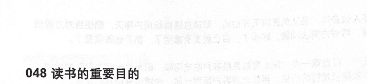

# 一位现代隐士的创富笔记

作者：刘挥——一只猫

## 割界一只猫

- 个人品牌顾问
- 图书策划人
- 社群运营专家
- 生命成长智慧深度探索者
- （一年顶十）作者
- 当当当影响力作家
- 常驻上海、深圳

## 其他信息

2015 年运营微信公众号“割界一只猫”，该公众号曾入围“新榜·中国微信突破500万”。

2016 年在“一块听听”举办个人品牌线上分享，单场分享销售量累计突破11万，平台排名第一。

2017 年打造微信公众号矩阵，读者数突破千万。

2017 年“割界晨读”上线《哥马拉爬》，播放量累计突破3700万。

2018 年在“镜界”迅速积累12万+订阅用户，平台排名第一。

2018 年在“有讲”举办单场年度分享，参与人数突破万，平台排名第一。

2019 年成为“樊樊读书”（现名“航书”）首席社群主顾问，单场分享一周内销售量突破11万。

2020 年出版《一年顶十》，该书发行量远达20万。

2020 年启动图书业务，策划为多本超级畅销书的首席运营营销顾问。

| 2015年至今 | 见了上千粉丝人和智者 |
| :--- | :--- |
| 2016年至今 | 社群内部累计培养了超7000名社群运营官 |
| 2020年至今 | 开了5个付费专栏，销售额超3200万 |

# 一位现代隐士的创造笔记

041 传递这些钱，确保他们多钱...................................................................................... 29
042 像一对猫的社交心得............................................................................................................... 30
043 谈谈学习...................................................................................................................................... 31
044 如何让人更愿意帮你.................................................................................................................... 31
045 业务增长三大秘诀...................................................................................................................... 32
046 做内容的注意事项...................................................................................................................... 33
047 持续，能真的真正的一十年............................................................................... 33
048 书籍的重要性...................................................................................................................................... 34
049 谈谈“害怕自由”...................................................................................................................... 35
050 付费加入社，如何实现利益最大化............................................................................... 35
051 跟曾国学如何打造个人品牌............................................................................... 36
052 跟孔子如何打造个人品牌....................................................................................................... 37
053 实高效的核心秘...................................................................................................... 37
054 打造不在场的影响力............................................................................................................... 38
055 个人品牌的四个核心为重要............................................................................... 38
056 个人品牌的五个动作...................................................................................................................... 39
057 价值万金的社交技巧...................................................................................... 40
058 如何更快实现自我突破............................................................................................... 41
059 应有的礼物...................................................................................................................................... 41
060 高质量的伴侣...................................................................................................................................... 42
061 这个领域其实很有市场............................................................................................................... 42

## 免费 价值 及时 专注

### 扫码加入 知识星球TOP 免费资源群

- 每日免费获取有价值资源
- 提供各类资源搜索服务

| 热门付费文章 | 各行行业报告 |
| :--- | :--- |
| 精选图书资源 | 副业赚钱方法 |
| 实用资源 | AI政经自媒体 |

公众号: 知识星球TOP 微信信号: jntsg8 微信信号: jntsg2

## 知识变现基本原则

### 01 知识变现
找一个领域（也许你不擅长，但未来会擅长），将领域变成钱（市场越小，人们越愿意付费，比如健康等）。

### 02 实践
不要学习，要实践，让自己成为领域的专家（只要你比一般人懂，而且有实经验，能够很好地帮助客户，同时建立信任，并且联系，最好是你的微信）。

### 03 内容
通过内容创作（写作、演讲等）、提供咨询、创建社区产品等方式拿到收入。

### 04 积累
一方面，你做出了足够的积累，就可以教其他人，帮助他们，带来新的收入。

### 05 有三个东西值钱
一个是你的信誉，二是你的专业能力，三是你的创造能力。

### 02 如何提升信息挖掘能力？
这里有两个方法：
第一个方法非常常见，那就是不断提问，不管是看书还是听课，多问一些问题。
第二个方法比较特别，就是研究某个领域，列出自己的心得，比如跟一个人深度交流，总结收获。

### 03 如何让自己的影响力更强？
有些高手会说话或写作，经常能让人感觉厉害，这种能力是这么做的：
01 看书、听课、看视频，遇到很妙的地方停下来琢磨一下（有时候不会，会之后细品）。
02 重复，复制以及思考，这种以后可以用。
03 大量写（实际上，我觉得写得好，现场教人听东西，很容易），大家以后学习的时候，不要只是学习，这样的语言会更有感染力，也许口才比较糟糕。

### 04 到了了一些钱，该做什么？
如果你通过积累，这时候别急着消费，先把存起来，你应该用它们去创造更大的价值。怎么做呢？
- 升级圈子，向上学习，升级自己的思维。结优质的朋友，以后想办法让他们价值互换。
- 进入目标用户聚集的圈子，跟群主搞好关系，并且在群里给大家提供价值，吸引目标用户。

### 03 花钱买时间
把一些并不是你非不可的事情分出去，自己腾出时间来回报更高的事情。很多人拿到钱很快就花掉了，然后继续花时间去赚钱。这是很笨的行为，聪明的做法应该是拿钱去投资，投入更大的价值。

### 05 从买家思维到卖家思维，大幅提升自己的创造能力
很多人以为花钱是付出的成本，花时间是付出的成本，这是典型的买家思维。其实大多数人的思维是买家思维，你得学会用钱换时间，用时间去创富。总是想着买买却没想过卖卖。其实买卖是一件非常重要的事，人很难。如果你想要成为非常优秀的知识创造者，你应该经常训练自己的卖家思维。怎么做？
- 喜欢研究广告，并且想要写广告，哪怕是别人的东西（其实很多知识付费的课程是可以拆分的）。
- 你要和喜欢买的人交流，不是为了买买，而是为了他们的需求，洞悉他们的心理，从而让自己更新。
- 花钱买别人的时间，也是一种学习，你不能花钱就完了事，你要靠卖别人的“卖”，看到是谁怎么让你赚钱的。

### 06 关于个人品牌打造的三个建议
- 01 多个标签并，其实很简单，哪个能带你赚到钱，你就留哪个，这个办法在绝大多数时候是管用的。
- 02 还不够努力的人，怎样靠背术怎样加速进步？想办法跟人做事，距离越近越好。跟着牛人，别人会看你一眼，跟着牛人，你有机会做更牛的事情，而且牛人会教你很多东西。这样的话，你的进步自然会更快。
- 03 作品、人、品都有。作品（比如自己的经验）是用来引流的，产品是用来赚钱的。很多人到处跑圈子，社交，但自己没有产品，自然没有机会。对外展示，通过传播一些案例，让目标用户知道，你是值得信赖的。

### 07 我们要好好认识“诚意”
不管做什么，只要涉及到人合作，当然会配合度很高。怎样知道对方是否有足够的诚意？好好看看对方。怎样知道对方有诚意呢？记住一句话：诚意=成本。

### 08 你的能量正确吗？
能量是正，意味着你能吸引人；能量是负，意味着你会失去力。那么，能量到位三个关键：
- 一、你的实力强。如果别人感觉到很酷，跟着学习，并付费。
- 二、对别人是安全的。不管做什么，安全是非常重要的。看起来如果你经常传播别人的隐私，在背后说话，别人会觉得是一个安全的人。
- 三、你能够给人信心和希望。总是喜欢通过贬低别人，指出问题时给出一些建议。

总结：对外展示、对外表达，很重要。很多人在表达时候，总是害怕表现不够，害怕被嘲笑，我们往往不敢尝试，错失了许多机会。

### 09 每天精进“脑子”
如何让自己更聪明，让自己的脑子更有价值，这里有输入和输出的方法：
01 输入：每天输入高价值的内容是必不可少的。比如与人对话（超级重要！），读经典书籍，听高质量的课程。不要多看垃圾信息。
- 1 不有很多，但必须有深度思考。
- 2 与人交流优于自己看书学习。
- 3 时间精力有限，优先学习对你有用的内容。
02 输出：每天输出也是必不可少的。写作、反馈、引导、践行，这些都是输出。
- 1 自己做到并帮助更多人，其实最好的输出方式。
- 2 及时空空，让自己保持节奏感。
- 3 最靠谱，你要通过自己的努力让自己的写作和演讲达到及格水平（二者都能及格的话，你比大多数人都有优势）。

### 10 每日精进“圈”
我们常规的习惯，我们经常的圈子对我们的影响是极大的。关于圈子的精进，有几个注意事项：
- 01 我们自己的能力是有限的，一定要重视圈子关系的作用。很多时候，并不是我们能力办做好事情，都需要来自他人的支持。
- 02 高端的能力是共有的，是极高效的长效。想要达到可能的境界，需要和他人的互信相信，相互交流。
- 03 安全是容易被破坏的，要让人觉得你是无害的，别人才可能让你走近。在未经授权的情况下，不要扫描别人的隐私、传播别人听的话、不要不体动作，都会让人觉得不安全。
- 04 要好好挣钱，无论是圈子里的钱还是维持关系，都需要花钱。如果你实力还不够，有一个好办法就是通过高质量的圈子社区成长，利用业务之便耕文文化。
- 05 永远不要忽视家里。他们是你最值得珍惜的人，把他们照顾好了，你就会少很多麻烦。

### 11 每日精进“案例”
例子指的是成功案例。一个人会说道理是不够的。没有案例，道理就没有说服力，也没有成功的基础。想要说服力，想要有吸引力，一定要有足够的案例。没有案例，就没有成功的案例。成功案例不仅指你自己做了什么，更指你帮助别人做成了什么。
关于打造成功案例，这里有几个注意事项：
- 01 记住一句话：高出名！所以，筛选比培养更重要。
- 02 没有宣传就没有发生，所以有了案例，宣传一定要好。
- 03 对于很多段位学习者来说，他们更需要具体问题答疑，而是在群体中积累，更有助于。

### 12 每日精进“功夫”
很多人向我精力管理，我觉得重要的两点：
- 一、你是否能够识别什么是该做的，什么是不该做的，并且尽可能只做该做的。
- 二、你是否能够好好饮食好好睡眠，锻炼，让自己保持一个比较好的状态。说实话，以前相比其他，在这一点上我是做得不够的。现在，我还是有了很大的改变，精力状态比之前好了。这里，重点给大家讲我的坚持方法：
01 每天100个俯卧撑，以前要做好几次，现在已经能一次完。养成习惯之后，每天都做好。基本原则是，不多做，不少少，少习惯，每天都做好。
02 每天都要多走路。最近每天都保持在5-10公里的量，而且尽可能是工作边走路，关于这一点，我是怎么做的？

# 一位現代騎士的創業日記

我是这样想的：坐着或站着指导，还不如边走指导，这样一来，既完成了工作，还鍛煉了身体。

现代人跑步太难了，发现跑步变成学数学+200。下雨後怎麼办？

家里有跑步机嗎。

(備考：以上是对一隻獵貓三年前的做法，现在仍然很有参考意义)

(一)“现代骑士”产品第五代设计S70

“设计”与开发的的关系，现在仍然……

## 013 每日进阶的“票”

结合产品的第五代传统体验，我依然……

钱不是万能的，钱是万能的。事实上，不一样，但气的质量比钱更重要。

有钱，解决很多问题。但一事如果不够完美，产品质量很重要，钱还……

关于关键的重要性，我就不用说了，相信老师们都懂。请大家聚会，让经验与我……

在这里，大家分享几点赚钱心得：当你“成功”与别人分享时，不要怕别人的……

- 001 观察，接触那些赚钱的人，从他们那那里获得经验和玩法。这就是……
- 002 给一个付费的道理。想象我，我知道了星球，还有付费社群，还有服务。圈子和资源，比单纯的货便宜多了！可以用圈子和资源的人，赚钱也会更容易。
- 003 最好的宣传素材是成功案例。你要用成功案例来吸引别人，通过帮助他们解决问题，赚到不错的收入。
- 004 一定要用心记住这句话：你的产品是你的脸吗？创作内容只是一部分，你需要很多很多时间和精力去推广，销售内容，从从而连接你最想要连接的人。

就像我写书一样。

# 一位现代流量的创业笔记

大力推广、售卖，我就可以连接很多想要连接的人。学会销售非常重要。

- 005 将一些简单且有效的赚钱逻辑践行到极致，比一天到晚上学赚钱方法论，更能让你赚到钱。

## 014 如何提升自己的品牌段位？（一）

这笔记的关键词是“价格”。

贵，能帮你提升自己的品牌段位。

什么意思？

你至少有一个非常贵的产品，不一定销量，只要卖出去就行，哪怕只卖出去一次。

毕竟，把非常贵的产品卖出去，是很不容易的事情，一般人还真做不到。

如果你做到了，别人会对你产品相看。这种信任是建立在价值之上的。

有的人其实实底不错，反而觉得自己“不配”贵的产品，或者就算做出来了，也不敢卖。

其实，只要你有一定的基础，总有少用户是有这个付费意愿+付费能力的，只要你能提供足够的价值，就好。

## 015 如何提升自己的品牌段位？（二）

这笔记的关键词是“代言人”。

就像很多品牌会有代言人一样，我们每个人也要成为自己的代言人。

如果你的用户都普通，就算用户量还可以，你的品牌高度还是上不去。

## 怎么办呢？

想办法筛选那些高能量的、很认同你的用户，深度育成他们，打造成功案例，让他们成为你的“代言人”，并想办法“大喇”宣传传出去。

这样的话，别人会因为看到他们的“牛”，而知道你的“牛”。

要把你的“高”，建立在用户的“牛”的高上。要把你的成功，建立在用用户的成功之上。

这是互相相信，也是相互成就的。

## 怎样连接？

关于连接，有五个点特别重要：

- 001 你至少要有一个法，能够让别人解决他们的问题，让自己被牛人需要。可以以此为例，
- 002 加入你的优质社群，在里面好好经营，而且还要办法让社群赋能——比如，成为他人的成功案例。
- 003 重点连接人物，那些影响力大、且愿意分享人脉的人。通过这些人，你能连接到很多你想要连接的人。
- 004 让人感到安全，让人放心。
- 005 对于很多人来说，加入知名的公司、成为有影响力的牛人的团队成员，都是很好的方式。

# 第一代移民的创富笔记

## 017 你对多少人说你要做什么，你能做什么？

我有个习惯，就是跟很多人说我要做什么，我能做什么。

这样做有什么好处呢？

- 一、的许多人知道我要做什么，是不是可能给我介绍我需要的人，给我提供我需要的资源？事实上，是有很多人知道我的想法法之后，会给我提供支持。
- 二、的许多人知道我能做什么，是不是可能跟我发生交易，或者给我介绍客户？事实上，是有很多人清楚了我的业务后，会给我付费，有的会给我介绍人过来。

大家都是出来的，千万不要自己去介绍别人自己做什么，以及有什么？

你不说，你对连接的效率就低，你很难连接到你想要的人和资源。

最后，补充一个例子：

> 某天，我看到了一个朋友，他告诉了我能做什么，特别跟他他说，我想在某方面找很牛的老师学习。

于是，过了两天，我就遇到了一位特别厉害的老师，收获非常大。

但是这位老师，就是我这个的朋友的老，他听完我之后，很快就把他的老师介绍给我了。

如果我不说，这件事怎么可能发生呢？

## 提高品牌态势，我们要“高”

提高品牌态势，可以从以下五个方面入手：

一位现代人士创业笔记

- 一、高价。高价。品牌优势，与价格很大关系。
- 二、高咨。如果你的客户很高，你在别人眼里很高。
- 三、高慢。如果你是一个高中老师，只要你提供足够的价值，就满，你也会跟着他们一起。
- 四、高智。如果你很有聪明，把这些智慧表达出来，你自己也能很好，那么你就会非常有吸引力。
- 五、高圈。这里指的是高能圈，假如你经常跟你的人，进入高端圈，那么你在别人眼里，会有价值。

## 怎样转化，你的社交率高

怎样转化，你的社交率高，这笔记非常重要，请大家重视。

- 在社交活动中，把别人变为你的朋友，这叫转化。
- 在社交活动中，把别人变为客户，这叫转化。
- 在社交活动中，把别人变为老师，这叫转化。

怎样才能成为一个高社交率的人？有一点重要：

怎样升？做一件事：

提升品牌传播。

做好，一定要注意下面十个字：

- 001 欢迎来、一对一、促进连接。
- 002 欢迎来、一对一、促进连接。
- 003 促进连接。

- 001 欢迎来、一对一、促进连接。
- 002 欢迎来、一对一、促进连接。
- 003 促进连接。

- 001 欢迎来、一对一、促进连接。
- 002 欢迎来、一对一、促进连接。
- 003 促进连接。

- 001 欢迎来、一对一、促进连接。
- 002 欢迎来、一对一、促进连接。
- 003 促进连接。

- 001 欢迎来、一对一、促进连接。
- 002 欢迎来、一对一、促进连接。
- 003 促进连接。

- 001 欢迎来、一对一、促进连接。
- 002 欢迎来、一对一、促进连接。
- 003 促进连接。

- 001 欢迎来、一对一、促进连接。
- 002 欢迎来、一对一、促进连接。
- 003 促进连接。

- 001 欢迎来、一对一、促进连接。
- 002 欢迎来、一对一、促进连接。
- 003 促进连接。

- 001 欢迎来、一对一、促进连接。
- 002 欢迎来、一对一、促进连接。
- 003 促进连接。

- 001 欢迎来、一对一、促进连接。
- 002 欢迎来、一对一、促进连接。
- 003 促进连接。

- 001 欢迎来、一对一、促进连接。
- 002 欢迎来、一对一、促进连接。
- 003 促进连接。

- 001 欢迎来、一对一、促进连接。
- 002 欢迎来、一对一、促进连接。
- 003 促进连接。

- 001 欢迎来、一对一、促进连接。
- 002 欢迎来、一对一、促进连接。
- 003 促进连接。

- 001 欢迎来、一对一、促进连接。
- 002 欢迎来、一对一、促进连接。
- 003 促进连接。

- 001 欢迎来、一对一、促进连接。
- 002 欢迎来、一对一、促进连接。
- 003 促进连接。

- 001 欢迎来、一对一、促进连接。
- 002 欢迎来、一对一、促进连接。
- 003 促进连接。

- 001 欢迎来、一对一、促进连接。
- 002 欢迎来、一对一、促进连接。
- 003 促进连接。

- 001 欢迎来、一对一、促进连接。
- 002 欢迎来、一对一、促进连接。
- 003 促进连接。

- 001 欢迎来、一对一、促进连接。
- 002 欢迎来、一对一、促进连接。
- 003 促进连接。

# 一位现代的创业笔记

一位现代流量的创业笔记

- 005 将一些简单且有效的赚钱逻辑践行到极致，比一天到晚上学赚钱方法论，更能让你赚到钱。

# 一位现代骑士的创富笔记

一位现代骑士的创富笔记

- 21 必须具备的技能

想要销售高手，你必须掌握这样的能力：迅速识别对方真正的需要，找出真正的问题，并用别人接受的方式给出特别建议。

# 一位逸游者的创作笔记

- 001 一个人一定要发展让自己脱颖出的能力……
- 002 书能读吗？……
- 003 你的功能是什么？即，你能帮助别人解决什么问题？

很多人的个人介绍，属于自嗨，因为和别人没有关系，别人不知道他们能做什么。

很多人做的事情，并不解决重要的问题，因此，很难赚到钱。

## 关于“赚钱”这件事

# 一位现代父母的创造者笔记

一位位现代父母的创造者笔记

- 023 如何练好基础功夫（一）
- 024 如何练好基础功夫（二）

# 一位现代设计师的笔记

- 001 欢迎来、一对一、促进连接。
- 002 欢迎来、一对一、促进连接。
- 003 促进连接。
- 004 可持续

## 028 想要成事，三句重要的话

- 001 做好事情，先照顾好心情

## 029 有理，才能有利

## 029 “圈粉”的牛人，会这样展示自己

- 001 展现不断进步的自己。

## 030 提升格调，先养成掉这三件事。

## 031 重视你的铁律，成为别人的铁杆

结语：做个人品牌，最后，核心不是流量，而是人心。

## 038 打造个人品牌，到底要什么？

001 定位、内容、流量、产品、五个是重中之重！

002 定位。你能满足什么人的需求，你的独特卖点是什么？

003 内容。你能用什么内容吸引你的目标用户。

004 流量。在这里，指的是能被你触达的，你需要，且有足够付费能力的人。

005 产品。流量进来了，你该用什么产品留住他们的用户，并转化成不错的收入。

006 背书。背书指的是，能够促进用户愿意发生交易的一系列证明。比如个人的战绩、成功的案例、你拿过的相关奖项背书、你出过的相关书籍、知名人士为你撰写的推荐……

所以，虽然很简单，在这里，打造个人品牌，就是明确并传达定位+创作并传播内容+持续增加流量+销售的产品+不断积累背书。

我写完了，加油！

## 039 不要错错了对象

这里的对象，指的是目标用户。

我们在做事的时候，要搞清楚目标，搞清楚对象，不能随便使劲儿。

之前有人跟我说，他写文章，害怕被自己那些很优秀的朋友看到，担心他们会觉得自己的文章不够深度。

我问，这些人真的有没有可能成为你的用户，给你付钱？

# 一位现代骑士的创作笔记

他说，不可能。

我说，那就不对了，你又不是写给他们看的。

很多人，在写作的时候，并没有好主去考虑一个问题：写作，到底是要吸引什么样的人？

若是没想清楚，就抓错了对象，效果很难很好。

## 040 提升你创作能力的方法

如何有效提升你的创作能力？

除了多读多写之外，这里有一个方法，非常常用——大量提问。

答案和一般的分享是不一样的，你收到很多别人提问的问题，并且，你要快速为这些问题提供答案。

在这个过程中，你需要充分调动自己的储备，需要更专心地思考。

你的大脑会得到很好的锻炼。

请注意：我的建议，并不是提前搜问好，准备好答案再去跟人，这种方式跟通的做法区别不大。

我们应该模拟现场场景，即而是现场提问，你现场回答（线下皆可）。

这种方法的锻炼效果是最好的。

一个好问题+一个好答案，不就是一篇好内容吗？

提问的过程，其实就是创作的过程。

## 041 悟透这条铁律，确实能多赚钱

## 内容作者的创作笔记

在这个时代，内容质量无与比重要。

在创作内容的时候，一定要记得下面这条铁律：

我们创作的内容，要能促进目标用户跟我们发生交易。

我们创作的内容，要能促进目标用户跟我们发生交易。

我们创作的内容，要能促进目标用户跟我们发生交易。

重要的事情只有三点：

有人的东西，只有在写广告的时候，才有这样的意识。

在大多数时候，想写什么就写什么，吸引一些非目标用户，却“赶走”了真正的目标用户。

另外一些，尽可能只对目标用户有的内容，并且会大方打广告，介绍自己的产品，宣传自己的成功案例。

这样的话，赚钱自然容易许多。

# 042 副标题：一只猴的社交心得

这就分享几个非常重要的社交技巧。

- 001 别人为什么要找你？
例：从我自己开始做书营销，朋友觉得营销容易，因为“出书、卖书”有很多影响力的人的背书。

- 002 别人为什么要相信你？
例：还是以用书营销向这个身份作为来，我自己的书卖很好，我还为了了一些超级营销书的首席营销顾问，有了这些背书，信任问题就好解决了。（抱大脑袋极为重要）

- 003 别人会怎么介绍你？

# 一位现代骑士的创造笔记

举例：我好好准备了两次自我介绍，一份简短的（图片版），一份长的（访谈版），方便人转发。

举例：大部分情况下，对于我想要交往的交，我会迅速约约约，如果时机到了，我会出发见面邀约，到时候，我会看着对方做些什么。

举例：和你有共同未来的，即未来可以相互理解、相互成就、共同成长的人。

## 005 什么样的人非常值得

## 006 还有什么禁忌？

家人、团队伙伴，程度重要，千万不要忽视了他们。

## 043 谈谈学习

· 传一张纸，假传万卷书。
要学得真实本，我们得要找到真正靠肯的老师，让他愿意教我们那“一张纸”的内容。

· 出去跟人学习，要对对方信心，让自己觉得你是可以被教会的。在有人的学习的过程中，眼中喜欢说话，其实会让老师觉得你“呆木不可”。

· 学了东西，长了事，一定要去“卖”。
卖，指的是卖自己的所学所得，好好展现；弄指的是“钻门弄斧”，这里的意思是，请到真正的，在他面前展示你的你，让他找到你不好的地方，帮你弥补。

## 044 如何让人更愿意帮你？

001 别人带你出去，尽量少说多听，但该说话的时候，你得好好表现，该说的，好好，不该说的，一句也不要说。

# 一位顶级大师的创业笔记

002 高人带你进入他的圈子，如果你要用圈子里的重要人物，一定要跟他打招呼。

03 高人给你介绍朋友，你要积极回应，如果有什么进展，还要积极汇报，表达感谢。

04 高人打交道，真诚是第一原则，及时汇报也是第一原则。

05 高人安排的事，你要想办法把事情办漂亮，哪怕自己倒贴。如果不做到，不要逞强。

06 不要觉得高人你什么懂，该发的祝福，按照样子要送。

## 045 增长三大秘诀

001 粉丝我是做社群的，问如何做增长。

002 我问她有没有准备一份特别吸引的内容，然后想办法传播出来？她说，还没有。你可以从往的内容里挑，做一份特别吸引的内容，想办法让更多用户看到。

03 我问，今年参加了哪些社群？她说，今年就够了，你不缺多参加一些社群，打造粉丝影响力，不能忽略。

04 最后，我还问了一个问题，现在有没有收费过万？她说，还没有。我积累了这么多用户，做一个收费过万的产品，有些人需要更高端的产品，他们是付费的。

05 ，发现自己可以卖更多的，谢谢你。

06 总结：增长三大秘诀——传播有吸引力的内容，打造粉丝影响力，做高价产品。

## 046 咨询的注意事项

001 即使咨询，最重要的是找到对的问题，如果真的找到了，那么咨询至少完成了一半。

02 因此，很多时候，我们不要急于解决，因为他提出的问题并不一定是对的。

03 你可能不是万能的，为所有问题提供解决方案，但是如果你的网络足够，有些问题虽然搞不定，也可以找别人帮你。实在搞不定，千万不要硬装。

04 很多人做咨询，是从免费开始的，而是通过目标用户聊天，顺便对对方提供专业价值，帮对方解决问题，没必要占用你的时间。如果你不能足够的价值，也可能被他们毁掉。

05 让客户内心有力量，并且解决问题像客户一样。

# 047 这样做才能真正十年

01 想要一年如十年，有一个原则是非常重要的，这个原则就是五个字：每天如一日。这意味着什么呢？

02 我分享一下我的解：是要聚焦焦点，不要日复一日，每天一个月积累。

03 读书不是速度，有的书非常快，对于某些领域的新书，两个小时就读完了，而且还可以非常好的。我有这样的高手分享过：道理很简单，由于他常年关注几个领域的书，这些领域的词汇、概念、原理，他早就熟悉了，加上自己也有大量的积累，读起来就会很快的，跟人的时候也会从容，很有。

# 一位逸逸的创造笔记

04 写作也是一样，新手困难，但对于一些写了很多年的老手来说，一周写一本书也是可以做到的。

05 人怕急，嫌速度，又没有耐心。其实你只要熬过了新手期，情况就会好很多了。如果你能成为真正的作家，你就赢了大多数人。

06 对于积累这类事，千万不能纸上谈兵，一定要找到实战的机会，边练边练，效果很多的。（举例）就拿写作来说，你可以读相关的书、听听教写作的课，你可以好好拆解优秀作品，同时，你最好通过写作来带动、理论学习、案例研究、实战操作结合，更能输出“原生”。

## 048 读书的重要目的之一

01 读书的重要目的之一，是让自己更好地做好决策。

02 很多人并不重视书，沉迷于读书，不做事，没有好好解决现实问题，即使使经理满意，不在与人辩论的时候觉得自己特别博学，也终完成了一个失败者，对自己和家人都不负负责。

03 让你通人性的书，一方面，更了解自己，懂得如何规划自己；另一方面，更了解别人，懂得如何去影响别人。

04 历史、心理学、品牌营销方面的书，主要讲的就是人性。

05 在专业上，大量实践的同时，要反复阅读专业书籍，最终让书中的理论化为自己的本事。

06 通人性，懂专业，在做决策时就会容易容易，这样的人，在哪里都是稀缺的。

## 049 谈谈“财富自由”

一位现代创造者

01 对于绝大多数人而言，与其盯着财富这样的目标，不如好好提升自己持续赚钱的能力，以及克制不必要的欲望。

02 另外，如果你只是盯着钱，越想着盯着钱，很容易变成钱的奴隶，错过人生的美好。切记，你来到世界上，不是为了赚钱。

03 身体好+团结人+远离闲人+能够在自己擅长的领域坚持持久，这些是重。

04 不管你在哪个领域，请重视营销，用营销思维指导业务。

05 接下来，我和朋友都是，营销是最底层的逻辑，这句话很重要。

06 如果你做的事情是你擅长的，也是热爱的，而且不出错，恭你，你是幸福的人！

## 050 付费社群如何实现利益最大化

01 绝大多数情况下都是适用的，如果你对社群价值很大，你在里面会有很大的收获。

02 所以，我们要优先加入那些“非常需要的社群”，比如群里有很多人都需要你提供的服务，自然会有很多人主动连接。

03 有人问，有些社群，“被需要”是可以创造出来的，比在群里当志愿者，这样的话怎么办？

04 这种方法，最好的：一是观察别人，二是建立连接，然后提供价值。

05 绝大部分情况下，主要是做些事情，看着做法，看着人，然后建立互利共赢的关系。

06 对付费社群，其实也是一种绝佳方式，最后，如果你得到大家的喜欢和支持，恭你，大了。

## 051 跟曾国藩学打造个人品牌

01 希望。让大人都看到希望——他出身普通，长相普通，不算太好，但是能成为很多圣人。

02 精进。但不完美——但他有很多坏处，好、浮躁等等，但他不断反省，不断精进。

03 结果。用别人来说——如果曾国藩没有成功，后还会奉他？

04 写作。常年写东西——他写了很多日记和书，他成功后，大家足够的足够的学习。

05 忍受。忍了侮辱，受了折辱——很多人跟曾国藩学习“脱骨的精神”，曾国藩自己也说过，在遭受之时。

06 高徒。他培养了很多，李鸿章是他最厉害的“徒”。

## 052 跟孔子打造个人品牌

01 核心主张：仁。什么是仁？《论语》里有很多说法，我非常喜欢的是“己欲立立人，己达而达人”。

02 仁的基本功。孔子精通六艺，并特别擅长解答疑惑，在很多方面能给学员提供指导。

04 有很多高子，子游、子路、曾曾等学生，对孔子的帮助很大。《论语》也是从子孙辈们整理出来的。

05 精神相当强大。他应该知道他要推行的东西会被实现，但他却一直攻不挠，读他的故事，能够得到很大的力量。

06 为万圣，孔子是那个时代我们的文化大成者，大家看，其实朱熹、韩濂、灵妥，也都在做这件事。

## 053 高价的核心秘密

有人问我一个问题：你能卖高价，核心秘密是什么？

如果只能说一条，那就是足够的耐心。价格，其实是需要的。

你标高价，一上来就望着很多人来付款，其实很难。那么怎么办呢？

相信时间的力量！
我终会坚持，坚持下去、持续，就会有人相信我，就会人愿意。人只要——

2018年，我决定做高端业务，于是，我推出了20万的咨询。我的目的是让更多人接受我的价格，从而更好地做好高端业务。

我当然不会等到以后就能做好高端业务做起来。

我呢，有一个很大的优势，就是很能。为什么不能呢？只是因为认识、性格。

重要的一点是，因为我还有别的业务，哪怕没有高端业务不离一分钱，我也能得下去。没有人帮我，我就要好好好基础，好好好经营。你看，从那到现在，2018-2019-2020-2021-2022-2023，已经7个年头了，我仍在努力，仍在进步。

久而久之，业务就来了，市场上很多人也接受了我的价格。

## 054 打造粉丝影响力

先问两个问题：

第一个问题：这么多年，你读了这么多书，最喜欢哪个作者？

第二个问题：你这么大了，看了多少节目，看了多少故事，谁是你心中最大的英雄？

第三个问题：你问，这个作者，你见过吗？

接着，我问一个观点：顶级影响力，不在场。如果我不在，还能产生影响力，那该好。

怎么做？

活成了十二个：粉丝立，后成。

粉丝，包括链接、升级、转化。我们需要大家帮我们介绍，并且给出了非常吸引人的政策。当然，这个政策不是钱，是给他们的其他福利。大家可以对照一下，看看自己自己在哪些上做得很好，哪些做得不够。

## 055 打造个人品牌

第一个利：利益。你要让很多人迅速知道你能带来什么，而好处是很多人需要的，并且愿意购买的。

位现代程序员的创业笔记

第二个案例：例。你有足够的成功案例，就能让目标用户信任。

第三个理：理。这种方法叫理论，如果你有了前面的两个（利+例），如果你能增加转化，做得很好，让目标用户有收获。

第四个力：力。如果你的故事激励他人，激发人的内在动力，加上前面的利、理，这四个齐了，个人品牌将会强大。大家可以对照一下，看看自己自己在哪些上做得很好，哪些做得不够。

## 056 个人品牌的五个动作

个人品牌的五个动作：联、信、卖、成。

- 联：指的是和目标用户建立联系，吸引他们关注，或者是加上微信。
- 信：指的是建立信任，最好的办法是让对方占便宜，比如送你的书籍，或者让对方以很低的价格获得产品，让他觉得很赚。
- 卖：指的是成交。重要的一点是，让对方没有任何风险，比如我们这边用过的转化训练，2024年10月之前，是可以退出的，全额退款，我们不需要任何安排，留。
- 成：指的是成就，比我们用过的转化训练，给大家分享，尽可能让的人很有收获。
- 续：指的是后续，包括链接、升级、转化。例：我们这边会主动跟大家介绍，并且给出非常吸引人的政策。当然，这个政策不是钱，是给他们的其他福利。大家可以对照一下，看看自己自己在哪些上做得很好，哪些做得不够。

# 057 价值万社交积累

我认识一些人，他们喜欢到处连接，也会努力付出，但是他们却难以实现极大的商业价值。我分析原因，其中重要的一条是，对外连接的时候，他们没有带着正确的“容器”。

什么是容器呢？

我们来举个例子。

我自己举例，今年虽然没有公开暴露，我是私下里了很多客户，线上接触了大量的，在这个过程中，我的收获并不是巨大的。在对外连接的过程中，我主要使用以下几种：

- 容器一：学员容器。适合我学员的，可以进入我的学员容器，主要就是他们的社群，比如刘博这样一只留猫策划薛学徒。
- 容器二：客户容器。有些不是我的学员，不符合我的客户，他们又需要我，希望建立关系，这时，他们可以成为我的客户，给他们咨询和其他的支持。
- 容器三：盟友容器。这些人不合适我的学员，不符合我的客户，非常适合和我共同成长、互相帮助，我会把他们发展为我的朋友，特别的，还会不收费的小圈子（虽然不收费，但是筛选机制很严格），比如这里的俱乐部，也有读书会，大家每个月都会在线交流。在这里补充一个容器，就是老师容器——如果对方觉得你适合学习，但不适合放以上一种容器，就可以放入老师容器。

如果一个人有些好好给自己教的老师，有很多高段位的付费学员，有几个势能很快的人，又有一群能自己互助的高能盟友，这个人的量能肯定不会弱。大家一定要有容器思维，把不同的人放到合适的容器里，分别对待，大家互利共赢。带着容器去社交，去连接，这样的话，你的社交效率更高，在对外连接的过程中容易有巨大的收获。

## 058 如何更快实现自我突破？

001 你经常接触的人，会影响你的认知和状态。每年都要遇到新人，并将其中的部分更新。

02 卖是更好学的，在卖的过程中，你会慢慢变成买家的思维，更懂人性。

03 比如：打磨自己的产品，哪怕是一小事，然后卖出去，获取市场的反馈。如果没有自己的产品，卖别人的也。

04 找到与自己特别的内容，反思自己的，并找机会近距离学习（最好是在长时间跟随他们），你真正掌握一位导师的精髓之后，你的孩子就不太一样了。

05 为了学到精髓，加入牛人团队，长期距离牛人一起生活。

06 务必要养成良好的习惯。身体的，让你感觉更好，也让你有充足的精力去成就。

## 高质量的伙伴

在刚结束的某个人品牌创立七周年年会上，我跟大家分享了我们的创业秘诀，其中有一条是：我们需要的是高质量的伙伴。

事实上，绝大多数人在生活中都缺少高质量的伙伴。

高质量的伙伴，同学们，才是真正的奢侈品。

大家来到私下聚聚，我花了很多时间陪着大家，同学们之间互相陪伴，在家里，你能得到灌养，能够被激发，得到支持。成长，自然会变得更容易。

同样是读书，“一个人在家里读书”和“几个高质量的人在非常不错的环境里陪着你坐着”，效果是很不一样的。

同样是写作，“一个人在家里写作”和“几个高质量的人与你深度共振、互相启发”，效果也是很不一样的。

## 06 这个领域其实很有市场

做了多年年的学习型教练，我发现，绝大多数人的表达能力并不是过关的。即使是一名气大的大师，提升空间还是很大；即使是一些教表达的老师，也未必须把这件事说清楚。

如果你认为自己已经表达能力很好，你可以好好研究关于表达的学问。琢磨如何带着他们用较短的时间在这一方面实现突破。

我的建议是，不要教表达。最好是跟营销，财富相结合，效果会好很多。接下来的，我就会干些什么的事情。
